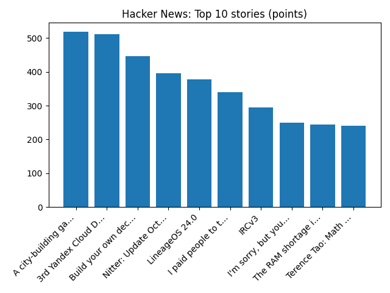

# Daily Knowledge Garden — 2026-10-11

## 🧭 Daily Summary
Global coverage includes 'Prepare for the unthinkable' warning over autumn flooding; Stellantis bets on small affordable EVs for European comeback - Reuters; Prominent Republican senator says Trump's Russian diesel deal may be illegal - Reuters. Local coverage includes World Day of Remembrance for Road Traffic Victims - FFXnow; Boo! Your 2026 guide to Halloween across Northern Virginia - InsideNoVa.com.

## 🌍 Global News (cross-source)
- ['Prepare for the unthinkable' warning over autumn flooding](https://www.bbc.co.uk/news/articles/cm4g1pqyqzqwo?at_medium=RSS&at_campaign=rss) — BBC — Science
- [Stellantis bets on small affordable EVs for European comeback - Reuters](https://news.google.com/rss/articles/CBMivAFBVV95cUxNQ3Vnc21nNnBpSEFHQW5rSEIweVpPVHU1aHNfLXhscElQQ3NZU21kOGNOMXlVVWdiTE1raXhHdjhKMDJpYUhqZURGM2NyS21MVjdzQVl1ckVJdkk2U3MzcVFLX05QU05rUG1VNWZMcDBFYmd4NVNoNzF6aVk2QVNyMjhEYk9xb0d1bnlsZkpKdFJBaGYxamd3QVB1Z25BVGFhQjM4Wkw1Y1NCUktQVHJWMWljZlVDNld3UlUyNw?oc=5) — Reuters — Headlines (Google News)
- [Prominent Republican senator says Trump's Russian diesel deal may be illegal - Reuters](https://news.google.com/rss/articles/CBMixgFBVV95cUxPcDdtenR1Q0JlMzNKUUlHb0ROcUkwZHVpRlQ4ZDFDT2d2WlJndmVVMldTdC1EZkp6TUhSSHNNOWU3SFh3YnJVVk1wTFZIRl9nQTh5OEhHaGtUd1ZOUmJyaGtUOFJIZkFOb2E2N1VtREhDVEZFaHVPMXdaM3pRYlVLWUxTUW45WEllbmNVQ3RQTjZBSDltRXJIbUtJVHJGcU9lVEtNMTgtT0l5VWh2Tk5YQWdma0piSGhMWDQyYkhtc0tkZ2tNelE?oc=5) — Reuters — Headlines (Google News)
- [France’s far-left presidential candidate cheers Gen Z school protests - AP News](https://news.google.com/rss/articles/CBMiqwFBVV95cUxPaFRUVktxZDVXNFg2cnlBekxIbUI0a09XUkdBRVBfRVIxdUxBclVzM3lQRW5IUVRfcmI0VE13QkRLUEs3dnFDYmlnNUtVSE0zS18zQmtrbTlGZUdlMHVYQzlrYWFTZ3I1a1ZQYnRVS0tISHRobTlSYVc2OU1oS29JNmlBaE5SX2Y5ZTRzeXFhWFBPLTJ0Z181NnVxS1BvUHJnaVlaN0JtWlFlaTg?oc=5) — AP — Business (Google News)
- [Orangutans released back into Borneo forest after devastating fires](https://www.bbc.co.uk/news/articles/cwvgde0m2d73o?at_medium=RSS&at_campaign=rss) — BBC — World

## 🏙️ Local News
- [World Day of Remembrance for Road Traffic Victims - FFXnow](https://news.google.com/rss/articles/CBMikAFBVV95cUxPdmNpRV90eHBLUTdCWHY4dlFqLUZ3S3luUlJFQmphc21JMGphaGdfT203bnN2aGxzMTdMcEdYTkJxR09pd2xGQXBQUE5lMTNnMnViLUFhQXBLcW1maVJoUXF3dmNHMXlrdHl5eWNfOTlsbXJDUEZZMmtfMHVfQWxSa0NHSWM0b1k2anA1bXc3b0E?oc=5) — Google News — Northern Virginia
- [Boo! Your 2026 guide to Halloween across Northern Virginia - InsideNoVa.com](https://news.google.com/rss/articles/CBMi3AFBVV95cUxNRHdyX2RCdFpmdzBFNUlxUlh1VjZPOTlzdllPUVNvVFMzZjZaUGJDTEFUYUR6ZkQ1OHIxMTdNY3V2RERuWVBVTlZUcHJaTlFPQ19HclB4ZDNkdmJpMFo1Y29YSzczSmNIWVd1UzBMSDBuWkF3a0FFQUFHeGVQeUNsVGowNndwUm5LX3FfRWN0YmYzakdOWHhJRWFaMURjYWNBQW5nWDBTdko2UGNoTFdVRVVQd1pTR1REQjBDR2JjUWY1X1VJYTZrWE5MMTlnMUNpTzU4bVh3TVc0SGk1?oc=5) — Google News — Northern Virginia
- [Northern Virginia defense tech firm plans to increase staff by 25% or more - WTOP News](https://news.google.com/rss/articles/CBMitAFBVV95cUxPd0J1RGQ2OElFUjhoUmZRd1pQTlNHRXM0MU4tMFdnRnRxSHk0YkdVOWgzTS1qQ3phdURXSU9PLUtSQWxjVjZGZ3pBVmNHbVdaSWt3YmZWUnZLWVFtSUppWE1sWGVnWk1ZT0NpS09ZbEJnU253YzVsSUNmZko0TlRGZHEyVzRLU3B5OTZWS25xMHh6N2E2NmVsd3dpV01wVGs3SWx3ampCTlhOeW0yaVdFSml4Z2c?oc=5) — Google News — Northern Virginia
- [Northern Virginia high school football scores for Oct. 9 - InsideNoVa.com](https://news.google.com/rss/articles/CBMi2gFBVV95cUxNYzNNN0tySkNFRmYtSlZDMjg1bTZjR1ltN2Q1LUI4YnlEYTNSOFlhZFdOUXRDUFRldzdyTERVb0ZrWHFDQnNERlBVWThqUUpvR2xSNEtJelUwVzN1U2t0UnY0cVZCVGZVc1NMbnJpcXp0UjhnNHlJUm9ZT2xwZ3JYbVU5Nnk5MzJkZUsyYy03eVdJd2NkcUtzMG1pTm10UEpucm9kRjBXY3o5cGxmQmJqbjdNYlJBWTdIb2VVYVk4X05PSGRYd2d0c3doTklJa0QwcU0zOHE4MFR3dw?oc=5) — Google News — Northern Virginia
- [MS-13 gang member sentenced for double murder; Maryland man convicted of deadly I-70 shooting - FOX 5 DC](https://news.google.com/rss/articles/CBMilwFBVV95cUxOMjAzQWJjQnNnbS13U3pXV0JabG1hVFo4WkU3TkxkSDZCZXZqQ0pHaXNqcXZ3NHNLanRYTkdtZVVkbHJyc1lwRTlKbW0zMlNSc3d2NnZpaFJFaTY3MVFNNTctaUJDU3F3d3U4SFQ3dkdvM1ZVcW53djhFVDBPWU9ERXY4OUdVY0pySGhiMEpMbmdOdXlWNTZj0gGcAUFVX3lxTE9sSHRsbUJ6U1A2T1VKYTdUbUhjWVRLVEozVzF6YXFGMEYzaUwwR1VmWVp6OV96QzhBd05mQ256dkJmTkxEbzRmQ2FlREt6aE5vOVRrMG4yTklIUmpMU0tsLW95R2NiRjItQ2FxY0pjeUZkN2ZLRzdvc21XaE45SV93LUlBcVM3NWhRYkhiUlRvTUt0RUQ4eEZQaGVhQw?oc=5) — Google News — Northern Virginia

## 🚀 Hacker News (Top 5)
- [2D Vehicles](https://patkerr.co.uk/2d-vehicles/) — 570 points, 109 comments
- [The Lightbulb Computer](https://lightbulbcomputer.com/) — 521 points, 83 comments
- [A city-building game in which the city would prefer you didn't](https://housing.over.pizza/) — 457 points, 154 comments
- [Build your own decision model](https://nishtahir.com/build-your-own-decision-model/) — 412 points, 95 comments
- [Talorys – A self-hosted personal AI agent on Cloudflare's free tier](https://github.com/rociiu/talorys) — 312 points, 144 comments

## 🌍 Wikipedia — On This Day (selected)
- **2018** — Soyuz MS-10, launching an intended crew for the ISS, suffers an in-flight abort. The crew lands safely.
- **2013** — A migrant boat sinks in the Channel of Sicily, with at least 359 people drowning.
- **2002** — A bomb attack in a Myyrmanni shopping mall in Vantaa, Finland kills seven.
- **2001** — The Polaroid Corporation files for federal bankruptcy protection.
- **2000** — NASA launches STS-92, the 100th Space Shuttle mission.

## 🎲 Wikipedia — Random Article
**Alameda del Valle**  
Alameda del Valle is a municipality in Spain, 92 kilometres (57 mi) northeast of Madrid.
https://en.wikipedia.org/wiki/Alameda_del_Valle

## 🌌 NASA APOD
[Ice Fishing for Cosmic Neutrinos](https://science.nasa.gov/image-article/apod-2026-october-11-ice-fishing-for-cosmic-neutrinos/)

## Feed Health
- **Reuters — Headlines (Google News)**: ok (15 articles)
- **Reuters — World (Google News)**: ok (15 articles)
- **Reuters — Business (Google News)**: ok (15 articles)
- **BBC — World**: ok (15 articles)
- **BBC — Tech**: ok (15 articles)
- **BBC — Business**: ok (15 articles)
- **BBC — Science**: ok (15 articles)
- **AP — Headlines (Google News)**: ok (15 articles)
- **AP — Politics (Google News)**: ok (15 articles)
- **AP — Business (Google News)**: ok (15 articles)
- **NPR — Top Stories**: ok (10 articles)
- **NPR — Politics**: ok (10 articles)
- **NPR — Business**: ok (10 articles)
- **NPR — Science**: ok (10 articles)
- **NPR — Technology**: ok (10 articles)
- **ScienceNews**: ok (15 articles)
- **ScienceDaily — Top**: ok (15 articles)
- **Nature — Technology**: ok (15 articles)
- **Google News — Northern Virginia**: ok (15 articles)
- **Google News — Northern Virginia traffic**: ok (15 articles)
- **Google News — Northern Virginia weather**: ok (15 articles)
- **Wikipedia — On This Day**: ok (10 articles)
- **Wikipedia — Random**: ok (1 articles)
- **NASA — APOD**: ok (1 articles)

Runs so far today: 8
