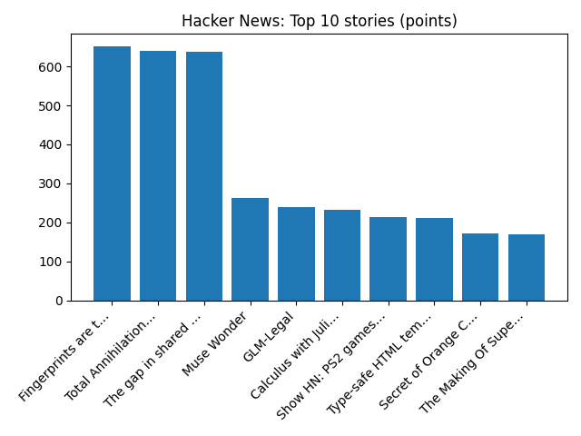

# Daily Knowledge Garden — 2026-10-12

## 🧭 Daily Summary
Global coverage includes US immigration authorities raid Democratic congresswoman Ilhan Omar's home - Reuters; US stocks hover near their latest record in mixed trading on Wall Street - AP News; Fridges in French supermarkets hit by cyber attack. Local coverage includes 2026 Northern Virginia Veterans Parade - Prince William Living; Northern Virginia Local Arts Agencies and NYFA to Offer Five Free Professional Development Workshops - BroadwayWorld.

## 🌍 Global News (cross-source)
- [US immigration authorities raid Democratic congresswoman Ilhan Omar's home - Reuters](https://news.google.com/rss/articles/CBMizAFBVV95cUxOMDJQVmVIaFZGdTRES18xTGZOQTgtMzMyWGVOb2VxOUxpWUpQNDlhXzZIdXU0bE81bHVqZ2dRcnVqeE1NWkhtNXNQMTZHb0RtWUhibjBiVkF5MWdSTHJZLW0yNjJrWFYxRVpHQjBnZHJDWGhwVTBIanpDak5iLWc0Y1NIVjN1VmRhTVV2WXE1X0VHQ2gwZXNwb2FIQlEwaGtDWFVnMGpDTlQzLVd2SlNXcVB6dmpDYzJmMURtbUdQYmVra3dtc0ViRWl6NU4?oc=5) — Reuters — Headlines (Google News)
- [US stocks hover near their latest record in mixed trading on Wall Street - AP News](https://news.google.com/rss/articles/CBMimAFBVV95cUxQcWs0OFJBbUxDSUJpUEhoaTEwSmlNRVdmWFgwX19pUnc2YWlrdnNTUUJ1VjZsUnNJQ3Vfc0lxMVhMNkdWVjVsdzJVbFlQaHhoRlNsOWtIUHBGVUVyMUxQcmEwLWp3dEZwZkt4aGEySmNmZS1XRVhhWHB1S0dZZlRkWlVDeEVtUm95cVZpanpxNGhsUWcyZU9NRQ?oc=5) — AP — Headlines (Google News)
- [Fridges in French supermarkets hit by cyber attack](https://www.bbc.co.uk/news/articles/crq5nzxv9q4yo?at_medium=RSS&at_campaign=rss) — BBC — World
- [Agents search Rep. Omar's Washington home in criminal probe as she vows she won't 'be silenced' - AP News](https://news.google.com/rss/articles/CBMijAFBVV95cUxNQjdzXzdVOVh5OVVkeXRrSlNpQXBuMTBWQzhqRDUtbG9uY1ZET0trR0xXNmlIQUhBY1hRS1BsVm8yRENMUE1MZTRxaEtsUmFoaEFUSXFuTXpqeVpqMHd5a1ZYOEtnT3ZvV1NhNmZYMUg0WnlGenFVal82aFp3c2psT25Fc0dRSUNWbkNobw?oc=5) — AP — Headlines (Google News)
- [Hurricane Simon crawls along Mexico's Pacific coast, bringing floods and evacuations - Reuters](https://news.google.com/rss/articles/CBMi0AFBVV95cUxNaElqa3NPZERzOHYyU3NVZmRTSkpYY1U4SzM5ZTZzQzlGbFBhTlhhWHNUN014M3JVWV80c19kRVFWaFRXRWRUVnFOLUV4eVlVWVdlbUVReWFRY1RsUVhvQjhET0dtN2I4ZmRuT1hmU01GY1JmS2hQUG0ycXN6ZWRRUjZpR3VvRTBLYXJxVEx1QUluN001Wjd5Yi1LMFpHQ1RQb0pMbGgtekJvaEpBVzJEOWxMZEtUUVVTQUUxamk3SzNlQlJvb1pXeHJkT1dCSUZG?oc=5) — Reuters — Headlines (Google News)

## 🏙️ Local News
- [2026 Northern Virginia Veterans Parade - Prince William Living](https://news.google.com/rss/articles/CBMie0FVX3lxTFBzdU1UR1NnY202NmdVU3BBNmZ0NHllSTJJcG5jUExhcTk0aUdTV25PQmg2WmFOZEVfTFRTalF2alFySjRMRWp0dWFaM21qNThWOU8ydmhpMklISUhaSVIxMUF0Q3hYZjNZaENPcnNGSGlUOVlDcU4tZ1Z6VQ?oc=5) — Google News — Northern Virginia
- [Northern Virginia Local Arts Agencies and NYFA to Offer Five Free Professional Development Workshops - BroadwayWorld](https://news.google.com/rss/articles/CBMi6wFBVV95cUxPUTVaa05DZFEtaGtCcDVwdUVmcFJrWllPWlhDZjRIT0wyZmJ3Z1BHVkRzS2hnZEJySXhEUC1hRXlyS1FSdGtWWDNhNm56TjJpZTNsWVBuOTVXWkFhTGdrWlZnTGhIckdvYmlyZXpvUGtGclRTZnM4WF9uTjVJclRYaGVfaHBlc2dpdlV1M3RwWW03eEYtNElmYkJlX2tINnE1MWN2M1k0d25wbEJ2TDRSZ2wyOWxzTlVwVmR1ZkpXT2poanJvUFpsMFpVTjB2LVpJdC1UUExoWHczSmhJQVFNOVVmRXhXVW00MnJn?oc=5) — Google News — Northern Virginia
- [New Documentary About Fraternity Hazing Features Loudoun County Family - Northern Virginia Magazine](https://news.google.com/rss/articles/CBMiuwFBVV95cUxQX2xGcjh0V0ZrWWVTZlhCT0hkbEF5eEdTQllLZHk4Nk9OdlpicDlvWWdzYmxCWFFqNGpmN2F6TXNNMzFfanlud2EtYzdXME0xeWQ0NW93S3BVZHVmcUVQUGJ5dmYyZFd0a2M1bVA4V2t5MjltQU1zUlVEQlFwelNpY0J4VkdrTExhWS1EaTV3ZWpmcUxoRGF4NlVhWEVIVGVvQXdCTXZSVXFKYWFWcW1BZ0hQOUd0NXl2bmhn?oc=5) — Google News — Northern Virginia
- [Vindman faces crowded field and economic pressures in Virginia's 7th District Congressional race - Virginia Mercury](https://news.google.com/rss/articles/CBMi0AFBVV95cUxNaEl3RF8tbkZSWDRtYUV1MEVzOTZIU3BDWWlIckhrbmtjUE05aVhvNndRVm1UdFpCc0xhLXd6NHI1bFJ4X29NNWkwRE1xNkFHOWlGd0x6WDB5NDJqY3dYQi0tbDkzQW5UblhxNVFzVEdDaEdRX1EtTWtYZlozWVlxcUpqaDVpNWd2NC1Ya2haS09rX2lzZ2pFXzRra19aeDhTb3puVlV5VFJUWU9BalhGLWl1NzZ2eGR2dTk3OFROUHlLY1VpT1hoX3NEWnEzQzlo?oc=5) — Google News — Northern Virginia
- [As Virginia voters continue early voting, Warner, Mizusawa highlight differences in forum - WTKR](https://news.google.com/rss/articles/CBMitwFBVV95cUxNaV9nczRSTHUyakp6SFZkWkVkeHVoZ0F4Y0Z3a1ZOVkdhT1V4dWNXNUZZdmhucUlMYThBcmdrNDZIQmFlem0yXzc1cjhxZVROejdWN0VybHJJSHZFQ1JRRWsydnZDLVp2NkdfR2Y5VWp2NnlRVXljSWx1SDUzZXVlY1RiaW1adTRyY0tMMlVIZUZOcEs5aUFwUVQ4TUlueHNsSHk5SFBQbTkwcjlUQ2ZtZDlic2l2RU0?oc=5) — Google News — Northern Virginia

## 🚀 Hacker News (Top 5)
- [IRCv3](https://ircv3.net/) — 341 points, 289 comments
- [Total Annihilation, rebuilt for modern computers](https://nanolathe.gg) — 328 points, 141 comments
- [NYC's "Click to Cancel" rule is now in effect](https://www.nyc.gov/main/click-to-cancel) — 322 points, 153 comments
- [Terence Tao: Math 2.0 [pdf]](https://teorth.github.io/tao-web/slides/math-2-0-caltech-2026.pdf) — 303 points, 358 comments
- [So, You’d Like To Sell Your Print Issues Of The Onion?](https://theonion.com/archivehunt/) — 227 points, 31 comments

## 🌍 Wikipedia — On This Day (selected)
- **2022** — 2022 Bratislava shooting, killing 3 (including the perpetrator) and injuring one. The shooting occurred outside of a gay bar in Bratislava known as Tepláreň. Two people (excluding the perpetrator) died as a result of the shooting: Juraj Vankulič, a non-binary person, and Matúš Horváth, a bisexual man. The perpetrator (Juraj Krajčík) was found dead of a self-inflicted gunshot the morning after the attack.
- **2019** — Typhoon Hagibis makes landfall in Japan, killing 10 and forcing the evacuation of one million people.
- **2019** — Eliud Kipchoge from Kenya becomes the first person to run a marathon in less than two hours with a time of 1:59:40 in Vienna.
- **2019** — The Hard Rock Hotel in New Orleans, which is under construction, collapses, killing three workers and injuring 30 others.
- **2017** — The United States announces its decision to withdraw from UNESCO. Israel immediately follows.

## 🎲 Wikipedia — Random Article
**European Shooting Championships**  
The European Shooting Championships are the continental championships for ISSF sport shooting disciplines in Europe, including 10m air rifle and air pistol, cartridge rifle (50m and 300m) and pistol (25m and 50m). Sometimes the competition also includes trap shooting, skeet and running target shooting events, usually organized in special championships.
https://en.wikipedia.org/wiki/European_Shooting_Championships

## 🌌 NASA APOD
[Jupiter and the Moons](https://science.nasa.gov/image-article/apod-2026-october-12-jupiter-and-the-moons/)

## Feed Health
- **Reuters — Headlines (Google News)**: ok (15 articles)
- **Reuters — World (Google News)**: ok (15 articles)
- **Reuters — Business (Google News)**: ok (15 articles)
- **BBC — World**: ok (15 articles)
- **BBC — Tech**: ok (15 articles)
- **BBC — Business**: ok (15 articles)
- **BBC — Science**: ok (15 articles)
- **AP — Headlines (Google News)**: ok (15 articles)
- **AP — Politics (Google News)**: ok (15 articles)
- **AP — Business (Google News)**: ok (15 articles)
- **NPR — Top Stories**: ok (10 articles)
- **NPR — Politics**: ok (10 articles)
- **NPR — Business**: ok (10 articles)
- **NPR — Science**: ok (10 articles)
- **NPR — Technology**: ok (10 articles)
- **ScienceNews**: ok (15 articles)
- **ScienceDaily — Top**: ok (15 articles)
- **Nature — Technology**: ok (15 articles)
- **Google News — Northern Virginia**: ok (15 articles)
- **Google News — Northern Virginia traffic**: ok (15 articles)
- **Google News — Northern Virginia weather**: ok (15 articles)
- **Wikipedia — On This Day**: ok (10 articles)
- **Wikipedia — Random**: ok (1 articles)
- **NASA — APOD**: ok (1 articles)

Runs so far today: 2
