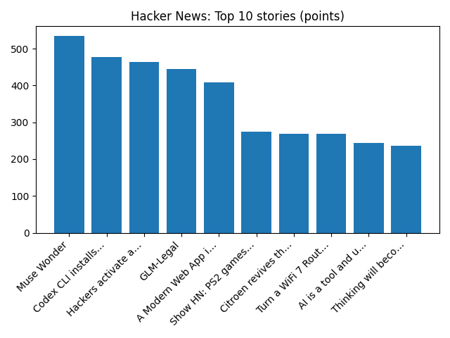

# Daily Knowledge Garden — 2026-10-13

## 🧭 Daily Summary
Global coverage includes UK growth upgraded but energy prices and rates to bite in 2027; Bumble shares soar after report dating firm in $1bn takeover talks; Agents search Rep. Omar's Washington home in criminal probe as she vows she won't 'be silenced' - AP News. Local coverage includes Lucia Wilson Obituary (2026) - Berryville, VA - Northern Virginia Daily - Legacy | Obituary; High School Football Top 25 (D.C., Maryland, and Northern Virginia) - The MoCo Show -.

## 🌍 Global News (cross-source)
- [UK growth upgraded but energy prices and rates to bite in 2027](https://www.bbc.co.uk/news/articles/cmglw0r21zexo?at_medium=RSS&at_campaign=rss) — BBC — Business
- [Bumble shares soar after report dating firm in $1bn takeover talks](https://www.bbc.co.uk/news/articles/cm9qzwjgnjxlo?at_medium=RSS&at_campaign=rss) — BBC — Tech
- [Agents search Rep. Omar's Washington home in criminal probe as she vows she won't 'be silenced' - AP News](https://news.google.com/rss/articles/CBMijAFBVV95cUxNQjdzXzdVOVh5OVVkeXRrSlNpQXBuMTBWQzhqRDUtbG9uY1ZET0trR0xXNmlIQUhBY1hRS1BsVm8yRENMUE1MZTRxaEtsUmFoaEFUSXFuTXpqeVpqMHd5a1ZYOEtnT3ZvV1NhNmZYMUg0WnlGenFVal82aFp3c2psT25Fc0dRSUNWbkNobw?oc=5) — AP — Headlines (Google News)
- [Washington - AP News](https://news.google.com/rss/articles/CBMiSEFVX3lxTE5QR3huWGxwNU5TM3lzQ2VHTXc0UWR5VURxMmNIQjlsQkRfeklWc21VazJCYkQ1UHRmOEhENEVJdW9COUt3WGdMTg?oc=5) — AP — Business (Google News)
- [Oil ticks lower as Russia diesel supply prospects counter Gulf supply risks - Reuters](https://news.google.com/rss/articles/CBMiwgFBVV95cUxPa2sxWTVlekZ2bXloVXNiOUltMm5iODVOMW9NTUo4Q016ZU02OFQ5TU9relFTcUZSaW8xV0c2YmNVbE5jWW5uQjhKeXNKaWxBcE92SU1fQUU0R2RVamdNUzRhTER3NzEzMFUtRVd3bzVnZ1g0ZmtRek95VHdYbVNNMmNacmlDd3dLTThmaGF2VVJDYTc4c1hQeUZfX0ZGQzZjTXlpLU52U3JuUGpjOHJjWndoS19LandSX0dtMmdUMzNKZw?oc=5) — Reuters — Headlines (Google News)

## 🏙️ Local News
- [Lucia Wilson Obituary (2026) - Berryville, VA - Northern Virginia Daily - Legacy | Obituary](https://news.google.com/rss/articles/CBMiiwFBVV95cUxNcTBvOTdLc19YU0lvdXRwcG93bms1NjJyVHN5V2VDT2xaR2FoejBrRDBxZl9RekhWMXdOMkJiSjZ2VzBOQkNaMk1QSXl3d3BJNXR3S1d5NmI4WHZRQ0U0X0JYR0xhS19xVWlnaUlQTDNNLTFrUUdVZmRSQnhRcno1aDl6RFJkVVpYQUlF?oc=5) — Google News — Northern Virginia
- [High School Football Top 25 (D.C., Maryland, and Northern Virginia) - The MoCo Show -](https://news.google.com/rss/articles/CBMimwFBVV95cUxOemw0UEZhckpPMFdwTVJxaTlZRS1vdy1zR0NJdkd6dmpUeVhCWmdfN2x2QzNMel9ZYTNBSksybFZ4aFBJNl9qTWZoNmJ4MDViUHBYTnM2NWE2OFNnRXliU2hlYVNfTjJxdHEzUE9iUFNrV2JiWFpTVEdTRTNhZWVvcloySzFuemRzYWpaLTlFOVhQTFhVRHkzVHNEaw?oc=5) — Google News — Northern Virginia
- [Is the future of data centers underground? Here's one engineer's vision - NBC4 Washington](https://news.google.com/rss/articles/CBMi0gFBVV95cUxQczRXU01QYWdVWkZEbFNXWUt0QUZQSF9CeWVwcFZjWUdsYk5WV0MteGtXdUh1ZDVhSTAzNmZkNmtYYmlkbk1GM20xa0ZzZzJvMWRpQ0xqQmZTOHQ1RlRvU0xhcElIUExqSDlBcW1rRG9NeWx0Y1dFWUJudlBmMUNnRFc2QVNEdXRXT3VWTHVWd1g4eUgtcExiSU5GaEM2YTB6UWgtSVNXam5KQ2tXS0xRT1ZfcXNyNTFnZUNKbVhWaElnTV9PVmdYZDJXSWlzV05STHfSAdoBQVVfeXFMT0h3dlFqMl9sM1lldVJfMzc1a3ZuZmpIZHloVW9fT2d0ODNGLU5VS0ZtSlE0Z2J0OTFfeEgwcllsc25qRDlleGxlYnVMNldTZ3hqNWsyQ3N3UzVJQTN0VFNhOVIzaUgtWWVhN2UzamlhLXpCYkM3cU5EMThweThESHNPb2M1Ry1OQ0s0blVMTzVZV3FuQ2xFbHRoSjhCdjBydmNrUDJ4WW1hUWFtbWNpNjlqVjl0S3h5eWNKWkxibC1rUVhUdU1DbklOSGVEOVVVXzlnZlBrODF4ZFE?oc=5) — Google News — Northern Virginia
- [2026 Northern Virginia Veterans Parade - Prince William Living](https://news.google.com/rss/articles/CBMie0FVX3lxTFBzdU1UR1NnY202NmdVU3BBNmZ0NHllSTJJcG5jUExhcTk0aUdTV25PQmg2WmFOZEVfTFRTalF2alFySjRMRWp0dWFaM21qNThWOU8ydmhpMklISUhaSVIxMUF0Q3hYZjNZaENPcnNGSGlUOVlDcU4tZ1Z6VQ?oc=5) — Google News — Northern Virginia
- [See How Virginia’s Public Universities Stack Up in the 2027 Rankings - Northern Virginia Magazine](https://news.google.com/rss/articles/CBMixwFBVV95cUxPa1o1eDRYak82eUdMWS05dzB5SW1jZkhBQUwyZDlzQ0d3dml0N1NOQkpTOHRKNXFJaW5IbjdLSDJ6Mms2Rmt6R3JzM1pyOFdZNk9PSTQzU2Q0Rk5Rdk1jVmUyQkgxOVgzMG4tT1B2cDdRa2x4a2JDd1hRd1gySGVrVkJBTlAxdmJiQnEwNXdCZ2NvZHlYaFQxelc0UHFRcThyUWJobFFqaU5ZMzJmY1FNUV94bDRqcDdKUGcyYWVYUUdUMjd3dk80?oc=5) — Google News — Northern Virginia

## 🚀 Hacker News (Top 5)
- [Muse Wonder](https://research.meta.ai/blog/muse-wonder) — 534 points, 299 comments
- [Codex CLI installs a persistent, self-updating background daemon by default](https://github.com/openai/codex/issues/48195) — 478 points, 242 comments
- [Hackers activate automatic defrosting in supermarket fridges across Europe](https://www.tomshardware.com/tech-industry/cyber-security/unprecedented-cyberattack-cripples-supermarket-fridges-across-europe-as-hackers-activate-automatic-defrosting-delivery-and-store-prices-also-impacted-by-incident) — 464 points, 670 comments
- [GLM-Legal](https://z.ai/blog/glm-legal) — 444 points, 249 comments
- [A Modern Web App in C](https://prophitt.me/writing/a-modern-web-app-in-c) — 409 points, 166 comments

## 🌍 Wikipedia — On This Day (selected)
- **2019** — Kenyan Brigid Kosgei sets a new women's world record with a time of 2:14:04 at the 2019 Chicago Marathon.
- **2016** — The Maldives announces its decision to withdraw from the Commonwealth of Nations.
- **2013** — A stampede occurs in India during the Hindu festival Navratri, killing 115 and injuring more than 110.
- **2010** — The mining accident in Copiapó, Chile ends as all 33 trapped miners arrive at the surface after a record 69 days underground.
- **1993** — At least 60 people die in eastern Papua New Guinea when a series of earthquakes rock the Finisterre Range, triggering massive landslides.

## 🎲 Wikipedia — Random Article
**2026 European Shotgun Championships**  
The 2026 European Shotgun Championships is the 55th edition of the global shotgun competition, European Shotgun Championships, organised by the European Shooting Confederation.
https://en.wikipedia.org/wiki/2026_European_Shotgun_Championships

## 🌌 NASA APOD
[Jupiter and the Moons](https://science.nasa.gov/image-article/apod-2026-october-12-jupiter-and-the-moons/)

## Feed Health
- **Reuters — Headlines (Google News)**: ok (15 articles)
- **Reuters — World (Google News)**: ok (15 articles)
- **Reuters — Business (Google News)**: ok (15 articles)
- **BBC — World**: ok (15 articles)
- **BBC — Tech**: ok (15 articles)
- **BBC — Business**: ok (15 articles)
- **BBC — Science**: ok (15 articles)
- **AP — Headlines (Google News)**: ok (15 articles)
- **AP — Politics (Google News)**: ok (15 articles)
- **AP — Business (Google News)**: ok (15 articles)
- **NPR — Top Stories**: ok (10 articles)
- **NPR — Politics**: ok (10 articles)
- **NPR — Business**: ok (10 articles)
- **NPR — Science**: ok (10 articles)
- **NPR — Technology**: ok (10 articles)
- **ScienceNews**: ok (15 articles)
- **ScienceDaily — Top**: ok (15 articles)
- **Nature — Technology**: ok (15 articles)
- **Google News — Northern Virginia**: ok (15 articles)
- **Google News — Northern Virginia traffic**: ok (15 articles)
- **Google News — Northern Virginia weather**: ok (15 articles)
- **Wikipedia — On This Day**: ok (10 articles)
- **Wikipedia — Random**: ok (1 articles)
- **NASA — APOD**: ok (1 articles)

Runs so far today: 1
