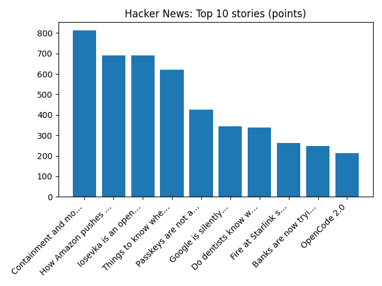

# Daily Knowledge Garden — 2026-10-14

## 🧭 Daily Summary
Global coverage includes Burnham - Rosebank and Jackdaw oil and gas decisions coming 'shortly'; US inflation heats up in September; Fed rate hike this month back on table - Reuters; Associated Press News: Breaking News | Latest News Today - AP News. Local coverage includes Northern Virginia, Maryland meetings set for proposed Valley North power line - WJLA; Fairfax County police sound the alarm about unsafe driving - NBC4 Washington.

## 🌍 Global News (cross-source)
- [Burnham - Rosebank and Jackdaw oil and gas decisions coming 'shortly'](https://www.bbc.co.uk/news/articles/c92031m6knljo?at_medium=RSS&at_campaign=rss) — BBC — Science
- [US inflation heats up in September; Fed rate hike this month back on table - Reuters](https://news.google.com/rss/articles/CBMiugFBVV95cUxNX3hkV3J5em1xWWY4V0hQODFTamFtU3NvdkpPRUUzMGY0TnlKaVlneXZPc0J6bFpWdDZWb2hLRkZZaHhZVElDSXNFbGNYMVVBRGR6c1RlNDA4cEhkMEcwck5VMFRtZ1QxOFJqNTkyaGJzWWFLSXp2Z0l1Z19vMDh5bGd6N1FJSkJFR2tZUXd1UWUzeVlvZi1xNTVONk00ejJ5cE0xSGY4THFsaUo0RGxPV3dpaW4tbEZseUE?oc=5) — Reuters — Headlines (Google News)
- [Associated Press News: Breaking News | Latest News Today - AP News](https://news.google.com/rss/articles/CBMiNkFVX3lxTE1JRTBkY0d6emFJTklfMk1FZkEtdnc2dmtQVGhJQUcxb3cxdVZNajFoUnMxbGx1UQ?oc=5) — AP — Business (Google News)
- [Driving test waits fall to two-year low - but still average 20 weeks](https://www.bbc.co.uk/news/articles/c94g1kvz006ko?at_medium=RSS&at_campaign=rss) — BBC — Business
- [World prays for Pope Leo after lung cancer diagnosis - Reuters](https://news.google.com/rss/articles/CBMiqwFBVV95cUxNZEhjR1JvdVhXeEhEaEZla2JHSkZ5bHFoeWtBTmxpcWgwS3hhMVdCMExHVzdYalFtZFp5VGhYYldPTU5MZWt1QkE3QXNrSU02ZWhkbEtfVE14RW4zZGZwa0VTUmRwUXo5VjRMVlNrc0ZqS1lhcE5QLUlsak9WODRybU5peXp2ei11N2M0M0hBdFdweEdsOU9Xb21TbTJ4T2NRMTh4UkVvSmVxbWM?oc=5) — Reuters — World (Google News)

## 🏙️ Local News
- [Northern Virginia, Maryland meetings set for proposed Valley North power line - WJLA](https://news.google.com/rss/articles/CBMilgNBVV95cUxQR3E4V3l5X0lBVmZPcUJfQ0VuaVk0bThidzVxMFh6QnFrVjg3OUFEY0hFUVFoM3EzODNGbWtZYjVrV0dxYmkzTVl1OWk1czdJX21veHc3ZUREWjdFUG9aanNrNXFoT0FYekJTaGppdUhJSExGS0MwU0t2b25KM0IydEx2V09QbV84TURVaVpQVXA3R00yVGI3QmpRaHFFMGpOelRMX1BVTEtGQ25BWFRXYzhrSVFUUVpmSHdTUjFJMU1mN1A3dDMxY1FPNFNFeW4tbzVMYXFMb3phRUhPTGNmSWR0TGhsWHJxdEEyMHJTa1VuNmwwMkU1bENJZmxxUVhxTzRUcGN2V0ttaG10dkE4b2lQTmZicGZ4NHZ3SWQxN3ZGWmF4RjRwYWlORVY5VnJ6bUhRT2FBX3loSjBxZWdORUgwSEtPNjJSaTg3bEZRd2RVZDBPdkRYSjU0bnNwUk5xeDczeU1ULURXZmUwc0tGbXQ0Z0FPYTJKSWdjaWdVUXFGejRSZUQ5UnZic3dDZ2NhWUh6S0dn?oc=5) — Google News — Northern Virginia
- [Fairfax County police sound the alarm about unsafe driving - NBC4 Washington](https://news.google.com/rss/articles/CBMizAFBVV95cUxQWnhnY2RINEYtU1ZqZDR5NmoxUVlKbkdQRHVneDZvZFVyZWczMnZoZlpTNFRwSkZBMWNMNGFyNzNWdFNacmtfZlhoQk5EaWozM0pDR3dBTGh6RnpqMVpZU1dTdC1mejlxNHN1Y1VjdDFBaThpZWVadi1NdHA2Vmc1Q3o4Z0pFTHI4ejhOTFpWdG0tMFAwcE9jdWI0VDZkZmR4cURQcDMtaXBWb0h6UFA0NEI3S2dZSXZKc0V5X052dVZCanY1NlVyWkF6d1TSAdQBQVVfeXFMTWtYT3RuYVV2QndxYTBPV3JieGlzdWRsbVNfalA3Ynh0NHRuRVVSNWRsejE3ZEh0cmNnZnZlY3N1S0xDNGlncjVNMVFqaVRyOTBacXE0NVlhbFdaV28wc2lzYmthX2hrN18tVzdYZXh1Rm9kVjVrakk4bTVQU2RUZ3k3eGl3cGRHdExYN0lvd3lodnh5UXRkZTl6bHQxZFFGVnFxNklDbjRmZ252T2ZiYmpFUlg2MzYxYjFoNkwxVEpac2J3TEU0R2NVYklwOGFXMkd4WDY?oc=5) — Google News — Northern Virginia
- [Popular Maryland Restaurant Expanding to Northern Virginia - The MoCo Show -](https://news.google.com/rss/articles/CBMilgFBVV95cUxQaXNUeEYxUmFjN2FlZ1dpZUktYjNTMnk1S280TklLODBvTFJCTTE5ODBRbHlBWExVUVBLQXo1WGhCbXppbmIxV3Z1RzNjcTBFRF9ZanhGNUtNZ1RxTndQU1RpeW1qR01JbGU3OE40NXQ2R1RXcTJ5VWp5ZmdTeE9vTkxwUVpURkR4NmZYZXNrWVUwaFBoU3c?oc=5) — Google News — Northern Virginia
- [Powering the AI Decade 2026 | Data Centers & Energy Policy Forum | Tysons, VA | Free - InsideNoVa.com](https://news.google.com/rss/articles/CBMi3AFBVV95cUxORVNwYVRhWGlwcEIzQm1lTi13alduUWxzUW84b05yLXlNMGQ2WXVmanh0dlJuTy1XOXEtcnhlekRkTW12bXVYVmlxSThXeW45VzAxY0xWYlYyNm5GWHB6RWVGbG02UjRjWGNReWd5QmQyYUJRd21XTkRJOUoydHdYenRrb3RTS290N3JORHV6cG9kd3hUTlVGWXRLRXU5ZGxvZVM0bVFuWFRSV0FHVWtHQWtpczU4cGtIYUFSTTkzcTBHR2pQWTMxWG1YTktHSktMc2dmNUZEY09VMU5l?oc=5) — Google News — Northern Virginia
- [Home remodeling firm moves HQ to Vienna, replacing longstanding beauty spa - FFXnow](https://news.google.com/rss/articles/CBMirAFBVV95cUxPLUlfcUZGNk92TXJhUFpCWFFFNVVJeDdaRGt4T2J6OWhESDgxNlo4VWRvNzBHd0xRcXdweEl4YmQxLTJSbG14Q2dYRGgta3dqSzNiQlZzYjZ6WHZqX2JmUmJwdkI4bm1OdWtWREFITmxHLXF5OGxIbjRodVRuMW9tYi0zN3Y5TV9CSmxQQ284VUxKeUdYWmV5UzV2MzFocW9ZY08wUWdhejBpNFRW?oc=5) — Google News — Northern Virginia

## 🚀 Hacker News (Top 5)
- [Gemini 4 Argon](https://deepmind.google/models/gemini/) — 926 points, 713 comments
- [11 year old unsoundness bugs found in Rust borrow checker](https://github.com/rust-lang/rust/issues/164250) — 657 points, 366 comments
- [Apple HomeView](https://www.apple.com/apple-homeview/) — 638 points, 761 comments
- [Firefox Enterprise](https://www.firefox.com/en-US/enterprise/) — 619 points, 256 comments
- [Redesigning source control at Anthropic](https://www.anthropic.com/engineering/redesigning-source-control) — 485 points, 485 comments

## 🌍 Wikipedia — On This Day (selected)
- **2025** — A coup d'état successfully overthrows Malagasy president Andry Rajoelina.
- **2023** — Australians vote to reject a constitutional amendment that would have established an Indigenous Voice to Parliament.
- **2021** — About 10,000 American employees of John Deere go on strike.
- **2017** — An Al-Shabaab suicide bomber detonated a massive truck bomb at the Zobe junction in Somalia's capital, Mogadishu, killing 587 people, injuring 316 others, and leaving more than 500 missing.
- **2015** — A suicide bomb attack in Tonsa, Pakistan kills at least seven people and injures 13 others.

## 🎲 Wikipedia — Random Article
**George (bishop of Veszprém)**  
George (Hungarian: György) was a Hungarian prelate in the 11th century, who served as Bishop of Veszprém around 1061.
https://en.wikipedia.org/wiki/George_(bishop_of_Veszpr%C3%A9m)

## 🌌 NASA APOD
[Mars and the Beehive Under an Aurora](https://science.nasa.gov/image-article/apod-2026-october-14-mars-and-the-beehive-under-an-aurora/)

## Feed Health
- **Reuters — Headlines (Google News)**: ok (15 articles)
- **Reuters — World (Google News)**: ok (15 articles)
- **Reuters — Business (Google News)**: ok (15 articles)
- **BBC — World**: ok (15 articles)
- **BBC — Tech**: ok (15 articles)
- **BBC — Business**: ok (15 articles)
- **BBC — Science**: ok (15 articles)
- **AP — Headlines (Google News)**: ok (15 articles)
- **AP — Politics (Google News)**: ok (15 articles)
- **AP — Business (Google News)**: ok (15 articles)
- **NPR — Top Stories**: ok (10 articles)
- **NPR — Politics**: ok (10 articles)
- **NPR — Business**: ok (10 articles)
- **NPR — Science**: ok (10 articles)
- **NPR — Technology**: ok (10 articles)
- **ScienceNews**: ok (15 articles)
- **ScienceDaily — Top**: ok (15 articles)
- **Nature — Technology**: ok (15 articles)
- **Google News — Northern Virginia**: ok (15 articles)
- **Google News — Northern Virginia traffic**: ok (15 articles)
- **Google News — Northern Virginia weather**: ok (15 articles)
- **Wikipedia — On This Day**: ok (10 articles)
- **Wikipedia — Random**: ok (1 articles)
- **NASA — APOD**: ok (1 articles)

Runs so far today: 4
