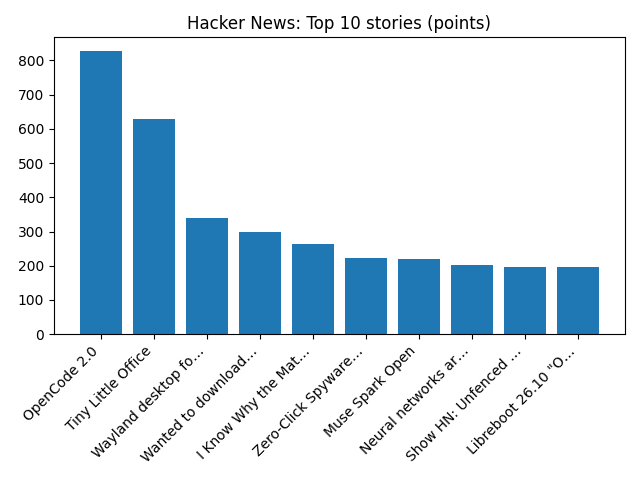

# Daily Knowledge Garden — 2026-10-15

## 🧭 Daily Summary
Global coverage includes America's historic preservation law is in peril, advocates say. Here's what's at stake; DOJ sues California to block votes from alleged noncitizens - Reuters; Suspected fly tippers shamed with online photos. Local coverage includes News | Northern Virginia housing authority plans affordable residences at mixed-use project - CoStar; USTA Mid-Atlantic Foundation honors local leaders at Tennis Creates Gala - ALXnow.

## 🌍 Global News (cross-source)
- [America's historic preservation law is in peril, advocates say. Here's what's at stake](https://www.npr.org/2026/10/15/nx-s1-6001504/section-106-historic-preservation-act-threats-anniversary) — NPR — Top Stories
- [DOJ sues California to block votes from alleged noncitizens - Reuters](https://news.google.com/rss/articles/CBMingFBVV95cUxOa2l3Nl9uOTQ5Qm16OWFRT09Ta19PQW9JYVBZRmQxLTJGdTRiOEdrZERrX3JfS1hMODhGbEdaaU9DelJ3dEw1LUJGSXpFeDJvVmgwT18yOE01VTNpQjhIa1k5WFJ4S0oxbEtvQ2hSX3pyT0VwWENuaGc1MG9yZkFkc3hVeHM4R0xKdEVmd3ppRjB4aWt4S3FzMHRhSmpnUQ?oc=5) — Reuters — Headlines (Google News)
- [Suspected fly tippers shamed with online photos](https://www.bbc.co.uk/news/articles/cqgm0jepyl01o?at_medium=RSS&at_campaign=rss) — BBC — Science
- [Wholesale inflation reaches levels last seen in 2022 - AP News](https://news.google.com/rss/articles/CBMimAFBVV95cUxQNExzSHEyWDFGWnpSTkR2V3NndkhQTmU1dzE3M2pTWENyU3RPRTAyb0JQQXNqbENPTjJneHRsYWpMMXFPUXg3dnZfekhEM1VoSFNIRTM4U29QR1l0TGhzeVd6WkZIamdXWDkwcmdlR3k5eExLZFd3SUc0MHFQc1NoQlIwRWw5MzM5OVpndWJKa3NIZFNJRGx5YQ?oc=5) — AP — Business (Google News)
- [Yemen's Houthis hit palace in Aden, coalition details attacks on Saudi infrastructure - Reuters](https://news.google.com/rss/articles/CBMixgFBVV95cUxQODZXb0UtbHJiTHdmLTZhUENYcXNNeVptZDFGV1pUUEpuS3A0RzROVlBWSGw2V2tvdjNabmlnX1llVmh1Tno5TW5jUjhLWm5BY3VOREdYTnd5Q2RpdmdyVnVzR0lFTlp4SDV4a3JzNWo0US1xdER1eUkybkRtOHlBT2U4RE43NFI2dGVnb29fSmdPVmVPaDY3NG5fNXRabFR5dkJBU0pwNDFZSkN0NkxaU2lEd2c1Mk9HbUNUYTROV3BJUnh3TEE?oc=5) — Reuters — Headlines (Google News)

## 🏙️ Local News
- [News | Northern Virginia housing authority plans affordable residences at mixed-use project - CoStar](https://news.google.com/rss/articles/CBMiwwFBVV95cUxOczJOcGZWVjVILXE0WGxGZFppUVZCTTMxVDlBdzlYY0NNeE0tT2RRcWJabXc0YmUyY1BfLTItNjU2QTkzb0p5aFhyYzVCNmFhUFhPdVpIV25fLV9OR2N5aGdfQ1l6SmhDTnJ5bmFRdGNtd1lIRW53cnZqSTdGT0Rsckp4b0o3X0N4bGZzcHFIbVg0dS1mUThfcS1YanpkWHZRaXB2TzVTTTc2eDZNTXNTbDRyY0h4Y19DZE1ZLUo0N2lyeVU?oc=5) — Google News — Northern Virginia
- [USTA Mid-Atlantic Foundation honors local leaders at Tennis Creates Gala - ALXnow](https://news.google.com/rss/articles/CBMisgFBVV95cUxONl9IQ1FqSlo2R0MwZzFCSHMyMS1lWkxFV1dNRHhMZjZkczMzXzZVRWdTMFFJTzFZMy1LMEFMdlFWSm9XVTFHNlNsNUp5N0FwQWlDbmRsWGhBbDFjZVREWnBKNW5IS0ZtNXNfUk1PMExRWXdNdWV5amhBbllIYUhwX0pWRzhKSXJiT01hcktXZ2hLakhLLWpGbW5jaG03NGhDcDU2UkZYckx2bHFodDlPX01n?oc=5) — Google News — Northern Virginia
- [Five N. Va. restaurants ranked among region’s 40 best by new WaPo food critic - FFXnow](https://news.google.com/rss/articles/CBMisgFBVV95cUxPWXdWZUFOb29fNHA5RWoyWDZmbXVVMjBURGdLUnpRek9kVktIZGlkVFllN21QNU1HdzNEUjdZNUF1QXhyNTA0WDRLN2YzU3BORTVvclFYcVM5SjBvcHN5RWNkV0x1NlVEVU9kTG5XQk9zRWZQVDAtUW9zZlN6ZE1RemU3ejktYjg2emxkOGljOEw3VG9pUzc1aldKN3hoX3hOSXdOei1BdV8zbjloX3FrU3Fn?oc=5) — Google News — Northern Virginia
- [Alleged auto fraud scheme targets Henrico, Northern Virginia man arrested: criminal complaint - WRIC ABC 8News](https://news.google.com/rss/articles/CBMinAFBVV95cUxQTy1fcjUzb1dyaWNTMlBmYWZLNlpNSnJBZV8tZGdpbnZoVkswdzdaUkdYNDNaY2dfcGo5ZlZGQVJUYjBGZTRibzc3XzJHTFkzZERIZU1mV085ZTBseGItRnNIcERFd19xWHlNalNQNUlnYVFETk5TVzRvVHhBT1dGNlZIWXVrcHpvNFFuakgxMEV6MVJRV2JMSXNmbVrSAaIBQVVfeXFMTlRrc1pMM2NWeVpwOHpqMzVsTTMxT3lSLXlHbVZpM0lqX3B2aU8zSjJFbnZTQUtQUmlES1djQl9JZ29BT3BvNE9ENlltdkRWRW1CQ0NIbkxseFBVMUM0TW5YRV81Y1pEWEs0eTFaMzVRRXpFdi11ZGgwTkpzYk1jeHhsbWRSbDBnWlNSaWR0WnY4UnFxVWVvT3liNk1QSXBiUzh3?oc=5) — Google News — Northern Virginia
- [New Northern Virginia group helps new moms find their village - Axios](https://news.google.com/rss/articles/CBMiqwFBVV95cUxQRjlKdDI1djR4clN0TnJIWnFVUW5Fd0lNcHoyUDk5WmNqSGpSbUVkME9lV3ZKOUI3T190QnoyLTA1MEhUUjlnMHdlZ0tIcUEtS0ZvZUpNZ2ZVcE5ZZ2tPUkpxUS11M0lEaVMyNGlwZXFqd1BvSlZveDNWaTRSbFZrNXlGeUs1S2YxZV92NG1iNnFrTlBfY0sxZ3hHNnBiOG54dUwycXBWS1ZVcE0?oc=5) — Google News — Northern Virginia

## 🚀 Hacker News (Top 5)
- [Things to know when you get cancer](https://jjmaxwell4.com/writing/things-to-know-when-you-get-cancer/) — 1654 points, 393 comments
- [How Amazon pushes up prices all across the Internet](https://www.not-ship.com/how-amazon-pushes-up-prices-all-across-the-internet/) — 899 points, 685 comments
- [Do dentists know what they're doing?](https://mapwriting.substack.com/p/dentists) — 824 points, 598 comments
- [OpenCode 2.0](https://anoma.ly/notes/opencode-2-0/) — 739 points, 313 comments
- [Tiny Little Office](https://tinylittleoffice.com/) — 543 points, 121 comments

## 🌍 Wikipedia — On This Day (selected)
- **2018** — 13-year-old American girl, Jayme Closs, is kidnapped from her Barron, Wisconsin home after her parents were both murdered.
- **2016** — One hundred and ninety-seven nations amend the Montreal Protocol to include a phase-out of hydrofluorocarbons.
- **2013** — The 7.2 Mw Bohol earthquake strikes the Philippines. At least 215 were killed.
- **2008** — The Dow Jones Industrial Average closes down 733.08 points, or 7.87%, the second worst percentage drop in the Dow's history.
- **2007** — Seventeen activists in New Zealand are arrested in the country's first post-9/11 anti-terrorism raids.

## 🎲 Wikipedia — Random Article
**Jacques de Sieyes**  
Jacques Edouard de Plan de Sieyes de Veynes (21 July 1891 — 25 June 1949) was a Legion of honor decorated captain who acted for de Gaulle against Vichy. His parents were Raoul de Plan de Sieyès de Veynes (1848 - 1944), lawyer, Joan of Indy (1856 - 1943).
https://en.wikipedia.org/wiki/Jacques_de_Sieyes

## 🌌 NASA APOD
[The Milky Way over Manhattan](https://science.nasa.gov/image-article/apod-2026-october-15-the-milky-way-over-manhattan/)

## Feed Health
- **Reuters — Headlines (Google News)**: ok (15 articles)
- **Reuters — World (Google News)**: ok (15 articles)
- **Reuters — Business (Google News)**: ok (15 articles)
- **BBC — World**: ok (15 articles)
- **BBC — Tech**: ok (15 articles)
- **BBC — Business**: ok (15 articles)
- **BBC — Science**: ok (15 articles)
- **AP — Headlines (Google News)**: ok (15 articles)
- **AP — Politics (Google News)**: ok (15 articles)
- **AP — Business (Google News)**: ok (15 articles)
- **NPR — Top Stories**: ok (10 articles)
- **NPR — Politics**: ok (10 articles)
- **NPR — Business**: ok (10 articles)
- **NPR — Science**: ok (10 articles)
- **NPR — Technology**: ok (10 articles)
- **ScienceNews**: ok (15 articles)
- **ScienceDaily — Top**: ok (15 articles)
- **Nature — Technology**: ok (15 articles)
- **Google News — Northern Virginia**: ok (15 articles)
- **Google News — Northern Virginia traffic**: ok (15 articles)
- **Google News — Northern Virginia weather**: ok (15 articles)
- **Wikipedia — On This Day**: ok (10 articles)
- **Wikipedia — Random**: ok (1 articles)
- **NASA — APOD**: ok (1 articles)

Runs so far today: 2
