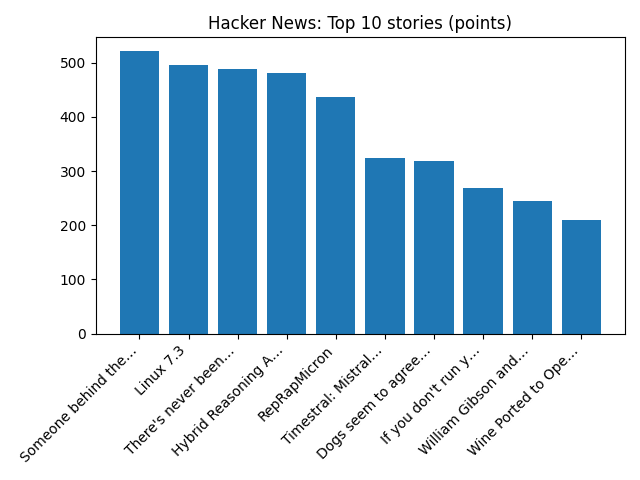

# Daily Knowledge Garden — 2026-10-19

## 🧭 Daily Summary
Global coverage includes Kenya cult leader who told parents to starve children guilty of 191 murders; Capybara pups at Manx zoo draw record crowds; Google, McKinsey strike Brazil carbon removal deal with silvopasture project - Reuters. Local coverage includes GYMGUYZ Celebrates Northern Virginia Grand Opening, Bringing Personal Training Directly to Clients Across the Region - PR Newswire; I-95 northbound nighttime ramp closures in Woodbridge tonight & Oct. 20 - Virginia Department of Transportation (.gov).

## 🌍 Global News (cross-source)
- [Kenya cult leader who told parents to starve children guilty of 191 murders](https://www.bbc.co.uk/news/articles/ckd6d2l3dz4xo?at_medium=RSS&at_campaign=rss) — BBC — World
- [Capybara pups at Manx zoo draw record crowds](https://www.bbc.co.uk/news/articles/cw7vplvjd3elo?at_medium=RSS&at_campaign=rss) — BBC — Science
- [Google, McKinsey strike Brazil carbon removal deal with silvopasture project - Reuters](https://news.google.com/rss/articles/CBMizAFBVV95cUxQZ3dueURyYnIwanJiVVIyLXdGYnJhTzRVMTV6bnc4WnZtRjhIWmQ3X0JyOHhjX1l3c0JpV1dqcTlBQ2RYdUE2NlIzYkFWcVljMGJGa25uUTFJMU81YXFQdDVrREtMeThDa3djVlcycWZxZW54dFpZOGhWNWhfZDYyWm5uVkNnV2pNZ0RRbmxkYmZGV0JjdFFDbXlhRnN2WUdjQ0NBN2podGdJcmhidkJTMVo5blVST0N3dV9JWjM3TDdFaVF2RWlKMzIwQ3E?oc=5) — Reuters — Business (Google News)
- [Alberta votes on leaving Canada; separatist movement likely to outlast expected defeat - Reuters](https://news.google.com/rss/articles/CBMiygFBVV95cUxNcVhpOEEtQU9ScjZPUU5YUnZfaG9LVXh6VHlxYzBrbzJzSGlzc2kweEZqMDZZMGpwNFNSQUtvNmF1bnVidmFNdU5ELUR5MTVaLTNhaTUwdTB3Rnd2cUhOM0ZIQ0k3TTd3VTFucWc4clltY3M4YnNrTGMzcnY0R2dmaXdZQnUxbEQ1eHd1ai1ldV9EUXQ3QTNlRXUwWjZWQlVEUWFCTmVYR05fYXFTbVdidElWcHoyV1RVYWdJVmZPbHA3Q1NheEZjd09B?oc=5) — Reuters — World (Google News)
- [These tiny snakes cartwheel to escape danger](https://www.sciencenews.org/article/tiny-snakes-cartwheel-escape-video) — ScienceNews

## 🏙️ Local News
- [GYMGUYZ Celebrates Northern Virginia Grand Opening, Bringing Personal Training Directly to Clients Across the Region - PR Newswire](https://news.google.com/rss/articles/CBMigAJBVV95cUxPNFFaMU45Z0hpbnhBdnZnRm93UkhQWnk2LVp5eV92REV4Yk5iWE5vT2Y1Mk4zODhHc0MxNF94Z1N3OXd5WjQ4eDFTeWo4OHBPTzFWYjlOcTdXczVGNnBlZk1mWHlMaTBTTTA0YmxtaThfUkNJV3JhTEd6QjJzNGF6bmM1dVdYVlA2elVBQUFLMEE4bW13a0l0Q3E2UmJRWmhKZ3BGX2pSSDZKZ1poVmFrOGNpQzFwMEdDSWN6bGVXTTdDbGVFQUlOQl8tdnB2Ym5hc3ZZb3pkYm1OODlvMlBiNXNVRWpreDY3R2ZkNFFHdUF6aVMtaG5kYms0eWJSdFF5?oc=5) — Google News — Northern Virginia
- [I-95 northbound nighttime ramp closures in Woodbridge tonight & Oct. 20 - Virginia Department of Transportation (.gov)](https://news.google.com/rss/articles/CBMi2wFBVV95cUxNdTNEX3R5amwwR3QwUWJKblVpSU5GUWJOSXc0WGlKU2Z0bDBqc3BfamdsdEtsaVlhVU8zUjg3aHA2NHN1VXdJaC0xb3RpdVcyT0gtNkVmQTF4Y0tRR2tFR3NaYldfbDlYNVNpRWJydzRDQmh3d1dmODBNTngxUy1wWnViWUZBbi1KREVacnhXeFpsR2lPUUJQeVV0LXBCTzVYQXhXY1Blam1mUlNoY2RGTGo2NFRvVy1YWkUzYVhfZGNCaVlMcXh2b3gwdFdyOVc1dmZicU5Xc0ozMzg?oc=5) — Google News — Northern Virginia
- [Serafin Real Estate Releases 2026 Northern Virginia Childcare and Early Education Real Estate Report - markets.businessinsider.com](https://news.google.com/rss/articles/CBMi8AFBVV95cUxNQmhHSzd1MTZFejJNb1R2dF9mYWNLLVVwa0xFZzZTYVoxZU5BMmNGQnhVeW9ZT004Q2lkU2lQTlhSaG1xZVhKRFpDU3F1cEQ4QTdxTjJKck1pNVhyV3M2aHExM2hNcXZPQUVJSWVTQVZpVnpFdjBvVG82Y1R6eDVyQlhIbDE5U253ZXhBeGd2Y0p1Q01ZWnRLcG9JNHJROWxmMzBNX2xyUnIxblp6bjRLR1dqOE5zeGw4c2ZIOEFyUGdGR1c5TjlEUnU0UENZakVsQ2p5R19rRlh0SGlXeGwwWEJfa0Qyc1BJZGdMNzczeVE?oc=5) — Google News — Northern Virginia
- [Wetzel’s Pretzels moving into Northern Virginia market - The Burn](https://news.google.com/rss/articles/CBMijgFBVV95cUxPYTlDb19ZMHpTaUphdkQ4MmpsRmItcnZsWXYzSFdCY3c1RFNRX3h3MDFBZVJkM0xUZl82VEFHdkxucmxTcTJ4R2RQRDIwQnJHbGdRV29VajNuODVuRVZ2bzM2czhJSlNkZFFyYjNnSlVPZUdKaHNVMUt0RVVBdXhsLUNOS3FEV1JybnJJRlVn?oc=5) — Google News — Northern Virginia
- [Living with 230 data centers on the doorstep: ‘Nobody warned us what was going to happen’ - EL PAÍS English](https://news.google.com/rss/articles/CBMi5AFBVV95cUxPd3dsZkFSWWNEVGZTVVZGdVZJQ2tXWm9ndHpPSUtJOEYxQ2JXZ0YwMExXRVVqemVyVnFwTTlqZ1RfMU5vcEJ3V3U1V0tmc1dqdDRjb2VWaFJ0ZV9URXZLM25vVFpYMFk5YzVfRWxqWGVNdXlsa2NGeXhwUGZuY2JsSFJmbC1fUTQyUEhIeFNfMXppb0ZRS1h6aU5FZFNlQU92UlFCX2FLTEE0d2ZUVzh0NmQ0ejNmbkJUU2FqUHFDSkxNUUtFMlh3ZzZCMW41ZnVwNUhKS192QkRKR2NEN2R3aEVOMl_SAfgBQVVfeXFMTVJfV0dOZlZvTEdrQ25yYjdmNnNtYWFoRE1tWElUYnplN2xHWUVjQ25nUVJReEJTeXNzS1BReUJHTU1PUk5MNFBNSGl1TTZFSlpMcXJITERHUTAycHNyZFFJRHgyMlJ3eHZyX0lVMGxnd3F4b0ZPeU9tZU9WaWtaaFVFRkVlTU8xeFZTSF9aZ0E5dWhjcVdIeHNrdm82bktqRzRLWGFXX2owQWNEalByMEpVSnFRc2hqdEdCbEY2YktnRnBJYlpndHM1enpNX2JYMXRrUFNZeFItVFdCSEY2UF90UXgwR0E4WkxkM3BlYzlWWGkweXk5b2g?oc=5) — Google News — Northern Virginia

## 🚀 Hacker News (Top 5)
- [Someone behind the software](https://karrisaarinen.com/posts/someone-behind-the-software/) — 521 points, 187 comments
- [Linux 7.3](https://lwn.net/Articles/1101143/) — 496 points, 218 comments
- [There's never been a better time to go into math (by: 3blue1brown) [video]](https://www.youtube.com/watch?v=LKrwhjOI8Nc) — 489 points, 668 comments
- [Hybrid Reasoning Agents: LLM agents that think in latent space, act through text](https://arxiv.org/abs/2610.18861) — 481 points, 226 comments
- [RepRapMicron](https://github.com/VikOlliver/RepRapMicron/wiki) — 436 points, 68 comments

## 🌍 Wikipedia — On This Day (selected)
- **2025** — Pieces of the French Crown Jewels are successfully stolen during a heist on the Louvre Museum in Paris.
- **2019** — Members of Parliament met at the House of Lords to discuss the United Kingdom's Brexit deal, this was the first Saturday sitting in Parliament since 3 April 1982 during the Falklands War.
- **2013** — One hundred and five people are injured in a train crash in Buenos Aires.
- **2012** — A bomb explosion kills eight people and injures 110 more in Lebanon.
- **2005** — Saddam Hussein goes on trial in Baghdad for crimes against humanity.

## 🎲 Wikipedia — Random Article
**Drenča Monastery**  
The Drenča or Dušmanica Monastery is located near the place of the same name, not far from Aleksandrovac and belongs to the Eparchy of the Kruševac of Serbian Orthodox Church.
https://en.wikipedia.org/wiki/Dren%C4%8Da_Monastery

## 🌌 NASA APOD
[Treble Clef: Unusual X-ray Hot Radio Source](https://science.nasa.gov/image-article/apod-2026-october-19-treble-clef-unusual-x-ray-hot-radio-source/)

## Feed Health
- **Reuters — Headlines (Google News)**: ok (15 articles)
- **Reuters — World (Google News)**: ok (15 articles)
- **Reuters — Business (Google News)**: ok (15 articles)
- **BBC — World**: ok (15 articles)
- **BBC — Tech**: ok (15 articles)
- **BBC — Business**: ok (15 articles)
- **BBC — Science**: ok (15 articles)
- **AP — Headlines (Google News)**: ok (15 articles)
- **AP — Politics (Google News)**: ok (15 articles)
- **AP — Business (Google News)**: ok (15 articles)
- **NPR — Top Stories**: ok (10 articles)
- **NPR — Politics**: ok (10 articles)
- **NPR — Business**: ok (10 articles)
- **NPR — Science**: ok (10 articles)
- **NPR — Technology**: ok (10 articles)
- **ScienceNews**: ok (15 articles)
- **ScienceDaily — Top**: ok (15 articles)
- **Nature — Technology**: ok (15 articles)
- **Google News — Northern Virginia**: ok (15 articles)
- **Google News — Northern Virginia traffic**: ok (15 articles)
- **Google News — Northern Virginia weather**: ok (15 articles)
- **Wikipedia — On This Day**: ok (10 articles)
- **Wikipedia — Random**: ok (1 articles)
- **NASA — APOD**: ok (1 articles)

Runs so far today: 1
