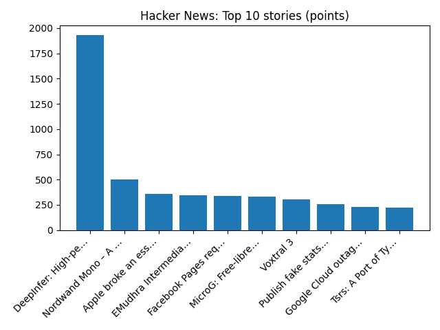

# Daily Knowledge Garden — 2026-10-20

## 🧭 Daily Summary
Global coverage includes Britain says it will carry out defensive air missions over Saudi Arabia - Reuters; Zelensky and US envoys to hold Oslo talks as Rubio denies withholding intelligence; Salesforce deepens AI bets with $5.66 billion Braze deal - Reuters. Local coverage includes What issues are driving Virginia voters to the polls? - WUSA9; Ask Eli: Three charts highlight our current real estate market - ARLnow.

## 🌍 Global News (cross-source)
- [Britain says it will carry out defensive air missions over Saudi Arabia - Reuters](https://news.google.com/rss/articles/CBMi1AFBVV95cUxQTGh1LWkyRVZqaTRQMEdnRXhvWFhvWnJ6TW5WdlEyM0dxTFQwLWczNjAwLU95SDFDZVVSdUNQUE1uYkREcG05THRjbmhiQk5FWlBjb2p2V01DVmhGRFppUmFHQUFwMm4yZHFLRndUbU9PcEVjY0JBY1JpZjROd0JnOTdoZXFodTRDSzJEQURHQkVzd21pMmtUZmdnLUE3SGI1UGt5Wno0WWVKR1ZWV0FaQ0FmZUY5aVlQZVAtRGV4WEhoTmVnbHRsZ0taZ2d2NFBxOFIzdQ?oc=5) — Reuters — Headlines (Google News)
- [Zelensky and US envoys to hold Oslo talks as Rubio denies withholding intelligence](https://www.bbc.co.uk/news/articles/ck9qzn193lrlo?at_medium=RSS&at_campaign=rss) — BBC — World
- [Salesforce deepens AI bets with $5.66 billion Braze deal - Reuters](https://news.google.com/rss/articles/CBMijwFBVV95cUxQUVE0QXkyR1NSaXY3LTNJTE9uQmY1bXhaV19YNzFMejJRZEhFeDJwd1VCdWg3ZjFFM29VYUNkMWRkSVlsMzlpcmZrdzFudjM0MS02dVJOVGFJZW94cFpHSU9JeGNtSHZtbFQzX3VsaWVTYXFIdzIxbmdhbUVncWRZbFc0T25aUDRMVGwzT01LNA?oc=5) — Reuters — Headlines (Google News)
- [Huge fin whale filmed off Welsh coast](https://www.bbc.co.uk/news/videos/cxly491v6p7yo?at_medium=RSS&at_campaign=rss) — BBC — Science
- [Google Cloud outage hits UK banks - AP News](https://news.google.com/rss/articles/CBMilAFBVV95cUxQa19yZHNPSUxKdDBqd2FfTDNXbThvRC1nRWdsLWVzd2htZDhQTE1YT3BPRnFXOEZNdFZKbnJhUlUyZnFldnBIRnhkalRrVmNmazB6U2lEdjNzSGMyMURLYTFYNldpYlBTQk45VWF3UVhlVUpTbHluUHZWVDZxZzczcVRGUjNVX2ludFBOODYySGJHVF9X?oc=5) — AP — Headlines (Google News)

## 🏙️ Local News
- [What issues are driving Virginia voters to the polls? - WUSA9](https://news.google.com/rss/articles/CBMiugFBVV95cUxORWgyMm41UVA4Qk5nTWF4ZjhTam1xbmNuSzVpY2k1Si1DOW10VVlwSkFsSXRMY2FSZTAtOUdCdlFwb05iZ0ZnZFFDVTFERTF6Uk5jM0RnMTMxczVGaHpIcXZSUnZjU2ZtcF8wQXR3Q29jSmNvS0JlS2lxWUtyWUNmWGZyTUNMb0pXRjZRWmNqc0NzU29IOW1MQ2ZlaVQ3SE1sQ01YNnUtQm5tNURQUjdiaHE3VGJEdEM4MGc?oc=5) — Google News — Northern Virginia
- [Ask Eli: Three charts highlight our current real estate market - ARLnow](https://news.google.com/rss/articles/CBMiowFBVV95cUxOYUxyNWNOUkdXQ2xYTThyRnJhaFVYby0zcTZOaGhRblY0NGhsbEFkeVpGY3NTcmV6aE1DRHdkSHhOWkZTdDVLUWxRLTFwNW1zUkczekpYUkM3V0Y4QmZVUmJjNUpPMmFYWkV4dzJXUzZ0VVpDRjB2blE5NTNkRExQTXAzcXgyaE1UaFBrSDNJTUt4aXcwTWFheWdLTEFTR0xPaEhN?oc=5) — Google News — Northern Virginia
- [Fairfax County to review use of Flock cameras amid privacy concerns - NBC4 Washington](https://news.google.com/rss/articles/CBMiuAFBVV95cUxNNjFSRHlOUThTUVJEN1cwRTYwMUpVS0djX1p4VXR4aFFzWWhyZkUxTnhZY0dpM1BxeXpYZG1jUnd1ODZvWGg4MHpNMGxEYzdzXzBYMWxUNkVMc0FLZTQyYWt4TzltUmtGdS14VmVKNW91TTFoajZXQ3BIQ215UV9uU2FhSDF0NFpIdm11enJ4STZnMHpBLWR0MWpScnZkUFExTVdWUllRblNUN3YwRFlDRXNTLUZBQnlN0gHAAUFVX3lxTE8xR3d4QmdSeEFpdG9hRjFzSXNZT2xtdTJzN2tKM2thVG1HaHE1Tk1wVHJsa2R5RmNXVDBGa2tsdWhjQnBQcXdEcUxORDZFblJTQURVZUxsYUxZZkVFVndjU1NnNWNnZTVKUG9vRmpuaHdxX0NHa0ZuWlJmZkJ2ZWdYWkFXby1fdDl3VTdNcFBkcDAza21iemY3cVltTUdHdzhxWUh2ckZVWHRUTXlQWVpNeEx3ZE55S3FoY0g3ZmdQUA?oc=5) — Google News — Northern Virginia
- [Hampton law firm lands $17.5 million verdict in Prince William brain injury case - The Virginian-Pilot](https://news.google.com/rss/articles/CBMilwFBVV95cUxNYjZsRkhkZGdiUnJqSXJralpBREEycmoxSmllaXdJMThxenFjZFpNSC1rTkJiQkNYbFV4QmZHU1FHWFZkTVdYRUwtUll3Wm9xZDVQUm5FWVRhSnFDUTZidWVHeTBfVnhZbjdHcUJIdTRWdk9VQ19NcVdoRTVIcUVqdWstMkVEenlZLUNHY0poNjZxUzBYei1F?oc=5) — Google News — Northern Virginia
- [Greeley Boulevard five-week closure at Rolling Road in West Springfield begins Oct. 21 - Virginia Department of Transportation (.gov)](https://news.google.com/rss/articles/CBMi8AFBVV95cUxORklQdGpjX3FOc3lLTGdtQVlaT1c5WENrc1ZzTzFUSnJkZnhjaWNGZkZTZ3NNYnNMRWVWaVRYemtlRnIwdnpMVHphekh5Vk42WTI4czVUSVBycl8tM2ttMWxlLTU0cllVUzlfcTN0SkxxN1pDRHdERlJlUVVrMy1fbTd6eU5fZllGRmU2SndpQzBXb1NnX1hMNzVwb3NHYXlYLTNIZFBHSDdwQmFEc3FVOFg0eTQxdzd6Q1F4aGczNVZhbW5tdjJxUlltb0dzZDFHakpRcWVpRGNvWnJZZ1RfX09GNjJmdS1lUU03Q0oxY2Y?oc=5) — Google News — Northern Virginia

## 🚀 Hacker News (Top 5)
- [Timestral: Mistral's time-series foundation models](https://mistral.ai/news/timestral/) — 531 points, 98 comments
- [Wine ported to OpenBSD](https://marc.info/?l=openbsd-ports&m=179236125692175) — 485 points, 162 comments
- [It's still ok to enjoy programming](https://chriskiehl.com/article/it-is-still-ok-to-enjoy-programming) — 405 points, 385 comments
- [MiniMax M3.1 Flash](https://www.minimax.io/blog/minimax-m31f) — 349 points, 151 comments
- [I built a drone with only one motor [video]](https://www.youtube.com/watch?v=Ndftcft6XhU) — 345 points, 65 comments

## 🌍 Wikipedia — On This Day (selected)
- **2022** — Liz Truss steps down as British Prime Minister and leader of the Conservative Party amid the country's political crisis, serving for the least time of any British Prime Minister (49 days).
- **2018** — The BepiColombo spacecraft is launched on an Ariane 5 rocket to study Mercury.
- **2017** — Syrian civil war: The Syrian Democratic Forces (SDF) declare victory in the Raqqa campaign.
- **2011** — Libyan Crisis: Rebel forces capture Libyan dictator Muammar Gaddafi and his son Mutassim in his hometown of Sirte and kill them shortly thereafter, ending the first Libyan civil war.
- **2005** — The general conference of the United Nations Educational, Scientific and Cultural Organization (UNESCO) passes the Convention on the Protection and Promotion of the Diversity of Cultural Expressions.

## 🎲 Wikipedia — Random Article
**Piptatherum racemosum**  
Piptatherum racemosum, commonly called black-fruited mountain ricegrass or simply mountain ricegrass, is a species of grass native to the northeastern United States and southeastern Canada. Piptatherum racemosum is a conspicuous and easily identifiable grass with broad, shiny cauline leaves and large, long-awned spikelets.
https://en.wikipedia.org/wiki/Piptatherum_racemosum

## 🌌 NASA APOD
[An Anticrepuscular Rainbow Fan](https://science.nasa.gov/image-article/apod-2026-october-20-an-anticrepuscular-rainbow-fan/)

## Feed Health
- **Reuters — Headlines (Google News)**: ok (15 articles)
- **Reuters — World (Google News)**: ok (15 articles)
- **Reuters — Business (Google News)**: ok (15 articles)
- **BBC — World**: ok (15 articles)
- **BBC — Tech**: ok (15 articles)
- **BBC — Business**: ok (15 articles)
- **BBC — Science**: ok (15 articles)
- **AP — Headlines (Google News)**: ok (15 articles)
- **AP — Politics (Google News)**: ok (15 articles)
- **AP — Business (Google News)**: ok (15 articles)
- **NPR — Top Stories**: ok (10 articles)
- **NPR — Politics**: ok (10 articles)
- **NPR — Business**: ok (10 articles)
- **NPR — Science**: ok (10 articles)
- **NPR — Technology**: ok (10 articles)
- **ScienceNews**: ok (15 articles)
- **ScienceDaily — Top**: ok (15 articles)
- **Nature — Technology**: ok (15 articles)
- **Google News — Northern Virginia**: ok (15 articles)
- **Google News — Northern Virginia traffic**: ok (15 articles)
- **Google News — Northern Virginia weather**: ok (15 articles)
- **Wikipedia — On This Day**: ok (10 articles)
- **Wikipedia — Random**: ok (1 articles)
- **NASA — APOD**: ok (1 articles)

Runs so far today: 3
