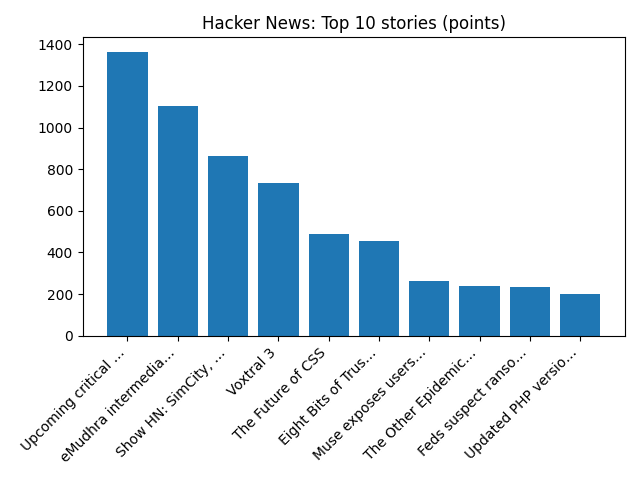

# Daily Knowledge Garden — 2026-10-21

## 🧭 Daily Summary
Global coverage includes Drilling approved at controversial Jackdaw gas field in North Sea; Websites taken down across Europe ahead of critical cyber-security update; Peek into hidden worlds revealed by the 2026 Nikon Small World contest. Local coverage includes The Connection Newspapers 2026 Voter Guide House 8 - Connection Newspapers; Salute local veterans from across Northern Virginia | Headlines - InsideNoVa.com.

## 🌍 Global News (cross-source)
- [Drilling approved at controversial Jackdaw gas field in North Sea](https://www.bbc.co.uk/news/articles/cy4zdgk081eo?at_medium=RSS&at_campaign=rss) — BBC — Science
- [Websites taken down across Europe ahead of critical cyber-security update](https://www.bbc.co.uk/news/articles/cmly0lg3w5x2o?at_medium=RSS&at_campaign=rss) — BBC — Tech
- [Peek into hidden worlds revealed by the 2026 Nikon Small World contest](https://www.sciencenews.org/article/nikon-small-world-contest-2026-photos) — ScienceNews
- [End of an era? How the Hermes Birkin bag is losing its scarcity appeal - Reuters](https://news.google.com/rss/articles/CBMiwAFBVV95cUxOUkV0VkJwLW56SEZOb1R0N0xhSXJmcGtRRkZhOUk3dTdWQlB4NjFVVU1vak9vYXFnTDduRXlJdmMyRUtpMHp2Mm1MbXVRdlFUVG5ydk1NZ3IxTU1acTRmRUtLOHc4ZW91RGFUYzdTbGdabmt2WGlsWGg4MGFvSWJVRlMzdlF3MXpxY3YtcmlmbDdqV1dXNjdtaG9KVHphdnprelNmZmpVU1JUSm84ck9rdHFxcWlTM3FsazFpQmN6NGU?oc=5) — Reuters — Business (Google News)
- [Government websites go dark as vulnerabilities in programming language send shudder across internet - Reuters](https://news.google.com/rss/articles/CBMixAFBVV95cUxNemhoUnNZdUg4Sk9JMjJQU25mTUZSX2lHc1JTNTFpNGlTcWxRRDctcFNCcVZiTUhYQ211YnNjSnRvYTYyS29VNFFKcHE4VGFMcHMxTGNwa3NmVUFNamNnektGaU9BbURibzdIY2hHUlpMbEwtNWhrOG9BenJvYkllVnNfakVVRU5yRzRjdDBjQXc2OEwtS1RwZVZhaWhoRWtlalVmU0xOQm5SbmUyeGVGeGgzUkE2XzRtbFBKdTJnUTJoRWdV?oc=5) — Reuters — World (Google News)

## 🏙️ Local News
- [The Connection Newspapers 2026 Voter Guide House 8 - Connection Newspapers](https://news.google.com/rss/articles/CBMiqAFBVV95cUxPY216QnB6TmFpMWtKUG5yeXlyUFZNbFE3RjlDRXlvQ2VrZVk3Wlk5WUdiMU5pOWxsaFdXOEwtZkJXYmZ1WnVfZm5nQjByUldySmVxSy1pZnVSRmszUTNnSURNQUtGdEhFRGg4dlFTdWVzdDgweTJCX2xOWFVYS3V4VnBudTRKdWM2U2NmMzNncm14LWFtNEQ0SnZ6dUwzNzAwMlVYOFUtZXo?oc=5) — Google News — Northern Virginia
- [Salute local veterans from across Northern Virginia | Headlines - InsideNoVa.com](https://news.google.com/rss/articles/CBMi2gFBVV95cUxQQVdaWjNjZW5BajVuYmVsQW1kZFVReDZUdDdBOFplT3d4OFV5NUctVm8zRXhBWnNrWS1SWlM0NmExdG1RUUtVeW1fZTQzM2xpVGdBZVhVQVVmSUkxMkd1LXZqMkpPaGV6RWptRWhqY083dmlucWgyNXRLWTV0enMxazVKRkI0Z2dldk8zZ1VOeEFqTVpCb2p5OHVFXzczNkgtNFhaY1Rwb0hEZ2cyTjE5VDQ4UjA5TER0N3VpbUVuNHh4VzdfeFFrSjZ1RE9heHc1RnBWeG44M2c0dw?oc=5) — Google News — Northern Virginia
- [‘We're talking about people's right to privacy': Fairfax Co. debates Flock cameras - NBC4 Washington](https://news.google.com/rss/articles/CBMitAFBVV95cUxPeWRqOHlWYUJLZzJidXRMNF9FdXdMR1l4QnhaTVgtUXd4UDI0bEpFTU5UcldKNWJueGp6b3pHOU5ndUVTd0hDLXM5QzU0SU9Cb3RjMmZEeTFLNmVFUlJaRXVuSzljVkZuMk9ObVVZQTZvN1ZTX2tmYjBwUnNnbDlxMmFnNmNGN1FsdUNGRzVud2t3T0E0a0Z3bTZBNHE4SWo3S1VEX2E3d0lvMzZpZWpFbU9WVGXSAbwBQVVfeXFMTUdYV09ablR3LXpBZ1ZmdUJ0MU5IelIyU04wd3RmZzZEN2dNbEpydG9yN2h6UGlqZi1SeC14SnIwSmtOSUV0YzhfeUdLc2JNOW1CRk5MSE9lZ2MwOGFSWHJmWlJrR0NBSkNaVzlfa0VnLWgxSHlqdzRwbkFpZ0taSWRoblJFOTYwQ0xQalZWa2dmOFBsN0lMdllNMHpnb1VWQTExcDZwZnBqUF93VXY1S2JiV2Vsay04cS0zcjY?oc=5) — Google News — Northern Virginia
- [John C. Flood: 120 Years of Keeping Northern Virginia Homes Running - TysonsToday](https://news.google.com/rss/articles/CBMimwFBVV95cUxQOFNoMThqQXVVYXFFbzdGeHVDeXU0ZEJFVWlLdGRpdlRjY3h4cHc0cklmdjkxTkVFYWxtcFJXZTJxZkFJdmR0QTdnSXV6Z2dSVmJBWTJsUElxUl9mN05reFIzelAyVHhDMHVQSExYNnQxaDczdnA1MTJZVlZqajgtWEhkMlBDaXRVbzVBWnVLbmZzOG5NRUN3RE9Xbw?oc=5) — Google News — Northern Virginia
- [Ask Eli: Three charts highlight our current real estate market - ARLnow](https://news.google.com/rss/articles/CBMiowFBVV95cUxOYUxyNWNOUkdXQ2xYTThyRnJhaFVYby0zcTZOaGhRblY0NGhsbEFkeVpGY3NTcmV6aE1DRHdkSHhOWkZTdDVLUWxRLTFwNW1zUkczekpYUkM3V0Y4QmZVUmJjNUpPMmFYWkV4dzJXUzZ0VVpDRjB2blE5NTNkRExQTXAzcXgyaE1UaFBrSDNJTUt4aXcwTWFheWdLTEFTR0xPaEhN?oc=5) — Google News — Northern Virginia

## 🚀 Hacker News (Top 5)
- [Upcoming critical PHP security release (CVE-2026-109618 / -109619)](https://news-web.php.net/php.announce/509) — 1365 points, 573 comments
- [eMudhra intermediate CA compromise](https://emudhra.we-have-a-problem.com/) — 1104 points, 424 comments
- [Show HN: SimCity, but with Permits](https://permit.petercai.com/) — 861 points, 392 comments
- [Voxtral 3](https://mistral.ai/news/voxtral-3/) — 732 points, 182 comments
- [The Future of CSS](https://www.joshwcomeau.com/css/interop-2027/) — 489 points, 205 comments

## 🌍 Wikipedia — On This Day (selected)
- **2021** — A shooting occurs on the set of the film Rust, in which actor Alec Baldwin discharged a prop weapon which had been loaded, killing the director of photography, Halyna Hutchins, and injuring director Joel Souza.
- **2019** — Thirty people are killed in a fiery bus crash in western Democratic Republic of the Congo.
- **2019** — In Canada, the 2019 Canadian federal election ends, resulting in incumbent Prime Minister Justin Trudeau remaining in office, albeit with the Liberal Party in a minority government.
- **2018** — A passenger train derails in Yilan County, Taiwan, killing 18 people and injuring 187.
- **2011** — Iraq War: President Barack Obama announces that the withdrawal of United States troops from Iraq will be complete by the end of the year.

## 🎲 Wikipedia — Random Article
**Ma-V-Elle**  
Ma-V-Elle is a three-piece New Zealand girl group best known for their top-40 singles in the New Zealand charts in the mid 1990s. The group consists of Lavina Williams, Marina Davis and Maybelle Galuvao.
https://en.wikipedia.org/wiki/Ma-V-Elle

## 🌌 NASA APOD
[New Ghosts Revealed in Cassiopeia](https://science.nasa.gov/image-article/apod-2026-october-21-new-ghosts-revealed-in-cassiopeia/)

## Feed Health
- **Reuters — Headlines (Google News)**: ok (15 articles)
- **Reuters — World (Google News)**: ok (15 articles)
- **Reuters — Business (Google News)**: ok (15 articles)
- **BBC — World**: ok (15 articles)
- **BBC — Tech**: ok (15 articles)
- **BBC — Business**: ok (15 articles)
- **BBC — Science**: ok (15 articles)
- **AP — Headlines (Google News)**: ok (15 articles)
- **AP — Politics (Google News)**: ok (15 articles)
- **AP — Business (Google News)**: ok (15 articles)
- **NPR — Top Stories**: ok (10 articles)
- **NPR — Politics**: ok (10 articles)
- **NPR — Business**: ok (10 articles)
- **NPR — Science**: ok (10 articles)
- **NPR — Technology**: ok (10 articles)
- **ScienceNews**: ok (15 articles)
- **ScienceDaily — Top**: ok (15 articles)
- **Nature — Technology**: ok (15 articles)
- **Google News — Northern Virginia**: ok (15 articles)
- **Google News — Northern Virginia traffic**: ok (15 articles)
- **Google News — Northern Virginia weather**: ok (15 articles)
- **Wikipedia — On This Day**: ok (10 articles)
- **Wikipedia — Random**: ok (1 articles)
- **NASA — APOD**: ok (1 articles)

Runs so far today: 1
