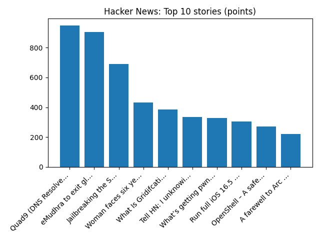

# Daily Knowledge Garden — 2026-10-22

## 🧭 Daily Summary
Global coverage includes Appeals court lifts block on Mississippi's DEI ban, ejects judge over AI errors - Reuters; Trump says wind turbine imports threaten national security - Reuters; Firefighters and public 'knowingly put at risk' during summer wildfires. Local coverage includes Amazon explains shift in position on future data center developments in Northern Va. - WTOP News; Real estate giant Akelius offloads three N. Virginia apartment buildings for more than $230M - The Business Journals.

## 🌍 Global News (cross-source)
- [Appeals court lifts block on Mississippi's DEI ban, ejects judge over AI errors - Reuters](https://news.google.com/rss/articles/CBMixgFBVV95cUxNTXU4UEVFNmN1Z1hTZW5oWUhXVXRSWDMyM2JVa1FPUEN2OGFqWEdydi1zbElVb3ZsNGo3Z0RZLUU0bG94emsxTzl3RTV3bG1zUEVmckd1aTZ2MmVjY3V3dWdtR1lWSWxlT2NwR3ROTFFnNlFianNZMS1GdHUxR3BCYTJSQlBnUk9KcEVJNXlOSF9iWjZrR0RvU1lkOWNVa3RjWUREZ1lMTkFsMUFkVmJuN3JEWFRwcE1zbHNqX3BEZU9GQkF1elE?oc=5) — Reuters — Headlines (Google News)
- [Trump says wind turbine imports threaten national security - Reuters](https://news.google.com/rss/articles/CBMisAFBVV95cUxQbXBnbGtXTC1kdE85WW5oRjI1dW9WU1d6RGdZLXoyRS12V0l0NXZyT21Rcnk5eERXeDhacVlpSWRDNVc2VlhoOUJyWWFvOVV3ck5oeU45eXZHQVpCaklMLTh4QXJkcXVWX192VUQ3QmNEa2VyMVdWNUtTaGlYdm1qb3pNRGtDazdsdjFQb3lISUNBNDNEWkJjUkFhLXJXcGpjWndUaVJLaDJFaHRIQk9KZQ?oc=5) — Reuters — Headlines (Google News)
- [Firefighters and public 'knowingly put at risk' during summer wildfires](https://www.bbc.co.uk/news/articles/cqvgjk3j0j9wo?at_medium=RSS&at_campaign=rss) — BBC — Science
- [Zuckerberg wins Meta deal to help him foot bill for possible California billionaire tax](https://www.bbc.co.uk/news/articles/cky83vwnyglno?at_medium=RSS&at_campaign=rss) — BBC — World
- [Powerful Democratic Virginia state Sen. Lucas is accused of leading a marijuana criminal conspiracy - AP News](https://news.google.com/rss/articles/CBMirAFBVV95cUxQWV9EN19IUDB3X3ROUy1MNUhvTnh1cUdDMHJQeWhhLVBWTnpiNXhSQkV6a24xdWF5SXVmN184c3UwZFVzc3pOMWpOb25PZkZFbzY4LThoamJBSXJZRFBnR0hUWFBBMk5pOTUzLVFkc3BDcFhUVS1JcHROdmUtN0Q4RFh3cDVPNjRFNHM5WHFUYkZzdE9jTWt0ZW5KMTY5MXRpVms1cDluQ3Y2b19j?oc=5) — AP — Headlines (Google News)

## 🏙️ Local News
- [Amazon explains shift in position on future data center developments in Northern Va. - WTOP News](https://news.google.com/rss/articles/CBMiugFBVV95cUxNUFVTNjFvajRTWnZHOThIR010dzNxek1LZllJTFFVc3RsZTk3ek1GY3NXaml4YzRMQS1fMm5EUXhrbmJJd2FGMmFDWklrcy02LW8tNDlMX080ZWs3XzUyYzhnN1pPaDFpNTNHbjcyclN5a2RIZzU5M3Uzbzh2TUpld3B2RlNzY2hJaUZsUnJUampabVpHZTl5bHJPSDVZSEpTUU0zTHBMZkRYYXk2TndQMjM3VjI2Ui1WcGc?oc=5) — Google News — Northern Virginia
- [Real estate giant Akelius offloads three N. Virginia apartment buildings for more than $230M - The Business Journals](https://news.google.com/rss/articles/CBMikAFBVV95cUxPRlM1ZktUMTB3SUFMRzNBYmlyVEh0MU1qWVI4VVNfa3U2UXlleVp5anFaTERCMlJZS1YtTGw4VVh1U092MmJGZjBlNThsWnh6TUpSMUp6TGNzaFFSdDJRM3ZyLTRqRTd3alNtdHBnbmsxZC1fTERmYkJhR2w5eEVnLUxpVUFteXcwaDR4STc5MDc?oc=5) — Google News — Northern Virginia
- [Investing in the Future of Jewish Northern Virginia: Meet Federation’s Third Leadership Cohort - Jewish Federation of Greater Washington](https://news.google.com/rss/articles/CBMiugFBVV95cUxQZlh6ZnBlR3JMNnM3X3RkZThzX3pBMGFlZ3h6R3EwUU1NSDNuVkpmdlNteDRJbmhxdmhtVVZjZFJNZktucW51RndoRmJjRHpCcGRwZGFZeU1MalR0V2dodXVJNVVtemgzd2xDUEk0Nk9sZ3VVeUVkdkdxR0FaeTFib3A1dGpHd1FjS2RtM0J3RFBYMGhyc2RZMUtWYXd4ZGUyNUNhQnVmaEhEX21KRGhLMElVLTgwZXkzdHc?oc=5) — Google News — Northern Virginia
- [Reston Couple, Inova Honored by Community Foundation for Northern Virginia - Northern Virginia Magazine](https://news.google.com/rss/articles/CBMivwFBVV95cUxQa0ZOd3d1MFdLTG1EMHBuRUFLS2pnMFkwYVJYUk52ZVFrcG4wVXdmeGF4dlMzcnEzRmdaMUxza2txc2JZbEJuTklndkJuV1JYR3JmUkwyNmFoUDJienhSdWRmMWpIbWU0YkhBdW5qWmFNYkFFdWktQXlZUDRqLVR4VXM5dlFTaTl5VFA4SlVtejY4TUhVT1U5Y3dqWDNnYmJLYlNGNmMwbVF0Yk1nbWNCdTlMVmxYcWFicWF3MmRXYw?oc=5) — Google News — Northern Virginia
- [Amazon cancels plan for data centers in Loudoun County, donates land - The Washington Post](https://news.google.com/rss/articles/CBMivgFBVV95cUxNXzBsaFpHTHYtSTd1RWVXS0pPSHB6amo2NUhOWkNNUHlTMlRJTTR5aUhKSGRKZm1JcjFkSWdwbWlmYy1vTlBfb0hwS1NVSlFhZFhURU1LQ0Y0dC1PeWNMZFdQYWNFYzQyWmRrR0txNFRjbHFvOHllc0RiVzJWdFF0X2ZZcVBISU5OWmNIdEFwUzlWOWlqdlV5YjBCdW40cHBoYUNGbmY3OGdiWUd5dWtSSGVRT3lzVFVvZ1ZsR3FB?oc=5) — Google News — Northern Virginia

## 🚀 Hacker News (Top 5)
- [Compromised LiteLLM 1.107.0 on PyPI Installs a Credential Stealer and Backdoor](https://safedep.io/litellm-pypi-compromise-credential-stealer-backdoor/) — 562 points, 183 comments
- [Security Disclosure](https://blog.railway.com/p/security-disclosure-wednesday-october-21st) — 531 points, 305 comments
- [Claude Duet](https://claude.com/product/claude-duet) — 470 points, 439 comments
- [No more icons in every menu by default](https://blog.jim-nielsen.com/2026/icons-in-every-menu/) — 397 points, 229 comments
- [PingCap TiDB Leaks](https://fulcrumsec.vg/pingcap/) — 390 points, 66 comments

## 🌍 Wikipedia — On This Day (selected)
- **2019** — Same-sex marriage is legalised, and abortion is decriminalised in Northern Ireland as a result of the Northern Ireland Assembly not being restored.
- **2015** — Anton Lundin Pettersson attacks a school in Trollhättan, killing three people and injuring two others.
- **2014** — Michael Zehaf-Bibeau attacks the Parliament of Canada, killing a soldier and injuring three other people.
- **2013** — The Australian Capital Territory becomes the first Australian jurisdiction to legalize same-sex marriage with the Marriage Equality (Same Sex) Act 2013.
- **2012** — Cyclist Lance Armstrong is formally stripped of his seven Tour de France titles after being charged for doping.

## 🎲 Wikipedia — Random Article
**J. Y. T. Greig**  
He was born in Manchuria where his father was a Presbyterian missionary. His 1931 biography of Hume won the James Tait Black Award, and he also edited Hume's letters.
https://en.wikipedia.org/wiki/J._Y._T._Greig

## 🌌 NASA APOD
[The First Green Star, WD J1330+6435](https://science.nasa.gov/image-article/apod-2026-october-22-the-first-green-star-wd-j13306435/)

## Feed Health
- **Reuters — Headlines (Google News)**: ok (15 articles)
- **Reuters — World (Google News)**: ok (15 articles)
- **Reuters — Business (Google News)**: ok (15 articles)
- **BBC — World**: ok (15 articles)
- **BBC — Tech**: ok (15 articles)
- **BBC — Business**: ok (15 articles)
- **BBC — Science**: ok (15 articles)
- **AP — Headlines (Google News)**: ok (15 articles)
- **AP — Politics (Google News)**: ok (15 articles)
- **AP — Business (Google News)**: ok (15 articles)
- **NPR — Top Stories**: ok (10 articles)
- **NPR — Politics**: ok (10 articles)
- **NPR — Business**: ok (10 articles)
- **NPR — Science**: ok (10 articles)
- **NPR — Technology**: ok (10 articles)
- **ScienceNews**: ok (15 articles)
- **ScienceDaily — Top**: ok (15 articles)
- **Nature — Technology**: ok (15 articles)
- **Google News — Northern Virginia**: ok (15 articles)
- **Google News — Northern Virginia traffic**: ok (15 articles)
- **Google News — Northern Virginia weather**: ok (15 articles)
- **Wikipedia — On This Day**: ok (10 articles)
- **Wikipedia — Random**: ok (1 articles)
- **NASA — APOD**: ok (1 articles)

Runs so far today: 3
