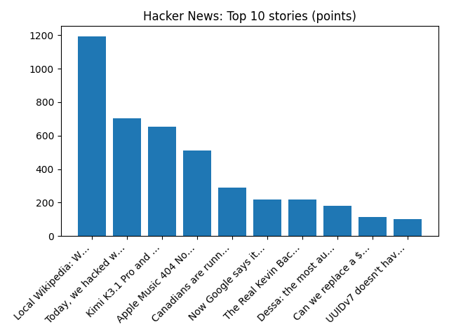

# Daily Knowledge Garden — 2026-10-23

## 🧭 Daily Summary
Global coverage includes Judge puts off decision on Charlie Kirk murder trial date, media reports - Reuters; White House lifts tariffs on some Canadian goods as midterm elections loom; Carney dismisses US accusations of Canadian election interference - Reuters. Local coverage includes Amazon backs off Northern VA data center plan months after purchase - The Real Deal; Burke Centre Parkway westbound permanent access changes at Fairfax County Parkway begin Oct. 26 - Virginia Department of Transportation (.gov).

## 🌍 Global News (cross-source)
- [Judge puts off decision on Charlie Kirk murder trial date, media reports - Reuters](https://news.google.com/rss/articles/CBMitgFBVV95cUxPNkxMbkJHNmNaaTJrTnVMblhhLTZwaE9yX1JhV1ZOYUp5Qng3QkNMUmIxXzJxaE5yRTROWko4c3JpUVE1RC1EOVdyWmZoc01mTDRBNi1OdHRZMU9FOWZRMFJLVG5sVURMOUVnZFRzc05ja29zYmlIazRWOVdPUV8zT1FmTDM2aHAxclE0bFJHQlZCVVpMbm1KNTJUaC1JanpiSFNDN2VTMUNqLTdoc1BPeHJQUHRhdw?oc=5) — Reuters — Headlines (Google News)
- [White House lifts tariffs on some Canadian goods as midterm elections loom](https://www.bbc.co.uk/news/articles/c60qk573yzz8o?at_medium=RSS&at_campaign=rss) — BBC — Business
- [Carney dismisses US accusations of Canadian election interference - Reuters](https://news.google.com/rss/articles/CBMiswFBVV95cUxOY1R2aTl5dkhkWnQ0LXBfNUN4aktLbmNJNlFJZHJYRTI5bVZLUWZfSHpxOWR5RlVOYnRmQ1RWS0RhUTl1NjRsREdzWWJzSzIxNW1TVnBmSU5tMDAzejB6VFp3YkcyOU9ZSnNPTEFkQzV2aWxIODZmcURZRjFDNDl0Tlk2SVY4cEtjZVZkc29OMXNUU3Jta0pvc3RJdjJoLTNNV2hlazZVZktIdk44RE95TlF4Yw?oc=5) — Reuters — World (Google News)
- [Storm Austen brings power cuts and travel disruption as more wind and rain forecast](https://www.bbc.co.uk/news/articles/cxj0l193y0l8o?at_medium=RSS&at_campaign=rss) — BBC — Science
- [Trump says he ordered the Justice Department’s lawsuit over Alaska’s US Senate race - AP News](https://news.google.com/rss/articles/CBMitAFBVV95cUxNY2lwdVh1SXlFeWVFaFRvNGN6a0dUaVV1b0diS0ZvaXhmYWJRR3JVYmRudTdhRmg0V18wYVVvenVWaUJJLTRBRkFkZXhIbEdYcHFGOXZiQ1JUMGRadHRMclMxdG9GTE5rTnBlVVoxbUdNM3VuZ0pkN2REZ2hKYWxVcDNubW9ESVMyQmVtS3doVUNLRTk4a1ZBT1hKTVNoT1Qta2U4V28tMW9KaTdpcUI3bDhPYjk?oc=5) — AP — Headlines (Google News)

## 🏙️ Local News
- [Amazon backs off Northern VA data center plan months after purchase - The Real Deal](https://news.google.com/rss/articles/CBMipwFBVV95cUxONU1oNFlFbGQ0Rk5aTGZXWmo1c2xQa1dPU3U5MEZ1TnBhVU1ObHJZeE1Bd0hBN0dtVGdpMEc5czFjQUZlSU95a3FkNkJNREN4TWY0YzBHd3N6RXJ2UVgxR3ZzSTFKdGZPWWZlR29SRTdFQTllRTBUSzRLNktRMWtkeFJGSWJFcWR6V00zdFM2V3J1azhZUG9XaW5ydGsyX0FxdXVFVTRTZw?oc=5) — Google News — Northern Virginia
- [Burke Centre Parkway westbound permanent access changes at Fairfax County Parkway begin Oct. 26 - Virginia Department of Transportation (.gov)](https://news.google.com/rss/articles/CBMi_AFBVV95cUxPTm5CY05ZZjBYQVJxQWNUeDdOTlA4U1VrY2IxWEdTXzhLeHdXZ0hWMy0taGlTSzdwTGx5emFCWHBocjNCaXprbTVhcHItQlRPNFBRcDJ2WnBkNjlOR0FxWGk0cDl4OENhaW5keXdNYWNGRV92S3NRUThndHUyZHM5ZlIwYllUbUlBdnFDT3k5bDNZMldQeXZzdXVyUlBaODZiUkdRdk1WM09tME85QTBxYlYwbFExTTk1aU04aXp4S1BIUTMyM0dFLXRlV1U5S2xhaUplZTJ1VmZpZFpYbUF6dFRiczFhRGg1V1RmRkxfdXdBaEk0REg5a1c2c24?oc=5) — Google News — Northern Virginia
- [Drought update: Over for us, for now, with dry weather in the forecast - Augusta Free Press](https://news.google.com/rss/articles/CBMipAFBVV95cUxNU3VQc2hDYUdDUjdFbFhxbV9CVmNmYmhsRFZnVURubEdBOXhYTk9HOUpMMGJxWXVnMG8yZEZnbHJPTlZ3cjVoQ2ZvZGhzcmFoS2hzUXFXdThQbi0xemNObTFadXlFYU5CSEJyZU1YeG13LTlObVVqV3F3a0w5QW1acHB3WHhzUUZSRkNOM1FMWTlEMFBjU1RWS2FraTdwOXRRdU9UeQ?oc=5) — Google News — Northern Virginia weather
- [2 Fairfax City Restaurants Rank Among Northern Virginia's Top 10: Report - Patch](https://news.google.com/rss/articles/CBMirwFBVV95cUxNQjBuS0lkOS1nUlcwbVJtVVZ0UTZRR29FSGRKWjFlZVdoXzZKUVJXTnhLYUZyeFM3a3Q3U3VMR0JmYklnRF9GNWV3WW5oZWJjQnVjOTNWdndOUDNJN3hBem9lTHhmZTZPVlVVTENZMGY3TzMwLWVtek1wT3lNUS1xcDNLd0htU0xfQVRaZ0JVN3VhcVFEc2s3TVl2eFVMdXJPa2VORy1nV0E5V0tOVnNr0gHAAUFVX3lxTE1iMkJuQkRrZzVkeXhDQjgtZVN6MTlfdmswX2I1SkE0S2U0STk1NkI3SkJEZ2JibUZuT29zSzdkNE9XeTFoemFEUEp1aFNudjU5YXFTTTRqRFVMZEI1M2x4NzhiaGFTWHl0aDdPaDA4a2hOWGhvaFRuemY1VFUwMTZ5MVlmcGYyUG02QUZPQnJ1YTkzRC1OZHYzUnllSmMzV3Z4b1Z1TWlRYm5iYjVaZE1oa3N3MFVuUkg1Znp2UjcwXw?oc=5) — Google News — Northern Virginia
- [Washington Manassas Airport Breaks Ground on New Air Traffic Control Tower - Northern Virginia Magazine](https://news.google.com/rss/articles/CBMiwAFBVV95cUxPQVRybHJMUF9IUnJqMVlqQ2FfREc2VzJmTi1sdGtqZmVBS0dSN2EtNldsaEpRUEswd0JUeHJBeWFwRDFZeW0wV3ZEUmJORG1oaHVhLW1WSkpZSDBHb3lDVEJVV2piczYzOU91UERxSi1BYjdTbFp1TmhPUDN1Q3J4c2c4TS1hYWpnZ1ZTbHR3c183QktWVmRSVUJyN0lHcHR0X1UyQkp1MTlLUXR4bzdmWkwtbEdfRTZ1OFU3OEpEZ3I?oc=5) — Google News — Northern Virginia traffic

## 🚀 Hacker News (Top 5)
- [Quad9 to exit France](https://quad9.net/news/blog/au-revoir-france/) — 1282 points, 439 comments
- [Local Wikipedia: Wikipedia, but only for things a half hour walk from you](https://edjefferson.com/localwiki/) — 707 points, 147 comments
- [Tell HN: I unknowingly broke the PHP RCE embargo. I am sorry.](https://news.ycombinator.com/item?id=50193416) — 635 points, 236 comments
- [Docker is weird](https://codeandcake.dev/posts/2026-10-22-docker-is-weird) — 629 points, 264 comments
- [WorldTUI: I trained a 360M model to pretend to be a terminal](https://simedw.com/2026/10/21/world-model-terminal/) — 570 points, 176 comments

## 🌍 Wikipedia — On This Day (selected)
- **2022** — Xi Jinping is elected as General Secretary of the Chinese Communist Party by the Central Committee, beginning a third term of the paramount leader of China.
- **2022** — Myanmar Air Force airstrikes a concert in Hpakant Township, Kachin state killing at least 80 people, including senior Kachin Independence Organisation officials, in the Hpakant massacre.
- **2020** — Second Libyan Civil War: The Second Libyan Civil War comes to an end as all parties to the 5+5 Joint Libyan Military Commission agree to a ceasefire.
- **2017** — War against the Islamic State: Philippine defense secretary Delfin Lorenzana declares the end of the Siege of Marawi.
- **2015** — The lowest sea-level pressure in the Western Hemisphere, and the highest reliably-measured non-tornadic sustained winds, are recorded in Hurricane Patricia, which strikes Mexico hours later, killing at least 13 and causing over $280 million in damages.

## 🎲 Wikipedia — Random Article
**List of New Zealand Liberal Party MPs**  
The following is a list of members of the New Zealand Liberal Party who served in the New Zealand House of Representatives. From 1922 onwards the Liberal party received several cosmetic name changes; Progressive Liberal Labour Party (1922), "National" Party (1925) and finally United Party (1928).
https://en.wikipedia.org/wiki/List_of_New_Zealand_Liberal_Party_MPs

## 🌌 NASA APOD
[Andromeda in Southern Spring](https://science.nasa.gov/image-article/apod-2026-october-23-andromeda-in-southern-spring/)

## Feed Health
- **Reuters — Headlines (Google News)**: ok (15 articles)
- **Reuters — World (Google News)**: ok (15 articles)
- **Reuters — Business (Google News)**: ok (15 articles)
- **BBC — World**: ok (15 articles)
- **BBC — Tech**: ok (15 articles)
- **BBC — Business**: ok (15 articles)
- **BBC — Science**: ok (15 articles)
- **AP — Headlines (Google News)**: ok (15 articles)
- **AP — Politics (Google News)**: ok (15 articles)
- **AP — Business (Google News)**: ok (15 articles)
- **NPR — Top Stories**: ok (10 articles)
- **NPR — Politics**: ok (10 articles)
- **NPR — Business**: ok (10 articles)
- **NPR — Science**: ok (10 articles)
- **NPR — Technology**: ok (10 articles)
- **ScienceNews**: ok (15 articles)
- **ScienceDaily — Top**: ok (15 articles)
- **Nature — Technology**: ok (15 articles)
- **Google News — Northern Virginia**: ok (15 articles)
- **Google News — Northern Virginia traffic**: ok (15 articles)
- **Google News — Northern Virginia weather**: ok (15 articles)
- **Wikipedia — On This Day**: ok (10 articles)
- **Wikipedia — Random**: ok (1 articles)
- **NASA — APOD**: ok (1 articles)

Runs so far today: 3
