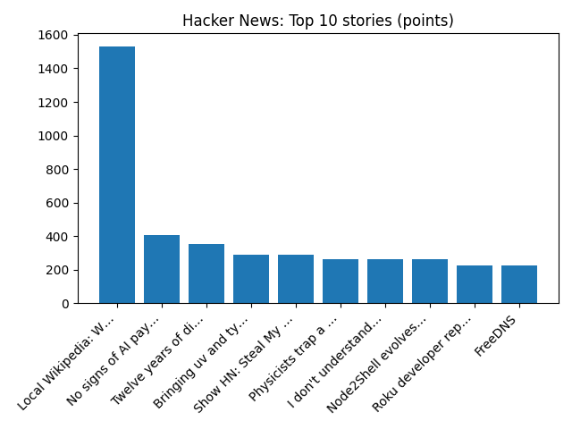

# Daily Knowledge Garden — 2026-10-24

## 🧭 Daily Summary
Global coverage includes Archdiocese of New York agrees to $800 million settlement over sexual abuse claims; Trains cancelled and road warnings as Storm Boelo sweeps into Scotland; Trump administration demands county election officials identify noncitizen voters in California - Reuters. Local coverage includes The Burn celebrates 10th anniversary with books for kids fundraiser - The Burn; ~$!【LIVE@STREAMs】 Northern Virginia HomeSchool vs Harvest Covenant 𝐋𝐈𝐕𝐄 ＯＮ Ｔｖ Ｃｈａｎｎｅｌ 23 October 2026 - FC東京オフィシャルホームページ.

## 🌍 Global News (cross-source)
- [Archdiocese of New York agrees to $800 million settlement over sexual abuse claims](https://www.npr.org/2026/10/24/nx-s1-6015522/new-york-archdiocese-settlement-agreement) — NPR — Top Stories
- [Trains cancelled and road warnings as Storm Boelo sweeps into Scotland](https://www.bbc.co.uk/news/articles/c60qk5lw1z8wo?at_medium=RSS&at_campaign=rss) — BBC — Science
- [Trump administration demands county election officials identify noncitizen voters in California - Reuters](https://news.google.com/rss/articles/CBMixgFBVV95cUxQMmlFSUIxOVVNeTdTRWJLSGVWYUQzS3FGNEk4SVU2dmM5aS1MZThUYUc5cG85WXFnd2V6bDBFOF9zd09EREduV2lGbWJTTUhURER2R3RISWxWT3pvSWhRTVNHcFRtTUFRX0E2OU1QQjdHS2hBZ1ZnZzRYLXFLdTZTX2w2dUFQRGRZVDh1aHJuSkxSQzliZ2pqaWQ2blpEdXp5b0sxUlQyTHpPZVFGOVpQdkRmMHhtS1BiUDhYei14V04zX2s2OHc?oc=5) — Reuters — Headlines (Google News)
- [Trump set to announce plan by Audi to build US factory in Georgia, source says - Reuters](https://news.google.com/rss/articles/CBMizwFBVV95cUxOZGx3Y2FFQnJqWm4xQzIyem5aQXhBRWU1UkwyblYyU1BTQmR5TllmeUF6aGpDYjNQZmJNZlRWZXRzTDg5dlZYUGNXalE1ajdLUzc4blptZWJVaWdqYUFWcjViR1gxazBrSXp6bHFScVBRV3hQNEpLbi1fRm1CTGlPNUMtMDJTS0gyN3lzU2lrTDZhQjFoaWZtMXQxUThHV19oNmxzTFFGNnRlMlEyb3JQeDF6dm16bE5odlEzcGZ6THBEUDVEelktZmhHV2ZSM28?oc=5) — Reuters — Headlines (Google News)
- [Trade tariffs cause whiplash at Port Milwaukee](https://www.npr.org/2026/10/24/nx-s1-6011193/trade-tariffs-cause-whiplash-at-port-milwaukee) — NPR — Top Stories

## 🏙️ Local News
- [The Burn celebrates 10th anniversary with books for kids fundraiser - The Burn](https://news.google.com/rss/articles/CBMiowFBVV95cUxOS05RMXNkR3lOVTQya2dYM0VZdjZlbUI5Y0J1eWxJeVRNbXI0Nm5ObUVuVkgtR0pocnJCM2tDWmZMWlA2TnQ0YmluRjlUeDRzOWNsSkl3ZUEtV1Z3SElBQU91M1NIU3J2UE9GcmFnLUlQUHd6aEVoOGNvYzNyTDVYQUdBSFlKZWVDUDh5SXd6cnBXbUczZERKZ3lTXzdRQl9mZGkw?oc=5) — Google News — Northern Virginia
- [~$!【LIVE@STREAMs】 Northern Virginia HomeSchool vs Harvest Covenant 𝐋𝐈𝐕𝐄 ＯＮ Ｔｖ Ｃｈａｎｎｅｌ 23 October 2026 - FC東京オフィシャルホームページ](https://news.google.com/rss/articles/CBMi0AJBVV95cUxOZEFOd2J5SEx1aTRvSVhqRGpZTWVLRjcyTTNuclF4dndTVEdfNE1KSDhtYWVXWk5wbEwzLVBHWmdWQUtmMER1R19HNnJfTWh1T24yWWI2M0ItazhJUllhMkNqQnQtQi1uUW1xTEt3bFFjQ2o3eGNKbV84V2NkVGx2VnNnS0RKUWo4RG16ZUpSUG1PbS1aVmt6QThZSHE4ZWJ2UDZpWHppdWZfQncyY0FMZEZGYWItd1pQMDJzLVdKWG9LTkY4N1JPY1lpZk83SW1aMjV3dV9QREpZNlRhdjI4Z1JBQTVKZ3pzWWtUZDBPaHdvaElNSEJuTTF4OEQtc0pUVzJVZW9mQnY4OWFnUVgwd2lNZF82ODAwUTV3eXRIcjktNWw5NURiOXVONkJiUFk1SnZSRzRxNjJvLTY0MTljSmozZXVfTlZIX1VRaEJZY0k?oc=5) — Google News — Northern Virginia
- [Infantino says he's supported by 'vast, vast majority' of soccer ahead of FIFA elections - The Northern Virginia Daily](https://news.google.com/rss/articles/CBMikgJBVV95cUxQTk5fVUExeDlZTnBIdWlvQVc0UC1CVERjd2pRRDEtUW9pbllBTkFCNjltLWhaUzMxcFVpTzVZYlVvb05WU1BlSXlsOElWZ1pGUjdUcng1bktRLXRQYkhEa1R4bTRXbklNcEYzeWFfYlhXcV9UVjU0eGV5X2h1dzVZbXd4TjFaVEhnbGI0ZEQtRVpWS051UTlOOTZlN2JYSHEzb1oxZS1DZG9VQ1ZrXzJLdjBPYzlOSkZmZS1xX1Joa3lLQjVtaG5oSjJselJ4Z1hpdmNmMHV4MDNhTTlPaGktZG5FZDg3enljRFgwU3l1QTRLcFFKQXVFdmp4aUh1VUFzSU1CQ2pzVnZyaUpGLVpkb2dB?oc=5) — Google News — Northern Virginia
- [Northern Virginia high school football scores for Oct. 23 - InsideNoVa](https://news.google.com/rss/articles/CBMioAFBVV95cUxOOV9teG1CYWNuWDBpNjNqUHNoMGxOWGxUZHhzQkp2UWMwUF9yTTdJTUFXRFp3bkNkY2ltWnJrd2VZOHVabWlNS1FtSkoyYmlPS0NIaHgwbjB6NW5kd2k2V2FReDhSR2tnZWJsNFFHaHc0Z0N6dUdVUE9saGNwZXM4bUk3QklpRGRDOVllNzFqaGVlS3ZXbVpPYVl3XzdqNXdG?oc=5) — Google News — Northern Virginia
- [Viola Street multi-week closure at Rolling Road in West Springfield begins Oct. 27 - Virginia Department of Transportation (.gov)](https://news.google.com/rss/articles/CBMi6wFBVV95cUxOWGdkN05GNVUxbUNJMjk2M09OTElGYWJzLUpmV29PY1JGeXMybGtEaThJNUlib0Q5QXpJa2ZtWV9kN0NKQkRsNzVVeG1tU0NwNklTSExkck1ITkRGeE51N05XMzhDMmZKT0I4NXpFcFRSNkdoTURaVmlmNHQ1Q1c4LXlTZnhoN19GX2xpRXMtaDBCeDZnX3dtWUx1TDhFRVBJQWpOcUxvVjBwckRMVnB5Z3dkZTJYZ09nVjhaT3JZdHhNU0NXaWNDSlgyVDZvU3k2SnVnZWtlT19GVmxyLVZPWkxMb0hRNDBQQ19B?oc=5) — Google News — Northern Virginia

## 🚀 Hacker News (Top 5)
- [Local Wikipedia: Wikipedia, but only for things a half hour walk from you](https://edjefferson.com/localwiki/) — 1420 points, 237 comments
- [Kimi K3.1 Pro and K3.1 Pro Highspeed](https://www.kimi.ai/blog/kimi-k3-1-pro) — 957 points, 575 comments
- [Today, we hacked what we'd set out to hack: the iPhone](https://blog.calif.io/p/iphone) — 939 points, 608 comments
- [Apple Music 404 Not Found](https://music.apple.com/this-url-doesnt-exist) — 810 points, 243 comments
- [Canadians are running out of time to oppose Bill C-22](https://www.eff.org/deeplinks/2026/10/canadians-are-running-out-time-oppose-dangerous-c-22-surveillance-bill) — 437 points, 231 comments

## 🌍 Wikipedia — On This Day (selected)
- **2024** — A 14 year old resident from Bosanska Krupa, Bosnia and Herzegovina initiated a terrorist attack on the local police station, killing one police officer and injuring another.
- **2018** — The world's longest sea crossing, the Hong Kong–Zhuhai–Macau Bridge, opens for public traffic.
- **2016** — A French surveillance aircraft flying to Libya crashes on takeoff in Malta, killing all five people on board.
- **2016** — Three heavily armed terrorists from the Islamic State – Khorasan Province open fire on and eventually suicide bomb a police training centre in Balochistan, Pakistan, killing at least 59 cadets and injuring more than 165 others.
- **2015** — A driver deliberately crashes into the Oklahoma State Homecoming parade, killing four people and injuring 34.

## 🎲 Wikipedia — Random Article
**Ravens & Lullabies**  
Ravens & Lullabies is a studio album by Gordon Giltrap and Oliver Wakeman. Giltrap also worked with Oliver's father Rick Wakeman on the album From Brush and Stone three years prior.
https://en.wikipedia.org/wiki/Ravens_%26_Lullabies

## 🌌 NASA APOD
[Rosetta's Selfie](https://science.nasa.gov/image-article/apod-2026-october-24-rosettas-selfie/)

## Feed Health
- **Reuters — Headlines (Google News)**: ok (15 articles)
- **Reuters — World (Google News)**: ok (15 articles)
- **Reuters — Business (Google News)**: ok (15 articles)
- **BBC — World**: ok (15 articles)
- **BBC — Tech**: ok (15 articles)
- **BBC — Business**: ok (15 articles)
- **BBC — Science**: ok (15 articles)
- **AP — Headlines (Google News)**: ok (15 articles)
- **AP — Politics (Google News)**: ok (15 articles)
- **AP — Business (Google News)**: ok (15 articles)
- **NPR — Top Stories**: ok (10 articles)
- **NPR — Politics**: ok (10 articles)
- **NPR — Business**: ok (10 articles)
- **NPR — Science**: ok (10 articles)
- **NPR — Technology**: ok (10 articles)
- **ScienceNews**: ok (15 articles)
- **ScienceDaily — Top**: ok (15 articles)
- **Nature — Technology**: ok (15 articles)
- **Google News — Northern Virginia**: ok (15 articles)
- **Google News — Northern Virginia traffic**: ok (15 articles)
- **Google News — Northern Virginia weather**: ok (15 articles)
- **Wikipedia — On This Day**: ok (10 articles)
- **Wikipedia — Random**: ok (1 articles)
- **NASA — APOD**: ok (1 articles)

Runs so far today: 3
