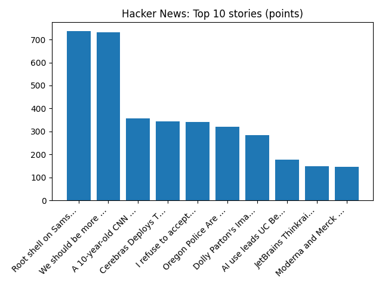

# Daily Knowledge Garden — 2026-10-25

## 🧭 Daily Summary
Global coverage includes Serbia's veteran ruler Vučić concedes election to student-led protest movement; Serbia’s strongman leader Vucic concedes defeat to student-led movement in seismic political shift - AP News; Trump invokes 9/11 in urging Michigan voters to oppose Muslim Senate candidate El-Sayed - Reuters. Local coverage includes Kyle King, Kaylee Slade win 2026 Marine Corps Marathon - NBC4 Washington; The Burn celebrates 10th anniversary with books for kids fundraiser - The Burn.

## 🌍 Global News (cross-source)
- [Serbia's veteran ruler Vučić concedes election to student-led protest movement](https://www.bbc.co.uk/news/articles/cw5yn3xlprpmo?at_medium=RSS&at_campaign=rss) — BBC — World
- [Serbia’s strongman leader Vucic concedes defeat to student-led movement in seismic political shift - AP News](https://news.google.com/rss/articles/CBMilAFBVV95cUxPZV9RN2t0QWZJWXdXekhjZVNLbU9Xek1ibDZsQTVpMmszTWtzMjdpbTlCeTJEZE1SdkJobXVsWUxLT24tMlY2b1N5bWZCc3dEeDJ5MVduRUhnN3NQLUh2UXRBX0Y1ci1tanJXY1N1OWNMVkdVd1BlR0Y3UFM4eFZ1UEgtS3pXWHI5RmY2TXRlc0d6OEFQ?oc=5) — AP — Headlines (Google News)
- [Trump invokes 9/11 in urging Michigan voters to oppose Muslim Senate candidate El-Sayed - Reuters](https://news.google.com/rss/articles/CBMipgFBVV95cUxNbW50b2RKQnYxQ3pEY21lOWdDMTNwTmN6cDFsS1lKVmpWcDZ2U25TVGlELXpFMkZoOXJhU1R4WUF5NHNISmNKejJ2VnFnckRaUWlrVi04SFQxT2xOS19qQWM0ZkZsVmlpOFBjUVlNN3gxU2Y4aTRsZGtLRXZfWlVSV0xoSXd1em0xUUlfZzlIVDJGOElMdlpvVVY3ZGFDcjRGaDRQMlVR?oc=5) — Reuters — World (Google News)
- [US appeals court appears skeptical of Trump DOJ's lawsuit over California voter rolls - Reuters](https://news.google.com/rss/articles/CBMiuAFBVV95cUxPU25wRVhKZUxxMGJKMjRLWVptYXNHRVZ1UjYtM1VDUGFDOFRlSkY4eERuQm90RUV4a1R6NE1ia1FHZzItRTRVSHJOS3dvMXc4VURHTmxuMzBMWUZDOFI1SGhrVjdQMkJXM1ByRFRsNEVDUFkzX1huMWl1SEZqaWhYUERUNWxPWGlaMThLU2RjaUxUSTc4V3hRWWtyaVN3aENiSnZOMGRrZUlsQ3AtMHQ5WFVURTBrN1BW?oc=5) — Reuters — Headlines (Google News)
- [Two men killed by falling trees as Storm Boelo leaves 160,000 properties without power](https://www.bbc.co.uk/news/articles/cxdd8gr1vje0o?at_medium=RSS&at_campaign=rss) — BBC — Science

## 🏙️ Local News
- [Kyle King, Kaylee Slade win 2026 Marine Corps Marathon - NBC4 Washington](https://news.google.com/rss/articles/CBMipgFBVV95cUxOT2x3ZHNyNEVJdGl6alpxR2pyQl9xbzl2OG9ZT1BmaE5zM1BUMUxKR253VWJySE42cjFObTgzel9qUVprMTJTUGx2VUExMk1sRHJxZEJOR2duaFJKUENhMUozWGxxWmJwT09YT3FJOTYwcDFUWmNZa1VMYW9hdEhVNEJuemZta2FWWjJObTM2ak1nWEZqUno0M3dLRi03MUl1UzIyLVB30gGuAUFVX3lxTE5YU0otOTFZTHJKTmJTa0hVbXRUNVloTS15eDJ5cFZncFhrR2hxQ2V3amg2LTN5OXF6NVFhdURNTUtIWXhwR0tDMDBUZGctSlkwVHpqV0ZObHVpUEhuRTNBWGZyTlpoQWlXZzJfbUdwRUpxWEZkVUtocXVnaC1YalJhQndhUHVwZTBrVHFodzc0SUtpWGcyNFp0YzZkNzg5clp4MHI2a0kzUEdtWExZZw?oc=5) — Google News — Northern Virginia
- [The Burn celebrates 10th anniversary with books for kids fundraiser - The Burn](https://news.google.com/rss/articles/CBMiowFBVV95cUxOS05RMXNkR3lOVTQya2dYM0VZdjZlbUI5Y0J1eWxJeVRNbXI0Nm5ObUVuVkgtR0pocnJCM2tDWmZMWlA2TnQ0YmluRjlUeDRzOWNsSkl3ZUEtV1Z3SElBQU91M1NIU3J2UE9GcmFnLUlQUHd6aEVoOGNvYzNyTDVYQUdBSFlKZWVDUDh5SXd6cnBXbUczZERKZ3lTXzdRQl9mZGkw?oc=5) — Google News — Northern Virginia
- [Northern Virginia high school football scores for Oct. 23 - InsideNoVa](https://news.google.com/rss/articles/CBMioAFBVV95cUxOOV9teG1CYWNuWDBpNjNqUHNoMGxOWGxUZHhzQkp2UWMwUF9yTTdJTUFXRFp3bkNkY2ltWnJrd2VZOHVabWlNS1FtSkoyYmlPS0NIaHgwbjB6NW5kd2k2V2FReDhSR2tnZWJsNFFHaHc0Z0N6dUdVUE9saGNwZXM4bUk3QklpRGRDOVllNzFqaGVlS3ZXbVpPYVl3XzdqNXdG?oc=5) — Google News — Northern Virginia
- [Amazon backs off Northern VA data center plan months after purchase - The Real Deal](https://news.google.com/rss/articles/CBMipwFBVV95cUxONU1oNFlFbGQ0Rk5aTGZXWmo1c2xQa1dPU3U5MEZ1TnBhVU1ObHJZeE1Bd0hBN0dtVGdpMEc5czFjQUZlSU95a3FkNkJNREN4TWY0YzBHd3N6RXJ2UVgxR3ZzSTFKdGZPWWZlR29SRTdFQTllRTBUSzRLNktRMWtkeFJGSWJFcWR6V00zdFM2V3J1azhZUG9XaW5ydGsyX0FxdXVFVTRTZw?oc=5) — Google News — Northern Virginia
- [Burke Centre Parkway westbound permanent access changes at Fairfax County Parkway begin Oct. 26 - Virginia Department of Transportation (.gov)](https://news.google.com/rss/articles/CBMi_AFBVV95cUxPTm5CY05ZZjBYQVJxQWNUeDdOTlA4U1VrY2IxWEdTXzhLeHdXZ0hWMy0taGlTSzdwTGx5emFCWHBocjNCaXprbTVhcHItQlRPNFBRcDJ2WnBkNjlOR0FxWGk0cDl4OENhaW5keXdNYWNGRV92S3NRUThndHUyZHM5ZlIwYllUbUlBdnFDT3k5bDNZMldQeXZzdXVyUlBaODZiUkdRdk1WM09tME85QTBxYlYwbFExTTk1aU04aXp4S1BIUTMyM0dFLXRlV1U5S2xhaUplZTJ1VmZpZFpYbUF6dFRiczFhRGg1V1RmRkxfdXdBaEk0REg5a1c2c24?oc=5) — Google News — Northern Virginia

## 🚀 Hacker News (Top 5)
- [Local Wikipedia: Wikipedia, but only for things a half hour walk from you](https://edjefferson.com/localwiki/) — 1616 points, 251 comments
- [We should be more ambitious with the software we build](https://danluu.com/ambitious/) — 520 points, 463 comments
- [The Goose Programming Language](https://aardappel.github.io/goose/) — 462 points, 280 comments
- [America has lost 200k of jobs in media, film and the arts. How much is AI?](https://www.apricitas.io/p/ai-and-the-fall-of-the-creative-class) — 404 points, 421 comments
- [Meta Ignores Brazilian Court Order to End Bolsonaro Favoritism](https://www.panamericandispatch.org/p/meta-ignores-brazilian-court-order) — 376 points, 230 comments

## 🌍 Wikipedia — On This Day (selected)
- **2023** — A mass shooting occurs in two locations in Lewiston, Maine. 18 people are killed and 13 more injured.
- **2010** — A magnitude 7.8 earthquake strikes off Indonesia's Mentawai Islands, triggering a tsunami that kills at least 400 people.
- **2009** — The October 2009 Baghdad bombings kill 155 and wound at least 721.
- **2001** — Microsoft releases Windows XP, which becomes one of Microsoft's most successful operating systems.
- **1999** — A Learjet 35 crashes in Mina near Aberdeen, South Dakota, killing all six people on board, including PGA golfer Payne Stewart and golf course designer Bruce Borland.

## 🎲 Wikipedia — Random Article
**Back Mountain**  
The Back Mountain is a region and former census-designated place (CDP) in Luzerne County, Pennsylvania,  United States. The region has a total area of 117.59 square miles (304.6 km2).
https://en.wikipedia.org/wiki/Back_Mountain

## 🌌 NASA APOD
[Dark Matter in a Simulated Universe](https://science.nasa.gov/image-article/apod-2026-october-25-dark-matter-in-a-simulated-universe/)

## Feed Health
- **Reuters — Headlines (Google News)**: ok (15 articles)
- **Reuters — World (Google News)**: ok (15 articles)
- **Reuters — Business (Google News)**: ok (15 articles)
- **BBC — World**: ok (15 articles)
- **BBC — Tech**: ok (15 articles)
- **BBC — Business**: ok (15 articles)
- **BBC — Science**: ok (15 articles)
- **AP — Headlines (Google News)**: ok (15 articles)
- **AP — Politics (Google News)**: ok (15 articles)
- **AP — Business (Google News)**: ok (15 articles)
- **NPR — Top Stories**: ok (10 articles)
- **NPR — Politics**: ok (10 articles)
- **NPR — Business**: ok (10 articles)
- **NPR — Science**: ok (10 articles)
- **NPR — Technology**: ok (10 articles)
- **ScienceNews**: ok (15 articles)
- **ScienceDaily — Top**: ok (15 articles)
- **Nature — Technology**: ok (15 articles)
- **Google News — Northern Virginia**: ok (15 articles)
- **Google News — Northern Virginia traffic**: ok (15 articles)
- **Google News — Northern Virginia weather**: ok (15 articles)
- **Wikipedia — On This Day**: ok (10 articles)
- **Wikipedia — Random**: ok (1 articles)
- **NASA — APOD**: ok (1 articles)

Runs so far today: 3
