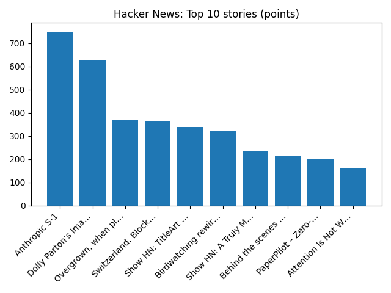

# Daily Knowledge Garden — 2026-10-26

## 🧭 Daily Summary
Global coverage includes How 'Lula's Army' WhatsApp chat helped turn Brazil election around; Serbia's new leaders face host of tough challenges - Reuters; Whatever the outcome of Israel's election, its policies toward the Palestinians will largely endure - AP News. Local coverage includes Donald Kuser Obituary (2026) - Strasburg, VA - Northern Virginia Daily - Legacy | Obituary; Nexus234 career fair to be held Thursday in Manassas - InsideNoVa.

## 🌍 Global News (cross-source)
- [How 'Lula's Army' WhatsApp chat helped turn Brazil election around](https://www.bbc.co.uk/news/articles/cwz0vg4v3ndeo?at_medium=RSS&at_campaign=rss) — BBC — World
- [Serbia's new leaders face host of tough challenges - Reuters](https://news.google.com/rss/articles/CBMikgFBVV95cUxQNTRFU0EzLUl3eFBOWEpjUDBKSmh3ZjQyd1ZIQlVlQm0wS0pRM203aEhwSXZocXowZFdzbFVlOU9iREJtbXpfMmswbjdoLTlvQmUtV1pzNHhHdENZQXRwQ1h0S2VSR3Q0REE0VFpkcUtBaUpCWWRxNEZFMGtrRTBVSThLcE9TRW03LVFDd1FRT1h6Zw?oc=5) — Reuters — Headlines (Google News)
- [Whatever the outcome of Israel's election, its policies toward the Palestinians will largely endure - AP News](https://news.google.com/rss/articles/CBMitAFBVV95cUxPYlZnTHNhMml2aGxlT2lxMk1fRjc2SEx4TUFYVHdjMmdzU1dxSUk5UnhaR2FFRU42RHhDaHRJM203aDh0WGpwYkJLSzlMVGRzV0dKb3hXTHRWcFBkREdBMmd2RGZTVjhrbGhKS3BQRWxSbWhZd003bTNTSWxMZFd5dkloNnphSG5WZk1Vc3RYYUV1TkVOVG1yTXdrTmVjUWROMEpacnRYU016VUtxSDRnc0VQRDU?oc=5) — AP — Headlines (Google News)
- [Anthropic warns of 'catastrophic risk' to humankind ahead of blockbuster share listing](https://www.bbc.co.uk/news/articles/cq398p1wd1evo?at_medium=RSS&at_campaign=rss) — BBC — World
- [Nigeria's Ebola patient on medical evacuation flight to Switzerland, condition stable - Reuters](https://news.google.com/rss/articles/CBMitwFBVV95cUxOQ2JzYTNSSkhYZVdfa2VWN092SzJLc3I1d3dWdjhtQjIzcHNFVVJYUVN0N3d4MllSZTJyTEtyYkEzeGx0TXljcDZpNkZfZlBLbXMtY0VUcHdsV2JabXlkYzlhZTZKRi03dEhqeTZYZk15SlBseW9iMHRCLU9ueFR0TVQyUWtrZHJwU0E4UVVIcGZPczVCRURkNzQyZXVCREJpRExJWjFqenVHYUFCSjlMWDREN216Y1U?oc=5) — Reuters — World (Google News)

## 🏙️ Local News
- [Donald Kuser Obituary (2026) - Strasburg, VA - Northern Virginia Daily - Legacy | Obituary](https://news.google.com/rss/articles/CBMiiwFBVV95cUxOQmFQWUplWE92SllHbmdRVEV5R3ZlSmtrM2x2TEVnNnItVW5EZWx0R0hLelMxSy1xUVV5MXBOVHNZQVNqV05sRy03TnFEbTJRakRmc29FUGlRaFJQWEd0SklIY1lsT3AzMkRjb2RMNzJIS1cycjlIM1JBZDItQnVzYWFHdmNrVTB0LWpF?oc=5) — Google News — Northern Virginia
- [Nexus234 career fair to be held Thursday in Manassas - InsideNoVa](https://news.google.com/rss/articles/CBMimgFBVV95cUxOSkNzc09nc19YT2NnajJqeVpoMjdqSTlpd2RaeFN6MDVqUWdrVTQzcWw4N2l1b2pXVl9lY25BRzJGOEtZeG4zQU5kT0VwSF8tOVlPWHgyeHdnd3hyeUgzd0hpN3pjekdjbjRxcEZNTGxRVXptakZucFdTdmNBcFBFWkZUQ1Yzajg5eFFXS0lvcng0TUV6WFdZNU9R?oc=5) — Google News — Northern Virginia
- [Northern Virginia Community College workforce training programs could be your mid-career pivot - The Business Journals](https://news.google.com/rss/articles/CBMirwFBVV95cUxQSTllR2JMbFIxMThZazdLZzgwTlhRbXBTc05ETURwdm50UGdhUEZzM2tzT2sxZFk5aEg2cFctRzMxVjdSbVh3WGw3a1JJN2x5TjNYN29FVGFsLTFwQzNxWjdyNXRMdHQ2VldqM194QVg3TGVTZ0oyakxoR3pvY3JkVG1pN2ZZSUdZN2RSeU5LQVcyR1pSSWFfTktjVUV5bEowcy12MmtFenJqOVM5RFo4?oc=5) — Google News — Northern Virginia
- [Dems sense pickup chances in Va., even after failed redistricting - FOX 5 DC](https://news.google.com/rss/articles/CBMiXkFVX3lxTFBCLUFMRFhLRXlGWktMbDFfLUVNMVY5aTJqRm0tX0R3ZWh2c3lQMy1wa2U2aW9EaVR3T0hhcVVaSld0ZFZLdnA1TDQ5LTJHdFcxdWRuWE1YTmhuOHhiblHSAWNBVV95cUxNbVhIUWlONHVTSVBlQjRTNmlzUEpra3ROdTJkbEtTaXIxNU1xeUhCYkZxbUZFeGd6cXBvN3NGOEgzaGxqNEQ4ZTZxN1hlWFJrbTMxWWJDVjlhOHpER2Z6ekw1cE0?oc=5) — Google News — Northern Virginia
- [Alexandria police investigating ICE deportation graffiti as bias incident - NBC4 Washington](https://news.google.com/rss/articles/CBMi2AFBVV95cUxQZ3E1MmVrQ3h5ckdIRXZDNnB3d0JsVmp6QzlmTG9NX2d5WExUa1pTczc2V0xhc01JekhmSy1PVDY0QXJ2YnZIMTFFTWhtTzBRVXpBcDc1bnB0cUJTbFJFeUhINzB0a3VUb0o4bXFwdnBFUHBleFZfX1g3WHlSa0lTeUprWDhBcVk2Z1lxZkg2Wi04NVRNNTVhcy1kZ0JNNmdncWVsbzBWT1lvZEQybW9nRThJNGY4NmdsMmdXUzdCSWJLTDEtWS1QYWdTVG9Ya0RGaWVTWkcyNmrSAeABQVVfeXFMTm9WaWFWZUpRY3FMTjRmLTNBN2hLUmpJQzJQSlpFcnlEMDlPVkZGeUFGOEpxc2xsWmd1YUZZemFybFY3ZFMza2RMNWFUS3FqMGpQdC00Zkh5elVLNnduYWhlQ0h5cTh2eE1iVm05Z0x1OWIxRUpuSnBNZmtyenhlcTFId1NiSVk5T3ExLV9HTUY2SXI4czN0Y294SEowTUlfLXlGRld5NmstX29EWGlUSWYwaXJZZnRRVmR5ZWFmLXJoU09PLV9PVU1WS1BraTdKNmVpMWQ3TktsWDVWcFZOYmI?oc=5) — Google News — Northern Virginia

## 🚀 Hacker News (Top 5)
- [Anthropic S-1](https://www.sec.gov/Archives/edgar/data/2130357/000162828026067168/anthropicpbc-sx1.htm) — 750 points, 683 comments
- [Dolly Parton's Imagination Library](https://imaginationlibrary.com/) — 629 points, 105 comments
- [Overgrown, when plants invade your abandoned tabs](https://charliegerard.dev/blog/overgrown-extension/) — 369 points, 124 comments
- [Switzerland. Block by block. At 1:1 scale](https://blocks.manifold3d.ch/) — 365 points, 169 comments
- [Show HN: TitleArt – Make text like it's 1997](https://titleart.dvy.io/) — 338 points, 63 comments

## 🌍 Wikipedia — On This Day (selected)
- **2015** — A 7.5 magnitude earthquake strikes in the Hindu Kush mountain range in South Asia, killing 399 people and leaving 2,536 people injured.
- **2012** — Microsoft made a public release of Windows 8 and made it available on new PCs.
- **2004** — Rockstar Games releases Grand Theft Auto: San Andreas for the PlayStation 2 in North America, which sold 12 million units for the PS2, becoming the console's best-selling video game.
- **2003** — The Cedar Fire, the third-largest wildfire in California history, kills 15 people, consumes 250,000 acres (1,000 km2), and destroys 2,200 homes around San Diego.
- **2002** — Approximately 50 Chechen terrorists and 150 hostages die when Russian special forces troops storm a theater building in Moscow, which had been occupied by the terrorists during a musical performance three days before.

## 🎲 Wikipedia — Random Article
**Miankuh Rural District (Ardal County)**  
Miankuh Rural District (Persian: دهستان ميانكوه) is in Miankuh District of Ardal County, Chaharmahal and Bakhtiari province, Iran. The previous capital of the rural district was the village of Sar Khun, now a city.
https://en.wikipedia.org/wiki/Miankuh_Rural_District_(Ardal_County)

## 🌌 NASA APOD
[M42: The Great Nebula in Orion](https://science.nasa.gov/image-article/apod/2026-october-26-m42-the-great-nebula-in-orion/)

## Feed Health
- **Reuters — Headlines (Google News)**: ok (15 articles)
- **Reuters — World (Google News)**: ok (15 articles)
- **Reuters — Business (Google News)**: ok (15 articles)
- **BBC — World**: ok (15 articles)
- **BBC — Tech**: ok (15 articles)
- **BBC — Business**: ok (15 articles)
- **BBC — Science**: ok (15 articles)
- **AP — Headlines (Google News)**: ok (15 articles)
- **AP — Politics (Google News)**: ok (15 articles)
- **AP — Business (Google News)**: ok (15 articles)
- **NPR — Top Stories**: ok (10 articles)
- **NPR — Politics**: ok (10 articles)
- **NPR — Business**: ok (10 articles)
- **NPR — Science**: ok (10 articles)
- **NPR — Technology**: ok (10 articles)
- **ScienceNews**: ok (15 articles)
- **ScienceDaily — Top**: ok (15 articles)
- **Nature — Technology**: ok (15 articles)
- **Google News — Northern Virginia**: ok (15 articles)
- **Google News — Northern Virginia traffic**: ok (15 articles)
- **Google News — Northern Virginia weather**: ok (15 articles)
- **Wikipedia — On This Day**: ok (10 articles)
- **Wikipedia — Random**: ok (1 articles)
- **NASA — APOD**: ok (1 articles)

Runs so far today: 1
