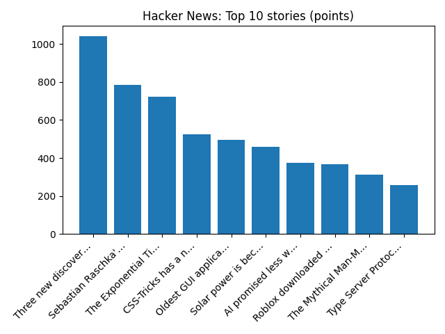

# Daily Knowledge Garden — 2026-10-27

## 🧭 Daily Summary
Global coverage includes Truce begins in Ukraine city where residents ate weeds to survive; Minimum wage set to rise but 18-20 year-olds will not get bigger increase; Boeing will not reach 737 production target until early 2027 - Reuters. Local coverage includes 'His Business Was People': Tributes Pour In For Beloved Virginia Businessman Jared Snow - DailyVoice.com; Henrico County remains under a drought watch advisory after Virginia environmental officials reviewed conditions across the state this month. A drought watch is intended to alert state and local officials and the public to developing conditions. Full story: https:// - Instagram.

## 🌍 Global News (cross-source)
- [Truce begins in Ukraine city where residents ate weeds to survive](https://www.bbc.co.uk/news/articles/ck20wjnv3w0jo?at_medium=RSS&at_campaign=rss) — BBC — World
- [Minimum wage set to rise but 18-20 year-olds will not get bigger increase](https://www.bbc.co.uk/news/articles/c6d93gq1xdgno?at_medium=RSS&at_campaign=rss) — BBC — Business
- [Boeing will not reach 737 production target until early 2027 - Reuters](https://news.google.com/rss/articles/CBMixwFBVV95cUxPNnZ1c1Q5Q2tSYnRpdnppV25UNEpNekRsVGhpbkdLVk95QjBkenF1Ni0tOFJFYThrcXlnYjhRbUJWMlo2WHlkLUIzNlJ5UUpoN1p3VUh3b1p5TlJlZHBpaENqVmY4RDZPVTFsRHhMZXJKQzhseUM1V2U4TjMySHdvNzZ1VE9MbnI4ajV1dklVemhwWFRrZmtYWF9qYUNjUTFLOVRMaGNVUG0wSDhHcEZMbXNjcWpHWGZqeUEzc3puMGZwd2FvVU93?oc=5) — Reuters — Headlines (Google News)
- [Bolsonaro's Party accepts Brazil election defeat, but he refuses to concede](https://www.npr.org/2026/10/27/nx-s1-6019217/bolsonaro-flavio-lula-brazil-election-trump) — NPR — Top Stories
- [Yemen's Houthis say they hit Saudi Ras Tanura oil refinery with missile - Reuters](https://news.google.com/rss/articles/CBMiwgFBVV95cUxPMU9tRHdmbzQ2ZHlsQzBDVmpqUEhlTk9meXgzN1VMOWlUMnlKOU1ibFRMQ1VQNDNjTkloUG9lb054S2JXZ2YwMS1MMXM4b1pwczl2clNyTHM5RGZVdnd6bzJXTVl4bW4yZ0pGTEV2aEV4dlR2cDNkc0lvNjVMN2ZScklvRDE3S1VyS0FoaC02Z3BqTHJPeTJrekxhM0dONmN0VzdXTmE5QjNfM0pIZ1Q2SHMtSkZzbFNqSThaN2RybDFBdw?oc=5) — Reuters — Headlines (Google News)

## 🏙️ Local News
- ['His Business Was People': Tributes Pour In For Beloved Virginia Businessman Jared Snow - DailyVoice.com](https://news.google.com/rss/articles/CBMiigFBVV95cUxOS25Ja29vazRXd2dPd2tpQi1xdlJRODdNSTNKTkNVQ0FFUXlaMVdKV2hrenBBWkRjbzdrNWZKVlVOZWVIblFUYUFwTGpKUzJicnhudXRpQkFaSWwyYms2Y3pYTTJmWnJHVWw4VEZ6SGFlNHhfTFcxZkJ3a2RiU3RkbzctZ1RMZXhsV3c?oc=5) — Google News — Northern Virginia
- [Henrico County remains under a drought watch advisory after Virginia environmental officials reviewed conditions across the state this month. A drought watch is intended to alert state and local officials and the public to developing conditions. Full story: https:// - Instagram](https://news.google.com/rss/articles/CBMiUkFVX3lxTE1tQ0pEVzBvdjZ5cGxwZ0s4cUQyQTRlNV9FczhHVzdDYmhOZDBWdmlZMjhoVzdYQUJ2Q29haGlvWEFYQzhrajZaRjBtd1FFR3I0b1E?oc=5) — Google News — Northern Virginia
- [Initial data from Urban Heat Island Mapping Project points to hottest spots in N. Va. - FFXnow](https://news.google.com/rss/articles/CBMiugFBVV95cUxNZ0VIcUowXzBDUmpyeGdJX1l3aEVEeVdHYmpxWFZwT3JrRUFqV3VwUlZtQkxXVndkYlI5TEdrMXRrYzdLOUV2bEFIMmdfNWhEY1VGYm5KR3lhYWEyY0ZXdkVMS1VFbVFsTnd1eTNiZzJteUhaQ0xmSC1lOS1KWlRSYkxrNXpOV202V1paaWxyZE84UVFmazhIYlZRQm9SRnpMNHRWV2w2NEdXMUFmZWJGYmFtamdpNXdzS0E?oc=5) — Google News — Northern Virginia
- [Jason Kelce played saxophone with an Army big band in Alexandria for a PBS Veterans Day special - The Alexandria Brief](https://news.google.com/rss/articles/CBMixwFBVV95cUxQVERyREFXMDlWVGRVTjJaZ0hfdXV6T2hzM2lCOWxiQkk2NERkLVhTM0p2a0JOblpJOXdnS1VQRnBzUTBMZnpOZjNlSU9qOVRLV0xIN0FWX0tTUENEMkV3bk5GcnFjRFFKZ0IzNV93TzgycHJFU2dLRzNlU3ctd2dsSHAwM0VQZURkajBiX1MyNTAzMTlSYzViNUxIazB4QVpsVGpJT3ZFQ3JxS2Y1a01LSjBMamx3ZmhSMFViMzRCcXFoSjdQa1Rv?oc=5) — Google News — Northern Virginia
- [Man convicted in non-fatal Northern Virginia road rage shooting - FOX 5 DC](https://news.google.com/rss/articles/CBMikgFBVV95cUxPQmdSRzI1OVl3a05BNUU0bjlZZmdfbG5UcG4tVWhtLVVUU3QzZDVDQkNVVmROejVBLTY2QUs3VkRWYy1GdHJYS0FocVlIcVY2SnZWWmh4VlhkQmRnSHhlRHI5emZ1YVpZTXRHY09zcGtIVnZyWHZFRWNhT0p2QUpCQ1RjVXJ1V1lCRkFCUFEzOUIyZw?oc=5) — Google News — Northern Virginia

## 🚀 Hacker News (Top 5)
- [Anthropic S-1](https://www.sec.gov/Archives/edgar/data/2130357/000162828026067168/anthropicpbc-sx1.htm) — 1443 points, 1408 comments
- [Microsoft offers mass buyouts for roughly a quarter of its workforce](https://www.seattletimes.com/business/microsoft/microsoft-offers-mass-buyouts-for-roughly-a-quarter-of-its-workforce/) — 706 points, 621 comments
- [Sebastian Raschka's from-scratch video course on building reasoning models](https://magazine.sebastianraschka.com/p/building-reasoning-models) — 526 points, 79 comments
- [Birdwatching rewires the brain and slows cognitive decline](https://www.bbc.com/future/article/20261019-birdwatching-rewires-the-brain-and-slows-cognitive-decline) — 498 points, 193 comments
- [GPT-6.1 Terra](https://openai.com/index/introducing-gpt-6-1-terra/) — 475 points, 299 comments

## 🌍 Wikipedia — On This Day (selected)
- **2019** — Islamic State of Iraq and the Levant founder and leader Abu Bakr al-Baghdadi kills himself and three children by detonating a suicide vest during the U.S. military Barisha raid in northwestern Syria.
- **2018** — A gunman opens fire on a Pittsburgh synagogue killing eleven and injuring six, including four police officers.
- **2018** — Leicester City F.C. owner Vichai Srivaddhanaprabha dies in a helicopter crash along with four others after a Premier League match against West Ham United at the King Power Stadium in Leicester, England.
- **2017** — Catalonia declares independence from Spain.
- **2014** — Britain withdraws from Afghanistan at the end of Operation Herrick, after 12 years four months and seven days.

## 🎲 Wikipedia — Random Article
**Maria Pope**  
Maria Pope may refer to:

Maria Ann Campion (1775–1803), Irish actress and second wife of actor Alexander Pope
Maria Sophia Pope (1818–1909), New Zealand shopkeeper and businesswoman
https://en.wikipedia.org/wiki/Maria_Pope

## 🌌 NASA APOD
[Noctilucent Clouds over Sweden](https://science.nasa.gov/image-article/apod-2026-october-27-noctilucent-clouds-over-sweden/)

## Feed Health
- **Reuters — Headlines (Google News)**: ok (15 articles)
- **Reuters — World (Google News)**: ok (15 articles)
- **Reuters — Business (Google News)**: ok (15 articles)
- **BBC — World**: ok (15 articles)
- **BBC — Tech**: ok (15 articles)
- **BBC — Business**: ok (15 articles)
- **BBC — Science**: ok (15 articles)
- **AP — Headlines (Google News)**: ok (15 articles)
- **AP — Politics (Google News)**: ok (15 articles)
- **AP — Business (Google News)**: ok (15 articles)
- **NPR — Top Stories**: ok (10 articles)
- **NPR — Politics**: ok (10 articles)
- **NPR — Business**: ok (10 articles)
- **NPR — Science**: ok (10 articles)
- **NPR — Technology**: ok (10 articles)
- **ScienceNews**: ok (15 articles)
- **ScienceDaily — Top**: ok (15 articles)
- **Nature — Technology**: ok (15 articles)
- **Google News — Northern Virginia**: ok (15 articles)
- **Google News — Northern Virginia traffic**: ok (15 articles)
- **Google News — Northern Virginia weather**: ok (15 articles)
- **Wikipedia — On This Day**: ok (10 articles)
- **Wikipedia — Random**: ok (1 articles)
- **NASA — APOD**: ok (1 articles)

Runs so far today: 2
