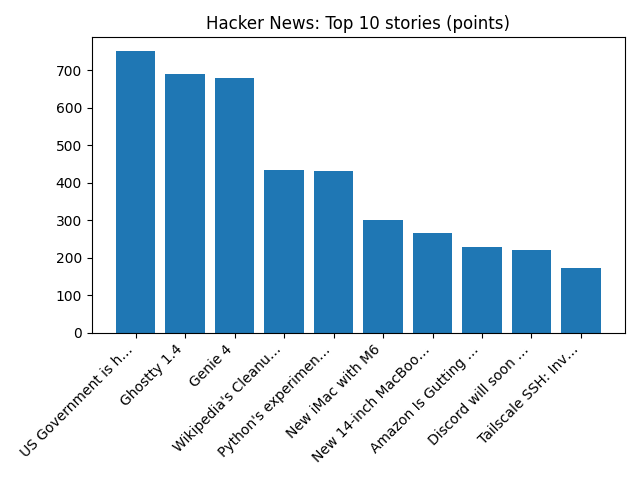

# Daily Knowledge Garden — 2026-10-28

## 🧭 Daily Summary
Global coverage includes Tax on banks, energy bill help and minimum wage rise - what could be in the Budget?; I get £4,062 a year and am trying my best - here's what I want from the Budget; Rights monitors raise concerns over senior UAE diplomat bid for next UN boss - Reuters. Local coverage includes Stalled in D.C., Waymo turns to Virginia - The Washington Post; Profs & Pints Northern Virginia: Nature’s Hidden Logic - ARLnow.

## 🌍 Global News (cross-source)
- [Tax on banks, energy bill help and minimum wage rise - what could be in the Budget?](https://www.bbc.co.uk/news/articles/c6x2zrjl7kjno?at_medium=RSS&at_campaign=rss) — BBC — Business
- [I get £4,062 a year and am trying my best - here's what I want from the Budget](https://www.bbc.co.uk/news/articles/cmx235r9wr3yo?at_medium=RSS&at_campaign=rss) — BBC — Business
- [Rights monitors raise concerns over senior UAE diplomat bid for next UN boss - Reuters](https://news.google.com/rss/articles/CBMixAFBVV95cUxOVEo2NDgyNjdJcHpxNTlUcGpCRURGc2JWTjhjSUx0aHBYUEhCcVlTajg1QjRhczNUeVBRS0JURTlMYU9VMGtUVks5MnBCal8wOWI5TTA1eFA4SU8xZDBHanZ2eUZSTVMwbWVVQTRpS2VWNW5STjRVYjBsVHBKRGZEaG1nRERnS1ExTGxad1NfUllEc28tc2k2NnpiU0l6V0h5dF83WmswWUV5YWpaM1Z0UENqTlpFVFFRanI0Z21aaFZ5cGpD?oc=5) — Reuters — World (Google News)
- [EXCLUSIVE: Hackers target US FEC system, disrupting campaign finance disclosures days before midterms - Reuters](https://news.google.com/rss/articles/CBMiuAFBVV95cUxPbDV3WWJ5Ulh3Q05tT203WGNGVE1UNmFvZ2ZoclFXemtrWXFhNlRhUmtabmlPZXRaYU1sQ251VWhSSWJMODNJQkRrMk9MNFdfb1RVT2VJQTR4akpfM0JQNk9wMkpMV2tFY2tHc2ZpTGMwcHlLNFU3UDBrZk5MbGFrb2ZqX25XRVZCQmI5Z29LbDI5cjF2S0JodjVNcVVmV3RyUFR1SW5RZUwwY2JlSWJrRUMyNEgta3dl?oc=5) — Reuters — Headlines (Google News)
- [Grand jury refuses to indict former White House aide Cassidy Hutchinson, AP sources say - AP News](https://news.google.com/rss/articles/CBMimwFBVV95cUxNNnBPa2VzUUoxM3RCb0cyd0Fmem05T0lHMVJrejNkdGdGLU1xRmZGQ0g4UDA5N2g2NVRSU0QyTkVWUTFaYXYxUVhDVUZuZElEaDA3dkNZTW9nM3VjXzlyR2R0LXA5a0doNmh5SF9WVVd0UDlYb3hRRHVnalJuZjdGSkNxYWVmUnVLZlJVMXFzX0tReVV0MnVDQ2Jodw?oc=5) — AP — Headlines (Google News)

## 🏙️ Local News
- [Stalled in D.C., Waymo turns to Virginia - The Washington Post](https://news.google.com/rss/articles/CBMijgFBVV95cUxOVURiVEtaYUdaUXM4UUVVdVJMVzdIY3FEUEtmWGRoZXg4dUZXaTNtdmFYVlU3NzlKNHI4cV9kanJ3VzRfYjd0ajJJUTdYQkFLZkFDLUJJc20tUFlCZWhtQWxZNHJqRVNydHVLdFFILVA5Y1RjZHJaajVwRmcwMXN4UmtsRFctWDlVY05RdzdR?oc=5) — Google News — Northern Virginia
- [Profs & Pints Northern Virginia: Nature’s Hidden Logic - ARLnow](https://news.google.com/rss/articles/CBMikgFBVV95cUxQS1IwUnZ6YUMwZlBwaFdmMTM4UkZnSkt4WmtjZXI1OGwxV2NmR3Y5WkZlMEVXRFk4bFpJbG9yUnRBb2VZelNCajQwaGtNdV80aVJoTmZ1eDRHVFdhX1FvMzA1aXR5cGxIUjhhV2lDQjdBT1lXYzQ2RXdfS3lybGRBRE5icVVsZ0NaNTRpa1hMMENZZw?oc=5) — Google News — Northern Virginia
- [Full Stock Cabinets Sterling Showroom Expands Wholesale Cabinet Selection for Northern Virginia Contractors - EIN Presswire](https://news.google.com/rss/articles/CBMi6gFBVV95cUxQMkhJZy1fd3E3WHhPMFZXenpadU9fWXBJRHVoLWlzUW5Rc2o2LUFzUlBDck1QLUtPaHgyZ3liS2xfbFVkSmFJSTlZTUE0VHMxejhMTFExNUhNXzBuWUw1dDJRSFhGUlJvQ2lSNi16WnlKQTVfWVlxX1l0cUQ4cjliYzlGTU5mWXZUT2NpbnNTZ1M2U1FXeWswOE9TMnRETEp6SXRCS0t6cFJza3FveG52OXZkUFBOTHE4Q3NBVmtnTjZpMFg2SU5IMlAzMnRUV2tjVHNaSThzRDlGS0UwYlZaNm5oalhQMk5Uenc?oc=5) — Google News — Northern Virginia
- [Will It Rain On Halloween? Early Forecasts Released In VA - Patch](https://news.google.com/rss/articles/CBMikAFBVV95cUxPdDlpQ2tNcHdYN1JyZHkzRVN1TElROW9ScjhCVnh2TUpGNi1ubDhhNkJiQ3RkRjBNUmRBajhlMmVOZzNJU0lUNkhVSXJtamw2RUY1YS03cE1sNXdYTERoWnV0RElscG82a1NXckZTYWRaTzNEYnJERzc4Q01jTFl3SWN4UHhqTXJoMUo2Nk9neE7SAaoBQVVfeXFMTnZybFNfeDJURVVXa2M1NUZ0Q2U2cXlZLTctZ0cwLUh3WDMxcF8xbGFjcjFDRFh5NTdmN2ZlbFd6WFlLRXkzMVhGRlJvU0JOLWxHSmZZcEM4eDVTeDRGLV9naGNrT1NmME1sWEZ2bjl1NXRRb1dZYUJrQnpJZ3I1U0xMeVlnV2U0UTVCam10Vm95LUFOUmVrRnc2ZE9CWS1LalMzUTdSVVFEZUE?oc=5) — Google News — Northern Virginia
- [Infinity Replacement by Marvin® Washington DC Named the #1 Window Supplier in Northern Virginia for 2026 - The National Law Review](https://news.google.com/rss/articles/CBMitgFBVV95cUxNOGE0MmhLODMtcWExQk1wc21LSzkxUVh0ZEctUFF5YXNUYkFoR1lyZEFQelhUNTdDRlZmRFBLem5rTnBTN0RnRl82Sy1nbHI1REFPRzdTNS1qclY0NXlZNkNpWmVWVXdpU3hrUmV1MGJmcjQzTm9mSTA0WmpueU5raWQ5eU5OTUpuaXdtVlhiLWluLVVPQUtiUTZGZF9YSUR2dEYwaS1xaWI0UUx0eWU3UTU2SkNTQQ?oc=5) — Google News — Northern Virginia

## 🚀 Hacker News (Top 5)
- [US Government is hiding a secret court ruling about how it spies on Americans](https://www.wired.com/story/the-us-government-is-hiding-a-secret-court-ruling-about-how-it-spies-on-americans/) — 751 points, 271 comments
- [Ghostty 1.4](https://ghostty.org/docs/install/release-notes/1-4-0) — 691 points, 214 comments
- [Genie 4](https://deepmind.google/blog/genie-4-a-new-generation-of-world-simulation/) — 681 points, 411 comments
- [Wikipedia's Cleanup of AI-Generated Content](https://spectrum.ieee.org/wikipedia-wikiproject-ai-writing-cleanup) — 435 points, 200 comments
- [Python's experimental JIT to be removed](https://lwn.net/SubscriberLink/1102102/0c00e4d550f25f8c/) — 433 points, 228 comments

## 🌍 Wikipedia — On This Day (selected)
- **2025** — Hurricane Melissa makes landfall near Black River, Jamaica, killing over 30 people, as well as tying the 1935 Labor Day hurricane as the most intense landfall in the North Atlantic.
- **2023** — The 2023 Rugby World Cup final is held at the Stade de France in Saint-Denis, France. It saw South Africa defeat New Zealand 12 to 11, claiming their fourth Webb Ellis Cup, becoming the first nation to do so.
- **2018** — Jair Bolsonaro is elected president of Brazil with 57 million votes, with Workers' Party candidate Fernando Haddad as the runner-up. It is the first time in 16 years that a Workers' Party candidate is not elected president.
- **2014** — A rocket carrying NASA's Cygnus CRS Orb-3 resupply mission to the International Space Station explodes seconds after taking off from the Mid-Atlantic Regional Spaceport in Wallops Island, Virginia.
- **2013** — Five people are killed and 38 are injured after a car crashes into barriers at Tiananmen Square in China.

## 🎲 Wikipedia — Random Article
**Leccino**  
The Leccino olive is one of the primary olive cultivars used in the production of Italian olive oil. Across Italy, it is one of the primary olive cultivars found in olive groves.
https://en.wikipedia.org/wiki/Leccino

## 🌌 NASA APOD
[Noctilucent Clouds over Sweden](https://science.nasa.gov/image-article/apod-2026-october-27-noctilucent-clouds-over-sweden/)

## Feed Health
- **Reuters — Headlines (Google News)**: ok (15 articles)
- **Reuters — World (Google News)**: ok (15 articles)
- **Reuters — Business (Google News)**: ok (15 articles)
- **BBC — World**: ok (15 articles)
- **BBC — Tech**: ok (15 articles)
- **BBC — Business**: ok (15 articles)
- **BBC — Science**: ok (15 articles)
- **AP — Headlines (Google News)**: ok (15 articles)
- **AP — Politics (Google News)**: ok (15 articles)
- **AP — Business (Google News)**: ok (15 articles)
- **NPR — Top Stories**: ok (10 articles)
- **NPR — Politics**: ok (10 articles)
- **NPR — Business**: ok (10 articles)
- **NPR — Science**: ok (10 articles)
- **NPR — Technology**: ok (10 articles)
- **ScienceNews**: ok (15 articles)
- **ScienceDaily — Top**: ok (15 articles)
- **Nature — Technology**: ok (15 articles)
- **Google News — Northern Virginia**: ok (15 articles)
- **Google News — Northern Virginia traffic**: ok (15 articles)
- **Google News — Northern Virginia weather**: ok (15 articles)
- **Wikipedia — On This Day**: ok (10 articles)
- **Wikipedia — Random**: ok (1 articles)
- **NASA — APOD**: ok (1 articles)

Runs so far today: 1
