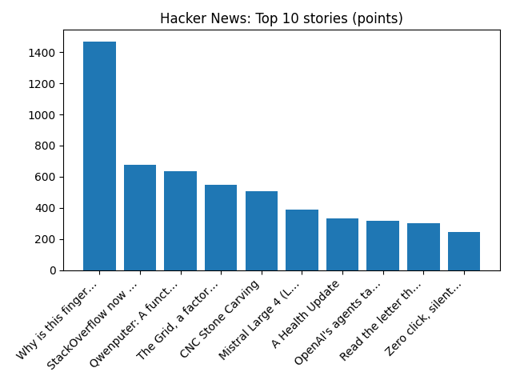

# Daily Knowledge Garden — 2026-10-29

## 🧭 Daily Summary
Global coverage includes Faisal Islam: This Budget was micro and that was deliberate; EXCLUSIVE: QatarEnergy buys US, other LNG to hedge future Hormuz disruptions - Reuters; Poundland's future hangs in the balance as chain edges towards collapse. Local coverage includes Navis Pack & Ship Owners Strengthen Northern Virginia Presence with Operation of Alexandria Location - Yahoo Finance; Publix is coming to Culpeper! New store planned at Dominion Square - WJLA.

## 🌍 Global News (cross-source)
- [Faisal Islam: This Budget was micro and that was deliberate](https://www.bbc.co.uk/news/articles/cwx283zynnv3o?at_medium=RSS&at_campaign=rss) — BBC — Business
- [EXCLUSIVE: QatarEnergy buys US, other LNG to hedge future Hormuz disruptions - Reuters](https://news.google.com/rss/articles/CBMiswFBVV95cUxQT19OLUYzbVNkOXdLUFJnQWJpOHRJaDQ0Y3FyVWs5M1IyLTFIZmRsazhqakFvMlFPNnFTeEM1T0VTTnlHTjJyMjFsblVzMlduWlRNeFI0VjlZVXRwNUZGUTVFeWdTY0tLRzlaRWFKam9uU2lRREVFS0lTLXpQME9jR25LRjF5Z0lnZ2lqbV9ybjZfRlZldDRYXzB6UElVU08zVFduMzhCYjFTb25hWTBtNTA4dw?oc=5) — Reuters — Business (Google News)
- [Poundland's future hangs in the balance as chain edges towards collapse](https://www.bbc.co.uk/news/articles/cqrky1p4dlm7o?at_medium=RSS&at_campaign=rss) — BBC — Business
- [Robust consumer spending, AI-related investment power US economy in third quarter - Reuters](https://news.google.com/rss/articles/CBMikwFBVV95cUxNd0JuSzdaWWtxaGJGdW5CV0pONGc2dlpzMVJnaGl2UUIwQmtkc1FNSUVNQzhxTFRycVZ4dGpRaVlvbGdraXBWenkzY1otSno3TC1zWTlQUmFRandmM0hlSm14a1pfWTJMNjdNclo5bFlFQWt3UlpIcFlPY3RtZzBQVXhKUzVPSWMxUXZFckNVM3ZXZEU?oc=5) — Reuters — World (Google News)
- [DoorDash offers $17 billion for Instacart in what would be a big consolidation for grocery delivery - AP News](https://news.google.com/rss/articles/CBMikAFBVV95cUxNMDdlS1JnRGhISk0zVUdvN2dfbmV4cVJPM3BheUNERHNJekZLU195TUZtcm5OZ2ZfS05SckFRSWVhVmxsMV95RGxXWGNDUXExZ0xVdkRvM2REZHVnczI3VnEwMy1WenpSUlM3YzdCTk4ycnhBMkpRZ3ZHbjFETFJrb3I3N3lhU0NzY25mSmhLaVk?oc=5) — AP — Headlines (Google News)

## 🏙️ Local News
- [Navis Pack & Ship Owners Strengthen Northern Virginia Presence with Operation of Alexandria Location - Yahoo Finance](https://news.google.com/rss/articles/CBMinwFBVV95cUxPUUR5SVh6ekJQSkdsaDlGVjFtMVZtcUZoeFMzQjJUbm42c01oTTNOa0w4R3FONVVyWnNpdVE1ZFY0MmRzRU5sUEhTTWZKX050dFdOWTFoaFhFNy1zVUhiRGR3bTU4dHBWVjVGR1lLa2RGckVROVgwMDNiSGpITFhMOThya0VJcTR2MWFVVmpPbHpXU3hmX21vOW9qV1ZkUHc?oc=5) — Google News — Northern Virginia
- [Publix is coming to Culpeper! New store planned at Dominion Square - WJLA](https://news.google.com/rss/articles/CBMi2wFBVV95cUxPZXlla3JBMGNXbWhRc2dMUE9NaUVEOHdBRkFpdnoxanlTdnJxeTdVb2dOWmdDWTlFa0NGdVVZMHB4WXAtbGd1a0VUemczc0s1RmszRjFDUkpkRWtNOUNqVmk0NER6UGJrVlBpai0teUVLNnkwb2FBRHctbVFJdXVBaTE5LUQwSWNMUkNYM1RlX0ZGWlEzRWJ2WVFEaC1YcHVxUnVidTA2c2o5TEVkUUVuVDE5cjB3OGVNdUZPQUdpYk91SkdhLTZHbFk3NGxONHRfUndHYi1rR2J5SWc?oc=5) — Google News — Northern Virginia
- [Award winning Virginia winemaker to Speak at Nov 4, 2026 LLI/NOVA Forum - Fairfax County Times](https://news.google.com/rss/articles/CBMi2gFBVV95cUxOY3RoUWFXcVNJdDc4ZUQzMVg1bFNkclRkeUcweHdOV3NHdXFzNG5MNnoydU9rd1NjYjdXNVhtRTFwdmR2TEk3dnZtbmhPZktzYVRJeWYtNzRjWnpXWVg1dzIyMHNQZ0dtRDlNN0FGb2Q3WWI2dUF1UEZMMFY4UkRObHZ6ZGtncU4xeVQwWVdxQlRiQ3R4WWpaOG82d05PcDZtb0o4SWNvRjRENFRtWWJpR3kxcUJkUWIxYVQtU2V3Vy1ObFJDMjdSckdoUGRybVNSTzA5UGtnV0Qtdw?oc=5) — Google News — Northern Virginia
- [New maps reveal Northern Virginia's hottest and coolest neighborhoods - Capital Weather](https://news.google.com/rss/articles/CBMiogFBVV95cUxQNTJFSExPRmJEMkxhdjljeU1vbU9OMTJmVGg2UjczbnJvYXpQY1pWaVpzcDNWWXhWVmlzVVdlbTZBRTVjYTVlZENBandtLTZKa01YdmpXOUZiU2stVlh1NkV3THZtMFdQQjkxTER6MGdSX1ZhUkxPaFpEbjB1Wmd2VkdXY0tQQ2c4U3dPQ25qekduQ2lkN2ZxV0xqdEZEM1F6cXc?oc=5) — Google News — Northern Virginia
- [DOJ Honors Northern District of West Virginia Team Member for Superior Performance - Department of Justice (.gov)](https://news.google.com/rss/articles/CBMisgFBVV95cUxPMXBlYlhWLWxsQV9pNWxVRkZsbmk3SlBVV1VkZk1TNDNHSHdnczFlMGZaekh6R1NDcWN2YXoyemN3R051R1lLSC13U1JQOVN5SUdLbF9NREh0dGRfV1IzZTA3aXlWM1VGa1oyMm1NamFYSmRRVS1ibEpvY0xUTFliYjRWcW1hamtzb1g2RUJaZmxVUmJSUDdNQWtUTlRfOHBDNkdNSDhkMy0wY003blZISkZn?oc=5) — Google News — Northern Virginia

## 🚀 Hacker News (Top 5)
- [Ghostty 1.4](https://ghostty.org/docs/install/release-notes/1-4-0) — 1294 points, 412 comments
- [Apple's git still trusts the compromised eMudhra certificates](https://emudhra.we-have-a-problem.com/apple.html) — 1030 points, 376 comments
- [Gemini 4 Carbon](https://blog.google/innovation-and-ai/models-and-research/gemini-models/introducing-gemini-4-carbon/) — 781 points, 640 comments
- [Why is this fingerprinting script creating bioweapons?](https://nullpt.rs/fingerprinting-bioweapons) — 778 points, 176 comments
- [Start Doing Graph Theory](https://vertex.degree/) — 571 points, 124 comments

## 🌍 Wikipedia — On This Day (selected)
- **2022** — At least 156 die at a crowd crush during a Halloween celebration in Itaewon district, Seoul, South Korea.
- **2022** — At least 100 people are killed and over 300 are injured by a double car bombing in Mogadishu, Somalia.
- **2020** — Jeremy Corbyn, former Leader of the Labour Party and of the Opposition in the United Kingdom is suspended from the Labour Party following his response to findings from the EHRC on the issue of antisemitism within the party.
- **2018** — Lion Air Flight 610, a Boeing 737 MAX, crashes after taking off from Jakarta, Indonesia killing 189 people on board.  This is the first of two crashes that will lead to the plane being grounded worldwide.
- **2015** — China announces the end of its one-child policy after 35 years.

## 🎲 Wikipedia — Random Article
**Bethel, Eugene, Oregon**  
Bethel, also commonly referred to as Bethel-Danebo, is a neighborhood of west Eugene, Oregon, United States. Bethel School District is separate from the main Eugene school district.
https://en.wikipedia.org/wiki/Bethel,_Eugene,_Oregon

## 🌌 NASA APOD
[The Horns of Venus](https://science.nasa.gov/image-article/apod-29-october-2026-the-horns-of-venus/)

## Feed Health
- **Reuters — Headlines (Google News)**: empty (0 articles)
- **Reuters — World (Google News)**: ok (15 articles)
- **Reuters — Business (Google News)**: ok (15 articles)
- **BBC — World**: ok (15 articles)
- **BBC — Tech**: ok (15 articles)
- **BBC — Business**: ok (15 articles)
- **BBC — Science**: ok (15 articles)
- **AP — Headlines (Google News)**: ok (15 articles)
- **AP — Politics (Google News)**: ok (15 articles)
- **AP — Business (Google News)**: ok (15 articles)
- **NPR — Top Stories**: ok (10 articles)
- **NPR — Politics**: ok (10 articles)
- **NPR — Business**: ok (10 articles)
- **NPR — Science**: ok (10 articles)
- **NPR — Technology**: ok (10 articles)
- **ScienceNews**: ok (15 articles)
- **ScienceDaily — Top**: ok (15 articles)
- **Nature — Technology**: ok (15 articles)
- **Google News — Northern Virginia**: ok (15 articles)
- **Google News — Northern Virginia traffic**: ok (15 articles)
- **Google News — Northern Virginia weather**: ok (15 articles)
- **Wikipedia — On This Day**: ok (10 articles)
- **Wikipedia — Random**: ok (1 articles)
- **NASA — APOD**: ok (1 articles)

Runs so far today: 2
