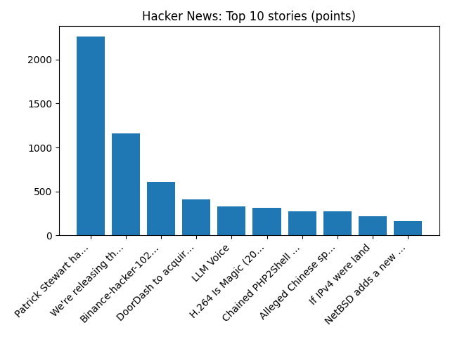

# Daily Knowledge Garden — 2026-10-30

## 🧭 Daily Summary
Global coverage includes Crypto giant Binance freezes $2.5bn of assets over suspected hack; Justice Department issues new subpoenas over Alaska spoiler candidate controversy, AP source says - AP News; From workshops to the catwalk - why mended clothes are going mainstream. Local coverage includes Northern Virginia man accused of stealing $1.4M in international 'ghost student' loan scheme - FOX 5 DC; ‘Money draining out': Woman says I-66 express lanes cost her more than $100 round trip - NBC4 Washington.

## 🌍 Global News (cross-source)
- [Crypto giant Binance freezes $2.5bn of assets over suspected hack](https://www.bbc.co.uk/news/articles/cwg7xp8kx4v5o?at_medium=RSS&at_campaign=rss) — BBC — Tech
- [Justice Department issues new subpoenas over Alaska spoiler candidate controversy, AP source says - AP News](https://news.google.com/rss/articles/CBMiswFBVV95cUxQZFMwOVMxQVRwVnBFam0waFlKVG8tQ1poNGdDUmhPaXlHX1A0bVRscWFGSmwtMnNtUzFMQnAtbkt4WmtJbWRFUnNnYWhPVGFHOHRsTkdsTzducml1dVlhR25LQTFaeC1Ld0V6amhGS0doakg2dFZ0ckhDeVhqVndUTmliLW8zWDNZV1NvT3pxbk1zdkN2ZFBNaWxnS2FyeldUeFM5YmJmQ1o1QnMyeXJ5YzVjMA?oc=5) — AP — Headlines (Google News)
- [From workshops to the catwalk - why mended clothes are going mainstream](https://www.bbc.co.uk/news/articles/cmwy9qe5r1z3o?at_medium=RSS&at_campaign=rss) — BBC — Business
- [Microsoft expects to raise $25 billion in US bond sale, source says - Reuters](https://news.google.com/rss/articles/CBMisgFBVV95cUxNakliRm9KY3R6ekRkaEl2SzZaUWtUdzczRlRyYmJNd2V2MDBLdkVVZjZQSmtVd3pzYk5JREM4M29hVHREdHBLWGljQ19rTWV5LVJMcmM0UW1OME9EY2MtTGcyRUpCcjVaYmcyVk1ZMEY5aWdvRmRpdy0tMGRfSWF2anVwQlBEOFNtaklfNDdsQURObDVXOERYejh6U3hTYzh0RGpJUDk4cU1KOE01N1FDdl9R?oc=5) — Reuters — Business (Google News)
- [Patrick Stewart, legendary actor of ‘Star Trek’ and ‘X-Men’ fame, dies at 86 - AP News](https://news.google.com/rss/articles/CBMihwFBVV95cUxQS3cxRGJjSXBXVU1QdWZQa0tFZnJiR1pvRW1WLXZJSmRBZlpsV180RVNPdEZBUzJFazlsS1lfZ1VNM212VzFCTEo2ajlMcm9TLU8tVktRTnYzazJpWWxmcV9TS01xWW1jdTh6ZGVQRGZuYV8zUnJ6V2R6WnhoYjdrcnFhYmxWS1E?oc=5) — AP — Headlines (Google News)

## 🏙️ Local News
- [Northern Virginia man accused of stealing $1.4M in international 'ghost student' loan scheme - FOX 5 DC](https://news.google.com/rss/articles/CBMiekFVX3lxTE1JSGdxUTB2Tml4T3JWalQ5X1JQVDRkRzZXVUlnTnVMN1RyX0Zyb3l5VkdkRDJuVzdpZFAwNXM3WF9xbXBScU5wRExUdGQyVk5hUkFnbzExbU5USFkzcGtGX0xrVU15M3hLNkRncGZxdld5LUk1RElJUk5n?oc=5) — Google News — Northern Virginia
- [‘Money draining out': Woman says I-66 express lanes cost her more than $100 round trip - NBC4 Washington](https://news.google.com/rss/articles/CBMi4AFBVV95cUxNNHhYSjhBMnRzaWVaeXhacWtPbHRaNDNjd3c4VmlFVWlZZVBDTi1iSUI1R19XLVVCZ0NxbnI2ZWlKZ0F2cFRXR0h2dHRPVWFjbHV1NHBfY2NfNXQtMU5lMTBLbUxyZ0FMWld0NlJVZlJlajRZVU1xMzMzUGotTmF4SzU0djEtZFpRRXZmZU9JbVpKSFE2UkJ4QjlIb1Vsc1NMVmhNMHdmYmx0TWFmdnJaZF92UnU1VkgwalVsdk9oYVFXdi1sdDhuSWtqaHo0TmJwMG5jMXZyUHhLNy0tRkJ1VtIB6AFBVV95cUxNRV9YRmRPWU1nazdQTGRHdG5peWtNWHNUWFFrNzZZY2VOaGIwVHJzRWRDTEw4aDFyWUNlQ09LX3dDbzBUcFk3alJWbURCREdBWFR4SjY4aDhmU21wVWo4SG5tRDJ5MF9Jc3FzWmNoMm5hOV9ENFBfVlNWUDY5eUt0Rlh1RFlEamdseXZDdjJkUWhBLS1oVEFuSzlnbGxWeTBYSGgxdU5VQ0x1ZThqbnY5ZnVCQ3NxeXdndVdtRUFMTzdPWnA2T0MxWTF3RlJiUmJjb3MzWGpVWDhCN0lRbjVZLWljUFowWmJU?oc=5) — Google News — Northern Virginia
- [Fear and Loathing in Northern Virginia - RVA Mag](https://news.google.com/rss/articles/CBMikwFBVV95cUxPR0NkUXl3c3NiLXNfd3hQZ0JTdnM1dlI5UWFxVGZTVkUwV3pDNkRoZXlxOERtVlV0Vlh1U0ItTTdlWHUxem1STS1zMkNEX09JcnRlajVyTFF2ZjhTb3dIWGRnOTRwTWh1YlpXQWZjSDJYTGVlRUlEVVdCcHRzS1Biek9iZGZEc1AzcmpuXzNkZmJlaVU?oc=5) — Google News — Northern Virginia
- [Heat island mapping project identifies Alexandria as one of N. Va.’s hottest areas - ALXnow](https://news.google.com/rss/articles/CBMitgFBVV95cUxPVlRPNHFodWk1MjNBcXNNOG5JbkZiS2gxTXpTSXlhaF9YTW1fZlMySm9UMDhHcW9GX0dwekNvWVpQaHFYdDlPaDBIMjJBWlFrVVJ6N3dTNDcxQTFxVXZ0VXB5eXROdzV6YzFUX3pPSnNRVElMcHRJeFAtZExFZVVBWmk3M2wtSkF1MjZBU2ZCY3B3dmtWcHBRUFA5WVZLVHRKcmxrLXhjU3BUbFlFVEJwV1Q5TEtoUQ?oc=5) — Google News — Northern Virginia
- [Daylight Saving Time Ends: When Does The Sun Set Sunday in VA? - Patch](https://news.google.com/rss/articles/CBMilAFBVV95cUxQYnhhNEFFbWRVeEhOZTFzUklhNjBUNVZ5YVcwcWFTYTJnTnNpTU40emFRbWlXODlYZnc5ZUVpLUx3ZVcyVHBhV3pENFVCSDJHbzRPaGNseVZCczQzZWdOT0poZ2dUMktDMGVlYktXcUN3QkdwWUdfQlJCbTVra0dremtoSi1nVGZzRlpNQzEzYldvUlM00gGvAUFVX3lxTFBIMjFwMWxZRlZtNWYyTHdIM3VJRC1wWGN2emtQT1dMX2RFRzhRQkxBREtUeXRQWU1PVnk2U1dsbkt1NmFTTmt0bW10Ykx3NVdXaTlpUmJYRXpjcjduQVF6eVZzVW81OXYybEVHRklFaDVkck5DU0ZzVEdhVENoOEE2VW5HTjRXRTlMLXBRRHNIOWF4LV8zdF9EUFM4R28zdDZObHJabWNlQzlQUHRBUzg?oc=5) — Google News — Northern Virginia

## 🚀 Hacker News (Top 5)
- [Patrick Stewart has died](https://www.nytimes.com/2026/10/29/arts/television/patrick-stewart-dead.html) — 2264 points, 470 comments
- [We're releasing the weights of Mistral Large 4](https://mistral.ai/news/mistral-large-4-oss/) — 1162 points, 331 comments
- [Binance-hacker-1029 – $5.6B stolen from Binance](https://arkm.com/explorer/entity/21a94755-f604-45e5-9501-6542e23005e8) — 609 points, 365 comments
- [DoorDash to acquire Instacart](https://about.doordash.com/en-us/news/doordash-to-acquire-instacart) — 409 points, 593 comments
- [LLM Voice](https://martinfowler.com/bliki/LLM-Voice.html) — 328 points, 168 comments

## 🌍 Wikipedia — On This Day (selected)
- **2023** — First rescue of a prisoner during the Israeli invasion of Gaza.
- **2022** — A pedestrian suspension bridge collapses in the city of Morbi, Gujarat, leading to the deaths of at least 135 people.
- **2020** — A magnitude 7.0 earthquake strikes the Aegean Sea between Greece and Turkey, triggering a tsunami. At least 119 people die mainly due to collapsed buildings.
- **2015** — A fire in a nightclub in the Romanian capital of Bucharest kills sixty-four people and leaves more than 147 injured.
- **2014** — Sweden becomes the first European Union member state to officially recognize Palestine as an independent and sovereign state.

## 🎲 Wikipedia — Random Article
**Christine Præsttun**  
While studying she had become involved in RadiOrakel in 1993, and while doing field work in Hong Kong in 1996 she managed to become P4 Radio's correspondent. She resided at Nesøya.
https://en.wikipedia.org/wiki/Christine_Pr%C3%A6sttun

## 🌌 NASA APOD
[The Horns of Venus](https://science.nasa.gov/image-article/apod-29-october-2026-the-horns-of-venus/)

## Feed Health
- **Reuters — Headlines (Google News)**: ok (15 articles)
- **Reuters — World (Google News)**: ok (15 articles)
- **Reuters — Business (Google News)**: ok (15 articles)
- **BBC — World**: ok (15 articles)
- **BBC — Tech**: ok (15 articles)
- **BBC — Business**: ok (15 articles)
- **BBC — Science**: ok (15 articles)
- **AP — Headlines (Google News)**: ok (15 articles)
- **AP — Politics (Google News)**: ok (15 articles)
- **AP — Business (Google News)**: ok (15 articles)
- **NPR — Top Stories**: ok (10 articles)
- **NPR — Politics**: ok (10 articles)
- **NPR — Business**: ok (10 articles)
- **NPR — Science**: ok (10 articles)
- **NPR — Technology**: ok (10 articles)
- **ScienceNews**: ok (15 articles)
- **ScienceDaily — Top**: ok (15 articles)
- **Nature — Technology**: ok (15 articles)
- **Google News — Northern Virginia**: ok (15 articles)
- **Google News — Northern Virginia traffic**: ok (15 articles)
- **Google News — Northern Virginia weather**: ok (15 articles)
- **Wikipedia — On This Day**: ok (10 articles)
- **Wikipedia — Random**: ok (1 articles)
- **NASA — APOD**: ok (1 articles)

Runs so far today: 1
