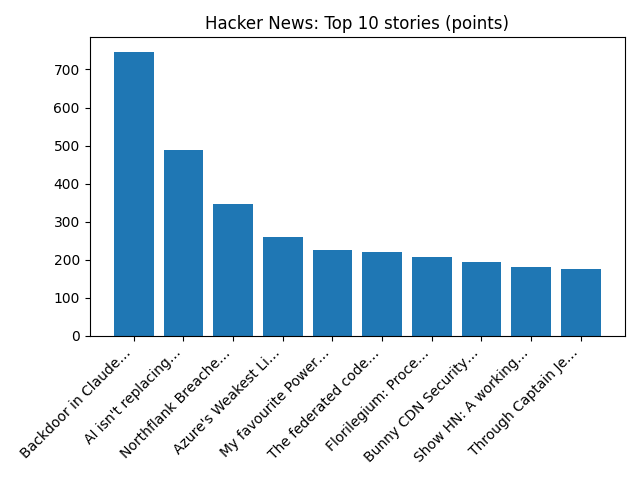

# Daily Knowledge Garden — 2026-10-31

## 🧭 Daily Summary
Global coverage includes Alaska Senate candidate denies knowing about alleged plot to put two Dan Sullivans on ballot; UK could see 10 days without rain after 'wettest week in two years'; Russia, US veto rival UN Western Sahara resolutions, leaving peacekeeping mission in limbo - Reuters. Local coverage includes Omer “Roy” Wiles “Buster” Obituary (2026) - Fort Valley, VA - Northern Virginia Daily - Legacy | Obituary; Arlington Pizzeria Named Best in Virginia by ‘Food & Wine’ - Northern Virginia Magazine.

## 🌍 Global News (cross-source)
- [Alaska Senate candidate denies knowing about alleged plot to put two Dan Sullivans on ballot](https://www.bbc.co.uk/news/articles/cmwyq2gg1yzzo?at_medium=RSS&at_campaign=rss) — BBC — World
- [UK could see 10 days without rain after 'wettest week in two years'](https://www.bbc.co.uk/weather/articles/cq98zrwd42jzo?at_medium=RSS&at_campaign=rss) — BBC — Science
- [Russia, US veto rival UN Western Sahara resolutions, leaving peacekeeping mission in limbo - Reuters](https://news.google.com/rss/articles/CBMilgFBVV95cUxQUm5zVXBMZTEtQnVkYW9MY1FJYXo0S0x2V1llamdsaEgxZmFLMlBpVEE5b3BZUGM1akRURXg2dWJJdUpOeHJlc3FvYW5QUEc0czJZdTI1SUNKYm5GS2FGNGxqcHFwQzdmQ3drOFBwa19JaHFvZEFRMGwzdTQ3T3gyNzJYdmctUDQ1Y2xCZmh4NC1oQUhqVXc?oc=5) — Reuters — Headlines (Google News)
- [McDonald's must face lawsuit over McRib, US judge rules - Reuters](https://news.google.com/rss/articles/CBMiqgFBVV95cUxNVDhaTWVhR2RLZVplbHFIWkZQTGFXLVRZRnk5TEhiV0k2RGpjREU2d2JVdDQ0bGR1dWVLQ1FhQmNrdTJFazlaQXh6bWN6d0dkWjA2cGRXYVdqRGVMVHRRWl9TN1pScDBuT1ROUWlyUGEtM2FyTGdCWVJmSm5aQkdyY0RUV1pHMDZKbFBWZ0hYdXhrRWw3Skt0cGZkREFGVWdGN2Q0ZnpxNDZIdw?oc=5) — Reuters — Headlines (Google News)
- [An ICE officer is charged with assault for striking a man with a car in Houston - AP News](https://news.google.com/rss/articles/CBMimwFBVV95cUxNSFh4dnZmYThTd3d1QUZQRDdEOTNNU2tfYUQxM3FtVGR0UjdSTzV0ZndxWGt6MDI2NGMwTUZhcXZSN2xCbG1XdDg3aW4yUWJnWHRYeW1CTmxMRVRpR0wtX2IyLUtDdlFGMmxtNkNqRG1WQmhGRGh6VUU3dG1GLW9GdmUwWVVsYlJscnRKdnNCLTk2cnJYRXZtc0tDdw?oc=5) — AP — Headlines (Google News)

## 🏙️ Local News
- [Omer “Roy” Wiles “Buster” Obituary (2026) - Fort Valley, VA - Northern Virginia Daily - Legacy | Obituary](https://news.google.com/rss/articles/CBMilwFBVV95cUxQcUMxX0FLZXlEWC1oa1FRN0FDN0xkc1R1QVBZWG8xalQ1Z2pPSVo0cmlHN3Uyek02eFdhUERzck1adWgxZzRvNU0tT2ctdXZ5VGtmZVpQM0VMdkxycUpjZHJ5UHFqMjFGV1ZCUm91NVJwZ0FiR0o3WHNfTTRiOElxWWRheUx0bFdDQy1aOW5WNElIMkszRFZ3?oc=5) — Google News — Northern Virginia
- [Arlington Pizzeria Named Best in Virginia by ‘Food & Wine’ - Northern Virginia Magazine](https://news.google.com/rss/articles/CBMiwgFBVV95cUxQS19ld3dUcXRhREhZRE14UkFhQkNKRU1MdnA2bzFqQmhhbG14enE3b2hSbjREdktBd21SajBZZHA1OTFlV19FSDRTcC1hbFhrb2pzOFRrbWpSdUdfNk4zTXNOVnFWeUZDZHNpMUszMWRzSjB3aHdNeWxjVGJBUzh3ZGJMRDdCUkFoS2EycnNBN2JLWWZfcmN3U0lqWEp3Z1BmOE1DWnhWRVZGQ0RySEhNaVg4clFjYlBIbWN3VXhPS0Vzdw?oc=5) — Google News — Northern Virginia
- [Northern Virginia gymnast talks dreams of 2028 Olympics - NBC4 Washington](https://news.google.com/rss/articles/CBMixAFBVV95cUxOUFpvS216amVvclByRHFCdTFESE9xWHdIM1NFY3dVR09sTjRpUV9GUkVOQU4xYUFBWS1wc0l5X2s5NXRydXF1MzV2QjF2OEtvX3A0ZXI4NWdDc0tvUDlwelcySFN6c3U1aFM4ZURnbUJrLUNWbmdheTY5bTFYSHJiazdiQTBEZ1I4ZVJ2emJMLUROdmVOT05nN0lxT0RrWDFQNFZfN2RuNE5raTYtaElGTlpBNXRhNjhTaUhXeGZpcV9IaTBE0gHMAUFVX3lxTE9LdnQ0YXMtNXpVVFd4djRZWS15dll5MnU1Si1nUEtyV0JTM0k0N2RzMHVPVjdfU050U3gxd0xYNlhYbFB3YVRtZXpuT21WRkUzOUpuTXNvam1Iakd4bXg0bjRvcFlXRm9pcS1ESGRKLTEyX2E3VmticEg2NnFNRHZzMDV5cWU1ZXM4ajBKVzVCeDJHTXRCcXM1SnE0V2ZVQW1vYjFuSEdTRE1oU28tUUJMQ3BKU0hNSF9XTHhWZDVZUEhnaVBMb2F4VWFFOQ?oc=5) — Google News — Northern Virginia
- [Northern Virginia man accused of stealing $1.4M in international ghost student loan scheme - Potomac Local News](https://news.google.com/rss/articles/CBMisAFBVV95cUxQdWlQWWRVV2RVQzRJMk9wSGo4TERVNXhHekVGdlB3WWRaMDF0NlYyNGlVT25wdVFvX0gySjVEUHlrQmV3LWZZRGpwdld3R21qX1VxRjRFSk9vSjNPdmpTc2ZnZkgtaDF3WEMzWjV5RU1kcUVBT0NvUk1ZWnpibkFneVNEb3o1ZlVkX0tFZy1LdFBLMExOOGZvd0pHRWZNVjBOdzdFdXcwcmlBSEhtZXBKXw?oc=5) — Google News — Northern Virginia
- [WJLA’s Winter Outlook Calls For 10-25 Inches of Snow Across Parts of D.C., Maryland, and Northern Virginia - The MoCo Show -](https://news.google.com/rss/articles/CBMi0AFBVV95cUxQWnMyT3JxbjRYYldXczNXQzVSb015LUs5bXVjU1hTd2FNUlZlelNDeDdYcWNFbFFNNWM1aTZnS3paNkN6bHRsTU9xLW5DZ1p3TWJJU09MbjFmcHotWVJ5MU85a2ZHRmMzLTFRX2xnNjNSRXROZnJ1Mk9HN09fd0FmN0RfeTlCejk3ZVlaZ1ZFTmhkZWVwTlViU0xneExKRGlLZklsRVg1Q3ZDSmxhUFpiSHkzNjR1aWRWUXJYcGY2UFczVlhmTi02a1pMU0I1S184?oc=5) — Google News — Northern Virginia

## 🚀 Hacker News (Top 5)
- [Backdoor in Claude Code for VS Code extension on the Cursor Marketplace](https://phorion.io/blog/offical-claude-code-vsx-compromise/) — 747 points, 469 comments
- [AI isn't replacing SREs, it's deskilling them](https://newsletter.signoz.io/p/ai-isnt-replacing-sres-its-deskilling) — 489 points, 361 comments
- [Northflank Breached](https://status.northflank.com) — 347 points, 268 comments
- [Azure's Weakest Link – Five Full Cross-Tenant Compromises](https://www.binarysecurity.no/posts/2026/10/one-root-case) — 259 points, 49 comments
- [My favourite PowerMac is a Nintendo Wii](https://virtuallyfun.com/2026/10/29/my-favourite-powermac-is-a-nintendo-wii/) — 227 points, 59 comments

## 🌍 Wikipedia — On This Day (selected)
- **2020** — Berlin Brandenburg Airport opens its doors after nearly 10 years of delays due to construction issues and project corruption.
- **2017** — A truck drives into a crowd in Lower Manhattan, New York City, killing eight people.
- **2015** — Metrojet Flight 9268 is bombed over the northern Sinai Peninsula, killing all 224 people on board.
- **2014** — During a test flight, the VSS Enterprise, a Virgin Galactic experimental spaceflight test vehicle, suffers a catastrophic in-flight breakup and crashes in the Mojave Desert, California.
- **2011** — The global population of humans reaches seven billion. This day is now recognized by the United Nations as the Day of Seven Billion.

## 🎲 Wikipedia — Random Article
**Linda E. Carlson**  
Linda E. Carlson (born 10 August 1969) is a Canadian clinical psychologist.
https://en.wikipedia.org/wiki/Linda_E._Carlson

## 🌌 NASA APOD
[Haunting the Cepheus Flare](https://science.nasa.gov/image-article/apod-2026-october-30-haunting-the-cepheus-flare/)

## Feed Health
- **Reuters — Headlines (Google News)**: ok (15 articles)
- **Reuters — World (Google News)**: ok (15 articles)
- **Reuters — Business (Google News)**: ok (15 articles)
- **BBC — World**: ok (15 articles)
- **BBC — Tech**: ok (15 articles)
- **BBC — Business**: ok (15 articles)
- **BBC — Science**: ok (15 articles)
- **AP — Headlines (Google News)**: ok (15 articles)
- **AP — Politics (Google News)**: ok (15 articles)
- **AP — Business (Google News)**: ok (15 articles)
- **NPR — Top Stories**: ok (10 articles)
- **NPR — Politics**: ok (10 articles)
- **NPR — Business**: ok (10 articles)
- **NPR — Science**: ok (10 articles)
- **NPR — Technology**: ok (10 articles)
- **ScienceNews**: ok (15 articles)
- **ScienceDaily — Top**: ok (15 articles)
- **Nature — Technology**: ok (15 articles)
- **Google News — Northern Virginia**: ok (15 articles)
- **Google News — Northern Virginia traffic**: ok (15 articles)
- **Google News — Northern Virginia weather**: ok (15 articles)
- **Wikipedia — On This Day**: ok (10 articles)
- **Wikipedia — Random**: ok (1 articles)
- **NASA — APOD**: ok (1 articles)

Runs so far today: 1
