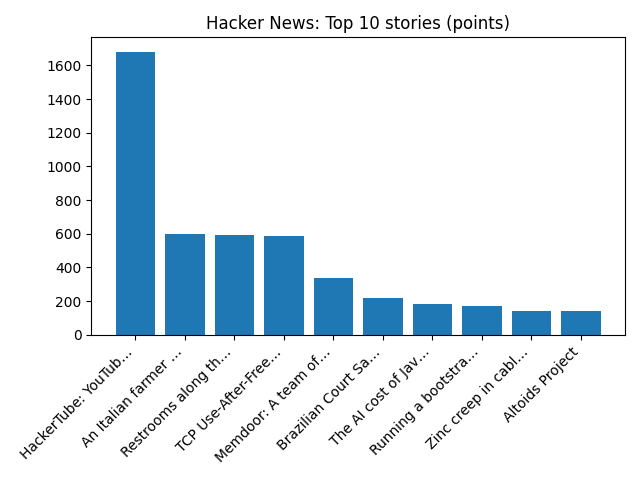

# Daily Knowledge Garden — 2026-11-01

## 🧭 Daily Summary
Global coverage includes Russia's FSB says minor detained over park attack threat after US tip-off - Reuters; Trump heads to Iowa, Kansas for rallies before midterms - Reuters; At a Moscow movie screening, Anthony Bourdain's Russian fixer remembers the late chef. Local coverage includes Skilled trades now offer direct path to six-figure pay without college debt thanks to emerging tech industry - 930 WFMD Free Talk; USDA affordable housing in Loudoun evacuated due to unsafe conditions - NBC4 Washington.

## 🌍 Global News (cross-source)
- [Russia's FSB says minor detained over park attack threat after US tip-off - Reuters](https://news.google.com/rss/articles/CBMitAFBVV95cUxQVEpDUVhCYWticTBIZEZxaHVlMXBZbFp0ODd6RVB2c1VzNllrVFpHRk5SR3E4Uk9YeWRJVFVoVGhlLS10ckliNzkyTzdjNi1KRU85UG9UQXpvcjlteTdLcm5iTERreDNqaF9jSU1ndTBwN2pBcXdGNlhEYTRmTFpKOXVOMUl3Q21fQW9DS2gxUWpkYjdfYnlJWmROR3VEQk5KUVhNSGFMNFFHcUZmNTZ2UENLWks?oc=5) — Reuters — Headlines (Google News)
- [Trump heads to Iowa, Kansas for rallies before midterms - Reuters](https://news.google.com/rss/articles/CBMilwFBVV95cUxQX2FHcHFUc2FHcFNFdlgyU2xwdjFlUDZ4ZG1aQjk1aDdCYnNFaE5WSXM5Q0E5cHB5Z0tKaWp0QXZ2dThVYjU2ZW1VemZmYmswcm1lUHA3TXhNVVBmUWdSQnRBTVJBdFlHQmlvempGUkFnTFo1aHBTZTZGeU53T3pIYUxXUTFaVGtaLXFldGwyUGRFNTNlWWtn?oc=5) — Reuters — Headlines (Google News)
- [At a Moscow movie screening, Anthony Bourdain's Russian fixer remembers the late chef](https://www.npr.org/2026/11/01/nx-s1-6020404/at-a-moscow-movie-screening-anthony-bourdains-russian-fixer-remembers-the-late-chef) — NPR — Science
- [Crypto firm Binance covers 90% of losses after $6.3bn hack](https://www.bbc.co.uk/news/articles/ckpdg3ql4169o?at_medium=RSS&at_campaign=rss) — BBC — World
- [Living with high prices in Virginia's 1st Congressional District](https://www.npr.org/2026/11/01/nx-s1-5945628/living-with-high-prices-in-virginias-1st-congressional-district) — NPR — Top Stories

## 🏙️ Local News
- [Skilled trades now offer direct path to six-figure pay without college debt thanks to emerging tech industry - 930 WFMD Free Talk](https://news.google.com/rss/articles/CBMi2AFBVV95cUxPa1VKMUhDRGlMZGRtREVTLUdOLXU3dzV0YkFkRjB6aVc4S25XMkNiVzhMbVdJMC1sZlRoOVJYdTNlcEQ1b0pCV0U4NXQtUFdZbkNNanh3eVg4ZnNsdFJMSmN0TU5Xb0xsVElLVUJjRk1weTBXN05IdkcxVDhJRERaNU9BZjFsWDJ6ZDdZcDFTSlMzbkxXbXd6aTQ2VHFuZVVMOHRfX0hUUlJURE0tVkFEaXRhN1B0NkN1NFJXUkFCelNkMzVmQnZ4MU56aVJ0d0x1UUNwcEg3cDA?oc=5) — Google News — Northern Virginia
- [USDA affordable housing in Loudoun evacuated due to unsafe conditions - NBC4 Washington](https://news.google.com/rss/articles/CBMi0wFBVV95cUxOcHl2VjJheHM3bWNVUV83eENjTDVORGRhbk4yYnBmX203cVlRM0NtdXk4ZEFMNUczVnFHVzc3b05lR3g0ZXpVVERvQXlrY3I0S2dGVzBfVDdhdHBEOVA3OXUwc1Z3a3oxb1Q3bVhVMlhNanVaSVZmcDlMWjlKelNtTGR0UnlfMm51dVhvckF4Y0RoQko4SWdVYXhjdlhmOWlQOV9SV0tIQkpYVy1sUGk0anU3UWhRbnhZa1B0djRTVU5uVzlUZVpxUmFuMTEyeTZkOGw00gHbAUFVX3lxTE4yRmUwRmpzMjlKWE9vYVhOSHJyZGVGd2RTYXR4U0dvcU10R01jVkZWYnluakNWUHBsSzVaTGl1TDFvVlVVM0piVl9OcUx6T3g4YldSOUxETm42N0tvb2NEeWNwNlV0bW1vVTBHYm45Z0pOYlE1bmE0b1FZYVhra3FDMm1PQmNsVDlnRUFRekRXWW4wNThQUlFpaVU4U3FxRFZwU2VfcHlwcEFlUjZ1bTlFWTUtRHM1MFJ6ZkxxRU5keVp3VUtWVzhhZm1TR2NDcG5QZlZhREk3VWpTWQ?oc=5) — Google News — Northern Virginia
- [USDA apartment complex in Loudoun evacuated due to unsafe conditions - NBC4 Washington](https://news.google.com/rss/articles/CBMi7AFBVV95cUxOYzZoMFpPYVBEbk9hc1I0NHBXMzRvR1FmYTRLVWkxWWZYbkFxa3hWdmp6UjdnV3Q3R2c0b09OLXhsR1REZFRpdTBNRGRvVTNocmZwSjI0akVxWTF3YjlKU2RHX0YwZVQtX0x0TWRWSkpNNUNOYURnYTZzcWd5NlFXbFdBMk1FblQwakxzZGd6VnhISHhUQmNabUx1TzdvY0ZCd0tKekV5RHlTbzNYQWdkTVNIOWRSTGRfVzJrNk5mNnJUc0dDQjhVakg1STh2YXJXNlFBRm5OeWtWSlc1dkZ3NFBhekRqbG9ZbXpUdNIB9AFBVV95cUxPVXluNGZRUzlrYzZ5UFlXQWxuZk9hYjZqV3UtVUpNMmRWZzJZeVU2REFxd2FScDVIMnJ5a0hGcHlwcDlSdzVodUxVRW5GaUN2SE5WZ3VGRDJIZ1B2VkxQd3NBSGtrNFZ0QVd3RHBEdmxLTFQ1VHFBaUdMS04xRG9uUmh3SHhabGdwNFk0dDJCcUVBSllVVXR3RnhXVElWUGZZeEJETlR0M05FSGtkaU0wSXFfa2I4SWZoZ3pEY3JXeFprMk54Qmp5TUZ1Rnl0dVpCY3h4enNpZHEtNzRBWEx5MDRDalJYV09aR2pLSFlOdkw1TVU5?oc=5) — Google News — Northern Virginia
- [Arlene Barb Obituary (2026 - 2026) - Edinburg, VA - Northern Virginia Daily - Legacy | Obituary](https://news.google.com/rss/articles/CBMiigFBVV95cUxOdzQyTXRSR3Y3ejQ3bkNCbHh1ZFhzNmFLR21Ma0RDdUlibWtrRlZVbVRVOTVzSEVYcThNT2ZBczNjbTJ4YXFjUTJycUV1bGtlOGI4THlJWTlnQV9xSnVsTXVETV9yakI5WWp0R3hVc3VDRFBJeGE3eEd4TS1fcE96Rl9xQjdMT0JnLVE?oc=5) — Google News — Northern Virginia
- ['I'm going to be priced out': Affordability, constitutional amendments drive Virginia voters to the polls - WUSA9](https://news.google.com/rss/articles/CBMi_AFBVV95cUxPakxjX25ZaUF0a1IzRjVfVmdVa0syVjFxR3Iyb09WdElObFlkbm5uNFdWRV8tN2pOQk1ITFF5dmJVbzFhVUp6d3g4LUZzMWtFb0FIdUQ2aUJYbmFyY2JNWHRRcXFLcldpVjdGbV9WRnhEUVcxcFBzUndpQm9YTnVnNjR4WVVWUVZuSTJaSGdweWhIemtXaG5zcTBRM0lYZkd2S3dTQTVuVURxNTY0bXI0blQ5YmdSejEzSHQzdk9xSUUtYjlhc09zbDFjMWJUOHJRalJLcXExTk4zQ09HMjZ1SEVRdjRtOFlnaHJpUkFJc3hWNTczWU1hQXFMajA?oc=5) — Google News — Northern Virginia

## 🚀 Hacker News (Top 5)
- [HackerTube: YouTube built from videos recommended by HN](https://karpathy.bearblog.dev/hacker-tube/) — 1682 points, 444 comments
- [An Italian farmer found some unknown seeds in his attic and planted them](https://www.smithsonianmag.com/science-nature/italian-farmer-found-unknown-seeds-attic-with-nothing-lose-planted-them-result-biblical-180989644/) — 600 points, 173 comments
- [Restrooms along the Norwegian Scenic Routes](https://www.visitnorway.com/plan-your-trip/travel-tips-a-z/norwegian-scenic-routes/worlds-best-toilets/) — 595 points, 338 comments
- [TCP Use-After-Free: CVE-2026-98432 / CVSS 9.8](https://atlasum.net/blog/cve-2026-98432-linux-ipv4-tcp-uaf) — 587 points, 287 comments
- [Memdoor: A team of 5 Qwen3.8-27B models beats Fable 5 on LiveCodeBench Hard](https://github.com/guregodevo/memdoor/tree/main/examples/workflows/team-solve) — 340 points, 165 comments

## 🌍 Wikipedia — On This Day (selected)
- **2024** — A concrete canopy collapses at the Novi Sad railway station, killing 16 people and injuring three.
- **2012** — A fuel tank truck crashes and explodes in the Saudi Arabian capital Riyadh, killing 26 people and injuring 135.
- **2011** — Mario Draghi succeeds Jean-Claude Trichet and becomes the third president of the European Central Bank.
- **2009** — An Ilyushin Il-76 crashes near the Mir mine after takeoff from Mirny Airport in Yakutia, killing all 11 aboard.
- **2004** — A suicide bombing at the Carmel Market in Tel Aviv kills three people and injures 50.

## 🎲 Wikipedia — Random Article
**Bruce Thornton (cornerback)**  
Bruce Thornton Sr. He played college football for the Georgia Bulldogs.
https://en.wikipedia.org/wiki/Bruce_Thornton_(cornerback)

## 🌌 NASA APOD
[Colors of the Moon](https://science.nasa.gov/image-article/apod-2026-november-1-colors-of-the-moon/)

## Feed Health
- **Reuters — Headlines (Google News)**: ok (15 articles)
- **Reuters — World (Google News)**: ok (15 articles)
- **Reuters — Business (Google News)**: ok (15 articles)
- **BBC — World**: ok (15 articles)
- **BBC — Tech**: ok (15 articles)
- **BBC — Business**: ok (15 articles)
- **BBC — Science**: ok (15 articles)
- **AP — Headlines (Google News)**: ok (15 articles)
- **AP — Politics (Google News)**: ok (15 articles)
- **AP — Business (Google News)**: ok (15 articles)
- **NPR — Top Stories**: ok (10 articles)
- **NPR — Politics**: ok (10 articles)
- **NPR — Business**: ok (10 articles)
- **NPR — Science**: ok (10 articles)
- **NPR — Technology**: ok (10 articles)
- **ScienceNews**: ok (15 articles)
- **ScienceDaily — Top**: ok (15 articles)
- **Nature — Technology**: ok (15 articles)
- **Google News — Northern Virginia**: ok (15 articles)
- **Google News — Northern Virginia traffic**: ok (15 articles)
- **Google News — Northern Virginia weather**: ok (15 articles)
- **Wikipedia — On This Day**: ok (10 articles)
- **Wikipedia — Random**: ok (1 articles)
- **NASA — APOD**: ok (1 articles)

Runs so far today: 1
