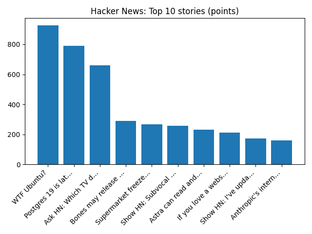

# Daily Knowledge Garden — 2026-11-02

## 🧭 Daily Summary
Global coverage includes Snap settles with two teens during trial testing claims social media caused depression, eating disorders - Reuters; Karl Bushby embraces emotional mother as he completes his 28-year, 31,000-mile walk around world - AP News; Judge accuses DOJ of 'weaponization,' tosses case against ex-FBI officials. Local coverage includes Alexandria Holiday Calendar 2026: Tree Lightings, Parades, Markets, Mount Vernon and More - Alexandria Living Magazine; Route 7 crash study names Beauregard, King Street area a top priority for safety review - The Alexandria Brief.

## 🌍 Global News (cross-source)
- [Snap settles with two teens during trial testing claims social media caused depression, eating disorders - Reuters](https://news.google.com/rss/articles/CBMivAFBVV95cUxQbWlaZ3pFczZyTTFuOFB2ZWlTbXZnZ0RTck5XTnh0b3AtcURJYkJDX202VWN2aWdyaWc1bHdBbWlHbU1RSFQ2QWZEYWRiS0dyOVRQOXZpN3A4ckFoUS1Bamp3bk0zNWpkVVl0ckc3VXZpZGNQR0Q1Z3B6UHlPcFZHTVY4LWlYemVCM3ZKSjExUHBUdzFZbHRGMkt4al9OYUs3b0pjM21RQVlkWkZ0YmZXa3RzcUhES2dXVExOVg?oc=5) — Reuters — Headlines (Google News)
- [Karl Bushby embraces emotional mother as he completes his 28-year, 31,000-mile walk around world - AP News](https://news.google.com/rss/articles/CBMimwFBVV95cUxNZG8yWEUtOVpibGVzRGlfaFRDMnFuaXNka0NOck91MXhHS1huenFKSFpRM0pMZnFoZkpGZlYta0JDNW14VGJCQ0Rmc3VkZmt0bGZfYldXdU9nazZrUDN5bXpnQUg4bExFb281NHBlYWtBNjJaYmcycUUxMkpzWjVtaUFWTnVzNG45UHR2YjdVZVZwRnNnUURjM1Vqdw?oc=5) — AP — Headlines (Google News)
- [Judge accuses DOJ of 'weaponization,' tosses case against ex-FBI officials](https://www.npr.org/2026/11/02/g-s1-151242/judge-tosses-case-fbi-officials-hunter-biden) — NPR — Top Stories
- [Russian bombing kills 24 people at Ukraine aid centre, Kyiv says](https://www.bbc.co.uk/news/articles/cjy56dndlyz0o?at_medium=RSS&at_campaign=rss) — BBC — World
- [Fake nuclear warning from hacked app sparks unease but not panic in Ukraine](https://www.bbc.co.uk/news/articles/cwx28mngxz8do?at_medium=RSS&at_campaign=rss) — BBC — World

## 🏙️ Local News
- [Alexandria Holiday Calendar 2026: Tree Lightings, Parades, Markets, Mount Vernon and More - Alexandria Living Magazine](https://news.google.com/rss/articles/CBMitAFBVV95cUxPVUhvV0hKd0taeUZRUXYwTjgtVGVkV0RPNUJ1QVVieXhMeWtncG5EaEpLM3ZIdFZHNTBOdVRuUm5EYl8zS1I0OTYyNFE0ZXB2QWZyTHNJbnpfcVhlMXItSGRGamJSamlPQmItanlEUmVwaU1PdmdIMDhZMmZLMTdHYnNIUW1HUVQ0RUd4ODY1Y3I0UThiRG9iaUg1d0c2eEVrOHhpODFob2lNS1hqaWR0dExmRms?oc=5) — Google News — Northern Virginia
- [Route 7 crash study names Beauregard, King Street area a top priority for safety review - The Alexandria Brief](https://news.google.com/rss/articles/CBMiuwFBVV95cUxNbXpBSGw1WTBqV25STkNaRjh5LXg2cmZkUlVGS2xhY2FUZnNheERlS1RPMDVDdmJtUW9fS3RiNzdoVnBFQ2lPYkN2bDJaU1pWZ3MtUy1jUTRyY1N1WkR6emhrTEFYYWo1VVJBeUx0VTJGN0oyNmpTSHVCX0RTY3Y4SFlQVjhzbE04dDRxZ2FFblVUZVFHRjM0ZV9VUDBGRm80M3oyTUwzYUxSZnkzdV96d2ZQV0pTYk0wSlU4?oc=5) — Google News — Northern Virginia
- [Early voting analysis shows Virginia Democrats in lead in 9 of 11 congressional races - Augusta Free Press](https://news.google.com/rss/articles/CBMivAFBVV95cUxOdWFkNm5IbXFWR1NCOG5YWEZYaU1pR2RmeXpnZVVrU3k3TGtuVTdyWE9yQzF6X09aN19SV25iczJXNTRTODlBaWpZLUxnUVJoaGNKTW5wbkctLVFweWRuanR1T2p0WFFLU0xTUXNqb0VQSGJwUEl6MWlrZVlfdFRYT2ludERsS3BIUTdDTWNxVFljVU5nX2lPT3pmVVBMbW5wZlVoTVJXNFc1NW5wTzNEWmJZaUdvM1N3ajdycA?oc=5) — Google News — Northern Virginia
- [Three Northern Virginia gastroenterology practices join UVA Health - InsideNoVa](https://news.google.com/rss/articles/CBMipAFBVV95cUxNVFhiWFJoazZZTWpUa2ZUR3VWM2lGZDBOdzVaZzZyVTN6anVweDR1QzNTeWc5aE92bEVmSFBFZGJhSHlpcG9VVFhuRkZTb2d4SVhzVEN4YS1qR19fMzl5ZklyTG01WUlrNFBuYU1oTTV4VUxtdXN0TUhWd29vdEFfb2xlSTdxQUlwTURnOHFmUmFOYnFPSXVRSWlnU082WGZ2ZVd5Sg?oc=5) — Google News — Northern Virginia
- [UVA Health Expands Gastroenterology Services in Northern Virginia with Addition of Three Established Practices - Prince William Living](https://news.google.com/rss/articles/CBMi2wFBVV95cUxNWEdnRUJOdlV4dWpUcDY4SzVjZlNMMUc0dWxOcHVHRTdQc2czVEk4and0TXdwczBpbWx6OGFjYWlFeXl4anVYU0ZkS0w0ZFB3SjRUaFMyVVpHVmF0bzB6QlFWSkRTUzVTSzZ2THVkUndhOEhiQTNzOWUwYjItaTNsUm9vT1c1VThfSWlyYVM2d0htQXJsSnZNay1oS0lDS3VIUmxOdmhycjR5V3U3MUNyNDlHMEdUclE1ZWpzTFBFMUdaR1g0N0piNFpfRGJIMWZ3TkV6cmRpcTdfSGs?oc=5) — Google News — Northern Virginia

## 🚀 Hacker News (Top 5)
- [HackerTube: YouTube built from videos recommended by HN](https://karpathy.bearblog.dev/hacker-tube/) — 2237 points, 537 comments
- [Show HN: HackerBooks – HackerTube, but for books mentioned on HN](https://hackerbooks.org) — 848 points, 168 comments
- [An Italian farmer found some unknown seeds in his attic and planted them](https://www.smithsonianmag.com/science-nature/italian-farmer-found-unknown-seeds-attic-with-nothing-lose-planted-them-result-biblical-180989644/) — 764 points, 197 comments
- [Lenovo's 'encrypted' fingerprint USB is just an unencrypted SD card in a case](https://www.reddit.com/r/technology/comments/1xl2pr3/lenovos_encrypted_fingerprint_usb_drive_is_just/) — 379 points, 134 comments
- [Patrick Stewart taught us what good men do with power](https://www.vox.com/politics/508526/patrick-stewart-jean-luc-picard-star-trek-liberalism) — 351 points, 247 comments

## 🌍 Wikipedia — On This Day (selected)
- **2022** — A peace agreement is signed between the Ethiopian government and the Tigray People's Liberation Front, ending the Tigray War.
- **2020** — In Vienna's Innere Stadt district, an ISIL sympathizer shoots and kills four people and injures 23 more, before being shot and killed by the police.
- **2016** — The Chicago Cubs defeat the Cleveland Indians in the World Series, ending the longest Major League Baseball championship drought at 108 years.
- **2008** — Lewis Hamilton secured his maiden Formula One Drivers' Championship Title by one point ahead of Felipe Massa at the Brazilian Grand Prix, after a pass for fifth place against the Toyota of Timo Glock on the final lap of the race.
- **2000** — Expedition 1 arrived at the International Space Station for the first long-duration stay onboard. From this day to present, a continuous human presence in space on the station remains uninterrupted.

## 🎲 Wikipedia — Random Article
**Pecks Beach**  
Pecks Beach or Peck's Beach is a barrier island located on the Jersey Shore in Cape May County, New Jersey occupied by Ocean City.
https://en.wikipedia.org/wiki/Pecks_Beach

## 🌌 NASA APOD
[A Long Cloud on Mars](https://science.nasa.gov/image-article/apod-2026-november-2-a-long-cloud-on-mars/)

## Feed Health
- **Reuters — Headlines (Google News)**: ok (15 articles)
- **Reuters — World (Google News)**: ok (15 articles)
- **Reuters — Business (Google News)**: ok (15 articles)
- **BBC — World**: ok (15 articles)
- **BBC — Tech**: ok (15 articles)
- **BBC — Business**: ok (15 articles)
- **BBC — Science**: ok (15 articles)
- **AP — Headlines (Google News)**: ok (15 articles)
- **AP — Politics (Google News)**: ok (15 articles)
- **AP — Business (Google News)**: ok (15 articles)
- **NPR — Top Stories**: ok (10 articles)
- **NPR — Politics**: ok (10 articles)
- **NPR — Business**: ok (10 articles)
- **NPR — Science**: ok (10 articles)
- **NPR — Technology**: ok (10 articles)
- **ScienceNews**: ok (15 articles)
- **ScienceDaily — Top**: ok (15 articles)
- **Nature — Technology**: ok (15 articles)
- **Google News — Northern Virginia**: ok (15 articles)
- **Google News — Northern Virginia traffic**: ok (15 articles)
- **Google News — Northern Virginia weather**: ok (15 articles)
- **Wikipedia — On This Day**: ok (10 articles)
- **Wikipedia — Random**: ok (1 articles)
- **NASA — APOD**: ok (1 articles)

Runs so far today: 2
