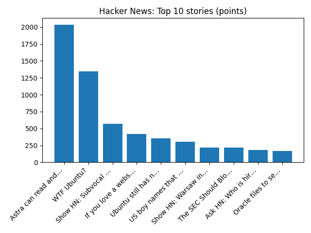

# Daily Knowledge Garden — 2026-11-03

## 🧭 Daily Summary
Global coverage includes UK and EU agree draft deal to scrap Brexit red tape over food exports; Dodge announces its return to the NASCAR Cup Series beginning at the Daytona 500 - AP News; Man and boy arrested after allegedly attacking One Nation volunteer with baseball bat in Australia. Local coverage includes Election Day Is Tuesday: Virginia’s Closest House Races, What’s on Your Ballot and How to Vote in Alexandria - Alexandria Living Magazine; Carolyn Valerio Obituary (2026) - Edinburg, VA - Northern Virginia Daily - Legacy | Obituary.

## 🌍 Global News (cross-source)
- [UK and EU agree draft deal to scrap Brexit red tape over food exports](https://www.bbc.co.uk/news/articles/cmp3grwre9xdo?at_medium=RSS&at_campaign=rss) — BBC — Business
- [Dodge announces its return to the NASCAR Cup Series beginning at the Daytona 500 - AP News](https://news.google.com/rss/articles/CBMilgFBVV95cUxQOGdpakRKNFVFZU5GZXdndXhWd0VGYmlfdDM2UTVCVVpncFlrdHB2UUp0aDBYVEFFcHVidVJLY0piZklmc2t3WXZZSldLQjZlR3oxZWFmb01FN3RaZmphZXdReTMyak5xZUtCbXZPNjA1OFc3ZWdnQmpydU1yX2pVOThlMHNfX3NNaHFvdFp3OThWa01LX2c?oc=5) — AP — Headlines (Google News)
- [Man and boy arrested after allegedly attacking One Nation volunteer with baseball bat in Australia](https://www.bbc.co.uk/news/articles/cwly3jd27m9xo?at_medium=RSS&at_campaign=rss) — BBC — World
- [Oil rises after report of US strike on Iran's Qeshm Island - Reuters](https://news.google.com/rss/articles/CBMiqwFBVV95cUxQTFpzbEJURFlBbkE1RzNfclduVWpDY29HaWY3dnZJNUFuTHFsckZXSU5iTGJHdUFzQkVmeVhvdk9IME9Hdkxwc0NQZzg4dFFzckltYVlzcGdWY2xhYmJWMWlMVmFyNml3YmFoSDBZMGdPZWlpU25IM3UtMW5iR3d1dGZrMGF4SzQ2MklEeG5lWU1iRUZjVDd5Nnhjc0dQamdDdEtUc3NMcFZDMTQ?oc=5) — Reuters — Headlines (Google News)
- [Parts of a Learjet may have broken off midair before Florida crash that killed 9, investigators say - AP News](https://news.google.com/rss/articles/CBMimwFBVV95cUxQNWplWXJyaW1GUjY2TkpCVXpWaEhTWjBFZFQtckh3UzlxNVN5SlAwS1JOR0xWTk9WWnJxeTRKRjZYTGtkdFhzWTVidmlzZnhUQ2VEMXl4dmU5cmtaSmdOSkNjN3kyMGVOSUs1YktTbTF3Z2I5Qkd6UEJhdHpwLU1FYkFVdDE1U1NvNWc5ZUVsZGh0Z29aSGkyOS1kYw?oc=5) — AP — Headlines (Google News)

## 🏙️ Local News
- [Election Day Is Tuesday: Virginia’s Closest House Races, What’s on Your Ballot and How to Vote in Alexandria - Alexandria Living Magazine](https://news.google.com/rss/articles/CBMiZkFVX3lxTE1EakxrMFNqU2haU0RWVWUweDhYS1hXUkdoNWZjM0VhY0cwSmJEeG9wVU9EV0oxcXlLZmtNZ3o2Q3R3R0V1RGRpNVBtbHptVUZCVGxoRllrdEFmUVVORlFxX2NYd2pqdw?oc=5) — Google News — Northern Virginia
- [Carolyn Valerio Obituary (2026) - Edinburg, VA - Northern Virginia Daily - Legacy | Obituary](https://news.google.com/rss/articles/CBMijwFBVV95cUxQX08xVG5KM05mR3ByTW94YXUwTENZR3pfTFlDSjFKT3lOOFRxNEpvSDB0UEw5T1pSLVc5Nm13ZTBkRFBmR0dwZ00wVnY0T2NNYnFLOVFQMG15RjFWRVU2WjAxYTYzdUxfT0pWT1hXTi1mMWtXa1hPRTlnVXF4cTNBd01yTVcybk80WjEwRU51dw?oc=5) — Google News — Northern Virginia
- [Joyce Powell Obituary (2026) - Front Royal, VA - Northern Virginia Daily - Legacy | Obituary](https://news.google.com/rss/articles/CBMiiwFBVV95cUxQNGVkUTNBUGJnQ3owLWlPZ1dWMERSSHBvSFhQcGQ2SjRzUTFVOTVubUhoWll0QUgyX0R5VlZ0eFdSUTZVYkVYS2NubFFKa1FHM0cwTG90Mk0ybmthR2cycEdiVkMtR09vYnVHZWl0UXRiWkNReFhtdFJaQjVFYWxXekp2ZVJLR3M3YkMw?oc=5) — Google News — Northern Virginia
- [Bon Secours completes Fauquier Health acquisition - Virginia Business](https://news.google.com/rss/articles/CBMiigFBVV95cUxOcnQ0djhZVE81NlIzOEhMVVdfU3ZnLUFzQVp1Q0hITF9YRHZ3VlVscHp2UlZYNTRHMEgyYnZlMElUY2k2QUNOX3R6MVRYOG5LeHREN3kzTlNPVmZUclBNbnJScXZXN1dVMWlfREs5RGx3NjZTUnBVSjRFLVBxNExlYUx0d1pTN2R2Ymc?oc=5) — Google News — Northern Virginia
- [Moving Out of State From Northern Virginia? Royal Movers Shares 7 Steps to Choosing Long-Distance Movers - Lohud](https://news.google.com/rss/articles/CBMi6AFBVV95cUxQazBma0RTUUpqY3NKb1UyU1E3THV0ZVM1VWdBM08tdHBpMEw1VHpHMGVHaktwZkVkY3dWb1JJbi13Ny1kdThZTTRacDJuRmZpbVhpTTJ0cDZnSzZYcG5Ud0h0U1dtanBoZkk3YlFqZWVza2M4RjY5djFCdzdJRW1obkNfdXVUR21yblF0SWF2N211aU5FVVF2TW4xNGFPVDExb1NoQ0NsYzdhdHpwSWY3US13cnFWSzNERnZEVVZtMDRsMXptQ1hLY3hnYjRMUFpKalFPSVhnNlFOTXdyeFNWY2o2aGtNNnNj?oc=5) — Google News — Northern Virginia

## 🚀 Hacker News (Top 5)
- [Astra can read and write weights to improve Qwen](https://rikiyat.github.io/blog/weight-space-programming/) — 2031 points, 660 comments
- [WTF Ubuntu?](https://chalmovsky.com/posts/wtf-ubuntu) — 1348 points, 587 comments
- [Show HN: Subvocal – Talk to your computer without making noise](https://news.ycombinator.com/item?id=50340088) — 573 points, 311 comments
- [If you love a website, back it up](https://blog.mistys-internet.website/post/2026/10/29/if-you-love-a-website-back-it-up/) — 420 points, 96 comments
- [Ubuntu still has not released patch for Linux 0day RCE in almost 3 weeks](https://freenode.net/article/ubuntu-lts-kernels-still-unfixed-for-critical-cve-2026-98432) — 357 points, 87 comments

## 🌍 Wikipedia — On This Day (selected)
- **2020** — The 2020 United States presidential election takes place between Democratic Joe Biden and Republican incumbent President Donald Trump. On November 7, Biden was declared the winner.
- **2016** — The Chicago Cubs beat the Cleveland Indians in the World Series, ending the team's 108-year-long title drought.
- **2014** — One World Trade Center officially opens in New York City, replacing the Twin Towers after they were destroyed during the September 11 attacks.
- **1997** — The United States imposes economic sanctions against Sudan in response to its human rights abuses of its own citizens and its material and political assistance to Islamic extremist groups across the Middle East and East Africa.
- **1996** — Abdullah Çatlı, the leader of the Turkish ultranationalist organization Grey Wolves, dies in the Susurluk car crash, leading to the resignation of Interior Minister Mehmet Ağar (a leader of the True Path Party).

## 🎲 Wikipedia — Random Article
**Cambodia national rugby union team**  
The Cambodia national rugby union team, nicknamed the Koupreys, represents Cambodia in the sport of rugby union. Cambodia has yet to make their debut at the Rugby World Cup.
https://en.wikipedia.org/wiki/Cambodia_national_rugby_union_team

## 🌌 NASA APOD
[A Long Cloud on Mars](https://science.nasa.gov/image-article/apod-2026-november-2-a-long-cloud-on-mars/)

## Feed Health
- **Reuters — Headlines (Google News)**: ok (15 articles)
- **Reuters — World (Google News)**: ok (15 articles)
- **Reuters — Business (Google News)**: ok (15 articles)
- **BBC — World**: ok (15 articles)
- **BBC — Tech**: ok (15 articles)
- **BBC — Business**: ok (15 articles)
- **BBC — Science**: ok (15 articles)
- **AP — Headlines (Google News)**: ok (15 articles)
- **AP — Politics (Google News)**: ok (15 articles)
- **AP — Business (Google News)**: ok (15 articles)
- **NPR — Top Stories**: ok (10 articles)
- **NPR — Politics**: ok (10 articles)
- **NPR — Business**: ok (10 articles)
- **NPR — Science**: ok (10 articles)
- **NPR — Technology**: ok (10 articles)
- **ScienceNews**: ok (15 articles)
- **ScienceDaily — Top**: ok (15 articles)
- **Nature — Technology**: ok (15 articles)
- **Google News — Northern Virginia**: ok (15 articles)
- **Google News — Northern Virginia traffic**: ok (15 articles)
- **Google News — Northern Virginia weather**: ok (15 articles)
- **Wikipedia — On This Day**: ok (10 articles)
- **Wikipedia — Random**: ok (1 articles)
- **NASA — APOD**: ok (1 articles)

Runs so far today: 1
