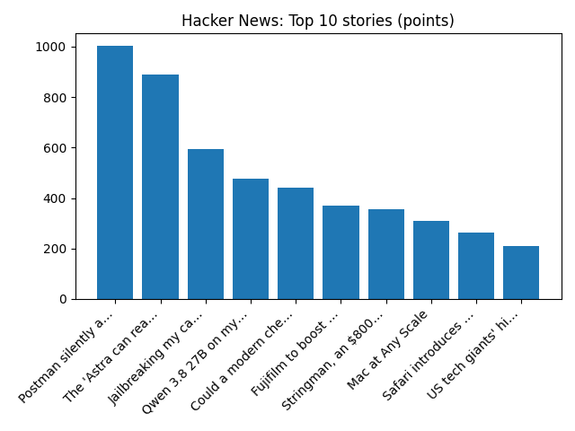

# Daily Knowledge Garden — 2026-11-04

## 🧭 Daily Summary
Global coverage includes Jon Ossoff wins reelection in Georgia, easily defeating Republican Mike Collins; Canva announces major job cuts after 'our hardest year yet'; Graduates are managing AI - but are they learning much else?. Local coverage includes Federal election monitors face different rules in Northern Virginia counties - WUSA9; Fay Ingles Obituary (2026) - Front Royal, VA - Northern Virginia Daily - Legacy | Obituary.

## 🌍 Global News (cross-source)
- [Jon Ossoff wins reelection in Georgia, easily defeating Republican Mike Collins](https://www.npr.org/2026/11/03/g-s1-150143/georgia-senate-race-jon-ossoff-mike-collins) — NPR — Top Stories
- [Canva announces major job cuts after 'our hardest year yet'](https://www.bbc.co.uk/news/articles/cw77pg7neydmo?at_medium=RSS&at_campaign=rss) — BBC — Business
- [Graduates are managing AI - but are they learning much else?](https://www.bbc.co.uk/news/articles/c820vz6wyp65o?at_medium=RSS&at_campaign=rss) — BBC — Tech
- [EXCLUSIVE: Tesla misled South Korean customers about automated-driving tech, consumer group alleges - Reuters](https://news.google.com/rss/articles/CBMi3gFBVV95cUxPaHFtVW90SEVfXzZpTkdUYVU0WENhU1BnZ3I4QW1sUUJjcGxqVHlpZzA4ODAyRF9LUmdRbnpCSjRPdUd2YjVTaktzZnJHeWx4WWxNMDhnaWVoS3c3djAyeEpMUWlaVVZwVE5BYUxnemhmbXlSRzBWdU41c0lRMGQwclZIbTVITE1iQWVhbzNsdjFySF9raFl0aDNHV0JLRjBqMU8xNmxBVmUxNUVpck1XcUlITmNqUFRMUWhHOEJmUzc1cTVMbUxjbVM2c2J0TGRHVG5PV1JNc2ZRSU5OV3c?oc=5) — Reuters — Business (Google News)
- [How hawkmoths turned their genitals into bat-busting weapons](https://www.sciencenews.org/article/hawkmoth-genitals-bat-weapon) — ScienceNews

## 🏙️ Local News
- [Federal election monitors face different rules in Northern Virginia counties - WUSA9](https://news.google.com/rss/articles/CBMi9wFBVV95cUxNSnFuYVpVaE4wd0RCRFV3NWZPQTRlcW0tN0prRnBYczNlRmExNXF5RFZuSXJCbDlqWGhxclZVR3RaaUxfMEF6eDhSSGUzR0RURHpqNmNqM1k1RXd6cUZiX0FPZDFXV3JaV1FlUlEyVllrMENsTzJVZ2tBbjRoUGlRbldMZ1o4V3c1LWxpcDN4aXE2NFhZWlAzdDF0MHRib2FWdDNYSEgwYUdLSXQ5Q3RrdmhmcVVkUjBEdGNPVTZtQWZ5c0FKMGpzc2pXQ1ZQM3o2RFFrazBmb3hMVUxrUk5iYm51RUJYSlI2aFBrQ2dIM2RVcnUxdlBv?oc=5) — Google News — Northern Virginia
- [Fay Ingles Obituary (2026) - Front Royal, VA - Northern Virginia Daily - Legacy | Obituary](https://news.google.com/rss/articles/CBMiiAFBVV95cUxQakZFZC0yUGt1VGVoMGRybTIyR3hiWHV4a21GQzBDU1hMNWl5a1FjSl94M2lJSU9Hd0dCOUFTWlJWVGpyZ1pOdkotOFdSRDIwSzBYdTFTZUNvbHNoUFlLSUlHVnZKT3ltbmRnTVlBdm1mVU43NlRTT2k1RFh5VGNLcHN1TDZ5ZlNR?oc=5) — Google News — Northern Virginia
- [Virginia voter guide: What to know ahead of 2026 midterm elections - WTOP News](https://news.google.com/rss/articles/CBMiogFBVV95cUxNaWU3SDNheHN4TVNWdnpFTTFFb09CUU5BbTF1RmRsMmp4MW9tMVY4Q1FabWlmQ1JPRVhzb3JlWTRUWkd6UFJFOXBlSW1TZ2U1Ul92UEYyUTJzRDNSTEdNRkhWTWtrN3lMLU5TVWsxb3ptOGUzVE5JLUxUTVRSZ1VxXzRBMzdpRHZWZTBSVjZfS2VpUmJzMzk1clNfeE12SUpVQmc?oc=5) — Google News — Northern Virginia
- [Election Day Is Tuesday: Virginia’s Closest House Races, What’s on Your Ballot and How to Vote in Alexandria - Alexandria Living Magazine](https://news.google.com/rss/articles/CBMiZkFVX3lxTE1EakxrMFNqU2haU0RWVWUweDhYS1hXUkdoNWZjM0VhY0cwSmJEeG9wVU9EV0oxcXlLZmtNZ3o2Q3R3R0V1RGRpNVBtbHptVUZCVGxoRllrdEFmUVVORlFxX2NYd2pqdw?oc=5) — Google News — Northern Virginia
- [18 New Northern Virginia Restaurants Serving Up Fresh Flavors - Northern Virginia Magazine](https://news.google.com/rss/articles/CBMivAFBVV95cUxQczBSaXhsT0ZuU24xZWJyVDZRN0pvVEowR2JiWGZhNzJia2tERklXNGRPZDlUNi1NQXF5ZEtrdTBOZHNidHZCZl9mWllYSjdhNDRoYTZhaUVPSVFWdWxodFZ1MjR3dlNKb0kxSGZOZ0UyZ2stNEZQbjJpUXplRVVZZjZNRDZLSFZqVm9SNjlCNS1zR25XMzlPYUY1Z3hoa2N2Y1NFOGp6SmpORGpzaEYwRWlTUWxfTFBkUzduZw?oc=5) — Google News — Northern Virginia

## 🚀 Hacker News (Top 5)
- [Postman silently auto-installs AI plugins and attempts to share all API data](https://github.com/postmanlabs/postman-app-support/issues/14370) — 1002 points, 333 comments
- [The 'Astra can read and write weights to improve Qwen' post is misleading](https://honnibal.dev/blog/astra-read-write-misleading) — 889 points, 190 comments
- [Jailbreaking my car's navigation system just so I can change the time](https://blog.nns.ee/2026/11/02/renault-hack/) — 595 points, 238 comments
- [Qwen 3.8 27B on my laptop can interpret model weights, too](https://simonwillison.net/2026/Nov/3/qwen-can-interpret-model-weights/) — 476 points, 151 comments
- [Could a modern chess engine on a Pentium have defeated Kasparov in 1996?](https://nicholas.carlini.com/writing/2026/algorithmic-improvements-chess.html) — 442 points, 210 comments

## 🌍 Wikipedia — On This Day (selected)
- **2025** — UPS Airlines Flight 2976, a McDonnell Douglas MD-11F crashes into multiple buildings during takeoff at Louisville Muhammad Ali International Airport in Louisville, Kentucky, killing 15 people, including the 3 crew members.
- **2022** — The Khash massacre, which refers to the repression of protesters by Iranian security forces, resulting in 18 deaths and more than 20 injuries.
- **2020** — The Tigray War begins with Tigrayan rebels launching attacks on Ethiopian command centers.
- **2015** — A cargo plane crashes shortly after takeoff from Juba International Airport in Juba, South Sudan, killing at least 37 people.
- **2015** — A building collapses in the Pakistani city of Lahore resulting in at least 45 deaths and at least 100 injuries.

## 🎲 Wikipedia — Random Article
**Gastropod shell**  
The gastropod shell is part of the body of many gastropods, including snails, a kind of mollusc. Shell morphology terms vary by species group.
https://en.wikipedia.org/wiki/Gastropod_shell

## 🌌 NASA APOD
[Comet PanSTARRs and Rainbow Meteor](https://science.nasa.gov/image-article/apod-2026-november-3-comet-panstarrs-and-rainbow-meteor/)

## Feed Health
- **Reuters — Headlines (Google News)**: ok (15 articles)
- **Reuters — World (Google News)**: ok (15 articles)
- **Reuters — Business (Google News)**: ok (15 articles)
- **BBC — World**: ok (15 articles)
- **BBC — Tech**: ok (15 articles)
- **BBC — Business**: ok (15 articles)
- **BBC — Science**: ok (15 articles)
- **AP — Headlines (Google News)**: ok (15 articles)
- **AP — Politics (Google News)**: ok (15 articles)
- **AP — Business (Google News)**: ok (15 articles)
- **NPR — Top Stories**: ok (10 articles)
- **NPR — Politics**: ok (10 articles)
- **NPR — Business**: ok (10 articles)
- **NPR — Science**: ok (10 articles)
- **NPR — Technology**: ok (10 articles)
- **ScienceNews**: ok (15 articles)
- **ScienceDaily — Top**: ok (15 articles)
- **Nature — Technology**: ok (15 articles)
- **Google News — Northern Virginia**: ok (15 articles)
- **Google News — Northern Virginia traffic**: ok (15 articles)
- **Google News — Northern Virginia weather**: ok (15 articles)
- **Wikipedia — On This Day**: ok (10 articles)
- **Wikipedia — Random**: ok (1 articles)
- **NASA — APOD**: ok (1 articles)

Runs so far today: 1
