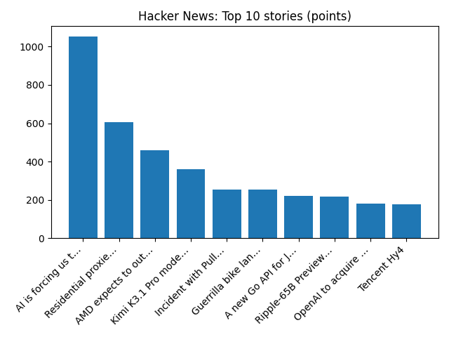

# Daily Knowledge Garden — 2026-11-05

## 🧭 Daily Summary
Global coverage includes Analysis: Trump has defied political consequences for years. The midterms changed that - AP News; Australia's oldest department store David Jones collapses after 188 years; Nevada U.S. House Election Live Results 2026 - AP News. Local coverage includes Civil War soldier who died in Northern Virginia is finally laid to rest - WTOP News; Virginia Republicans reassess party direction after Democratic gains - WUSA9.

## 🌍 Global News (cross-source)
- [Analysis: Trump has defied political consequences for years. The midterms changed that - AP News](https://news.google.com/rss/articles/CBMirgFBVV95cUxPMGdQR1FWSTFPNVdyeFBOWndlR2Y0d28wV2FtQ3hCVFNiMHNnX1k3MWpiYjhQVmlKMmEtNlYtaTBqRVJkYUlCeDI3Ni1McEVwOGxXZ1RVQzJodzlRLUNkTWxoSmZSa1FXbE05SnZ3Tlg0LUtzYVUzRkxoaW1rdTN6ZC1ad056NUVwSmlJbUdMTHB6d0JyUXZEUVpIRldBSk0tSTVnOW54MDU4RkN1c0E?oc=5) — AP — Politics (Google News)
- [Australia's oldest department store David Jones collapses after 188 years](https://www.bbc.co.uk/news/articles/cky93z5y0171o?at_medium=RSS&at_campaign=rss) — BBC — Business
- [Nevada U.S. House Election Live Results 2026 - AP News](https://news.google.com/rss/articles/CBMidkFVX3lxTFBHV0EyRm1IMmZJN2t3TE0tTldXMDFWeGIzelBNX2dDc0VPMVdqUUlzZFNhVlkyMU91Q0o4NE5TSEY2ZXZiSTk3ZjZaUDhKOVEwbjhkcXFZMWhNbHF6VGgwWXFoc01tYnpmUktnR2hVSmlPWDNTanc?oc=5) — AP — Headlines (Google News)
- [Interest rates expected to rise for first time in over three years](https://www.bbc.co.uk/news/articles/ck5ynw45jrgqo?at_medium=RSS&at_campaign=rss) — BBC — Business
- [Qualcomm shares slide as smartphone weakness clouds growth push - Reuters](https://news.google.com/rss/articles/CBMiwAFBVV95cUxPY1J5TU1haGNMUk9CVzZLSmN4d09oZXdTLUFSTEJOMVAxZURhWE5JRVgzVU41TXdHSV92TEJkODQ2Q1NFLUdLSjh6UThlVUVFTUJUS3gxb25ta1VHYjJEMWQ5LUxwTTRzNXpfaUdPOVJxeGhQaDhqMzg5eDRkTENkeUhNa3lwT1k1cEVQQWR6SEl1R1dkVUtFalp2eHVMTDR5VUhiM1JHUjNPRkt5MW1Td2U2UE9SejRBUTJJR0cyaWE?oc=5) — Reuters — Headlines (Google News)

## 🏙️ Local News
- [Civil War soldier who died in Northern Virginia is finally laid to rest - WTOP News](https://news.google.com/rss/articles/CBMiqgFBVV95cUxPLUltX2pSVEpOSmJVa1hveUt1czhBbmNLejc1c19FcW05S21sT1ZHUTZkNEwyb3BCU0llb1pOZDM5blFCXzJER0xHekk0U2RCWUZkRFhRTXN5ZXlrRHRzdTFITko5dVhuMnV0VGZRZk9Pd094by1GYmdxOV83T2JiS2hpQ3dTS24tRGQ4RW9yY2hRa05kaGhpRUYyQUhSakNsT3dDVkl3OTB5dw?oc=5) — Google News — Northern Virginia
- [Virginia Republicans reassess party direction after Democratic gains - WUSA9](https://news.google.com/rss/articles/CBMihwJBVV95cUxNbGNFeWV4dVdJRlVibHlIc0pSVkZhWmZWWEQyZmtQSkE2amxrbGREeXN2Y1hiZXJiQ01OSEdsOUthY0k3UFh5VVdaY3hkRkNoemNfOXR2TlJNS0duZlJiQnhtRmNBYVRwbVdWeldpVzdZVHZUd0Vib2hSV2Y3UkNJcUI0WlJmc2UtR0NNT1FkYjd1LUx6UnhvZVZVR20zMk5GUDFuejhpaGhKYUh3QmR3VmFRaUJLaTJDZHhrSXA2UkJITGc2R1k4UFpSMlRSVkdqcjY4V3ltakhzcDBjMG53Z0prWll5VVo3S1FaLUNrMUhMaHA5dzhsUEFnbzlVRmNPX215Ym9nQQ?oc=5) — Google News — Northern Virginia
- [Pro Exterior Wash Plus Joins Diamond Power Washers in Northern Virginia - The Daily Tribune News](https://news.google.com/rss/articles/CBMijwJBVV95cUxQUjZxV09oQXZRbkNpSGZqYXhTOFFDVDc4Qk5NSUtRZjFaU3Y3ekFUU2paSERUZElWbzJXcndNcVNkRTAwZHdSY1ktbm82QXdURFkwc2wtMWNrQXJKQ3ctNkJXbXE4amtaZXZyVGkzMjR0SFM4MTNjYzVLU0F5RzJjS0JhTEhCd3BYYVhySUtfRTN4TjFnT2VKb2VocXRSWEF4enlHbXN6bmJ1WUlRUEhOaDdOZzlHcVE5UFhkQ19hQ0hBWmZzWmF3ZU1FYzRWU1U4cTh3bWp0ckc5MEZucHVjMzBJU2xXaDBGYXh6U0NNNkJVUGlIWWVaU0tLRENFOXBPT3NjX05VNVBTMk4xYkcw?oc=5) — Google News — Northern Virginia
- [Northern Virginia duo Rachel Renée and Nikki Russell repaint Dork Diaries in color - WJLA](https://news.google.com/rss/articles/CBMi0wFBVV95cUxNcHZlTXFXS3ZzRlI0UjBsLXZvbkRQY1NYaDFlcEFkNUlBbmRFbkVCV2lybVRxOHpOVC1xb2lVTUVoMjVaWU9ZUEJRR3BzTlRwWUpGc19LZkQtV1Y4YnJFZW81OHQ3czdWNGVEQWRIdE5SYWsxb2lWYk55RFZwSWVRdTFwWVp1MnZ0VkFxemtYTnR0U2Fyd0VKY3p1d29CQ0VrYUtLemNnaVFBZjlDMm1tclVzYmY2SkNPSlJTQkp5WkpKZ01lMXFWMEEyM0d0ZnJfTG0w?oc=5) — Google News — Northern Virginia
- [U.S. News & World Report Ranks Porter Traditional School No. 1 middle school in Northern Virginia, No. 2 in Virginia - Prince William County Public Schools](https://news.google.com/rss/articles/CBMijAFBVV95cUxQYVVqRmlTdUQ0MGZ5ay1XenB1a1Y4MXlyUjRmZmRzc1lLWXQyNnN0Z1ZDYUpTN2dmQXZhYkJSTm1za29FUXRlXzFnZkdlQ2RJbXpZYV83SXFhaFRCM1U4ZVM5UGcyNHZiazFJODcwelFrQVNMNjhhdjNBRTR3bE81R1l3dWJoUVFiMUN3Nw?oc=5) — Google News — Northern Virginia

## 🚀 Hacker News (Top 5)
- [AI is forcing us to pay off 40 years of technical debt](https://spectrum.ieee.org/ai-in-cybersecurity-php2shell-vulnerability) — 1054 points, 627 comments
- [Residential proxies detected on White House network](https://layer3intel.com/blog/residential-proxies-white-house-network) — 605 points, 196 comments
- [AMD expects to outsell Intel in Q4 for the first time in history](https://www.tomshardware.com/pc-components/cpus/amd-expects-to-outsell-intel-in-q4-for-the-first-time-in-history-usd17b-guidance-would-exceed-intels-projections) — 459 points, 168 comments
- [Kimi K3.1 Pro model weights are out](https://huggingface.co/moonshotai/Kimi-K3.1-Pro) — 361 points, 98 comments
- [Incident with Pull Requests, Git Operations and Issues](https://www.githubstatus.com/incidents/smtdswd1h2w4) — 254 points, 127 comments

## 🌍 Wikipedia — On This Day (selected)
- **2024** — Donald Trump becomes the first president of the United States to be elected to a non-consecutive second term in 132 years, since Grover Cleveland won the 1892 election.
- **2021** — The Astroworld Festival crowd crush results in 10 deaths and 25 people being hospitalized
- **2017** — Devin Patrick Kelley kills 26 and injures 22 in a church in Sutherland Springs, Texas.
- **2015** — An iron ore tailings dam bursts in the Brazilian state of Minas Gerais, flooding a valley, causing mudslides in the nearby village of Bento Rodrigues and causing at least 17 deaths and two missing.
- **2015** — Rona Ambrose takes over after Stephen Harper as the Leader of the Conservative Party of Canada.

## 🎲 Wikipedia — Random Article
**Sir George Barrow, 2nd Baronet**  
Sir George Barrow, 2nd Baronet,  (22 October 1806 – 1876) was an English civil servant.
https://en.wikipedia.org/wiki/Sir_George_Barrow,_2nd_Baronet

## 🌌 NASA APOD
[The Not-So-Hidden Galaxy, IC 342](https://science.nasa.gov/image-article/apod-2026-november-4-the-not-so-hidden-galaxy-ic-342/)

## Feed Health
- **Reuters — Headlines (Google News)**: ok (15 articles)
- **Reuters — World (Google News)**: ok (15 articles)
- **Reuters — Business (Google News)**: ok (15 articles)
- **BBC — World**: ok (15 articles)
- **BBC — Tech**: ok (15 articles)
- **BBC — Business**: ok (15 articles)
- **BBC — Science**: ok (15 articles)
- **AP — Headlines (Google News)**: ok (15 articles)
- **AP — Politics (Google News)**: ok (15 articles)
- **AP — Business (Google News)**: ok (15 articles)
- **NPR — Top Stories**: ok (10 articles)
- **NPR — Politics**: ok (10 articles)
- **NPR — Business**: ok (10 articles)
- **NPR — Science**: ok (10 articles)
- **NPR — Technology**: ok (10 articles)
- **ScienceNews**: ok (15 articles)
- **ScienceDaily — Top**: ok (15 articles)
- **Nature — Technology**: ok (15 articles)
- **Google News — Northern Virginia**: ok (15 articles)
- **Google News — Northern Virginia traffic**: ok (15 articles)
- **Google News — Northern Virginia weather**: ok (15 articles)
- **Wikipedia — On This Day**: ok (10 articles)
- **Wikipedia — Random**: ok (1 articles)
- **NASA — APOD**: ok (1 articles)

Runs so far today: 1
