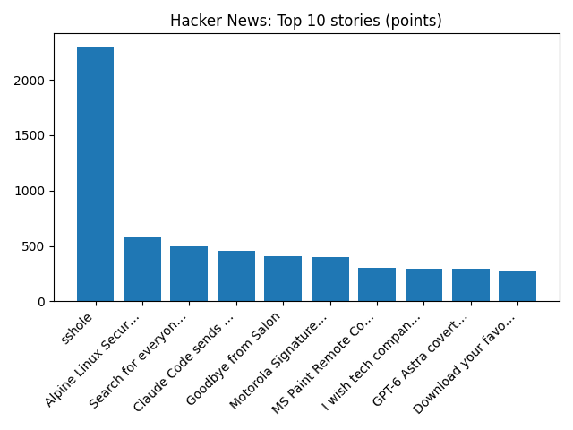

# Daily Knowledge Garden — 2026-11-06

## 🧭 Daily Summary
Global coverage includes Democratic socialist defeats incumbent Karen Bass in Los Angeles mayor's race; Could the earliest weakening of the polar vortex on record bring UK snow?; Florida carries out its 19th execution of year as 3 states administer the death penalty in a day - AP News. Local coverage includes Frances Hurdle Obituary (2026) - Strasburg, VA - Northern Virginia Daily - Legacy | Obituary; Fairfax City Awards Grants to Human Services Nonprofits City of Fairfax, VA - City of Fairfax, VA (.gov).

## 🌍 Global News (cross-source)
- [Democratic socialist defeats incumbent Karen Bass in Los Angeles mayor's race](https://www.bbc.co.uk/news/articles/c6e3xxwk3k11o?at_medium=RSS&at_campaign=rss) — BBC — World
- [Could the earliest weakening of the polar vortex on record bring UK snow?](https://www.bbc.co.uk/weather/articles/cwyvrz09mnd6o?at_medium=RSS&at_campaign=rss) — BBC — Science
- [Florida carries out its 19th execution of year as 3 states administer the death penalty in a day - AP News](https://news.google.com/rss/articles/CBMimgFBVV95cUxQSU9RMHg3N1FVX05NZG5acGlZRGc4STlmXzZtbUg3Y1VLWTFTQTFmcEdRbDlEelRDSnA3SFVvbHNZSW9yaHNHcHNBSkxGa2FvVnhsMzRPWHd5eGwwN1N0QkU4LWZZUU5aQU54Z1JRcWsxSHduWDIxbEJrRDN3UjM4MG5OZ1F1N2hFaElKTlA2WnZBdy1yZi1ONEhR?oc=5) — AP — Headlines (Google News)
- [Key federal panel is expected to approve Trump’s arch while it’s being challenged in court - AP News](https://news.google.com/rss/articles/CBMiowFBVV95cUxQNHlScU9rQWNvSC1DY3NqTjlfSmV0ZTZNNFJ6UkhodWtmQVljUDFtY1NGODBoanhvcDcyNm1RbjdVN2xrTnMzY3NtVkZpenRxM0I2RXNxTlVlWVBnMTZ1aUFQMW9YNkNYcmUwUUNZWlZESEMxZVVEVzdLTU5aTnpQZlplcEJnSlZpRFRoSENTaDkwcnVmUWh5bklwcU01UF9HNko4?oc=5) — AP — Politics (Google News)
- [Fears about an AI crackdown after midterms sparks a $2 trillion rout in tech stocks](https://www.npr.org/2026/11/05/nx-s1-6031987/stock-markets-ai-midterm-elections) — NPR — Top Stories

## 🏙️ Local News
- [Frances Hurdle Obituary (2026) - Strasburg, VA - Northern Virginia Daily - Legacy | Obituary](https://news.google.com/rss/articles/CBMijgFBVV95cUxNVXhKN0NlbllaQUhMUzl1ZXlKYmEwMnF3dmNramNzeUpyakZVNnBpRGx0OXNzYTlqeWhpR2V0clNsa2JPWFlxb0FYbkRmblpaa21BRGZ4Y0tsZHBIREhOZjNTVEUzQXpsbjMxTXlPemVhMlVPMjdPbERGN18wR0xncnZ5WmVZRVBDdTRRUmdR?oc=5) — Google News — Northern Virginia
- [Fairfax City Awards Grants to Human Services Nonprofits City of Fairfax, VA - City of Fairfax, VA (.gov)](https://news.google.com/rss/articles/CBMivgFBVV95cUxNMUVaNk9HSmxMTjBBbjJUMFBBejlXNDJQOWJFcTVBQXhQT3pIRFloYWN6d2ZDREtwcW5JX3pkbzdKcDlRT1V6elRKM1JUZjQ4d2c0SG5VeUxxaDdXeGp0Y25Md3E1b0V1OTRDUzVRVExRU3JMUk51cGJNM1ZJWnZFRWpFdUR2UEd6R1lWcl81N2hrOFo2dHFPekpLRVlHUUdxaWpPSXcxSUhVbnVsUnZEaGRsUWdZRG5GVHFyNW5B?oc=5) — Google News — Northern Virginia
- [Virginia Tech’s Northern Virginia leader to step down - Virginia Business](https://news.google.com/rss/articles/CBMigAFBVV95cUxPdHdWVkd6T1RpNXhYQmhENVhiMjV2RUk1Qm44V1F2bi1LSTVuX2o4NUNTQjg3bnZVeC0tSkJUU01ZNUtTUTl5Wjh6UkoweDAxaDJMaVRpNWlsaG1BWmN5R01mdkZsSDBSVlR0OGxUYXd4aDFORFFJTUhNeUVlZEhtQQ?oc=5) — Google News — Northern Virginia
- [These Are the 24 Best Restaurants in Fairfax County - Northern Virginia Magazine](https://news.google.com/rss/articles/CBMiugFBVV95cUxOX3czM3d1VVA1RTFEbjhSYUplTnNtNEdVT3NRVXhmX045M3hja19hSGpKUEFhOVdHWTJSSE1GTkVyLTdxUjdEYmJpNl9VazI3MlkxMW9vc2g4YjhkdFVMdnIzTXd2blFDejcwUjljUGNNaWJXUW10UEVybHhGbl9Fc2VRQWVNaEJoMGsxLVMweGVRQS1oZXlNallHellwNXlYa243M2RYYzVIbTBocUtxZjlodGtwOS1MRnc?oc=5) — Google News — Northern Virginia
- [6-12 Inches of Snow Expected for D.C., Northern Virginia, and Parts of Maryland in FOX5’s Winter Outlook - The MoCo Show -](https://news.google.com/rss/articles/CBMizgFBVV95cUxQY05uZkhqVUF6SUtRU0lxNzVsR1BxM1BfVkd2Z3R5MVRQQThIaEg5WkNydTl2Z1hHdUFzeU9EVElXMTBrUU9aNUtnVWVIZUJhR3NDcDFXM2V5MzVIUzN6eWNsMlBKV2ZkUUoyRE03V1M3ZUp0LTZTQkJoMlQta2l0a1V6eFNING9kQkg2RmlmUWw3akJ3Rno2b3FpSXd5V0ZpU08zaDhOWFducV94MWJ3ZTFoUE1hb2thUmE0MW80eV9KQUVtOGhKeThocE9IZw?oc=5) — Google News — Northern Virginia

## 🚀 Hacker News (Top 5)
- [sshole](https://sshhole.com) — 2304 points, 569 comments
- [Alpine Linux Security Advisory: OpenSSH-server password authentication bypass](https://alpinelinux.org/posts/2026-11-05-openssh-password-authentication-bypass/) — 579 points, 123 comments
- [Search for everyone](https://kagi.com/changelog#11820) — 499 points, 245 comments
- [Claude Code sends your email address to websites](https://github.com/anthropics/claude-code/issues/107757) — 454 points, 160 comments
- [Goodbye from Salon](https://www.salon.com/2026/11/05/goodbye-from-salon/) — 408 points, 150 comments

## 🌍 Wikipedia — On This Day (selected)
- **2025** — Canadian ostrich cull: The Government of Canada kills 314 ostriches after H5N8 is detected in an ostrich farm in Edgewood, BC.
- **2016** — Syrian civil war: The Syrian Democratic Forces launch an offensive to capture the ISIL-held city of Raqqa.
- **2012** — Tammy Baldwin becomes the first openly gay politician to be elected to the United States Senate.
- **2004** — An express train collides with a stationary car near the village of Ufton Nervet, England, killing seven and injuring 120.
- **2002** — Jiang Lijun is detained by Chinese police for signing the Open Letter to the 16th National Congress of the Chinese Communist Party.

## 🎲 Wikipedia — Random Article
**Traffic (disambiguation)**  
Traffic is road users including pedestrians and vehicles using the public way for purposes of travel. Traffic or Trafic may also refer to:
https://en.wikipedia.org/wiki/Traffic_(disambiguation)

## 🌌 NASA APOD
[Enceladus in Silhouette](https://science.nasa.gov/image-article/apod-2026-november-5-enceladus-in-silhouette/)

## Feed Health
- **Reuters — Headlines (Google News)**: ok (15 articles)
- **Reuters — World (Google News)**: ok (15 articles)
- **Reuters — Business (Google News)**: ok (15 articles)
- **BBC — World**: ok (15 articles)
- **BBC — Tech**: ok (15 articles)
- **BBC — Business**: ok (15 articles)
- **BBC — Science**: ok (15 articles)
- **AP — Headlines (Google News)**: ok (15 articles)
- **AP — Politics (Google News)**: ok (15 articles)
- **AP — Business (Google News)**: ok (15 articles)
- **NPR — Top Stories**: ok (10 articles)
- **NPR — Politics**: ok (10 articles)
- **NPR — Business**: ok (10 articles)
- **NPR — Science**: ok (10 articles)
- **NPR — Technology**: ok (10 articles)
- **ScienceNews**: ok (15 articles)
- **ScienceDaily — Top**: ok (15 articles)
- **Nature — Technology**: ok (15 articles)
- **Google News — Northern Virginia**: ok (15 articles)
- **Google News — Northern Virginia traffic**: ok (15 articles)
- **Google News — Northern Virginia weather**: ok (15 articles)
- **Wikipedia — On This Day**: ok (10 articles)
- **Wikipedia — Random**: ok (1 articles)
- **NASA — APOD**: ok (1 articles)

Runs so far today: 1
