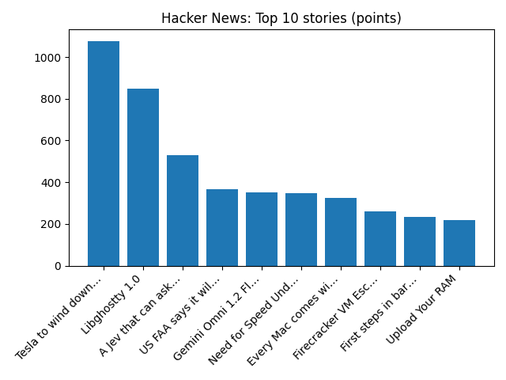

# Daily Knowledge Garden — 2026-11-07

## 🧭 Daily Summary
Global coverage includes Los Angeles, CA Mayor Nonpartisan Runoff Election Election Live Results 2026 - AP News; Two killed, at least 10 injured in shooting in Polish city of Krakow, TVN24 reports - Reuters; Italy foreign minister says he has been targeted by pro-Russian hackers over Ukraine backing - Reuters. Local coverage includes Maryland and Northern Virginia Meteorologists Tease Potential Snowstorm November 13-16 - The MoCo Show -; 20-35 Inches of Snow For D.C., Maryland, and Northern Virginia in WUSA9’s Winter Outlook - The MoCo Show -.

## 🌍 Global News (cross-source)
- [Los Angeles, CA Mayor Nonpartisan Runoff Election Election Live Results 2026 - AP News](https://news.google.com/rss/articles/CBMihwFBVV95cUxNb1A3LU02UEMzODJVNUMwNVpGTkxzYjF3VW0xYi1WUlByTHN4ZmhjR0M0QnotWUt4c3ZXWnJ2dHcxVENGWHd3V0pVNEVCZWRMNzJmaUoyREhSUjFiLXQzcGtVbHN5QVhYemZ1ZU5mdUxYeTNteHFPbGVDRXh5UzZnZWJWQUE4RDg?oc=5) — AP — Business (Google News)
- [Two killed, at least 10 injured in shooting in Polish city of Krakow, TVN24 reports - Reuters](https://news.google.com/rss/articles/CBMiuAFBVV95cUxPRTFhVC1uNVB5TFlvcHRtb2h6RmJPdjY0SDZjdWRJSUw0RlVLUUtnbkFlNGtZRlczbE5RU1U0NEhIRG9Ya3ZmNVlRb243YWQ5OTNkNThoaG1ZYUxONkZsaDJTeTctek9yX3hidk5lVU9qRUJidG5PNkczQVhKcEJKMG5nZzdGSVhUZUJ0S3RwWFJqbmVzSFU5YmE3dDgtRllhUVpDNkxxdnN6Q21MQ1A1cjFPNjc4cUdx?oc=5) — Reuters — Headlines (Google News)
- [Italy foreign minister says he has been targeted by pro-Russian hackers over Ukraine backing - Reuters](https://news.google.com/rss/articles/CBMiugFBVV95cUxNYWZNYXdzeHF4Ymh3blFVa2M3MlNpVWRUN0FjRXlkcWtVTjdwd0ZWZF9FSXpISWczYURGdmxzWVh1RE9SQ0NvaUhkTFV5dXg2dExMU1lGOVNJYnAyRUFGMUF2U1RMR0dlbFRiT3JmNV92Q3E0LUh6ZHU2Vm1WN2RvMk1hQWZyVTNlbGNCWFEyd3RtSkZaTHlEanRmOWJ3Qk1BQ3BSSDFwamdUb3pGWmVrQ1BWMnQwMW9rTFE?oc=5) — Reuters — Headlines (Google News)
- [No clear winner after tight New Zealand general election](https://www.bbc.co.uk/news/articles/c3ewev11g1e0o?at_medium=RSS&at_campaign=rss) — BBC — World
- [A promising new medicine against heart disease fails unexpectedly](https://www.npr.org/2026/11/07/nx-s1-6026379/lpa-drug-lipoproteina-heart-attack) — NPR — Top Stories

## 🏙️ Local News
- [Maryland and Northern Virginia Meteorologists Tease Potential Snowstorm November 13-16 - The MoCo Show -](https://news.google.com/rss/articles/CBMiuwFBVV95cUxOREM4QVFEdUtsdWE5OXVsNUJ2Zi0tR0h3Y1p6amdNenlFSzFmXzQwRWdFaXgxbTlvWUFIX3dZMTFqMERzenVZS1hsVV9EdU1BQS03SkRaNkN6OE5iWHZjNjdRZzhrd045TnlBOXBDRVI5b3dFYzZvbElGaC04OTMybFo4WThTenZmTTdVc2p1MTB1RlRJaEtib3ZfRW95S1B2YV92MVprU1NTNnRLTzlxcVIyNm5qeEFRNmVz?oc=5) — Google News — Northern Virginia
- [20-35 Inches of Snow For D.C., Maryland, and Northern Virginia in WUSA9’s Winter Outlook - The MoCo Show -](https://news.google.com/rss/articles/CBMiuAFBVV95cUxQTHN3V1pJUEtvUEJTUjd3ZHQ4ZGlSclloRDVoNF9WZ1drc21pMnNYMDNqYnhXMlBWTi13eTJyalBNaTB0XzNCR1Y0eDhSN0xFdUVfZ3g1WmRtWHRVbFI1WmpnWTlsSTBLODl6OU1na2JoSkRTMkVJa2RrcUpBQUtseWRuSVNJUmRZOG4tdUdYaVFpdHNRT2EtMzZZajh1d1lHMzFjMnFHUnNoWUlPeUF2ZTNucGM3Zmhr?oc=5) — Google News — Northern Virginia
- [Northern Virginia high school football scores for Nov. 6 - InsideNoVa](https://news.google.com/rss/articles/CBMinwFBVV95cUxPZFI0TVNHZzNPMU1hVHFZTlg5QzlWQTBMX0NHbHJmRVZWSHo4bWVxalNDdmdaYzdsR3U0R2RpZGY4RGVVZHlCS042SXdyVEQwM2RodUd6NDZ6UnZwLVB6MUk1a3V6bzhPZFpORUhpNkJzS2IzdjdlXzR5d1R4M1JBeTRDQVJyYnFrU0pMNlZyRVV4cmlyOWE5eGRYMkpBdFE?oc=5) — Google News — Northern Virginia
- [Last-minute cancellation of Northern Virginia Christmas market leaves 200 vendors scrambling - WUSA9](https://news.google.com/rss/articles/CBMi1gFBVV95cUxOUjVadUVOalVhWThuRDI3NzY3RHR3djNtbjFVS21WaGFnX0ZLajJhXzdrSi05eU4xNkdJdmNLdmJYWmJKUWk1Z2Q0UHZieWdhWENWNWNxOEgybkF1XzIyM2o1Z1dHeTlWS0lxUDdZZlFCRHRSYUd0dVl5UlZfVGdHRGtLMUh2RUdjblVWR1pvVFh1ZWJwR2dtcG9qVEMwZm5jaDZKaGFLR0NiazhFb09hOVpGNHlXSjd4R05TRW9HNF9XYnZpOXZScTlPY0hhMFJPX0l0Zkln?oc=5) — Google News — Northern Virginia
- [U.S. News & World Report Ranks Porter Traditional School No. 1 Middle School in Northern Virginia, No. 2 in Virginia - Prince William Living](https://news.google.com/rss/articles/CBMi2wFBVV95cUxNUURwcjRObkQybXQzTUNKSzR1TmxFRjNlb0xVemNsbGZMSnYwT1RSVjN6U3dhdXptNDhuNExROHVhZXdQSEtzeWtPWlhmRDZhNjlNLU1teUJDQTF1V1BEblVWbzNwRzhnU19xYlNlcUlnRy1MbXhqSno4ZEdlS0hfaGZRRHRHYnUwYVk4OUMxRHBZZEZodm12dnlWQkUtSzdGRWxVWjAtSk1QSG5lN2xvbjJXVDlxSktKajk2VGtYWWVYN2E5OG5SeG1veGpCTU9veXpuOE5SZHFhUDA?oc=5) — Google News — Northern Virginia

## 🚀 Hacker News (Top 5)
- [Tesla to wind down Cybertruck production](https://www.nbcnews.com/tech/tech-news/tesla-wind-cybertruck-production-years-poor-sales-markets-rcna607817) — 815 points, 1657 comments
- [Deus Ex](https://www.filfre.net/2026/11/deus-ex/) — 333 points, 169 comments
- [A Jev that can ask Opus for help gives Opus accuracy at 4x lower cost](https://hightouch.com/blog/llm-judges-identity-resolution) — 303 points, 65 comments
- [Gemini Omni 1.2 Flash](https://blog.google/innovation-and-ai/technology/developers-tools/introducing-gemini-omni-1-2-flash/) — 292 points, 216 comments
- [US FAA says it will phase out floppy disks from air traffic control by 2028](https://www.reuters.com/world/us/us-faa-says-it-will-phase-out-floppy-disks-air-traffic-control-by-2028-2026-11-05/) — 268 points, 211 comments

## 🌍 Wikipedia — On This Day (selected)
- **2023** — António Costa resigns as Prime Minister of Portugal following news of an investigation in a corruption scandal implicating members of his cabinet.
- **2020** — Joe Biden is confirmed elected as the 46th president of the United States, defeating incumbent Donald Trump.
- **2017** — Shamshad TV is attacked by gunmen and suicide bombers, with a security guard killed and 20 people wounded; ISIS claims responsibility for the attack.
- **2012** — An earthquake off the Pacific coast of Guatemala kills at least 52 people.
- **2007** — The Jokela school shooting in Jokela, Tuusula, Finland, takes place, resulting in the death of nine people.

## 🎲 Wikipedia — Random Article
**Oxygen (building)**  
Oxygen is an office building in Szczecin, Poland, located at 26 Malczewski Street, at the corner with Emancipation Avenue, within the neighbourhood of Downtown-North. The building was designed by Gdańsk-based architecture firm Arch-Deco, and opened on 7 November 2010.
https://en.wikipedia.org/wiki/Oxygen_(building)

## 🌌 NASA APOD
[De Gerlache-Kocher Massif](https://science.nasa.gov/image-article/apod-2026-november-7-de-gerlache-kocher-massif/)

## Feed Health
- **Reuters — Headlines (Google News)**: ok (15 articles)
- **Reuters — World (Google News)**: ok (15 articles)
- **Reuters — Business (Google News)**: ok (15 articles)
- **BBC — World**: ok (15 articles)
- **BBC — Tech**: ok (15 articles)
- **BBC — Business**: ok (15 articles)
- **BBC — Science**: ok (15 articles)
- **AP — Headlines (Google News)**: ok (15 articles)
- **AP — Politics (Google News)**: ok (15 articles)
- **AP — Business (Google News)**: ok (15 articles)
- **NPR — Top Stories**: ok (10 articles)
- **NPR — Politics**: ok (10 articles)
- **NPR — Business**: ok (10 articles)
- **NPR — Science**: ok (10 articles)
- **NPR — Technology**: ok (10 articles)
- **ScienceNews**: ok (15 articles)
- **ScienceDaily — Top**: ok (15 articles)
- **Nature — Technology**: ok (15 articles)
- **Google News — Northern Virginia**: ok (15 articles)
- **Google News — Northern Virginia traffic**: ok (15 articles)
- **Google News — Northern Virginia weather**: ok (15 articles)
- **Wikipedia — On This Day**: ok (10 articles)
- **Wikipedia — Random**: ok (1 articles)
- **NASA — APOD**: ok (1 articles)

Runs so far today: 2
