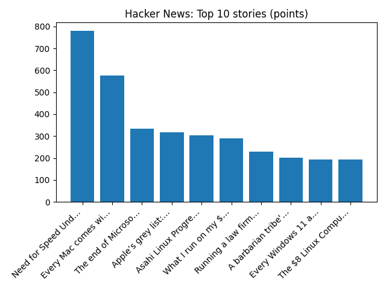

# Daily Knowledge Garden — 2026-11-08

## 🧭 Daily Summary
Global coverage includes Judge orders Paraguay's ex-president Peña held before trial - Reuters; What we know so far after Krakow gun attack; Poland in shock after six die in Krakow mass shooting - Reuters. Local coverage includes Maryland and Northern Virginia Meteorologists Tease Potential Snowstorm November 13-16 - The MoCo Show -; 20-35 Inches of Snow For D.C., Maryland, and Northern Virginia in WUSA9’s Winter Outlook - The MoCo Show -.

## 🌍 Global News (cross-source)
- [Judge orders Paraguay's ex-president Peña held before trial - Reuters](https://news.google.com/rss/articles/CBMixwFBVV95cUxQVGw3MmJzOEt0S1ozTzJoUDVsWDYya0FocXVpaGU0cG1EYWdILUp1UWc4SjMzaEg2ZnZWR0ZKRG5uaGhXVW0wbkFlMTFuVVp0WmFlZWQ3cnJuYy1WanFqSVlZYkdOQXBNRTJtcExjajYyZnU4ZXpTRmVpOGNGTnJfaERjTHVLUm9USjdpS1J2VGV1Z09zZ1ZxaGpVUVVjRHpON3ctb0JFUzRBX3VQUEVsZXIzWXR6eFJObk05SGlDelpVM0F5NF84?oc=5) — Reuters — Headlines (Google News)
- [What we know so far after Krakow gun attack](https://www.bbc.co.uk/news/articles/cmd7q15drwgeo?at_medium=RSS&at_campaign=rss) — BBC — World
- [Poland in shock after six die in Krakow mass shooting - Reuters](https://news.google.com/rss/articles/CBMiuAFBVV95cUxPRTFhVC1uNVB5TFlvcHRtb2h6RmJPdjY0SDZjdWRJSUw0RlVLUUtnbkFlNGtZRlczbE5RU1U0NEhIRG9Ya3ZmNVlRb243YWQ5OTNkNThoaG1ZYUxONkZsaDJTeTctek9yX3hidk5lVU9qRUJidG5PNkczQVhKcEJKMG5nZzdGSVhUZUJ0S3RwWFJqbmVzSFU5YmE3dDgtRllhUVpDNkxxdnN6Q21MQ1A1cjFPNjc4cUdx?oc=5) — Reuters — Headlines (Google News)
- [Melania Trump and LSU announce $7.2M to endow scholarships for former foster care students - AP News](https://news.google.com/rss/articles/CBMisgFBVV95cUxNaE9fZWFrMkNPS05yeXBqOVE0eWtqcldnVk9WT2gtVGJOZEhFY29rbENXUExfUmFrbVAxUzB4eFlwVGNVX2VhLTRwa3dtd2tvV25WU1NJODNtMWdsZUlJTWhURUc2MnlCSWltUzZtNUF1ZzVxUjRSejZHY0t5eVl5eHRqWGZkS2Z0c0pCTEowZi1GajhiaXBvOHlORTdUbmM5TnN5VTZVLWw0MEU1UFhZdzlR?oc=5) — AP — Headlines (Google News)
- [Israel's president tasks opposition leader Eisenkot with forming government](https://www.bbc.co.uk/news/articles/cmy8367lj5xlo?at_medium=RSS&at_campaign=rss) — BBC — World

## 🏙️ Local News
- [Maryland and Northern Virginia Meteorologists Tease Potential Snowstorm November 13-16 - The MoCo Show -](https://news.google.com/rss/articles/CBMiuwFBVV95cUxOREM4QVFEdUtsdWE5OXVsNUJ2Zi0tR0h3Y1p6amdNenlFSzFmXzQwRWdFaXgxbTlvWUFIX3dZMTFqMERzenVZS1hsVV9EdU1BQS03SkRaNkN6OE5iWHZjNjdRZzhrd045TnlBOXBDRVI5b3dFYzZvbElGaC04OTMybFo4WThTenZmTTdVc2p1MTB1RlRJaEtib3ZfRW95S1B2YV92MVprU1NTNnRLTzlxcVIyNm5qeEFRNmVz?oc=5) — Google News — Northern Virginia
- [20-35 Inches of Snow For D.C., Maryland, and Northern Virginia in WUSA9’s Winter Outlook - The MoCo Show -](https://news.google.com/rss/articles/CBMiuAFBVV95cUxQTHN3V1pJUEtvUEJTUjd3ZHQ4ZGlSclloRDVoNF9WZ1drc21pMnNYMDNqYnhXMlBWTi13eTJyalBNaTB0XzNCR1Y0eDhSN0xFdUVfZ3g1WmRtWHRVbFI1WmpnWTlsSTBLODl6OU1na2JoSkRTMkVJa2RrcUpBQUtseWRuSVNJUmRZOG4tdUdYaVFpdHNRT2EtMzZZajh1d1lHMzFjMnFHUnNoWUlPeUF2ZTNucGM3Zmhr?oc=5) — Google News — Northern Virginia
- [Northern Virginia high school football scores for Nov. 6 - InsideNoVa](https://news.google.com/rss/articles/CBMinwFBVV95cUxPZFI0TVNHZzNPMU1hVHFZTlg5QzlWQTBMX0NHbHJmRVZWSHo4bWVxalNDdmdaYzdsR3U0R2RpZGY4RGVVZHlCS042SXdyVEQwM2RodUd6NDZ6UnZwLVB6MUk1a3V6bzhPZFpORUhpNkJzS2IzdjdlXzR5d1R4M1JBeTRDQVJyYnFrU0pMNlZyRVV4cmlyOWE5eGRYMkpBdFE?oc=5) — Google News — Northern Virginia
- [Last-minute cancellation of Northern Virginia Christmas market leaves 200 vendors scrambling - WUSA9](https://news.google.com/rss/articles/CBMi1gFBVV95cUxOUjVadUVOalVhWThuRDI3NzY3RHR3djNtbjFVS21WaGFnX0ZLajJhXzdrSi05eU4xNkdJdmNLdmJYWmJKUWk1Z2Q0UHZieWdhWENWNWNxOEgybkF1XzIyM2o1Z1dHeTlWS0lxUDdZZlFCRHRSYUd0dVl5UlZfVGdHRGtLMUh2RUdjblVWR1pvVFh1ZWJwR2dtcG9qVEMwZm5jaDZKaGFLR0NiazhFb09hOVpGNHlXSjd4R05TRW9HNF9XYnZpOXZScTlPY0hhMFJPX0l0Zkln?oc=5) — Google News — Northern Virginia
- [U.S. News & World Report Ranks Porter Traditional School No. 1 Middle School in Northern Virginia, No. 2 in Virginia - Prince William Living](https://news.google.com/rss/articles/CBMi2wFBVV95cUxNUURwcjRObkQybXQzTUNKSzR1TmxFRjNlb0xVemNsbGZMSnYwT1RSVjN6U3dhdXptNDhuNExROHVhZXdQSEtzeWtPWlhmRDZhNjlNLU1teUJDQTF1V1BEblVWbzNwRzhnU19xYlNlcUlnRy1MbXhqSno4ZEdlS0hfaGZRRHRHYnUwYVk4OUMxRHBZZEZodm12dnlWQkUtSzdGRWxVWjAtSk1QSG5lN2xvbjJXVDlxSktKajk2VGtYWWVYN2E5OG5SeG1veGpCTU9veXpuOE5SZHFhUDA?oc=5) — Google News — Northern Virginia

## 🚀 Hacker News (Top 5)
- [Need for Speed Underground 2 online in the browser](https://nfsu2.xyz/) — 779 points, 222 comments
- [Every Mac comes with an (undocumented) family member classifier](https://8rank.ai/game/apple-intelligence-personal-knowledge-graph) — 577 points, 330 comments
- [The end of Microsoft Research's AI Frontiers group](https://hunch.net/?p=13764006) — 335 points, 194 comments
- [Apple’s grey list: Words and phrases your iPhone won’t help you spell](https://www.theguardian.com/technology/2026/nov/06/struggling-to-spell-male-chauvinist-pig-apple-grey-list-means-your-iphone-wont-help-you) — 318 points, 220 comments
- [Asahi Linux Progress Linux 7.3](https://asahilinux.org/2026/11/progress-report-7-3/) — 304 points, 252 comments

## 🌍 Wikipedia — On This Day (selected)
- **2020** — Myanmar holds the 2020 general election, re-electing a government led by the National League for Democracy, which is deposed by the Burmese military the following February during the 2021 Myanmar coup d'état.
- **2017** — The Louvre Abu Dhabi was inaugurated by the French president Emmanuel Macron and then-crown prince of Abu Dhabi Mohamed bin Zayed Al Nahyan.
- **2016** — Indian Prime Minister Narendra Modi publicly announces the withdrawal of ₹500 and ₹1000 denomination banknotes.
- **2016** — Donald Trump is elected the 45th President of the United States, defeating Hillary Clinton, the first woman ever to receive a major party's nomination.
- **2013** — Typhoon Haiyan, one of the strongest tropical cyclones ever recorded, strikes the Visayas region of the Philippines; the storm left at least 6,340 people dead with over 1,000 still missing, and caused $2.86 billion (2013 USD; equivalent to $3.95 billion in 2025) in damage.

## 🎲 Wikipedia — Random Article
**Enfield, Connecticut**  
Enfield is a town in Hartford County, Connecticut, United States, first settled by John and Robert Pease of Salem, Massachusetts Bay Colony. It is bordered by Longmeadow, Massachusetts, and East Longmeadow, Massachusetts, to the north, Somers to the east, East Windsor and Ellington to the south, and the Connecticut River (towns of Suffield and Windsor Locks) to the west.
https://en.wikipedia.org/wiki/Enfield,_Connecticut

## 🌌 NASA APOD
[De Gerlache-Kocher Massif](https://science.nasa.gov/image-article/apod-2026-november-7-de-gerlache-kocher-massif/)

## Feed Health
- **Reuters — Headlines (Google News)**: ok (15 articles)
- **Reuters — World (Google News)**: ok (15 articles)
- **Reuters — Business (Google News)**: ok (15 articles)
- **BBC — World**: ok (15 articles)
- **BBC — Tech**: ok (15 articles)
- **BBC — Business**: ok (15 articles)
- **BBC — Science**: ok (15 articles)
- **AP — Headlines (Google News)**: ok (15 articles)
- **AP — Politics (Google News)**: ok (15 articles)
- **AP — Business (Google News)**: ok (15 articles)
- **NPR — Top Stories**: ok (10 articles)
- **NPR — Politics**: ok (10 articles)
- **NPR — Business**: ok (10 articles)
- **NPR — Science**: ok (10 articles)
- **NPR — Technology**: ok (10 articles)
- **ScienceNews**: ok (15 articles)
- **ScienceDaily — Top**: ok (15 articles)
- **Nature — Technology**: ok (15 articles)
- **Google News — Northern Virginia**: ok (15 articles)
- **Google News — Northern Virginia traffic**: ok (15 articles)
- **Google News — Northern Virginia weather**: ok (15 articles)
- **Wikipedia — On This Day**: ok (10 articles)
- **Wikipedia — Random**: ok (1 articles)
- **NASA — APOD**: ok (1 articles)

Runs so far today: 1
