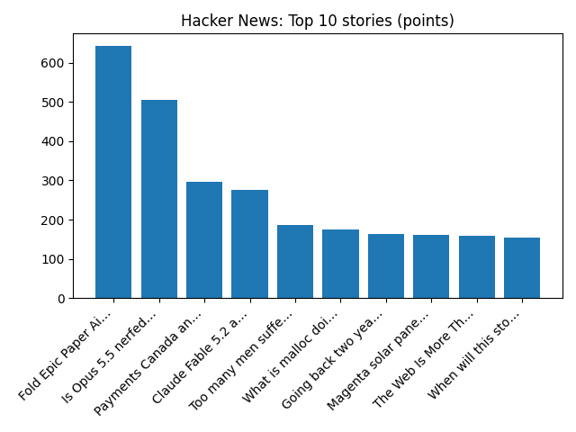

# Daily Knowledge Garden — 2026-11-09

## 🧭 Daily Summary
Global coverage includes Republican congressman to force impeachment vote on Defence Secretary Hegseth; Internal probe into CEO Jensen Huang and 'foreign intelligence' weighs on high-flying Nvidia shares - AP News; Boeing to cut 5% of commercial jet workforce amid production struggles - Reuters. Local coverage includes The Alvarez Law Firm Helps Northern Virginia Drivers Facing Reckless Driving Charges During Holiday Travel - azcentral.com and The Arizona Republic; Councilman seeks to bring downstate lawmakers aboard N. Va. transit to make case for funding - ALXnow.

## 🌍 Global News (cross-source)
- [Republican congressman to force impeachment vote on Defence Secretary Hegseth](https://www.bbc.co.uk/news/articles/cwr5y58jjp8ro?at_medium=RSS&at_campaign=rss) — BBC — World
- [Internal probe into CEO Jensen Huang and 'foreign intelligence' weighs on high-flying Nvidia shares - AP News](https://news.google.com/rss/articles/CBMikwFBVV95cUxPeXdpaDhrWVBiWm9zYjdnNTlEczJPX1g2YzExNUhpVml5WGZldkgtdXhnRWZ5QTVPWkFBLTAydEJ1MVhvNXBQZ0otcmlYNFZMRVY2bC1xb0VfVEFiZG5kUjN0VG1tU2duOWpZUHlfSTJpZEp2cDFqYnFCUGVaWTF5cDVvLVNNVFlqQ3ZSWmNPSXNMZlE?oc=5) — AP — Politics (Google News)
- [Boeing to cut 5% of commercial jet workforce amid production struggles - Reuters](https://news.google.com/rss/articles/CBMiyAFBVV95cUxOYVdQLTVQc2wtZzFUaDBNM3phQnpkZ0dfUlBXY2N3Z1BYcnZ3ajlMVjByY0gtcXExaWx5Qmx6T2M5LS1TMVhKb21teGtmZ082TmdoRGhGZkQwMTlqQzhncDFZaDhhNW9Rbml4VVZRSTZlTGRGb29JYW1pVUsxNUt4amNpdTlVTmRxZmdTMk0zNW55UXRLSHE5a0ZpZDFJenQwd2hPWjZ0UFZ2NzhiYl9meWphV0YzR1REZWNSOGRuMDZHTl9qdE1odw?oc=5) — Reuters — Headlines (Google News)
- [Hegseth calls Iran war necessary and waves off ‘the noise’ of expected impeachment push - AP News](https://news.google.com/rss/articles/CBMiqgFBVV95cUxQZjJQVDlfd0pOX1hsbURBWTRUQXR0T2VROGp4cmRmTUl0ZnMzYmh0OE9CSTd5STBxaTAxTHU4Ni1GOUQyWTVNbUlUX2hCM2NQOFBVTzdQemFkcWJ6R1N6QmY2Mnl6TmcxR0tiSmdUSUxTS0otcW00cERJbmJuNkRKZ0NiRTJqX2JWLTMxZmtqQnVzaVRVZ290X0YycHpFRFFaQk9WVVB6ZnZSQQ?oc=5) — AP — Headlines (Google News)
- [EXCLUSIVE: French officials blame Iran for refrigerator hacks, vow retaliation - Reuters](https://news.google.com/rss/articles/CBMisgFBVV95cUxQam51ejNqNThjR0wtTnFjaTNObkVoS25CUzUySnBhRVc5bWlIZnhpM0ZleDhuSnJ2Z19xcWd3Q1Z3bnJkQmo1NmlJZGZnYUhEQ3ZCNHF6Y1hKM3BHZlpYOUZGTDA4WjhyaEZXcVU1NzM3YUxsUWJvRl9tYS1YSU1WSEpCN3h0eWx5SU1ReU1pRUlzaFNJd2N1YS1PNDFsbndESXV1ODJTaUE4YldYVzFicWln?oc=5) — Reuters — Headlines (Google News)

## 🏙️ Local News
- [The Alvarez Law Firm Helps Northern Virginia Drivers Facing Reckless Driving Charges During Holiday Travel - azcentral.com and The Arizona Republic](https://news.google.com/rss/articles/CBMi8gFBVV95cUxNdVpaSWRza2pTQmdzMV82THpPb2YyMFlSYWRvMGlPREN3aTg0bW1nUUFlUzF6cWx1TnJFR0dBN08zb3VhRHRoNE5kUmpsQlVFTWRwWERwdDB5RUZKV01LRXRVaU53WWFYOGdJU29OcmJpSXBjNWxqQ2p0S2RBck9SRkRyVllHTUZOV1lCTVdJaEhWQml0TFRvUVp4LXcwenR3azRYNVI1N2pneEEwWjJmbFVMcGdURmdSQ0xfMnZ6WS1XMmxra240TWFTV1k0dXZkeUJFcmxuVnZYT2lTTURreVFGRG1kTEhhNjdoaVlieEw3Zw?oc=5) — Google News — Northern Virginia
- [Councilman seeks to bring downstate lawmakers aboard N. Va. transit to make case for funding - ALXnow](https://news.google.com/rss/articles/CBMiwwFBVV95cUxPaU5EUmVzOXY3NnNFOGhuZ0lQby1iWGhoSTFuXzR5d09iSVQ0ajFSWUxqbHpKaTY3a20xYk9ZeFNyNmlDNHBxeG9QMmFMQkJnS3A3eGFFbk9fb0d2LVRxVGthZEU4bVBkLTNkSzlRTF9vT0FHbVNNTllfeDJVc2Vqb0UzSnNYUFU2czZNaDB6bUNDOUF3WWlvaWloMVZOTE56azNaYzhnblkySWREbmNDdF9MWDRiRkdBa2VqWDNOQkJNenc?oc=5) — Google News — Northern Virginia
- [Local, state leaders still debating who should pay for future Metro service - FFXnow](https://news.google.com/rss/articles/CBMirgFBVV95cUxNVm9oQnhQeEk2TUEwbUYwYW0ySW9WUFJGMzhzYk92RmttVFZjWFVWR3hSOF9oMnZpM2ZkSVpJSzlpajJ1c2dPdVBRc3Q4U25nRWtkZWhsTEZ1ek9XOENWd0trVy0zbVNla05YYm5PSFZ1bjBvX0NZeks5ZWp4aFdUa1h0QjYtalI3eWtvUXd5bDZBU2dmZ3hqZHFFQ0VRamFCeHUwVlI4YXg4VklfV0E?oc=5) — Google News — Northern Virginia
- [Potential bump in Metrobus fares raises concerns for County Board member - ARLnow](https://news.google.com/rss/articles/CBMiqwFBVV95cUxQOVR3dktMd3VpbzlySVhobVdINTFBVU94SGU5WTEzX2hLRmViTGxwd1NxdUJESzJvLVlPckNqOVc2LTJ3VTBrU3FBc1BZSVo1SDNMUlRDanFiSU9tb3VRcTA2OUZFSTJwWGkzSTRMRjZkQWUzQTgwTzNHeS1iRUtRUnZicWtJRlVYaTlRRWpIYnNQTEJ2MjFWTU1BMXY3bW8tUk5hUER6SDcxVWM?oc=5) — Google News — Northern Virginia
- [9 Ways to Celebrate Veterans Day in Northern Virginia and DC - Northern Virginia Magazine](https://news.google.com/rss/articles/CBMiqgFBVV95cUxQckFkTG9VQVpwcURwNjlVX21mN1RpSG9qd0RiOXR4eUoyNmh1T3gtakItN2FDNTRRV3FNTW1ld0ZNNENCYnRFclMxUjNpUWRFLVZIMHdQQ2hCRVJtazNfREdkMGJxRTkyR1QyMUQ2NElUcTVNVzlNREJPREp1WUNQQ05kWGVReTNxTWlXYlhMaXVQYTFUMEhwcVFfLTkzNnpWaHhqX21vYzhkQQ?oc=5) — Google News — Northern Virginia

## 🚀 Hacker News (Top 5)
- [Goodbye Claude, hello Pi](https://caleb.software/posts/claude-to-pi.html) — 689 points, 424 comments
- [Claude Code's "Don't Ask Again" exposes passwords in 1,122 public GitHub files](https://apiiro.com/blog/coding-agents-leaking-secrets-github-dont-ask-again) — 582 points, 394 comments
- [Goldman Sachs is pulling Claude Code from its bankers and traders](https://www.thestateofai.com/news/goldman-sachs-claude-code-traders-bankers) — 566 points, 339 comments
- [Nvidia Board of Directors Is Investigating Jensen Huang](https://nvidianews.nvidia.com/news/statement-from-nvidia-board-of-directors) — 360 points, 275 comments
- [Llama-modchip: 284B DeepSeek on 64GB RAM, no GPU](https://github.com/synchopate/llama-modchip) — 351 points, 146 comments

## 🌍 Wikipedia — On This Day (selected)
- **2023** — U.S. surgeons at NYU Langone Health announce the world's first whole eye transplant.
- **2020** — Second Nagorno-Karabakh War: An armistice agreement is signed by Armenia, Azerbaijan and Russia.
- **2014** — A non-binding self-determination consultation is held in Catalonia, asking Catalan citizens their opinion on whether Catalonia should become a state and, if so, whether it should be an independent state.
- **2012** — A train carrying liquid fuel crashes and bursts into flames in northern Myanmar, killing 27 people and injuring 80 others.
- **2012** — At least 27 people are killed and dozens are wounded in conflicts between inmates and guards at Welikada prison in Colombo.

## 🎲 Wikipedia — Random Article
**Sylvester Uphus**  
He served on the Ashley Township board. He lived in Sauk Centre, Minnesota.
https://en.wikipedia.org/wiki/Sylvester_Uphus

## 🌌 NASA APOD
[Rigel and the Witch Head Nebula](https://science.nasa.gov/image-article/apod-2026-november-9-rigel-and-the-witch-head-nebula/)

## Feed Health
- **Reuters — Headlines (Google News)**: ok (15 articles)
- **Reuters — World (Google News)**: ok (15 articles)
- **Reuters — Business (Google News)**: ok (15 articles)
- **BBC — World**: ok (15 articles)
- **BBC — Tech**: ok (15 articles)
- **BBC — Business**: ok (15 articles)
- **BBC — Science**: ok (15 articles)
- **AP — Headlines (Google News)**: ok (15 articles)
- **AP — Politics (Google News)**: ok (15 articles)
- **AP — Business (Google News)**: ok (15 articles)
- **NPR — Top Stories**: ok (10 articles)
- **NPR — Politics**: ok (10 articles)
- **NPR — Business**: ok (10 articles)
- **NPR — Science**: ok (10 articles)
- **NPR — Technology**: ok (10 articles)
- **ScienceNews**: ok (15 articles)
- **ScienceDaily — Top**: ok (15 articles)
- **Nature — Technology**: ok (15 articles)
- **Google News — Northern Virginia**: ok (15 articles)
- **Google News — Northern Virginia traffic**: ok (15 articles)
- **Google News — Northern Virginia weather**: ok (15 articles)
- **Wikipedia — On This Day**: ok (10 articles)
- **Wikipedia — Random**: ok (1 articles)
- **NASA — APOD**: ok (1 articles)

Runs so far today: 2
