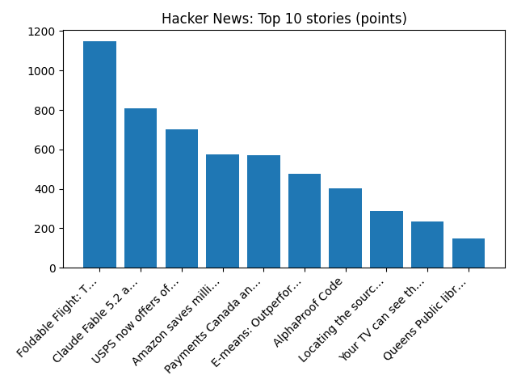

# Daily Knowledge Garden — 2026-11-10

## 🧭 Daily Summary
Global coverage includes EXCLUSIVE: Anthropic eyes $1.4 trillion IPO valuation in test of Wall Street's AI fervor - Reuters; Hegseth slams his potential impeachment as a 'political spectacle’ that undermines US troops - AP News; Arrests made in Mohamed Al Fayed probe in France, police say. Local coverage includes How a Northern Virginia youth group home is trying to get it right - The Washington Post; Naresh Bhatt murder trial: Virginia man says he dismembered missing wife Mamta Kafle Bhat's body in 2024 - ABC11 News.

## 🌍 Global News (cross-source)
- [EXCLUSIVE: Anthropic eyes $1.4 trillion IPO valuation in test of Wall Street's AI fervor - Reuters](https://news.google.com/rss/articles/CBMisAFBVV95cUxNaUtnS210c1pKNVpEZXJ1V1JpdUdyZ0h5OGh2SzVCXzJaVGRwaDZnb0NQZUxFS0ZFWmxwbU53ZlJtdlBkOWplZHdaNkloU0xwV3hvdlpjNnh0R1FISXdMOExfc09JckJqTWxjSWlZSjZpN0RWR1kyRUF6YUlXN0dqSm5XQU5TUmFmbWpFbGlzT3FZRllaMGU4cld0cDlsaFVYY0IzV2ZNYmwxYW0yd1FDaw?oc=5) — Reuters — Headlines (Google News)
- [Hegseth slams his potential impeachment as a 'political spectacle’ that undermines US troops - AP News](https://news.google.com/rss/articles/CBMiowFBVV95cUxPQUNXMkxGenZWcWlHclR5OG1zTlBOY1FCaktDemppTUVxd1R6aVdEU0t1Yld1U1h2empESzVJWXJxa0VYREVJenNGbVg4cmdKY3RkYkdwbmdsZGJiWmF2Y280dDYzbjJkcnRWbEp5MjJ3YzlUUEcySW5PcEYydzI4OHJoNWhKSHZvTlhMd3NRMll3VEwxTkpJOWhyUnFQV3dneTVV?oc=5) — AP — Headlines (Google News)
- [Arrests made in Mohamed Al Fayed probe in France, police say](https://www.bbc.co.uk/news/articles/ck1wvwyrd4ywo?at_medium=RSS&at_campaign=rss) — BBC — World
- [Israel's parliament sworn in as Eisenkot tries to forge a government - Reuters](https://news.google.com/rss/articles/CBMinwFBVV95cUxNVXZKMU1sQ21EaElhUnNZblNweVZxQWFZNFJUZVRNVzBRMW42WF8wY0k2YnRTSmRVVlFsYTZOcHhMOTVERUJuQUFlM3BfcVpJa01aMTFvdXg5ZEFJcWoyQndmS2UwcDI0a3ZKdEhwRXJadHZIRnFjLUIza1g5V2U1TmRzVWcxSUh1bEZENThRMDZnZUVJTFJSTW9qd2FSLVU?oc=5) — Reuters — Headlines (Google News)
- [Israel's new parliament sworn in as leaders compete to form government](https://www.bbc.co.uk/news/articles/crd939lpzjp9o?at_medium=RSS&at_campaign=rss) — BBC — World

## 🏙️ Local News
- [How a Northern Virginia youth group home is trying to get it right - The Washington Post](https://news.google.com/rss/articles/CBMigwJBVV95cUxNQnFfVk9vQkJjeXBWNmFRLTFYV2F5ZzV1cERNUTlQSkYtRlQ2b3o4QS0xWHgwbm5YRU82Y2k3TTZtRkppUkFWZDVVY2t0RFFhZUtwQi01SHA0NWdJVDV1M1h1ejZ3dFF0Q05ibS1qbjhUZEN1d2Q3VVBtS0s1Tjl3Y3E4dG54MWtOQWc5S2dha09KS0Z0VUhqTVoxY3ZFd2NXbEUxZTZteEdRRGI2S2xYbF9jOU00SjJpTEhGUGJJQ3F6b21heVY1THRFandUeFhUTVZlTTVwRkVZekllRkJrQ1M5X0hGanBQcHdvUjNzXzhpcWlWXzBSZXRyZkNySTRIRWlZ?oc=5) — Google News — Northern Virginia
- [Naresh Bhatt murder trial: Virginia man says he dismembered missing wife Mamta Kafle Bhat's body in 2024 - ABC11 News](https://news.google.com/rss/articles/CBMizAFBVV95cUxPcE5ra2RQZWd0TVVNdEJTOC1MNkdDUWVkUGw3VW4wWFNKTnVtTkhGYW05b1Awd25sb250UDhGU1VKNlBtMjVHSXNHSjRnOS16bHZjeGdYU0dRLXlkcmVDRTdLWmhEVUQ1clVjSGphVjVmVGJPS25SQ096eVRqbXE3M0xvc0xZMnNsd08yNVhJTHMtemdZVkw2ZXNOeVRLdG0zYzBqdk5sVkh1UTdXSjcxc2tsdWNKdlFvcGZrNmhQN2NMWFpRM1N3QkIxSkfSAdIBQVVfeXFMT0hvdGFfdTNjazNlSmpOYk55elVvS2h4MEpCUHFORVhiUlNZSW95dE9aRzJaVEdfQXhNR0lSZ0dIZlcxTDhVN0FvV3I0clg4eEFuclR0bUtqampsdW8yQWxjMHR1Uk03NUJHcDNLTkhvWm9IZ1d6T0dxbE11Nzg3MkRMVE1fOGtQNHBPbkxNYnJzTDFSWDk1TTdqZW9HZEgtemwwYVh1bFZSNnJ4b2JIc21zdkFoMXBBdEhJc3I0N3pOZGEwSnZydTU5Rks1My1HSmJ3?oc=5) — Google News — Northern Virginia
- [Veteran-Owned Rubbish Works Junk Removal of Northern Virginia Expands to 31 Communities - EIN News](https://news.google.com/rss/articles/CBMiyAFBVV95cUxPdU1qWGNQbUVnQ1R5REEzenNjXzh6NHdsaHlIV3o0RG11U0o1RldkbFhTVzVYRngwR2x5RU9pUHQ2bVAtMzVkQjVjeVJfeldxdlFHYm5LeGp5ZHcwbHJjX3N4aWFiVHFPTjFIRzE5WnF2YjZaTEw1S1lVbkZTVGIzdm1wTFlHMWVxVm5LRFhud0RBdjlSZlFLR0JodWJLZEFmdjBRVlJyTVdfMDBmNnFLWkcwS3phY1VKVjM1d2k4d0RDaGFlaHV2OA?oc=5) — Google News — Northern Virginia
- [How the Failed Digital Gateway Data Center Project Changed Northern Virginia’s Future - Northern Virginia Magazine](https://news.google.com/rss/articles/CBMizgFBVV95cUxQR0RRWkE0SzRyTWFEbW8zM1JYMHYtRU5XNWlzU05EMERjTXhvekJGY19tX0JhTG9IWVhrVU12RkJHRzJVXzhId2VtS05HTGNDYlZTVjQtNzdkbkcxZkUwNy11cy15NEgxNlU0d1lDaE11YVVYd3FkSENkMWhsMENuampIa2cyTHFZYXFzTlBWanZNdVoyeWJ1enk1X1hFSE5YRUcySE1tdWlKV2Z6T3hLWUpfVGF4akRDdVVHZzV3YUlGVXl0VldJSS1mWnZSUQ?oc=5) — Google News — Northern Virginia
- [Local businesses out thousands of dollars after Northern Virginia Christmas Market canceled over permit, construction issues - DC News Now](https://news.google.com/rss/articles/CBMi-AFBVV95cUxPNEpnR2d2TW1ZMjVaVEtGQzJOZWF3UnBYMDNIYVdaQ1RpTG1ES3laZnFqSUFWbmdkWHI4MWRNbEZjM2pUNkRMQzE1Q2Q4dWZJaTBDZFluRlRoQ3NoajI3UU5rYm1OemtZUDVQWmNDN1dGdG5ucVZoeEN3VWdKNVM4UVlCYmVrdkVJSWhOdEpRSlBrdzl5a053ZkIzblBLV1pwaF9BT2xCX3N5Njk4M043bjhLWTdUNjd5VU92dHdJYlQ0QjFUZ0RoMFNhMEdJTV9WMzRwSjJqMHdVNWxHOG5RYlZCZnVPbGdsMzFKX3FwY1pKQ1ZCWjJyVQ?oc=5) — Google News — Northern Virginia

## 🚀 Hacker News (Top 5)
- [Foldable Flight: The Best Paper Airplanes](https://www.foldableflight.com) — 871 points, 141 comments
- [USPS now offers official ZIP Code boundary polygons](https://postalpro.usps.com/zcb) — 508 points, 266 comments
- [Payments Canada announces launch of Canada's Real-Time Rail (RTR) payment system](https://www.payments.ca/canada-launches-real-time-rail-bringing-247-payment-infrastructure-national-economy) — 482 points, 265 comments
- [Google Gemini routes personal Drive files and emails to human annotators](https://github.com/thisisme6598/gemini_files/) — 457 points, 105 comments
- [Claude Fable 5.2 scores 65 on Artificial Analysis, highest so far](https://artificialanalysis.ai/models/claude-fable-5-2) — 301 points, 225 comments

## 🌍 Wikipedia — On This Day (selected)
- **2020** — Armenia and Azerbaijan sign a ceasefire agreement, ending the Second Nagorno-Karabakh War, and prompting protests in Armenia.
- **2019** — President of Bolivia Evo Morales and several of his government resign after 19 days of civil protests and a recommendation from the military.
- **2009** — Ships of the South and North Korean navies skirmish off Daecheong Island in the Yellow Sea.
- **2008** — Over five months after landing on Mars, NASA declares the Phoenix mission concluded after communications with the lander were lost.
- **2006** — Sri Lankan Tamil politician Nadarajah Raviraj is assassinated in Colombo.

## 🎲 Wikipedia — Random Article
**SRAM Corporation**  
SRAM developed the Eagle line of mountain bike specific drivetrain components intended to improve shifting performance. The company grew to become a cycling component brand, selling under the brands SRAM, Avid, RockShox, Truvativ, Quarq, Zipp, TIME Sport pedals, Hammerhead cycling computers, and Velocio cycling apparel.
https://en.wikipedia.org/wiki/SRAM_Corporation

## 🌌 NASA APOD
[Saturn Behind the Moon](https://science.nasa.gov/image-article/apod-2026-november-10-saturn-behind-the-moon/)

## Feed Health
- **Reuters — Headlines (Google News)**: ok (15 articles)
- **Reuters — World (Google News)**: ok (15 articles)
- **Reuters — Business (Google News)**: ok (15 articles)
- **BBC — World**: ok (15 articles)
- **BBC — Tech**: ok (15 articles)
- **BBC — Business**: ok (15 articles)
- **BBC — Science**: ok (15 articles)
- **AP — Headlines (Google News)**: ok (15 articles)
- **AP — Politics (Google News)**: ok (15 articles)
- **AP — Business (Google News)**: ok (15 articles)
- **NPR — Top Stories**: ok (10 articles)
- **NPR — Politics**: ok (10 articles)
- **NPR — Business**: ok (10 articles)
- **NPR — Science**: ok (10 articles)
- **NPR — Technology**: ok (10 articles)
- **ScienceNews**: ok (15 articles)
- **ScienceDaily — Top**: ok (15 articles)
- **Nature — Technology**: ok (15 articles)
- **Google News — Northern Virginia**: ok (15 articles)
- **Google News — Northern Virginia traffic**: ok (15 articles)
- **Google News — Northern Virginia weather**: ok (15 articles)
- **Wikipedia — On This Day**: ok (10 articles)
- **Wikipedia — Random**: ok (1 articles)
- **NASA — APOD**: ok (1 articles)

Runs so far today: 2
