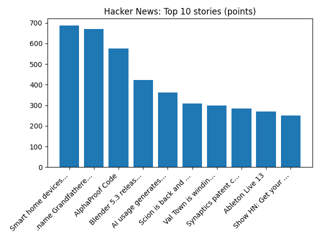

# Daily Knowledge Garden — 2026-11-11

## 🧭 Daily Summary
Global coverage includes Three Iran-backed suspects plotted attacks including RAF Fairford incident, US says; US House blocks bid to impeach Defence Secretary Pete Hegseth, for now; US judge says Trump’s $10 billion BBC defamation case can proceed - Reuters. Local coverage includes Warner calls election a 'huge repudiation' of Trump, says Northern Virginia felt it most - The Alexandria Brief; Veteran-Owned Rubbish Works Junk Removal of Northern Virginia Expands to 31 Communities - Lohud.

## 🌍 Global News (cross-source)
- [Three Iran-backed suspects plotted attacks including RAF Fairford incident, US says](https://www.bbc.co.uk/news/articles/c3rryrryk59zo?at_medium=RSS&at_campaign=rss) — BBC — World
- [US House blocks bid to impeach Defence Secretary Pete Hegseth, for now](https://www.bbc.co.uk/news/articles/cxly4y5jzl0qo?at_medium=RSS&at_campaign=rss) — BBC — World
- [US judge says Trump’s $10 billion BBC defamation case can proceed - Reuters](https://news.google.com/rss/articles/CBMitwFBVV95cUxQLXBMT2FsRHRuMzJPbE1qVmxwbUllWmUxZk5ENGVBSGthMGxsUjVDZFhiMEhNalJVdU5ZejhYcVo3SlBtTjZ5d09QVlF6QmdHYkZHSkxFQ2R3SXRTZXZtUU1IcjdoQjctb1FxcTNtalRtcWVqTms1aFhoR1pYRDlfZGhnUWc5b0cxdFVmOWg4WEw3STUwX05PVFZPTm9sTW9xbzc0S2NHQlBNRGd5WExTaHhiQTVXMDA?oc=5) — Reuters — Headlines (Google News)
- [Thomas Markle sent back to jail after cutting off his ankle bracelet - Reuters](https://news.google.com/rss/articles/CBMivgFBVV95cUxQSVloVDEyT01KczFSUlV1OU1NcUFrX3FCRGxIUEpfalN5Uk14Y3VwTHBXbDNUYkREUWt0RTNOWTNRRWtqRHp6ZTB5ZHJoN2JOR3B4ck5MNXlDSE5CUEdTZkd5ZHYwSTBDMVVhUk5HZmNWTEQyQm96WmUxa3ZpSHZHaG1Va3lzUWlORERfbk1aQmJLbmVMdmo3MXkyWGNzNlgtaEkweE5ycHlmOUJmQXZSN29UcE5oWnVCTTNhcUx3?oc=5) — Reuters — Headlines (Google News)
- [House Republicans quash effort to impeach Defense Secretary Hegseth - AP News](https://news.google.com/rss/articles/CBMiowFBVV95cUxPQUNXMkxGenZWcWlHclR5OG1zTlBOY1FCaktDemppTUVxd1R6aVdEU0t1Yld1U1h2empESzVJWXJxa0VYREVJenNGbVg4cmdKY3RkYkdwbmdsZGJiWmF2Y280dDYzbjJkcnRWbEp5MjJ3YzlUUEcySW5PcEYydzI4OHJoNWhKSHZvTlhMd3NRMll3VEwxTkpJOWhyUnFQV3dneTVV?oc=5) — AP — Headlines (Google News)

## 🏙️ Local News
- [Warner calls election a 'huge repudiation' of Trump, says Northern Virginia felt it most - The Alexandria Brief](https://news.google.com/rss/articles/CBMiugFBVV95cUxNLW5Md3JzU1dDa1RZWUdTdzZaLTNXZlVlbDVmcFN0ZTZ5WHY0UzdSTVBhdEIxVkdWbmJEZ0FwRVk2SmpVanh1ZGY0VmtMX2RiU19OcHczdElhU2VJaWw0OFI0WjZ1d3ZHcGJLSlZ1S1lXeTJxZmxDT0Zya3cxanRzck5DdmdDelNSRGdaYzVLUkF2d1drZUpwaFpzYjJYM3FjVnVOMVlQWV8yRWotN0hNQmYtS1lyV0ZteEE?oc=5) — Google News — Northern Virginia
- [Veteran-Owned Rubbish Works Junk Removal of Northern Virginia Expands to 31 Communities - Lohud](https://news.google.com/rss/articles/CBMi0wFBVV95cUxNWnh2eFVtZDRFVXNmdEtlUHViY3V2clIwX0dLQXA0YTBfMThqX3dieFQyOV9GRWdneG1qTzItTml1STc5NERFV05UaDhrQzU2a19ra0p6MlNiOVp6UHlKMG80ZEVBSEpmLVRkWWJSekl6d0NyQzNlRUVHcmtqTXVjWmFxOHRCdlpWVU5PbTBmbXpZMU5yYV9TckRxNmw3VTd1ZC1UY2pHSDV6SzVoUDlxVkhqNl9XODVXWU0zRVJFS0FHeS1HQk9nV3A1UlNwYWwzRm9z?oc=5) — Google News — Northern Virginia
- [Man accused of stabbing 2 strangers, trying to stab another in Crystal City - NBC4 Washington](https://news.google.com/rss/articles/CBMi2gFBVV95cUxNSlJzY24xTGZUb2FWS0s1VmRaNTVVbkhGYmFJd0xSLU45b1hhS1BpX3Rfamo5aHhpckU4el9YLW92RkQ3cTdrelljNDBVdVRST0czU0oxZUp2RnhnYnQ5NnFQNlVRdjBaZS1TTUYtUkJ3OHlPd0t4ZmktbDJNaWxGdldJREVPcG45ZDdKUVJxeUJFVTktT2xIalJobkJicWNLV0xWQWg4dFo1MktPOGhHQjYweC1jdVJ5ZHJVczBfOGhxclNoZnlYSjBNeHlKMFJyaFdFUnJqRjRUZ9IB4gFBVV95cUxQNDh6b1pWODlqRVJEMHBRdUYzTmZud1pvVFFhdTBUR2tRRWx6RTlncnBFOTNWRTNoaVFkc0RKOTFSV2V6Vk9XYVdock1QTnNRRmlWUHc2OGh2MlFWOVV0Q2tOMXQ5akJEaDNuQXlONkxLTU5BdndBRFZmVG5BZ3NlZlg1ZzFVUnp1cHc0RHZqejdUckNOTjhXY24wY09hNEVaLTl6MHVtekp2WHpQaDVSU21la25nXzZ5U1hydGRYVE5TZVpCbU9VOXRLQTlCbFVCdmlLYjJRLWVueEZXM3NJQnRn?oc=5) — Google News — Northern Virginia
- [Spirit Christmas opens holiday-themed store in NoVa - The Burn](https://news.google.com/rss/articles/CBMiiwFBVV95cUxQVUVYSHNBRzVCQ1VNVC1Ia2pYOTlLUzdTWEhhc2g2TndQa3VwUzlNMVlyMzZuZGV1Q3U0QkRTYkR5OFNfNmFpSHRUakx6WGVObXFiMGVldFZuM3c0SV85akMxMW9VS2ppVDZfanlXWm5SUHhBS3VWRklsakpjWDFzNFktYjlwNHlyVGhJ?oc=5) — Google News — Northern Virginia
- [Leased-up Northern Virginia offices trade at a discount via short sale - Green Street News](https://news.google.com/rss/articles/CBMiqwFBVV95cUxQTlhqOVlLZHoxSkpWb0hNanYxRjNmZC1FWllndDNITTc0S1EzMlprX1dXcUZFSGRaZkdGNktGd1JvYnV1a3EyNzMxdnBCNW1HOW9IdHJYYjRBUnh2eHIzeEpqal9SQTh4a0J6bEZwVFR5bExWcGQ0OGN0NWkzOUJNUW9jZmFpVU9WbFJjZk5YTldlcXRJMU8xY2x1anBDanprYTVXNEczN3RlYnc?oc=5) — Google News — Northern Virginia

## 🚀 Hacker News (Top 5)
- [Smart home devices should work without the internet](https://docodethatmatters.com/home-automation-overnight-success/) — 686 points, 247 comments
- [.name Grandfathered](https://neil.fraser.name/news/2026/11/10/) — 671 points, 155 comments
- [AlphaProof Code](https://deepmind.google/blog/introducing-alphaproof-code/) — 576 points, 175 comments
- [Blender 5.3 released with Gaussian Splat support](https://www.blender.org/download/releases/5-3/) — 423 points, 62 comments
- [AI usage generates a fragile codebase](https://evanxmerz.com/post/ai-usage-generates-a-fragile-codebase/) — 363 points, 397 comments

## 🌍 Wikipedia — On This Day (selected)
- **2024** — A vehicle-ramming attack in Zhuhai, China, kills 38 people and injures 48.
- **2022** — Russo-Ukrainian War: Ukrainian armed forces enter the city of Kherson following a successful two-month southern counteroffensive.
- **2020** — Typhoon Vamco makes landfall in Luzon and several offshore islands, killing 67 people. The storm causes the worst floods in the region since Typhoon Ketsana in 2009.
- **2012** — A strong earthquake with the magnitude 6.8 hits northern Burma, killing at least 26 people.
- **2011** — A helicopter crash just outside Mexico City kills seven, including Francisco Blake Mora the Secretary of the Interior of Mexico.

## 🎲 Wikipedia — Random Article
**Freies Volk**  
Freies Volk ('Free People') was a newspaper published daily from Düsseldorf, West Germany 1949-1956. On 1 September 1949 Freies Volk became the central organ of the Communist Party.
https://en.wikipedia.org/wiki/Freies_Volk

## 🌌 NASA APOD
[Saturn Behind the Moon](https://science.nasa.gov/image-article/apod-2026-november-10-saturn-behind-the-moon/)

## Feed Health
- **Reuters — Headlines (Google News)**: ok (15 articles)
- **Reuters — World (Google News)**: ok (15 articles)
- **Reuters — Business (Google News)**: ok (15 articles)
- **BBC — World**: ok (15 articles)
- **BBC — Tech**: ok (15 articles)
- **BBC — Business**: ok (15 articles)
- **BBC — Science**: ok (15 articles)
- **AP — Headlines (Google News)**: ok (15 articles)
- **AP — Politics (Google News)**: ok (15 articles)
- **AP — Business (Google News)**: ok (15 articles)
- **NPR — Top Stories**: ok (10 articles)
- **NPR — Politics**: ok (10 articles)
- **NPR — Business**: ok (10 articles)
- **NPR — Science**: ok (10 articles)
- **NPR — Technology**: ok (10 articles)
- **ScienceNews**: ok (15 articles)
- **ScienceDaily — Top**: ok (15 articles)
- **Nature — Technology**: ok (15 articles)
- **Google News — Northern Virginia**: ok (15 articles)
- **Google News — Northern Virginia traffic**: ok (15 articles)
- **Google News — Northern Virginia weather**: ok (15 articles)
- **Wikipedia — On This Day**: ok (10 articles)
- **Wikipedia — Random**: ok (1 articles)
- **NASA — APOD**: ok (1 articles)

Runs so far today: 1
