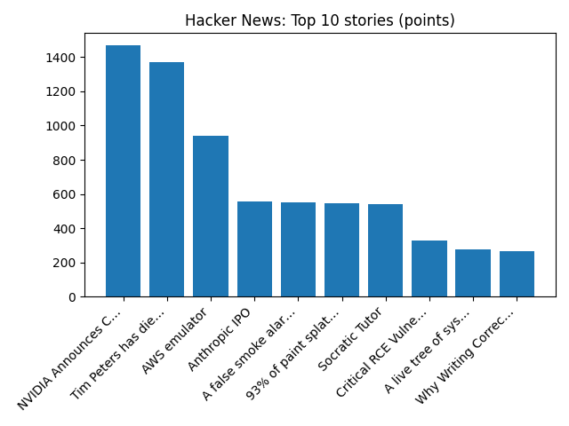

# Daily Knowledge Garden — 2026-11-12

## 🧭 Daily Summary
Global coverage includes Brooklyn building collapse killed 2 children and 6 adults, mayor says - AP News; Nvidia CEO Jensen Huang resigns in big blow to AI boom - Reuters; The rise and fall of Jensen Huang - how the tech superstar became mired in scandal. Local coverage includes Enverra Buys Northern Virginia Office Campus for $42M - Commercial Observer; Civil War soldier who died in Northern Virginia is finally l... - InsideNoVa.

## 🌍 Global News (cross-source)
- [Brooklyn building collapse killed 2 children and 6 adults, mayor says - AP News](https://news.google.com/rss/articles/CBMiqgFBVV95cUxQOTF0bXlzSWlmLWlkQWl1aE1xZzFRNjVtTXJtOFV4bUtGd2JQeGx0bjJ1bjRCQ2pUVFN2ejd2ZU5NZE5MVTdSNGpZbjU4RVV4MDVsQnRtLUZHV09LS0NYeWY1OGVaVkdWYk10Vy00UzdJY1lpSUYza2dWVGY3aC1vS3dCbDE2OVlHNHB5VVJYSDBSZi05eVNLcXRsMDZDWkJFZmYtMGxsN2hjQQ?oc=5) — AP — Business (Google News)
- [Nvidia CEO Jensen Huang resigns in big blow to AI boom - Reuters](https://news.google.com/rss/articles/CBMisAFBVV95cUxOMEFwN0FWdjB6blNtR0RZaTBWZXZDaWVwYkhXREttY2FaYVNNVC1qNEFHYm9Yd1pDODBDN2tvNzhnMTY4cmxWYTg1WVFidzFlNVFEdlZNb3IyZG1nS2FKcHAzUERhQW9EdG9oOER6YmwydXZOd0t1VHRub1BCdFdoR1V4dktlUVUydjZWeU53aVdKMGwtOGFtZmd2T3VhODF3eXhPazVtbV81b0hpUi1vcw?oc=5) — Reuters — Headlines (Google News)
- [The rise and fall of Jensen Huang - how the tech superstar became mired in scandal](https://www.bbc.co.uk/news/articles/cmze750zg0jeo?at_medium=RSS&at_campaign=rss) — BBC — Tech
- [5 people are shot in DC, including 1 killed at a gym, and then suspect kills himself - AP News](https://news.google.com/rss/articles/CBMijAFBVV95cUxQMW5zRmhTTGNjXzZqa1hiWG1oWmVLeGZzZmZiVkhjOEpqTlJiMVZudG1meElSb2d5djFtM0FSUzM0UVdtYXdRcVZReTBxUG5rMW9ZYVQ3MlFXTGhZRG5rZmZnay1ONXlEVzJWdFRKZ3VLZGRDNFVzU21oVkZHTkhCZGlDNTA2NlgzY3lhdw?oc=5) — AP — Headlines (Google News)
- [Italian schools defy new wave of bomb threats to remain open - Reuters](https://news.google.com/rss/articles/CBMimwFBVV95cUxQSFJJaFJoR2JHVWdTZmVzdkw2MDhTc29qU0pDRmdmaXpwWjN2Q3VyYjlFUWJkRmJHTmlaNFFYdWIxdTFHR3p5VGlTaGExYzFwZ3BTRjV6dTJuQWdibllJN1lwd3E1RThuUEU2ekpfbU1GSUJwU2tyMkd5a3daSEkwNm5YU19zUEIxLWpSNjNDS0lzT1NCd2ZQRG1COA?oc=5) — Reuters — World (Google News)

## 🏙️ Local News
- [Enverra Buys Northern Virginia Office Campus for $42M - Commercial Observer](https://news.google.com/rss/articles/CBMilwFBVV95cUxPd3MyV0Rsd2J6emUwemQtQ25MVXBpeEFDMFpUUEJ4VGtIZjJ4LTZMcDZBckNMY1FKRzJFRkVVZGhSMGN4MHRLbXFEQ25ONVQ1eUNMdkQ2NFdnSmZXa0hMajJmdjJXUkVqMDA5OWNPZTJHdk5sVlZPSm1EYTdXcFVZRV9qa0ZDeXd0OFdLZ3BHVFZBUnkxUkZV?oc=5) — Google News — Northern Virginia
- [Civil War soldier who died in Northern Virginia is finally l... - InsideNoVa](https://news.google.com/rss/articles/CBMisgFBVV95cUxQUXVNMVdOZUdneVFKelhRMFRTUVNYRktpOExfeHBRQkZkcDZnSFNDaVRfRzkxZmd5S3pra0lqSnFMR081UlN4Ulg4T29VckJwczhxWHBmQk1NbWJXaE9WT3dFT0NpWHhCdUQxenk1V2lSNFlvWUEwUGo1UDdaZVJrbXBiUDdxWGQ4YXdDbUZtazVMUHRNbmxkal9xbmR1SE10R2h6SlBLZGNxa1VQNXhVa29n?oc=5) — Google News — Northern Virginia
- [Sentara Northern Virginia Medical Center Hosts First Cadaver Skills Lab for Local EMS - Prince William Living](https://news.google.com/rss/articles/CBMiugFBVV95cUxOVkJxRVNPNmNoTy1WQW1xRHVmQVlVNV9Rb3o5T0ttdzExYkJhcFd0cVl1cE5oTy1Zd1hLQnhScW85b2JwTDFkY0lKSHF1OThoZUthTFV3S2lySUJ1bkU3WWxCeGZ1aUp5dFNBR191aUNyWkZ0MDlXZkQ1UlVha0RZR0JsMlN0cmpyU01ROS00Yk83XzJNTmlvY2pjMmd3ODJJcjhjU2xVay1Fd01yeTFrX19xVlVCVWZsNWc?oc=5) — Google News — Northern Virginia
- [Eddie Polk Obituary (2026) - Edinburg, VA - Northern Virginia Daily - Legacy | Obituary](https://news.google.com/rss/articles/CBMiiAFBVV95cUxNUEJWVWJjcXlkaDdaNXpjY254ZG52V3U5Ymk1emVhYTRubGxOVm9rMk9GQkt5T1JudHJwVVlnUHAtZ1podFFIc09ZbE9sMTlDYy1YbmJWU3J5WXE5ZHdDclhoeTVMNi1aQ2dKa0RtV2Z2emRqNFJhYkd1LXZLRVFsb0dXNjV4ekU2?oc=5) — Google News — Northern Virginia
- [Ronald Jennings Obituary (2026) - Stephens City, VA - Northern Virginia Daily - Legacy | Obituary](https://news.google.com/rss/articles/CBMijwFBVV95cUxPaXE5REFaQ3pLZ1JNVFV1clpoVDM2WkpyUnhPMTAyS0FpVU93dEpnTEpydzV2aFlfcTdWM2xnTmhhYkw2SFdhWnY2TVBCWUk3c2xoUzR4ZjRhbjY1QmtEazBHdzl5ZUg0cmFDZGozNTJMWjhndl8xS190ZEo5SXBaQ3ZoZ2s1QzRoYzJfZ0pwZw?oc=5) — Google News — Northern Virginia

## 🚀 Hacker News (Top 5)
- [My AI agents found an unmapped Maya site?](https://pietromiotti.com/latest/maya-site) — 930 points, 338 comments
- [Tim Peters has died](https://discuss.python.org/t/in-memoriam-tim-peters-1952-2026/110028) — 875 points, 94 comments
- [AWS emulator](https://github.com/aws/aws-emulator) — 677 points, 217 comments
- [Nvidia is preparing to oust Jensen Huang](https://www.wsj.com/business/nvidia-is-preparing-to-oust-nvidia-ceo-jensen-huang-30f421ad) — 531 points, 782 comments
- [A false smoke alarm almost drowned Jane Street's only NYC datacenter](https://michael.bacarella.com/2026/11/10/false-smoke-alarm-jane-street-datacenter/) — 415 points, 213 comments

## 🌍 Wikipedia — On This Day (selected)
- **2022** — A Boeing B-17 Flying Fortress and a Bell P-63 Kingcobra collide in mid-air over Dallas Executive Airport during an airshow, killing six.
- **2021** — The Los Angeles Superior Court formally ends the 14-year conservatorship to pop singer Britney Spears.
- **2020** — The PlayStation 5 is released.
- **2017** — The 7.3 Mw Kermanshah earthquake shakes the northern Iran–Iraq border with a maximum Mercalli intensity of VIII (Severe). At least 410 people are killed and over 7,000 are injured.
- **2015** — Two suicide bombers detonate explosives in Bourj el-Barajneh, Beirut, killing 43 people and injuring over 200 others.

## 🎲 Wikipedia — Random Article
**Cry to Me**  
"Cry to Me" is a song written by Bert Berns (listed as "Bert Russell") and first recorded by American soul singer Solomon Burke in 1961. On March 20, 1962, Burke performed "Cry to Me" on American Bandstand.
https://en.wikipedia.org/wiki/Cry_to_Me

## 🌌 NASA APOD
[Moon, Venus and Spica Meet](https://science.nasa.gov/image-article/apod-2026-november-12-moon-venus-and-spica-meet/)

## Feed Health
- **Reuters — Headlines (Google News)**: ok (15 articles)
- **Reuters — World (Google News)**: ok (15 articles)
- **Reuters — Business (Google News)**: ok (15 articles)
- **BBC — World**: ok (15 articles)
- **BBC — Tech**: ok (15 articles)
- **BBC — Business**: ok (15 articles)
- **BBC — Science**: ok (15 articles)
- **AP — Headlines (Google News)**: ok (15 articles)
- **AP — Politics (Google News)**: ok (15 articles)
- **AP — Business (Google News)**: ok (15 articles)
- **NPR — Top Stories**: ok (10 articles)
- **NPR — Politics**: ok (10 articles)
- **NPR — Business**: ok (10 articles)
- **NPR — Science**: ok (10 articles)
- **NPR — Technology**: ok (10 articles)
- **ScienceNews**: ok (15 articles)
- **ScienceDaily — Top**: ok (15 articles)
- **Nature — Technology**: ok (15 articles)
- **Google News — Northern Virginia**: ok (15 articles)
- **Google News — Northern Virginia traffic**: ok (15 articles)
- **Google News — Northern Virginia weather**: ok (15 articles)
- **Wikipedia — On This Day**: ok (10 articles)
- **Wikipedia — Random**: ok (1 articles)
- **NASA — APOD**: ok (1 articles)

Runs so far today: 2
