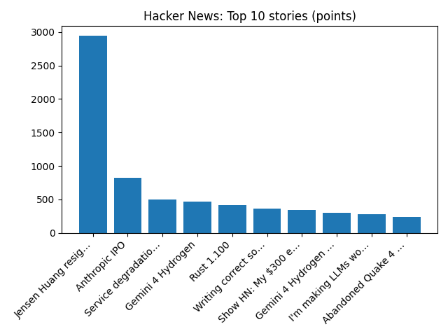

# Daily Knowledge Garden — 2026-11-13

## 🧭 Daily Summary
Global coverage includes Microsoft struggling to restore service as global outage affects Outlook and Teams; Is Outlook down? Widespread outage hits Microsoft email and other apps; 5 people are shot in DC, including 1 killed at a gym, and then suspect kills himself - AP News. Local coverage includes Massive house party thrown for teen ends with charges for Northern Virginia parents - FOX 5 DC; Northern Virginia Performing Arts celebrates first anniversary - Loudoun Times-Mirror.

## 🌍 Global News (cross-source)
- [Microsoft struggling to restore service as global outage affects Outlook and Teams](https://www.bbc.co.uk/news/articles/c5gm3g9ldz8xo?at_medium=RSS&at_campaign=rss) — BBC — Tech
- [Is Outlook down? Widespread outage hits Microsoft email and other apps](https://www.npr.org/2026/11/12/nx-s1-6039343/is-outlook-down-widespread-outage-hits-microsoft-email-and-other-apps) — NPR — Top Stories
- [5 people are shot in DC, including 1 killed at a gym, and then suspect kills himself - AP News](https://news.google.com/rss/articles/CBMijAFBVV95cUxQMW5zRmhTTGNjXzZqa1hiWG1oWmVLeGZzZmZiVkhjOEpqTlJiMVZudG1meElSb2d5djFtM0FSUzM0UVdtYXdRcVZReTBxUG5rMW9ZYVQ3MlFXTGhZRG5rZmZnay1ONXlEVzJWdFRKZ3VLZGRDNFVzU21oVkZHTkhCZGlDNTA2NlgzY3lhdw?oc=5) — AP — Headlines (Google News)
- [Australian footballers will not be charged after hotel incident, police say](https://www.bbc.co.uk/news/articles/ckregjwr7njqo?at_medium=RSS&at_campaign=rss) — BBC — World
- [Scammers stole his image to lure the lovesick. Then the lovesick came looking for him - AP News](https://news.google.com/rss/articles/CBMitAFBVV95cUxPWXdQSVNmSEw1UG1MSmhJRFZpTmFyWnkyZElyaVZodDVFVy15TUljaWhGX20wX1JJMmZhaElVRUUtbHNnWnMzTmI1Z18zWGl0Nlh4NTVUQ0Izc0liWU1HTFhnRlJHazhUci1SeERlNGt0YmV3Z19FOHNaMmhyTFlvSXNhVElRVEVoSkxwcGVpRHpsVEptSHZzUGkxdFdCLXVickNfM0lHdkJQZ0VfV0RuaWNPVEs?oc=5) — AP — Politics (Google News)

## 🏙️ Local News
- [Massive house party thrown for teen ends with charges for Northern Virginia parents - FOX 5 DC](https://news.google.com/rss/articles/CBMinwFBVV95cUxPbU5zNVBpWjFHZ2JTdWhqcm1XMVY2RU9rdzIyVVhRMWtwMS05S3BfdXhTRFB0UERjMWlySjh5cDVfQmd2QTRaaU9LYVhXU2hGWDI4eU5ZZm1rcjk5RU53OVRST0VzVHNHdnIxSUlQVk1yX0ZwemdWZWtkVEp5Q1ZVaUV4UWFpNGU1NDZGRWc2bDE3b2llclBwUkVDVVJoQmM?oc=5) — Google News — Northern Virginia
- [Northern Virginia Performing Arts celebrates first anniversary - Loudoun Times-Mirror](https://news.google.com/rss/articles/CBMi3wFBVV95cUxPeG1UVHpORVRoNU9YZnhPUjlfd0ZrblE3YUtyN2dxamhuYzFmZVY1VndSdUhFSkMxSkdVWHBIZDlmVlhfSWJzQW1wNmtET3lkalBleWp3UXhLZHBjeTBpUS1ETWZWeTdtZFY0NXJGZmNzRGJ3WWFmWHM2UzNBWkZodzNpOGZwdFlVTVVsR1ZTTWxkRFEzVEpNQjRCZ3gyZ29WWlhEYXFWVjFVYXBJYTAyOEdJY2xWalEwUEJneG5kdTBfMEF6ZUVpUXAxUThRaUhWMHZsVUtUeFVwR3EyV0RF?oc=5) — Google News — Northern Virginia
- [Holiday light shows open for the season at three Northern Virginia parks - FFXnow](https://news.google.com/rss/articles/CBMiqwFBVV95cUxPY1VTbVRGVWxpRUlzaXhOenBJSGx5YmFwUUVqU2VGb2cyYVJwUktPWWZKMVB5WGJkNW9HSXpiRWc2UmY3MXVOOEk3R3JGdHJ6YlRTM0Vwenh4am13MTVxbEJZXzVLbTdEM1F0aTc4aDNCRU5EMkx1Q01NNmMydENKUmJmaC1LaTN0Z0sxU3FHRnBFdER0cV9VdGpraDJRTUNtU0tyN1dnTTQxSkE?oc=5) — Google News — Northern Virginia
- [Children’s, Inova pursue pediatric surgery expansions as 11-year partnership nears its end - Howl.Link](https://news.google.com/rss/articles/CBMiO0FVX3lxTE90UWhSTDRuZUg1eldZY2ZjYVcxOEVpeXZsS1ZTUTdSNG1pd3RqdnRCbUFRT0NLQ1dFeXh3?oc=5) — Google News — Northern Virginia
- [Enverra Buys Northern Virginia Office Campus for $42M - Commercial Observer](https://news.google.com/rss/articles/CBMilwFBVV95cUxPd3MyV0Rsd2J6emUwemQtQ25MVXBpeEFDMFpUUEJ4VGtIZjJ4LTZMcDZBckNMY1FKRzJFRkVVZGhSMGN4MHRLbXFEQ25ONVQ1eUNMdkQ2NFdnSmZXa0hMajJmdjJXUkVqMDA5OWNPZTJHdk5sVlZPSm1EYTdXcFVZRV9qa0ZDeXd0OFdLZ3BHVFZBUnkxUkZV?oc=5) — Google News — Northern Virginia

## 🚀 Hacker News (Top 5)
- [Jensen Huang resigns](https://apnews.com/article/nvidia-megaspeed-china-singapore-huang-5403f152a601cf82ce939f1d24fffa0f) — 2943 points, 2788 comments
- [Anthropic IPO](https://ipo.anthropic.com/us/) — 818 points, 805 comments
- [Service degradation on Microsoft 365](https://status.cloud.microsoft/) — 498 points, 463 comments
- [Gemini 4 Hydrogen](https://blog.google/innovation-and-ai/models-and-research/gemini-models/introducing-gemini-4-hydrogen/) — 463 points, 296 comments
- [Rust 1.100](https://blog.rust-lang.org/2026/11/12/Rust-1.100.0/) — 417 points, 171 comments

## 🌍 Wikipedia — On This Day (selected)
- **2022** — A mass stabbing occurs in Moscow, Idaho in which four University of Idaho students are killed in off-campus housing.
- **2015** — Islamic State operatives carry out a series of coordinated terrorist attacks in Paris, including suicide bombings, mass shootings and a hostage crisis. The terrorists kill 130 people, making it the deadliest attack in France since the Second World War.
- **2012** — A total solar eclipse occurs in parts of Australia and the South Pacific.
- **2002** — Iraq disarmament crisis: Iraq agrees to the terms of the UN Security Council Resolution 1441.
- **2001** — War on terror: In the first such act since World War II, US President George W. Bush signs an executive order allowing military tribunals against foreigners suspected of connections to terrorist acts or planned acts on the United States.

## 🎲 Wikipedia — Random Article
**Trigonopterus bawangensis**  
Trigonopterus bawangensis is a species of flightless weevil in the genus Trigonopterus from Indonesia. It is mostly ferruginous, with a dark ferruginous to black pronotum.
https://en.wikipedia.org/wiki/Trigonopterus_bawangensis

## 🌌 NASA APOD
[Moon, Venus and Spica Meet](https://science.nasa.gov/image-article/apod-2026-november-12-moon-venus-and-spica-meet/)

## Feed Health
- **Reuters — Headlines (Google News)**: ok (15 articles)
- **Reuters — World (Google News)**: ok (15 articles)
- **Reuters — Business (Google News)**: ok (15 articles)
- **BBC — World**: ok (15 articles)
- **BBC — Tech**: ok (15 articles)
- **BBC — Business**: ok (15 articles)
- **BBC — Science**: ok (15 articles)
- **AP — Headlines (Google News)**: ok (15 articles)
- **AP — Politics (Google News)**: ok (15 articles)
- **AP — Business (Google News)**: ok (15 articles)
- **NPR — Top Stories**: ok (10 articles)
- **NPR — Politics**: ok (10 articles)
- **NPR — Business**: ok (10 articles)
- **NPR — Science**: ok (10 articles)
- **NPR — Technology**: ok (10 articles)
- **ScienceNews**: ok (15 articles)
- **ScienceDaily — Top**: ok (15 articles)
- **Nature — Technology**: ok (15 articles)
- **Google News — Northern Virginia**: ok (15 articles)
- **Google News — Northern Virginia traffic**: ok (15 articles)
- **Google News — Northern Virginia weather**: ok (15 articles)
- **Wikipedia — On This Day**: ok (10 articles)
- **Wikipedia — Random**: ok (1 articles)
- **NASA — APOD**: ok (1 articles)

Runs so far today: 1
