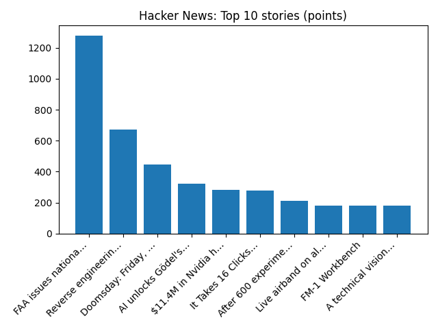

# Daily Knowledge Garden — 2026-11-14

## 🧭 Daily Summary
Global coverage includes 2026 U.S. House Election Results - AP News; Flights halted at airports across US due to air traffic control communications problems - AP News; Even Grand Theft Auto's original creators haven't been able to play GTA 6. Local coverage includes Parent charged over teen party in Northern Virginia speaks out - FOX 5 DC; NoVA Holiday Food Drives: Where To Donate And Find Help - Patch.

## 🌍 Global News (cross-source)
- [2026 U.S. House Election Results - AP News](https://news.google.com/rss/articles/CBMibEFVX3lxTFBUM0VmeFZ2SjF1RGJlVENLazFvbHZxWjRIYUlNMFlKal9sRW1ySS1UQWo4djh3cWpLcXJLWWFuWXBmdkllMTd2aVRhWF9YZFM5ZGRmN3pxZW5nWERXMjREbTVDeGF2RXRfM3ZTUw?oc=5) — AP — Business (Google News)
- [Flights halted at airports across US due to air traffic control communications problems - AP News](https://news.google.com/rss/articles/CBMikAFBVV95cUxOeFBta25Rakd3c0VBM0NUWjJzbmV2ajZwTWRtUFVTcTVzZ2otRGo0cXZSWWV0MzNBSXdmMXNzdm9SU1d1blBBNnktRlNqQmcwVUVxQzhCNERGel9ETDBHZjJwb29IYmhGX2VPNm8xeGwwU0VNajFzZnpIM19lejBOVTZrRVVjb2t4SDh3emhSZHI?oc=5) — AP — Headlines (Google News)
- [Even Grand Theft Auto's original creators haven't been able to play GTA 6](https://www.bbc.co.uk/news/articles/c6jd7k5ryl1mo?at_medium=RSS&at_campaign=rss) — BBC — Tech
- [Bluetongue virus confirmed on County Down farm](https://www.bbc.co.uk/news/articles/cmr4gxvrxd9yo?at_medium=RSS&at_campaign=rss) — BBC — Science
- [US National Weather Service says its radars operating normally - Reuters](https://news.google.com/rss/articles/CBMiwgFBVV95cUxOVVd5T1hBd3pUa3JPeW5ob1VrRV82TjhsN2t2UEQ2MFhZc3hqNU1LeHVDOEN2Vzk0cmRWRi1lQUtkNjJHakRFa0NTajMxRXlybnZtbGhPU0hXUVVFdlpPUEhpRWxyemNsUXE2cnVwSzJiSFZORFE1N1d6Y2sydFVxaTh0Vy0tQ1VqdXZYbEppdXVWVFc4Q0VxczNDQjRtblRKSTZ0ejlFY1ZFYTVmbTlST2pqMEhXUWFlSkpZM294ektYZw?oc=5) — Reuters — Headlines (Google News)

## 🏙️ Local News
- [Parent charged over teen party in Northern Virginia speaks out - FOX 5 DC](https://news.google.com/rss/articles/CBMiXkFVX3lxTE5ZQnV4UEFXZXNQNVBadjRrcVBLaDFvdENtc3daTldoN1NrdWRNMG85RzJSZ3UxaVktT3lzQ1FxdnBickVfQ2VVMUJOTlVQV3FJWXR3UEZKMnFPenlHcVHSAWNBVV95cUxObjFpMFl3blQ2LXVCTlBybWJfSjFqVG9MSXFSNWkzZVdzc2dfT2lvcW1RUmc5RFpPVktTYnRPSFJjZmJXYkpLbXlxdmVXM3R5RlV5RDRLbGlHUVczZ2dPRzVpWWc?oc=5) — Google News — Northern Virginia
- [NoVA Holiday Food Drives: Where To Donate And Find Help - Patch](https://news.google.com/rss/articles/CBMijAFBVV95cUxNV29qR09ubWR3dmpVNEkyV1NpbFh5OWZWblF5MWFtYjJjZFQ4WjFQdkgtQWlVZVg2eE9sRGRFeHp1Q1FrMUNCNVB2WU8zUndCRjgzc0hLUlloelJHdUlhVWU3YkVrTGIyRFBkZDJnV1lXV0tkMVVMS2RzdWNMU04xajJDRG9VRWdodW1PetIBpwFBVV95cUxPVDUwb1lvS2NTSTJWd0lWSzBhb1pweGRQOTFnLUYxYWxnVnFSZW9zZkdwYmlxVTFsM0REcG9hUzZhalQ2MlkyNFFXd0p6d2tBNndxRUNvcW5mdmxhaE5lWWQ5OC1PQnVyOWtKaHY1a3doa0VkRDJCbkFuQVVWTFBVX2ZxaDRQTmwzT1gzUTg1SDRmOWdTZGlEZmpiOUlMZC1hTkhncDY3VQ?oc=5) — Google News — Northern Virginia
- [Alexandria holiday market offers lifeline to vendors displaced by canceled N. Va. Christmas Market - ALXnow](https://news.google.com/rss/articles/CBMiywFBVV95cUxOVkJoWXBXU0NKbmt1TGh0Z29KYmU0cnhRdzJpeV9UdnVNLTNYdnJBSDdBTkZZalVMel9MQldWQTRoNEZhSkctZ3hveTlJeXhLZnBFbVNJbWNBUmtLS3ZPaEtzbmp3ektrUjItYm1oTm9MM0JoX2ZPQWkxRENWX0E0dUJ0ejg0b3lITXMzSkE2UTQ3dHlrVW0yemN3VTU0bS1yRU1wbVR6dUVXV0R1WElKMXZBY2FVM3h4d0gtTGhkS0NpYnhKMnFmSXNEYw?oc=5) — Google News — Northern Virginia
- [Guest Column: New zoning approach needed for housing - InsideNoVa](https://news.google.com/rss/articles/CBMimgFBVV95cUxPdUUxX2tMNmVwS3djSmlaZi1lUjNPcjhDS2swaGwwaklMLXp1bEh2WjhKZ1ZTUHdQczN5WUNmNjlNS2tWTlBlYVp3Mk93Ym9Wc1lrXy1xNWNVNDJGTF83ekZPYkFqY3M5bmxUeHlCTzhQb1drQVRKck5pNHRZYzFJcWE0X1JEZi0wajlGOGFzb0RGalAzMmFjaUZR?oc=5) — Google News — Northern Virginia
- [Freeze warning issued for parts of Maryland and Virginia, marking end of growing season - NottinghamMD.com](https://news.google.com/rss/articles/CBMiwAFBVV95cUxNWk92QWVzeHhQa1VjRnpYd2QwSkk1ZGRBQnd2YXVZMjNpQThlRllLalZIQ1pMS1lXejM0ZXliVnpXV1lPb1lnSUk5ZHJWdGtjR0lKV2M3ano2ckZzNTdnbm5xNW9PaW9NcUhUSjF0S1JwQ09ZblJ4a1JWbGtpdnROWDVIbW40SHRkaTJaWTZYUWhpTFhxQ3dULU1jMGh0dmlTMlJaVkdrVGY3STlkRFVzUURMdGhrM29lRlA3SVM5TjE?oc=5) — Google News — Northern Virginia weather

## 🚀 Hacker News (Top 5)
- [FAA issues national ground stop](https://www.nbcnews.com/news/us-news/faa-orders-nationwide-ground-stop-departing-flights-reasons-safety-rcna609247) — 1280 points, 770 comments
- [Reverse engineering my Coway air purifier to ditch the cloud](https://scottjg.com/posts/2026-11-11-reverse-engineering-my-coway-air-purifier-to-ditch-the-cloud/) — 671 points, 198 comments
- [Doomsday: Friday, 13 November, A.D. 2026 (1960)](https://www.science.org/doi/10.1126/science.132.3436.1291) — 447 points, 307 comments
- [AI unlocks Gödel's notebooks, said to contain hundreds of proved theorems](https://www.theguardian.com/science/2026/nov/13/kurt-godel-notebooks-ai-helps-unlock-hidden-discoveries-man-who-transformed-maths) — 322 points, 91 comments
- [$11.4M in Nvidia hardware vanishes during shipment from CA to TX](https://www.freightwaves.com/news/11-4-million-in-nvidia-hardware-vanishes-during-shipment-from-california-to-texas) — 282 points, 160 comments

## 🌍 Wikipedia — On This Day (selected)
- **2019** — A mass shooting occurs at Saugus High School in Santa Clarita, California, resulting in three deaths, including that of the perpetrator, and three injuries.
- **2017** — A gunman kills four people and injures 12 others during a shooting spree across Rancho Tehama, California. He had earlier murdered his wife in their home.
- **2016** — A magnitude 7.8 earthquake strikes Kaikōura, New Zealand, at a depth of 15 km (9 miles), resulting in the deaths of two people.
- **2012** — Israel launches a major military operation in the Gaza Strip in response to an escalation of rocket attacks by Hamas.
- **2008** — The first G-20 economic summit opens in Washington, D.C.

## 🎲 Wikipedia — Random Article
**SSNIT Flats**  
SSNIT Flats is a community in Tamale Metropolitan District in the Northern Region of Ghana. It is enclosed in the village of Fuo.
https://en.wikipedia.org/wiki/SSNIT_Flats

## 🌌 NASA APOD
[NGC 206 and the Star Clouds of Andromeda](https://science.nasa.gov/image-article/apod-2026-november-13-ngc-206-and-the-star-clouds-of-andromeda/)

## Feed Health
- **Reuters — Headlines (Google News)**: ok (15 articles)
- **Reuters — World (Google News)**: ok (15 articles)
- **Reuters — Business (Google News)**: ok (15 articles)
- **BBC — World**: ok (15 articles)
- **BBC — Tech**: ok (15 articles)
- **BBC — Business**: ok (15 articles)
- **BBC — Science**: ok (15 articles)
- **AP — Headlines (Google News)**: ok (15 articles)
- **AP — Politics (Google News)**: ok (15 articles)
- **AP — Business (Google News)**: ok (15 articles)
- **NPR — Top Stories**: ok (10 articles)
- **NPR — Politics**: ok (10 articles)
- **NPR — Business**: ok (10 articles)
- **NPR — Science**: ok (10 articles)
- **NPR — Technology**: ok (10 articles)
- **ScienceNews**: ok (15 articles)
- **ScienceDaily — Top**: ok (15 articles)
- **Nature — Technology**: ok (15 articles)
- **Google News — Northern Virginia**: ok (15 articles)
- **Google News — Northern Virginia traffic**: ok (15 articles)
- **Google News — Northern Virginia weather**: ok (15 articles)
- **Wikipedia — On This Day**: ok (10 articles)
- **Wikipedia — Random**: ok (1 articles)
- **NASA — APOD**: ok (1 articles)

Runs so far today: 1
