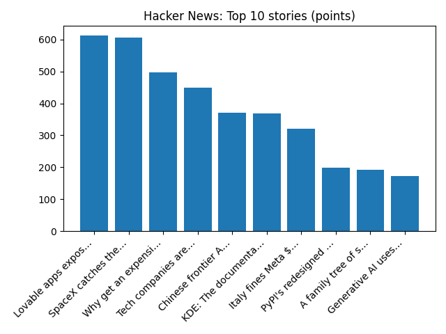

# Daily Knowledge Garden — 2026-11-15

## 🧭 Daily Summary
Global coverage includes 2026 U.S. House Election Results - AP News; Florida city cancels St. Patrick's Day parade, citing new anti-DEI law; Beauty advent calendars can cost hundreds - but are they value for money?. Local coverage includes Storm Team4 Forecast: DC area will have a cloudy and cold weekend - NBC4 Washington; Man accused in multiple attempted abductions, assaults in Northern Virginia arrested again - WUSA9.

## 🌍 Global News (cross-source)
- [2026 U.S. House Election Results - AP News](https://news.google.com/rss/articles/CBMibEFVX3lxTFBUM0VmeFZ2SjF1RGJlVENLazFvbHZxWjRIYUlNMFlKal9sRW1ySS1UQWo4djh3cWpLcXJLWWFuWXBmdkllMTd2aVRhWF9YZFM5ZGRmN3pxZW5nWERXMjREbTVDeGF2RXRfM3ZTUw?oc=5) — AP — Business (Google News)
- [Florida city cancels St. Patrick's Day parade, citing new anti-DEI law](https://www.npr.org/2026/11/14/nx-s1-6041093/st-patricks-day-parade-canceled-florida-dei) — NPR — Top Stories
- [Beauty advent calendars can cost hundreds - but are they value for money?](https://www.bbc.co.uk/news/articles/cqn83l442724o?at_medium=RSS&at_campaign=rss) — BBC — Business
- [Israeli military says it struck senior armed Hamas commander - Reuters](https://news.google.com/rss/articles/CBMivwFBVV95cUxPYUhZd1pxN2d0N3pmR2RCbjhCQk9teURKLThfYzR0bC1rVWJpVGUwNkpJelBNeVNLY3hxS1B0c0p2bTk5VmhCeFVGUWpHSFVNdHFKZjcydUdYNDEyMThuQ3hTRmFNSTQ0Z05ZSWRSd1A3QnM3eTRjWkNJbkN2Z2E5M1FQaUdrdUtaYzVNcWtVMC1LOU1yUkpoUk82d0ZQejM5cDR3YXVqcE5xMlJkTVU2dGduMDdsUWp2UG5ERFZUZw?oc=5) — Reuters — Headlines (Google News)
- [Air travel issues to persist well into Sunday, officials say, with thousands of flights affected - Reuters](https://news.google.com/rss/articles/CBMi0gFBVV95cUxOVXZEZWRocXp0dXdaSC1HaHpfRDdJdlU2WG9IbndjZnN0M0JBd05qbDlrdmtkOFpnalRoejZsWktJSlRkZERUZ29WbVBCWkw1WjlzbVpqODV3anFPLXNJNlJJNWlraGdLWmIyMWpsM2NrVTdqNWFmaFFDNkQ5M1BRWkJNN2xYSTRwMmVkZ1J6NjE5dVcwd0N2QjFGVEFrTWZzLUJQVWQ4TWFQcVI1d01FZk5ndW9qVjVsbGNrMHE2UlVIUUh2RklVeV9jMEw5WkFsSGc?oc=5) — Reuters — Headlines (Google News)

## 🏙️ Local News
- [Storm Team4 Forecast: DC area will have a cloudy and cold weekend - NBC4 Washington](https://news.google.com/rss/articles/CBMisAFBVV95cUxQVmVHYnlmbUhQUG9Uc2hwSEVtNFlyYXBycjJSZm5DZGR0YzRPU3IybHczblctRkp4OW55OGdTQWYwNjdHSmMxVElzd3F6aXdKNnI2M1pqVEhhV1N1YS14a2lQOUFNejB1S2ZoUmFfTjVramxqQm1wamstd0FDTzBhN0NiVlFPcTBGeGdtZnptdTR3TEVXUE45WkxPZnlIRnNXU2dCa2E5QUc4U0NBN0h4Z9IBuAFBVV95cUxNbXNkdFM3WHk0V0JzSFJPc2dTVG5PZUpONEdFbjRCNTZlcGFJcmROcGZoOFl6R0RkNktFTWtya1dnc0NmNzE3Ym5CR1V1dEtNYXFYeE4tTlRwTmRMN09NenZ0NHNwOURFdU4wQTdxb0tGN3I0ZDd0alJhX0lWaVBpZ2U4SnIxa3NBdHkxSHBLNGtUVkQyWXNzYXZ1RWVzVjRjVXNMZ2dQeWUxRzZtbHpqVDN2aWtQNHFH?oc=5) — Google News — Northern Virginia
- [Man accused in multiple attempted abductions, assaults in Northern Virginia arrested again - WUSA9](https://news.google.com/rss/articles/CBMi7gFBVV95cUxNOUlES1NScGt2dERFXzUtZkxZUzY5NVA3OU8tZDk3Y2ZOeHh0cXA5Z0hJOTZLZkE1ektCVW1JbUZqN0pydGxDNlVIbzRGUmJDcXNRNDdrdE1vR3FTczBTc1JyN2k4QktjYkZYb0ZraG13d3d1UEVGTnY0QnNlVHVmck1jSE1VRXh4N2RncVpWd2NzMjRWdWhVazUwdnBNbkI3eXRzTEFmclVLdDc5b1RHS0RrS2VVT091aXJZc1pRbEhyUGh1Q2UwMkpuNUkwQnlGWGNPbW1LaEp1YkxRQ1owVFhmT2NNUFJ1UWlUSHdn?oc=5) — Google News — Northern Virginia
- [Freeze warning issued for parts of Maryland and Virginia, marking end of growing season - NottinghamMD.com](https://news.google.com/rss/articles/CBMiwAFBVV95cUxNWk92QWVzeHhQa1VjRnpYd2QwSkk1ZGRBQnd2YXVZMjNpQThlRllLalZIQ1pMS1lXejM0ZXliVnpXV1lPb1lnSUk5ZHJWdGtjR0lKV2M3ano2ckZzNTdnbm5xNW9PaW9NcUhUSjF0S1JwQ09ZblJ4a1JWbGtpdnROWDVIbW40SHRkaTJaWTZYUWhpTFhxQ3dULU1jMGh0dmlTMlJaVkdrVGY3STlkRFVzUURMdGhrM29lRlA3SVM5TjE?oc=5) — Google News — Northern Virginia weather
- [A Northern Virginia Chick-fil-A Ranks the 6th Worst in the U.S. - Northern Virginia Magazine](https://news.google.com/rss/articles/CBMiygFBVV95cUxNSGZ0QXVPRzVNZkp3U09kUG5QNDRTQzhUZnhvMDRiN3BBamIwYXBIeTZTbmw4b1pqek1IMGFhdVdNaHFESml1VkwxcnQzdEFKVVl1SnNYc1lhRVY2R1dYLXllM1picFA5c21nWHZQSTkzS1hFQjZCYmpQM2tvWi1pakw2N0hybmN3RmRNSURMdHduMUpFS0MxdlJCTnlod00yVGJ2ZWVmS3R2T0xEMjBiSUJKc2FRTDRHeHAtN2hkclZQNlJBOFR3V3p3?oc=5) — Google News — Northern Virginia
- [McLean Parents Arrested for Hosting Underage Drinking Party - Northern Virginia Magazine](https://news.google.com/rss/articles/CBMirAFBVV95cUxPT29MMVBFa3FxeUNvdHljTW5KZFRBbnVVczR1aF82N1JpelI4a1pYQktEeVZFTzBOVXNfMDgwcGY3TGd6TXlMZjkzaEV4RWlFY1JNQTJNM2ZJUFBZX1ZFSzIyVHFQMHZxSFd3MGhGTk1NRGhNdGdURWlTMzJIT010Q0Nlbl9NR1VtbHNackVmQ2lON3ZEUGNPS091MmtUeEFSaTJJYUhJZ3Ytdmx5?oc=5) — Google News — Northern Virginia

## 🚀 Hacker News (Top 5)
- [Lovable apps expose passport details and more than 200K private messages](https://www.crissyfield.de/research/lovable-en/) — 612 points, 255 comments
- [SpaceX catches the Starship to end Flight 15](https://www.spacex.com/launches/starship-flight-15) — 606 points, 419 comments
- [Why get an expensive Pi when I have an old phone?](https://so.long.thanks.fish/why-pi-when-i-have-an-old-phone/) — 497 points, 280 comments
- [Tech companies are trying to shift the concept of privacy again](https://www.eff.org/deeplinks/2026/11/tech-companies-are-trying-shift-entire-concept-privacy-again) — 449 points, 170 comments
- [Chinese frontier AI models carry the fingerprint of export-controlled GPUs](https://unemploymentlabs.com/checkpoint-forensics) — 371 points, 161 comments

## 🌍 Wikipedia — On This Day (selected)
- **2022** — The world population reached eight billion.
- **2020** — Lewis Hamilton wins the Turkish Grand Prix and secures his seventh drivers' title, equalling the all-time record held by Michael Schumacher.
- **2017** — A flood a few miles outside of Athens results in the death of 25 people.
- **2016** — Hong Kong's High Court bans elected politicians Yau Wai-ching and Baggio Leung from the city's Parliament.
- **2012** — Xi Jinping becomes General Secretary of the Chinese Communist Party and a new seven-member Politburo Standing Committee is inaugurated.

## 🎲 Wikipedia — Random Article
**Susan Coyne**  
She was married to Canadian actor/director Albert Schultz. They have two children.
https://en.wikipedia.org/wiki/Susan_Coyne

## 🌌 NASA APOD
[Apollo 12 and Surveyor 3](https://science.nasa.gov/image-article/apod-2026-november-14-apollo-12-and-surveyor-3/)

## Feed Health
- **Reuters — Headlines (Google News)**: ok (15 articles)
- **Reuters — World (Google News)**: ok (15 articles)
- **Reuters — Business (Google News)**: ok (15 articles)
- **BBC — World**: ok (15 articles)
- **BBC — Tech**: ok (15 articles)
- **BBC — Business**: ok (15 articles)
- **BBC — Science**: ok (15 articles)
- **AP — Headlines (Google News)**: ok (15 articles)
- **AP — Politics (Google News)**: ok (15 articles)
- **AP — Business (Google News)**: ok (15 articles)
- **NPR — Top Stories**: ok (10 articles)
- **NPR — Politics**: ok (10 articles)
- **NPR — Business**: ok (10 articles)
- **NPR — Science**: ok (10 articles)
- **NPR — Technology**: ok (10 articles)
- **ScienceNews**: ok (15 articles)
- **ScienceDaily — Top**: ok (15 articles)
- **Nature — Technology**: ok (15 articles)
- **Google News — Northern Virginia**: ok (15 articles)
- **Google News — Northern Virginia traffic**: ok (15 articles)
- **Google News — Northern Virginia weather**: ok (15 articles)
- **Wikipedia — On This Day**: ok (10 articles)
- **Wikipedia — Random**: ok (1 articles)
- **NASA — APOD**: ok (1 articles)

Runs so far today: 1
