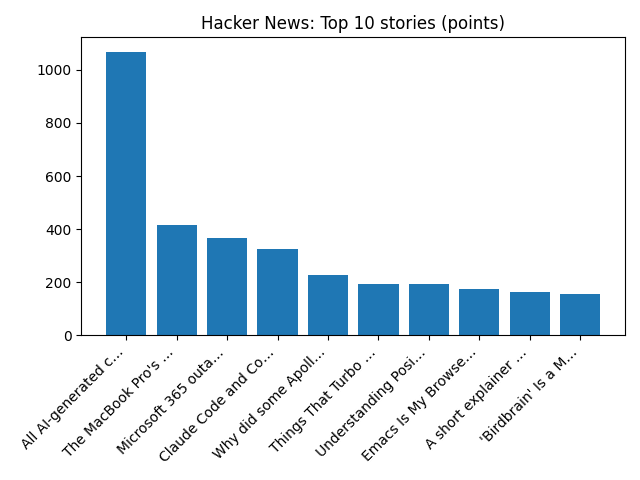

# Daily Knowledge Garden — 2026-11-16

## 🧭 Daily Summary
Global coverage includes Black Friday and tax return scams  - don't fall for these; Thousands of US flights still cancelled or delayed two days after grounding of planes nationwide; Steering problem on tanker caused collision in New Orleans, NTSB says - Reuters. Local coverage includes Eddie O’Brien Obituary (2026) - Strasburg, VA - Northern Virginia Daily - Legacy | Obituary; Mary G. Porter Traditional in Woodbridge named top school in Northern Virginia - Prince William Times.

## 🌍 Global News (cross-source)
- [Black Friday and tax return scams  - don't fall for these](https://www.bbc.co.uk/news/articles/cm4gnlz2p61ko?at_medium=RSS&at_campaign=rss) — BBC — Business
- [Thousands of US flights still cancelled or delayed two days after grounding of planes nationwide](https://www.bbc.co.uk/news/articles/cw1mdlv0k2r4o?at_medium=RSS&at_campaign=rss) — BBC — World
- [Steering problem on tanker caused collision in New Orleans, NTSB says - Reuters](https://news.google.com/rss/articles/CBMitgFBVV95cUxPbXBEMnhoWXdETmQ4d2JPM3Q2OUw0MDByaUV2di1Nc3ZVcmJHaGJ6bnNLN1lsc3gzeG5hSGlEYnBKaHJOajU2SzlrRXp4UUZtdU5Dc0I1TlNmYlFxWThaUFZvRk11UVJSY2YyakpJSFFGNWlVbmZrMDNXTXkyLXM2MWlydzN1YWwydGc5dmM3WVZjeFVVZDlIVGR2aGFEMzZrUkE3QnRXU1hibDlpU2RWQkkwTkRyZw?oc=5) — Reuters — World (Google News)
- [England end Spain's long unbeaten run, Italy crash out of Nations League - Reuters](https://news.google.com/rss/articles/CBMiuAFBVV95cUxOd3ZhSGtta2ltYVFfbXVVSC00alNLM3hwX0JOR09kbkZiQW5mQy10clVEX2lXYUhacnUtTjRPbUtYbC1SZTM4bThUNkp3WVg5RXl2VURGYlREMm5BNU14NjNic2RrNEg3bldja1liYmx5SXI0dnBsaHRidldoYmczQ3hjWnptRzFKMmlpd2w5S2RuSGJfeUZxUDlPdmZxMjJNQVc3TE1iS3hJblFCN2ZqRmJxdzFfYzBK?oc=5) — Reuters — Headlines (Google News)
- [Far from home. Voyager 1 is now farther than anything man has sent into space](https://www.npr.org/2026/11/15/nx-s1-6041716/a-long-long-ways-from-home-voyager-1-is-now-farther-than-anything-man-has-sent-into-space) — NPR — Top Stories

## 🏙️ Local News
- [Eddie O’Brien Obituary (2026) - Strasburg, VA - Northern Virginia Daily - Legacy | Obituary](https://news.google.com/rss/articles/CBMijAFBVV95cUxPVFlxX0Q2VjNONGJsU0FVS1htUzJ2VFNDdDQxQ0tkYXE4dDUzMGpmN0dKZ1lZb3VGTXNHZFZ5OTh5THZxRUs5eW94Z29CV1E5Z2JxYzgwbFhVX1R1UXFnZ0s2ZHEzMnNpU2hmdU9CcUR0SG12X1ViYkdiRHlUZnlRak5MckRmYWY3X2hGVA?oc=5) — Google News — Northern Virginia
- [Mary G. Porter Traditional in Woodbridge named top school in Northern Virginia - Prince William Times](https://news.google.com/rss/articles/CBMiggJBVV95cUxOUk96eWRGdW1nTUMyN0I1M0NwaE9yeTFTMU8xa1V3X19rUW9la0NiZXVSYms3LVVQbTBERlZBXzN5QkNDSlBqalJkbHhRZFFBbzNSeDlTSGx6alhLaVUybi1lZDVaYjF1RGpYMkd3OWJfczZvbGFuaEFpMjducW1DNWlUWHNTZnJDMFExbm9zYktNWU1MbVZ6T1FMcjdYOHNNVFBodHJYYVFuVWFOTHo0UDlnd1ltcm5KTUQ2YXZzMUljcUZUdkp3M2E3VU9pQzl1X3dENnRGSjJBV0lLUE84aGFLV0tGckhtZjBPSkphNjFOUnN1X1hmMXNNRTVNakZBVFE?oc=5) — Google News — Northern Virginia
- [Northern Virginia community honoring star who passed too soon - WUSA9](https://news.google.com/rss/articles/CBMi3AFBVV95cUxOdTJPd21BNGxMZFhGVkZmU3Y4dlFzQzBRZXdyZGJfX0dIM2xDZTg5UkllVk5nS2IxV1JtclBBcFRLRGNYQnBCMUJJalhuT1Z1X1ZHX1FBdlMtQTl2RU9MM1NQMDNVbkFsVGJhSkd6dzM1TXZtazd0ZEw2eTFhMk14ZnljYl9NM2p0d3NubUZXMjYwNXFTc2JqWUY1aExJYUVOd056MDBORlJtWi03OHhmQWEwSzBRUHFhVXhPMXFQUGFxZlVlOTdUN0pMNHhEYURueWJ2VDA4U3hHVDU5?oc=5) — Google News — Northern Virginia
- [Northern Virginia Christmas Market Canceled: Which 10 Fill In? - deeparrival.com](https://news.google.com/rss/articles/CBMihAFBVV95cUxPUmxfQ3ZoMmdxYXpScHBUQnNqNW1QVFVVd25uajFzcVNFcVkxd09hYXpfakpyNVdoRjZvN01Yc1p4dTlCY1hEZlI3ZTVmcl9UWUtXcWNwOWZ1R0xjSmdsSGJzVzNWUU9IUExfb3V6Z2pYNmc5Y3dDUmw0WENJUXA1b3AyMnY?oc=5) — Google News — Northern Virginia
- [Man accused in multiple attempted abductions, assaults in Northern Virginia arrested again - WUSA9](https://news.google.com/rss/articles/CBMi7gFBVV95cUxNOUlES1NScGt2dERFXzUtZkxZUzY5NVA3OU8tZDk3Y2ZOeHh0cXA5Z0hJOTZLZkE1ektCVW1JbUZqN0pydGxDNlVIbzRGUmJDcXNRNDdrdE1vR3FTczBTc1JyN2k4QktjYkZYb0ZraG13d3d1UEVGTnY0QnNlVHVmck1jSE1VRXh4N2RncVpWd2NzMjRWdWhVazUwdnBNbkI3eXRzTEFmclVLdDc5b1RHS0RrS2VVT091aXJZc1pRbEhyUGh1Q2UwMkpuNUkwQnlGWGNPbW1LaEp1YkxRQ1owVFhmT2NNUFJ1UWlUSHdn?oc=5) — Google News — Northern Virginia

## 🚀 Hacker News (Top 5)
- [All AI-generated code should be Open Source](https://jakub.jankiewicz.org/blog/ai-code-open-source/) — 1069 points, 579 comments
- [The MacBook Pro's OLED PWM problem](https://macanorak.com/the-macbook-pros-oled-pwm-problem-when-a-better-display-becomes-worse-to-use/) — 414 points, 229 comments
- [Microsoft 365 outage leads to chlorine gas poisoning of 15 hotel guests](https://www1.wdr.de/nrw/rheinland/rhein-erft-kreis/technischer-defekt-chlor-phantasialand-100.html) — 368 points, 175 comments
- [Claude Code and Codex reverse engineered my 1994 Jeep's ECU over a $3 Arduino [video]](https://www.youtube.com/watch?v=WPj3aQ-xxpI) — 326 points, 160 comments
- [Why did some Apollo missions carry a grenade launcher? (2019)](https://space.stackexchange.com/questions/37775) — 227 points, 146 comments

## 🌍 Wikipedia — On This Day (selected)
- **2022** — Artemis Program: NASA launches Artemis 1 on the first flight of the Space Launch System, the start of the program's future missions to the moon.
- **2009** — Space Shuttle program: Space Shuttle Atlantis is launched on mission STS-129 to the International Space Station.
- **2005** — Following a 31-year wait, Australia defeats Uruguay in a penalty shootout to qualify for the 2006 FIFA World Cup.
- **2004** — Half-Life 2 is released, a game winning 39 Game of the Year awards and being cited as one of the best games ever made.
- **2002** — The first cases of the 2002–2004 SARS outbreak are traced to Foshan, Guangdong Province, China.

## 🎲 Wikipedia — Random Article
**Sakaguchi Kiichiro**  
Sakaguchi Kiichiro (阪口喜一郎, Kiichiro Sakaguchi; January 1902 – December 1933) was a Japanese anti-war activist and a sailor in the Imperial Japanese Navy. During his service, he was active in anti-war activity.
https://en.wikipedia.org/wiki/Sakaguchi_Kiichiro

## 🌌 NASA APOD
[Leonid Meteors Through Orion](https://science.nasa.gov/image-article/apod-2026-november-15-leonid-meteors-through-orion/)

## Feed Health
- **Reuters — Headlines (Google News)**: ok (15 articles)
- **Reuters — World (Google News)**: ok (15 articles)
- **Reuters — Business (Google News)**: ok (15 articles)
- **BBC — World**: ok (15 articles)
- **BBC — Tech**: ok (15 articles)
- **BBC — Business**: ok (15 articles)
- **BBC — Science**: ok (15 articles)
- **AP — Headlines (Google News)**: ok (15 articles)
- **AP — Politics (Google News)**: ok (15 articles)
- **AP — Business (Google News)**: ok (15 articles)
- **NPR — Top Stories**: ok (10 articles)
- **NPR — Politics**: ok (10 articles)
- **NPR — Business**: ok (10 articles)
- **NPR — Science**: ok (10 articles)
- **NPR — Technology**: ok (10 articles)
- **ScienceNews**: ok (15 articles)
- **ScienceDaily — Top**: ok (15 articles)
- **Nature — Technology**: ok (15 articles)
- **Google News — Northern Virginia**: ok (15 articles)
- **Google News — Northern Virginia traffic**: ok (15 articles)
- **Google News — Northern Virginia weather**: ok (15 articles)
- **Wikipedia — On This Day**: ok (10 articles)
- **Wikipedia — Random**: ok (1 articles)
- **NASA — APOD**: ok (1 articles)

Runs so far today: 1
