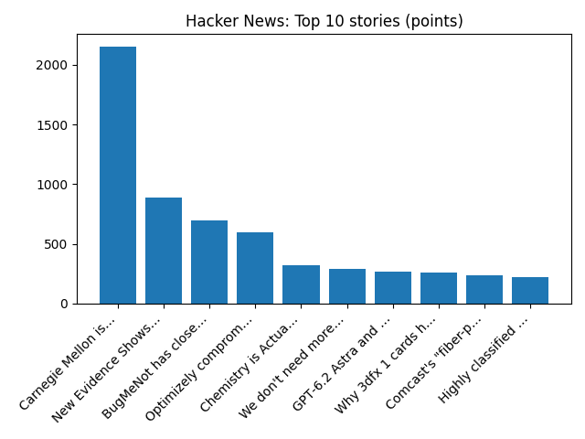

# Daily Knowledge Garden — 2026-11-17

## 🧭 Daily Summary
Global coverage includes William and Kate celebrate Earthshot Prize winners in Mumbai; Trump’s pick for Navy secretary acknowledges the Iran war is straining military resources - AP News; Huang would 'be honored' to return as Nvidia CEO after affair scandal forced him out - Reuters. Local coverage includes Now serving NoVA: Roda, your neighbor’s fave mechanic - ALXnow; Two Northern Virginians Take to the Mic on DC News Now - Northern Virginia Magazine.

## 🌍 Global News (cross-source)
- [William and Kate celebrate Earthshot Prize winners in Mumbai](https://www.bbc.co.uk/news/articles/cqlykve012d1o?at_medium=RSS&at_campaign=rss) — BBC — Science
- [Trump’s pick for Navy secretary acknowledges the Iran war is straining military resources - AP News](https://news.google.com/rss/articles/CBMipAFBVV95cUxNbllfOXUwUTRNV0hzUWFSeFRyLWZUSHQzaldSWWlxMVRyOXh1c3BCNm1Pa0Y2X0FJTWYzWXRUZ2xHX0ljTndqYmlTWFBFZ2ZpMmdXMWFPWDNXSDB0WFdrRGczUnJyT3BOVUwyeU9hSzhtUVVTNDdhLUlOaWVmcUJLWVpUc1IyUmg5VFNFTWk3TDRyZnVmbVVFbUN6LWc4cXQzUmZjVQ?oc=5) — AP — Politics (Google News)
- [Huang would 'be honored' to return as Nvidia CEO after affair scandal forced him out - Reuters](https://news.google.com/rss/articles/CBMitwFBVV95cUxQTTFHVE42V3FIZzBXbWhKLVR3bWRrZ3dRWGpCRm45dlktYkpveDBveW1IRFc1aDltUERHLURBUFdSUW5KMVVaZ2w2NGRuQVhmZmtyb2ZpUGZuZncyVXR3cFYxX2FUcmFyQVRBSHVnbWFsVFFTQ1lPS0lTdmZUMDktbTBUbndQdzhxc2JnWVctSF96QXdVb2JUeUpqYURha25FMEZhU3VqbWFTZDA0Q3lqanRUaGdMQ2M?oc=5) — Reuters — Business (Google News)
- [Jensen Huang pushes Nvidia comeback after board rejects pressure to reinstate ex-boss](https://www.bbc.co.uk/news/articles/cwx2en2vrxmdo?at_medium=RSS&at_campaign=rss) — BBC — World
- [Huang says he'd be "honored" to return to Nvidia as he agrees to testify to Congress](https://www.npr.org/2026/11/17/nx-s1-6044213/jensen-huang-nvidia-congress) — NPR — Top Stories

## 🏙️ Local News
- [Now serving NoVA: Roda, your neighbor’s fave mechanic - ALXnow](https://news.google.com/rss/articles/CBMilAFBVV95cUxPc290N01lSG8wams3UTdhdFlrbEVldnFScFk1MjJERk1HVG9rNFRZRUlCZzd6S2o2Z29rb3pNc082eG1CSUNrbUtMQzJMbFBOWXNMRnE1RC1sdUpwZllCN3hfN2prUW4yUVZjUUFPZ0MteFQ0dXJzcUJ1MTdHNEk0ZEpxT29fNExERWI5bjdGVjFrcnBH?oc=5) — Google News — Northern Virginia
- [Two Northern Virginians Take to the Mic on DC News Now - Northern Virginia Magazine](https://news.google.com/rss/articles/CBMiqgFBVV95cUxNQU1ubXlsQXc2eDlEd0dpUnhGZmRxNldEVXVrYzBQTGFFM2JSRzBXME9JaDlaNVhOX0czakNvR21sN19HV2NWbDNGMC10SW4yTXg0ODJvSGN1dXRWejUybVBSamVRazA2U2I5RnJ1TzYwcGpWY1N4aW1OaVYwM2xORlpJck1CSGIyVG4zV2U1SGtaTzU1UVhiOUptV3NuSDJsQU9EeTEtNlM1UQ?oc=5) — Google News — Northern Virginia
- [Virginia Shoots for the Stars: Spanberger Wants a Space Academy in Hampton - The Zebra](https://news.google.com/rss/articles/CBMihgFBVV95cUxOMVVtS0gtNktYdUhPcUtONUp3QWs0OHdLNkFycWpoMVFKNFp5eVhUVGN4WEJWSnpIaXVLbnBnZjdaX2pobUNab0JIUWtGcFhwQ0lfcy1COXRQYUpqdnZiVVpNR25TS3FpT1lCVGYwZHJweUl1aU54dGgwR19mVW5uZHYxMHQ4Zw?oc=5) — Google News — Northern Virginia
- [Data center concerns aren’t really about physical infrastructure, U.Va. study says - WTOP News](https://news.google.com/rss/articles/CBMisAFBVV95cUxNYUI1TTBBWlJsQy1UeVV1TVZiM1QzN182eGQ4VXdsZ1dydms0RDRkZE13U21tYjlpa3o5RzJfaTZDbHRLMUh0NEFSbUtSeFFnM2hGRm9MZzZrMEJXY0pfUm5BVm0yU3lmVWFKdVVkV2dOMEtoeWVDQ19CVWxGSEtQTE8xQ3V2Z2VJbTIyYTl5ZThWanJzY0NOTXFGVVRxNWk3bE9FejFQeGJJenJQU1hNTg?oc=5) — Google News — Northern Virginia
- [NBC4 Winter Outlook Calls for 14-42 Inches of Snow Across DC, Maryland, and Northern Virginia - The MoCo Show -](https://news.google.com/rss/articles/CBMiwgFBVV95cUxOQ2NxblAwVU04WW9OejlmR3E2cWJjN0w4Q1QzVS1BeUtONzhOMFFmNDZfSm1od1JGUGhORF92VjNJN29zbXczS210OUJjejBxV3Y5eXd6ZnB5aGQwanJQQ01VLVczSmJGRGxUUFh6YjNCWVR1WmFJR2xSSVFiR3JGMm5xeS1KdGpaZXZQUFRkN1Fpd0FyVFZXSUQ0N2xtQ2NDM2l6aGw5NC0tTDd5UFJqbXRzcUhZZWtseENxUWRGU2ctZw?oc=5) — Google News — Northern Virginia

## 🚀 Hacker News (Top 5)
- [Carnegie Mellon is putting computer science courses on YouTube for free](https://www.cs.cmu.edu/learn/) — 873 points, 141 comments
- [Technical issue at JPMorgan Chase triggers online banking delays for US banks](https://apnews.com/article/bank-outage-chase-wells-fargo-truist-50fee2693c22f597fa6ca51a97ef2cda) — 732 points, 607 comments
- [BugMeNot has closed](https://www.bugmenot.com/) — 370 points, 185 comments
- [Jiff 1.0: A datetime library for Rust](https://burntsushi.net/jiff/) — 329 points, 77 comments
- [Frame – 31.5" color ePaper display](https://trmnl.com/blog/introducing-frame) — 328 points, 236 comments

## 🌍 Wikipedia — On This Day (selected)
- **2020** — A Vega rocket carrying SEOSat-Ingenio and TARANIS fails after liftoff.
- **2019** — The first known case of COVID-19 is traced to a 55-year-old man who had visited a market in Wuhan, Hubei Province, China.
- **2013** — Fifty people are killed when Tatarstan Airlines Flight 363 crashes at Kazan Airport, Russia.
- **2013** — A rare late-season tornado outbreak strikes the Midwest. Illinois and Indiana are most affected with tornado reports as far north as lower Michigan. In all around six dozen tornadoes touch down in approximately an 11-hour time period, including seven EF3 and two EF4 tornadoes.
- **2012** — At least 50 schoolchildren are killed in an accident at a railway crossing near Manfalut, Egypt.

## 🎲 Wikipedia — Random Article
**Jim Clendenen**  
Jim Clendenen was deemed "The Godfather"  of Santa Barbara County wine. He was key in raising international recognition of Santa Barbara County as a world class wine region, as well as being instrumental in raising the quality of Burgundian varietals on California's Central Coast.
https://en.wikipedia.org/wiki/Jim_Clendenen

## 🌌 NASA APOD
[Milky Way versus Aurora](https://science.nasa.gov/image-article/apod-2026-november-17-milky-way-versus-aurora/)

## Feed Health
- **Reuters — Headlines (Google News)**: ok (15 articles)
- **Reuters — World (Google News)**: ok (15 articles)
- **Reuters — Business (Google News)**: ok (15 articles)
- **BBC — World**: ok (15 articles)
- **BBC — Tech**: ok (15 articles)
- **BBC — Business**: ok (15 articles)
- **BBC — Science**: ok (15 articles)
- **AP — Headlines (Google News)**: ok (15 articles)
- **AP — Politics (Google News)**: ok (15 articles)
- **AP — Business (Google News)**: ok (15 articles)
- **NPR — Top Stories**: ok (10 articles)
- **NPR — Politics**: ok (10 articles)
- **NPR — Business**: ok (10 articles)
- **NPR — Science**: ok (10 articles)
- **NPR — Technology**: ok (10 articles)
- **ScienceNews**: ok (15 articles)
- **ScienceDaily — Top**: ok (15 articles)
- **Nature — Technology**: ok (15 articles)
- **Google News — Northern Virginia**: ok (15 articles)
- **Google News — Northern Virginia traffic**: ok (15 articles)
- **Google News — Northern Virginia weather**: ok (15 articles)
- **Wikipedia — On This Day**: ok (10 articles)
- **Wikipedia — Random**: ok (1 articles)
- **NASA — APOD**: ok (1 articles)

Runs so far today: 2
