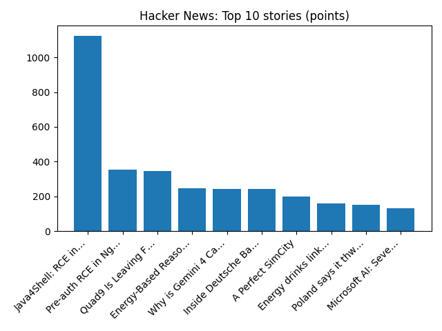

# Daily Knowledge Garden — 2026-11-18

## 🧭 Daily Summary
Global coverage includes William and Kate reflect on 'enduring' UK-India ties with Modi; Hakeem Jeffries could become the first Black House speaker after Democratic nomination - AP News; Grand Theft Auto 6 is a masterpiece, say critics. Local coverage includes Learn about agency programs and projects at Northern Virginia Joint Transportation Meeting Dec. 2 - Virginia Department of Transportation (.gov); LEO Impact Capital Leads Collaborative Acquisition of Northern Virginia Apartment Community to Protect Long-Term Affordability - citybiz.

## 🌍 Global News (cross-source)
- [William and Kate reflect on 'enduring' UK-India ties with Modi](https://www.bbc.co.uk/news/articles/cq62ped2ypy4o?at_medium=RSS&at_campaign=rss) — BBC — World
- [Hakeem Jeffries could become the first Black House speaker after Democratic nomination - AP News](https://news.google.com/rss/articles/CBMirwFBVV95cUxPMkFKcjYyblpFekN4MnNrTUo1Z0ZIVGkyRTJHSENPZ2N6bEE3QmNPVWVnX1VkRG5xbk1IRzBsM1hkaHgwaWo1NkdQSW9PUzZoS1h5TUFteGhGakcxdVUyaml1SDNCXzNkYkhiSkpQVWFkRjh3d3JOeVlkRGt4X01sazQteW42UGIwMjJCZklydHBVbWYwLThsVUEyRnZ3ckZTZkhrcFdfcENjVG9Rc3dJ?oc=5) — AP — Politics (Google News)
- [Grand Theft Auto 6 is a masterpiece, say critics](https://www.bbc.co.uk/news/articles/cw8r75xm8v4po?at_medium=RSS&at_campaign=rss) — BBC — World
- [Grand Theft Auto VI draws rave reviews as gamers enter Vice City - Reuters](https://news.google.com/rss/articles/CBMiwAFBVV95cUxNcVVqRHRmV1VIanMwYjl6bHB4R0FTSWZOVFY5RXVYSmtaOVZQMVhXNkoxVjM1NF9ZUUZYa2hneUMxeTBzRC1WTFJQZVJBOTAweVhHOFhfZFJIVmt6cTdHMGxwYnFDUjZaYUZJVGlvV2dOVGFvVWVDY3FaX2VHQWZ4dlhlRGxQdDhETVN5aFA0OG9hOVVHMFBYbHFESkxEY0ZPeUV0a0U3LTFvZFRnWk9oQkhwdTVSbmdGQUZHSk02UzE?oc=5) — Reuters — World (Google News)
- [Israel launches ground operation in central Gaza, dozens flee - Reuters](https://news.google.com/rss/articles/CBMisgFBVV95cUxPaVdVck4yZnVKU01QQ0Nrd1c2VXRReEloTk1IS0xKWjRkcUdrR3BiTlAyU2dQVm1POVg0MmM5anI0YWlIa0txYms3Sjh6QW9kRjU3bmk0ajlHZ3BZbHM5eHBqazVBbVRvYkt4NENBZ0VuU3NEREFaVGpEOXFyMkdPWEktNE41aUIzY2U3enZDX1dmTTZkQzJPNHh0WktQUV80M2ZTb2o0ZDBYUHR0YmIxRWlB?oc=5) — Reuters — Headlines (Google News)

## 🏙️ Local News
- [Learn about agency programs and projects at Northern Virginia Joint Transportation Meeting Dec. 2 - Virginia Department of Transportation (.gov)](https://news.google.com/rss/articles/CBMihAJBVV95cUxONUJuMjNjMDZiQndsV2Z1c2FIUWZkSUJEQU50SWhnMDJDVnRxS2pyR0ljMEtFVk5sS0xjNzFta1BZUW03a29KTDFhSk1EOVF0akVJZmxRbzYwcmoxM0hEdmR2MXlNcUpSZlRjMzZpVjZkSzRYem54eWlVdlhjMzFLbVhicHh5MjhGVU96VmFUT0JIVFljY0piU2ZLY2NUQUFpdUctZnNUTjJNSGZ4STA2NEVKSW1Qcmp2STlpTHFoVkRlZ2Nhb2dhSm9iQXhGTS1lZTBJZ1ZPU3dSeVRkakNYdml3UkxCam01S0d4Z0JQbnJqSGxUU21jZk9ham83WVQtcEprTw?oc=5) — Google News — Northern Virginia
- [LEO Impact Capital Leads Collaborative Acquisition of Northern Virginia Apartment Community to Protect Long-Term Affordability - citybiz](https://news.google.com/rss/articles/CBMi-AFBVV95cUxOeWMybGlPam1rVFN6bFR2TE5tcEFBRkhzOThYNnpLUjhsUTRMVkNiem42QjFKbWZublItYWs4Z0V2QmowcFZqUGpXZjVQSkxJVllBaGpLYklqQTVjWnNOVXFtQmZucHRSY1dDSGxYYWp6TnRZOE5zNG10OG9nM01SVWh3ZUJETXVXRHVyOUtfdFRtbzBVRDR1N1lkQUM4ZkVrNk5DajVZQ1U1ZUp2VXBqcjNBMXNkaDdTcWtWazg0U3IwSkxRVXhEcHBsU0tULXVFcUJoSk1zcm15dmZUTXZ5R3hINjRpS1VCa0RFMGFqbDl3ZXRCZU44Yw?oc=5) — Google News — Northern Virginia
- [11-year-old boy missing from Reston since Tuesday night - NBC4 Washington](https://news.google.com/rss/articles/CBMiwAFBVV95cUxNSEJ4WXNhVWV6a2RoM1lMNTFScF9jeFJiNzFYYktfX0FqYmN5bTl0b2Y5RmhtbzdGSGhxN0hBRWZmVmw0S3FFMllNd2RJZkgzQ09IVDA0clhMdUh6X1BpVjZTeXlJV01NLTdYaHJMQUg0Wl9zWUpZUmtWRUpPT0tvTndmYUp4SEI2UWFQdldsell1MklrRUFTaTNnYkNHVFV4RW9vT0J6cHZ1cHBGUkdWdDhBQ0Z0NUcwNmhlVFJvNWnSAcgBQVVfeXFMTjlWZm40UjVNUk1tTGdNM3VNalJFNkhuVXhzN0k1a2FRZTAzVEVxQ3BiczhXVnYyM3lGMi02Mkt2aHBVQnotQ2h1VEZrQmJIRjduT0pTbFJ2bDRwcF9Gb0xUbTdEVzBRNXQxallGeFh5VG5hWnR2YThyMWJieDZIdWdVTUtuVkxEcm93T25RRW5yaXZYelFEVlBNSi1NRS1LaXBtWF8xeEp3LXlwbHQxYkN4RDc5LWlHYzFnZ2poM3l3TzFGdG4yMkE?oc=5) — Google News — Northern Virginia
- [Falls Church Adds European-Style Market to its Holiday Festivities - Northern Virginia Magazine](https://news.google.com/rss/articles/CBMiwwFBVV95cUxNYm1pWjMtNjhnMEU5TUNsZjhlWWZyUnRCUlRHYTJ3UFNKNXpHd1g0Y0NEYjR2NGJjUWF2WkJ6dUJVbnk5U1puRzkxQmpBWXAyWndrMng1QVVkN29Od2JwMVFBSVRQQ1pqZU8tVjB5YlJPZHJxRjhlanZEQjRFejZiYUxzb3otNWtMZDRyRWY5ZndHMXBXbkt6SVVocjdIQ25YUFJzTmhPU1ZiZHJvNkoyeHpfUmVObkxOTllCalBQOUJsaG8?oc=5) — Google News — Northern Virginia
- [Porter Traditional named top middle school in Northern Virginia by U.S. News - Potomac Local News](https://news.google.com/rss/articles/CBMipgFBVV95cUxPTWhKaHVHWTg3aHk5QzhNa3dYWk1lM3QwQ0RRd2FyWmtjZzFlNjBKbkNiV2VYZV9kVmxieEhRYnRPMFc5SzQxb29wellxeGpSbThEX0dlaUxSTHpFTGdqTi1fZkt5VnZuM19GZ052Z1FXYUtSaEZSd2JSMFpMLWVvNzN1SjJZZVpMTjhFNm5aY2Fta09femdCczl6dXIyUlJvT1lmSHVB?oc=5) — Google News — Northern Virginia

## 🚀 Hacker News (Top 5)
- [GPT‑6.2 Astra and Sol](https://openai.com/index/introducing-gpt-6-2-astra-sol/) — 1107 points, 707 comments
- [Apple Services Down](https://developer.apple.com/system-status/) — 639 points, 354 comments
- [Java4Shell: RCE in OpenJDK when processing Base64](https://calif.io/java4shell/) — 572 points, 149 comments
- [Highly classified US national security communications network goes down](https://www.cnn.com/2026/11/17/politics/highly-classified-national-security-communications-network-goes-down) — 487 points, 562 comments
- [Nvidia stopped disclosing Singapore sales as revenues hit $104B](https://www.ft.com/content/dbde7a30-548c-4f9d-a4be-7898a0c24dcf) — 408 points, 196 comments

## 🌍 Wikipedia — On This Day (selected)
- **2026** — Voyager 1 becomes the first manmade object to travel a full light day from Earth.
- **2020** — The Utah monolith, built sometime in 2016 is discovered by state biologists of the Utah Division of Wildlife Resources.
- **2013** — NASA launches the MAVEN probe to Mars.
- **2012** — Pope Tawadros II of Alexandria becomes the 118th Pope of the Coptic Orthodox Church of Alexandria.
- **2003** — The Massachusetts Supreme Judicial Court rules 4–3 in Goodridge v. Department of Public Health that the state's ban on same-sex marriage is unconstitutional and gives the state legislature 180 days to change the law making Massachusetts the first state in the United States to grant marriage rights to same-sex couples.

## 🎲 Wikipedia — Random Article
**Axel Nilsson Ryning**  
Axel Nilsson Ryning, born 1552, died 8 January 1620, was a Swedish Lord High Admiral, Marshal, Councilor, and Baron to Tuna farm in Österåker parish in the current Österåker municipality in Österskär in Åkersberga, Stockholm county. Son of Nils Eriksson Ryning and Ingeborg Trolle.
https://en.wikipedia.org/wiki/Axel_Nilsson_Ryning

## 🌌 NASA APOD
[A Medium-Sized Solar Flare](https://science.nasa.gov/image-article/apod-2026-november-18-an-m-class-solar-flare/)

## Feed Health
- **Reuters — Headlines (Google News)**: ok (15 articles)
- **Reuters — World (Google News)**: ok (15 articles)
- **Reuters — Business (Google News)**: ok (15 articles)
- **BBC — World**: ok (15 articles)
- **BBC — Tech**: ok (15 articles)
- **BBC — Business**: ok (15 articles)
- **BBC — Science**: ok (15 articles)
- **AP — Headlines (Google News)**: ok (15 articles)
- **AP — Politics (Google News)**: ok (15 articles)
- **AP — Business (Google News)**: ok (15 articles)
- **NPR — Top Stories**: ok (10 articles)
- **NPR — Politics**: ok (10 articles)
- **NPR — Business**: ok (10 articles)
- **NPR — Science**: ok (10 articles)
- **NPR — Technology**: ok (10 articles)
- **ScienceNews**: ok (15 articles)
- **ScienceDaily — Top**: ok (15 articles)
- **Nature — Technology**: ok (15 articles)
- **Google News — Northern Virginia**: ok (15 articles)
- **Google News — Northern Virginia traffic**: ok (15 articles)
- **Google News — Northern Virginia weather**: ok (15 articles)
- **Wikipedia — On This Day**: ok (10 articles)
- **Wikipedia — Random**: ok (1 articles)
- **NASA — APOD**: ok (1 articles)

Runs so far today: 2
