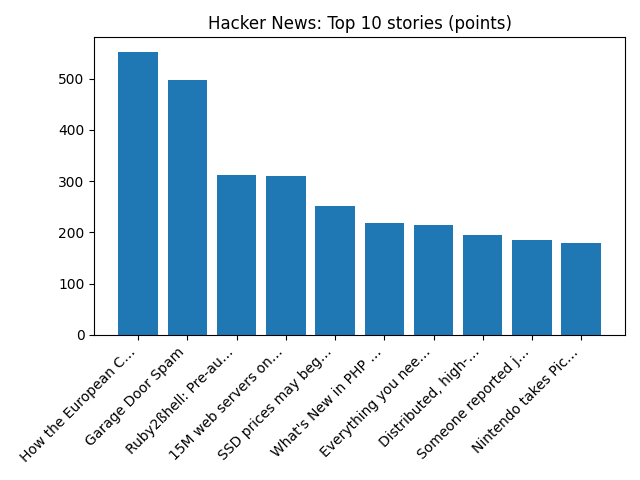

# Daily Knowledge Garden — 2026-11-19

## 🧭 Daily Summary
Global coverage includes Trump, Xi and Putin hold rare 3-way talks on nuclear risks but deliver no breakthroughs - AP News; FCC gives state prisons the go-ahead to jam signals from contraband cellphones - AP News; Trump, Putin and Xi release 'peace declaration' after historic meeting. Local coverage includes Rep. Eugene Vindman on the agenda for Northern Virginia’s Democrats in upcoming Congress - WAMU; 75 jobs and miniature 3D brains: ATCC opens its $55M biomanufacturing center - Technical.ly.

## 🌍 Global News (cross-source)
- [Trump, Xi and Putin hold rare 3-way talks on nuclear risks but deliver no breakthroughs - AP News](https://news.google.com/rss/articles/CBMimwFBVV95cUxOZko0TjU0LUdSMUxlTkNVcnJsSThoSFo5Y2ZuamRVQ2tidnZQa2M5N1o0dlpndmptSGxNTGhYYS1IUXVKMjZibjFPcWVURHJRaHNfclhIMHlSVFdIN3VkZUxFVEo5Z1JoZFR0bkdHOUd1UUNuNXRCVDBKUlhPaGItcmVfY09NQ1U5WmhHYzRNZHdtWDVVay1JalhlNA?oc=5) — AP — Headlines (Google News)
- [FCC gives state prisons the go-ahead to jam signals from contraband cellphones - AP News](https://news.google.com/rss/articles/CBMipAFBVV95cUxPMlp3X0FRVDBaTlhUclVuNV9PN2ZKcGc5QjBCNC1mbjFjamFqQy1TSUYyYjdwZXppTkIxZjZGSGVwaE0zNDRYU1JkM2JteXk3OXNZZ0JFNDgwd2JFRHgtSVJCTWtHM3dWdlY5d3dnWnZoa2g5RGptUWJFY0hNWWFycG5xMTZqNUxKUHdheTJrMEhNTTBlcUFhRy1ZWXVYRm1Udi1yYQ?oc=5) — AP — Politics (Google News)
- [Trump, Putin and Xi release 'peace declaration' after historic meeting](https://www.bbc.co.uk/news/articles/c623j4ln97x7o?at_medium=RSS&at_campaign=rss) — BBC — World
- [Anthropic blows past $2 trillion in Nasdaq debut, tops SpaceX's June listing - Reuters](https://news.google.com/rss/articles/CBMiswFBVV95cUxPVmU0cXVPRUhwcDZpRkRudEI3bjNfMllQVEN3M09VWFNmQUJTck1UUE9mVERRbmFicElZMWxKVnd3UWpTNGY3R1JiZ0NnRnNBRHhLMkxkVC1vUWVOVzQ3NzcwMkoycTR0MC1LUnBfdUIyWl9OZE5xYnlVVmQ5bzdVZmdnVHFjUjh6dHZrbVVQdEFPaDNCUC1KSkZEMUlhcU9OeWFiWi10SGwxNTBpNE16aTd1MA?oc=5) — Reuters — Headlines (Google News)
- [Susan Smith denied parole again 32 years after drowning her two sons](https://www.bbc.co.uk/news/articles/ckdd1y09eqjmo?at_medium=RSS&at_campaign=rss) — BBC — World

## 🏙️ Local News
- [Rep. Eugene Vindman on the agenda for Northern Virginia’s Democrats in upcoming Congress - WAMU](https://news.google.com/rss/articles/CBMiuwFBVV95cUxNSTF6VzBRTXF2eFQ4cHJRdVFiY1NueEFfbzZRcXBOQWM5a0tRMGphT05JUWpERWlFcEZoMUY3S2VuekhzdXdudkltNWJhc20ySVhsZGRYSWRBVnh2N01yUjBtMFdhcXBucVUtNUUtOG1yX3lvSWQweF9WdGVrVV9iZDRxMWlaR3ZaekZKWU1uOTF2Rm9KSWNaNzI3V2FfWnVLSmRUcEVrend6Z19WWjVxTkNXNUJVa19hVWJR?oc=5) — Google News — Northern Virginia
- [75 jobs and miniature 3D brains: ATCC opens its $55M biomanufacturing center - Technical.ly](https://news.google.com/rss/articles/CBMinwFBVV95cUxNS19jVHB2V1FJMFE5VWtsSF9pM1NZdnB3TDV0VWtscTJIRF9qQUFtbFNkZU1aMDhxZ0hhZVprSklqTXBWRnR3RHpadFJqc3JNbGxlU21ldFd6WWpfTUItNTREdlk2ZS1xeU92MlBmTzZBMndtX0MxczZGUHdxZFBCZUpzcHhTSWFrQkcwdkpUbkdyejhXTWktblRReFgzUTA?oc=5) — Google News — Northern Virginia
- [Leo Impact Capital, Partners Buy Northern Virginia Multifamily Property for $52M - Multifamily Housing News](https://news.google.com/rss/articles/CBMisgFBVV95cUxNd2c2LWhpOHdNMklIZmg4MDVXaC1ER1lKb3c4c24ySXhnSFZvSmRlM1V5c1p2dWRnY05kVDRFbmZoNEhrZFNFNVc0OGNCMXNkNkI5R1FMNXd5MHhyTWN6Nm4tR3YyRTAtRGhoNEdRNi1QZUsxaGlZZVBWdzZTTXFVUTZjN1pvVTA1S3ZNLUhWZDVtOVF6dzY4WGhrcWxsb3pSdW1uVjlTQWlhR1RhRGY0Sm1n?oc=5) — Google News — Northern Virginia
- [Rural advocacy groups band together to oppose data centers, related energy projects - Virginia Mercury](https://news.google.com/rss/articles/CBMivwFBVV95cUxNN3ZFWjVFT2otV1hiTnVrWnFjTkFCa1ZGWFg5cjNRQzcyLUtYUWRNZ1dHMjN6SFBXeVVweV9pcEdaVEE4S0JMQXJhWUxMM0xMRENob0VRcDRtN3Q5bFlFSFFGYWZpc1RkSHNPVVBqNnBkeVBtNHJxbXZQWlRGNktNeEZmX2I4dW0wNnpWcFVXY0MzMS1zalY1ckw0WFdUdTRxaTRTbUxxcUhENUI2RDJ2RklaTkwxWDNodVdpTHFtQQ?oc=5) — Google News — Northern Virginia
- [Brixton Capital Enters East Coast Retail Market With Acquisition of Northern Virginia Shopping Center - citybiz](https://news.google.com/rss/articles/CBMi1wFBVV95cUxOaGs0VDVWb0R2WVZwMm1EU2RlN3lwV2Zfc1A5anp2aEFPd3pMTElrS2ZINU9jWXE2eTFzMVNhTkpBOWRySDFTQnpFbkVtTE95OWx2VDdiMkVTcjZ5ZTVnNl9La1R1TWR5T2wtSi1iZC02Wk9mS1d0Y3czWE1sUUVWcDNhcV9pbXJ6TGxsTjJSamRlc3BFYUl2SXJ6VXFqVW9GWFphaW9iRnV0TDNlaC1vRFhVcmRoYXBkSkJSd2x6SGV2M1IwOXQ4Ri1yNkZYQ0dhRFNHTjdwMA?oc=5) — Google News — Northern Virginia

## 🚀 Hacker News (Top 5)
- [Unauthenticated remote code execution in Nginx](https://www.wiz.io/blog/nginx-http2-rce-vulnerabilities) — 1159 points, 514 comments
- [DNS resolvers are the wrong place to fight piracy](https://techstackups.com/articles/quad9-leaves-france-dns-blocking/) — 606 points, 224 comments
- [Inside Deutsche Bank](https://www.inside-db.com/) — 566 points, 190 comments
- [Gemini 4 Neon](https://blog.google/innovation-and-ai/models-and-research/gemini-models/introducing-gemini-4-neon/) — 479 points, 448 comments
- [Seven new models at scalable price-performance](https://microsoft.ai/news/microsoft-ignite-2026/) — 456 points, 318 comments

## 🌍 Wikipedia — On This Day (selected)
- **2026** — Rohingya genocide: The International Court of Justice delivers a 9-6 ruling finding Myanmar committed a genocide against the Rohingya people.
- **2023** — The 2023 Cricket World Cup final takes place at the Narendra Modi Stadium in Ahmedabad, India, played between host nation India and Australia.
- **2022** — A gunman kills five and injures 17 at Club Q, a gay nightclub in Colorado Springs, Colorado.
- **2013** — A double suicide bombing at the Iranian embassy in Beirut kills 23 people and injures 160 others.
- **2010** — The first of four explosions takes place at the Pike River Mine in New Zealand. Twenty-nine people are killed in the nation's worst mining disaster since 1914.

## 🎲 Wikipedia — Random Article
**John Creedon**  
He is the host of The John Creedon Show on weekday evenings from 8pm to 10pm on RTÉ Radio 1, and has also filled in for Dave Fanning on The Dave Fanning Show. Creedon has also served as a judge on The All Ireland Talent Show on RTÉ One and TG4's Glór Tíre.
https://en.wikipedia.org/wiki/John_Creedon

## 🌌 NASA APOD
[The Horsehead and Flame Nebulas](https://science.nasa.gov/image-article/apod-2026-november-19-the-horsehead-and-flame-nebulas/)

## Feed Health
- **Reuters — Headlines (Google News)**: ok (15 articles)
- **Reuters — World (Google News)**: ok (15 articles)
- **Reuters — Business (Google News)**: ok (15 articles)
- **BBC — World**: ok (15 articles)
- **BBC — Tech**: ok (15 articles)
- **BBC — Business**: ok (15 articles)
- **BBC — Science**: ok (15 articles)
- **AP — Headlines (Google News)**: ok (15 articles)
- **AP — Politics (Google News)**: ok (15 articles)
- **AP — Business (Google News)**: ok (15 articles)
- **NPR — Top Stories**: ok (10 articles)
- **NPR — Politics**: ok (10 articles)
- **NPR — Business**: ok (10 articles)
- **NPR — Science**: ok (10 articles)
- **NPR — Technology**: ok (10 articles)
- **ScienceNews**: ok (15 articles)
- **ScienceDaily — Top**: ok (15 articles)
- **Nature — Technology**: ok (15 articles)
- **Google News — Northern Virginia**: ok (15 articles)
- **Google News — Northern Virginia traffic**: ok (15 articles)
- **Google News — Northern Virginia weather**: ok (15 articles)
- **Wikipedia — On This Day**: ok (10 articles)
- **Wikipedia — Random**: ok (1 articles)
- **NASA — APOD**: ok (1 articles)

Runs so far today: 2
