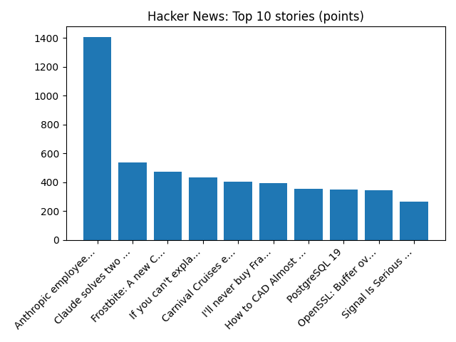

# Daily Knowledge Garden — 2026-11-20

## 🧭 Daily Summary
Global coverage includes Anthropic shares fall after blockbuster opening as wider tech sell-off continues; Trump initially accepted the midterm results, but most GOP voters doubt they were fair; Russian missile hits Poland as Ukraine's allies hold military exercise, says Tusk. Local coverage includes Holly Jolly: Northern Virginia 2026 holiday events guide - InsideNoVa; The 8 Best Italian Restaurants in Northern Virginia - Northern Virginia Magazine.

## 🌍 Global News (cross-source)
- [Anthropic shares fall after blockbuster opening as wider tech sell-off continues](https://www.bbc.co.uk/news/articles/c6808ym10vzgo?at_medium=RSS&at_campaign=rss) — BBC — World
- [Trump initially accepted the midterm results, but most GOP voters doubt they were fair](https://www.npr.org/2026/11/20/nx-s1-6047605/midterm-election-distrust-republicans) — NPR — Top Stories
- [Russian missile hits Poland as Ukraine's allies hold military exercise, says Tusk](https://www.bbc.co.uk/news/articles/cqx2x9dklxnro?at_medium=RSS&at_campaign=rss) — BBC — World
- [Saudi-led forces strike Yemen port as Houthis warn airlines off the kingdom - Reuters](https://news.google.com/rss/articles/CBMipwFBVV95cUxNQUE1UEFGeklRZGtscWJhNkdxRWpyWHkwQ29IcVQ1Umc2VHlkWlJGZzZPTC00SFl2a3J0SXY3TGo0X0t2a3A5ckMzbmtZXy1mYzdoa0F5Vmo1TGFaU1RIbEZHak5iTi1oRXhWWF9CbWZ2QWFLRG1HSG5Rc1dSbHZlaGNNSDlvZ2RiekJzbnpqMC1aektLZU1MSHBWN25PYURzUGduTjhURQ?oc=5) — Reuters — Headlines (Google News)
- [Congress struggles to avert US shutdown as Iran war divides lawmakers - Reuters](https://news.google.com/rss/articles/CBMiuwFBVV95cUxPUDZZTmpNTGpqLUMwR0JBZUJuaVBuMDAwYVpVanpkNTJDSGpNMEkxdXlSX1JkSDJpaG1SNUlmMnJZTHZ2Y192UmFKSjlGazN5UE9hZEJfcmFwdzVGWFE0QWk3OXBGWEpudkV5bTdiLVEwWjJicDFrTHJWVGVQT2RNMlBYZ3pMMmhQTHhKRnJ1QktWbGhVWWxRb0paRGZvdVNDdlRJNEd1N1lEbG9LOU1mTURPZE9CZlVvUk5j?oc=5) — Reuters — Headlines (Google News)

## 🏙️ Local News
- [Holly Jolly: Northern Virginia 2026 holiday events guide - InsideNoVa](https://news.google.com/rss/articles/CBMipwFBVV95cUxON09mTnJUaGhQS3J2cnQ1QzZ6Nk12UmFwQThQNVdab25feDF1QmJ6Q2F4NjZVemRfVDJFSnRVOWJkWTlFYklCbWtwMl9wZ0hRRVY5U2VjVEFwMk1ROVF4NjRnd092TjZFNF93VDNoSk16XzRFNC1YdlJXRG54dm9BdmtaeGQ2WEJvQUl1STNFRE5RcmlzdUxROVQ0dkhaUVFFcUdhcmpTYw?oc=5) — Google News — Northern Virginia
- [The 8 Best Italian Restaurants in Northern Virginia - Northern Virginia Magazine](https://news.google.com/rss/articles/CBMiugFBVV95cUxPR0Nvamc4YnVZNGFOMmNaR08zMmtqVlgzcURDcmNZUkdnX1ppSnJzc1RIQVJ1UjB2cEpRN1E3Z0NkNi1EbVFwMGY3V1VHNnVua2JJMGE2c1J1VlRfZlZzSk5qRTY3dlNsRVc5YW5JTEN2VVlzMzEtODFnOUQtMXZLdE41S1FLTGU5X1JvZHhicHRBS01QeEZQZTA0bXJrUVZFVHpWeUhyRGVOazdqN2k0US15cTNhNkoydnc?oc=5) — Google News — Northern Virginia
- [Lanes of I-495 back open following tractor trailer crash and fuel spill - WUSA9](https://news.google.com/rss/articles/CBMi4AFBVV95cUxOMlhLTVE1Qmc4eXE5T3dnVUJINTB1YmxFeFZ0UTUtOW1RSVNxV2JPN3paOXlmdUZTRDRNMDdfSzQzUE1wckZFQ1ptZ0RYVzFtXzBaVDNwOXdLRzVROHgxOEppQlN0c1Z0WXY4QVdwZXVXQWU4Qk9ueWY2MlJ4UnY1cG01LWVYcy00YkpaZUxIdHpvUmxIUEJyVDhOYlNQakpic0hDOFBBNzBjY2xJV3o1SW0xZnJrWUxCVGZ1T1M4SkRIMWR0VXJ0cFA4U0JCNHdFNk4tbTR1ZTYwNEk2WjZuNw?oc=5) — Google News — Northern Virginia traffic
- [Virginia school district shuts after finding 500 staff weren’t properly screened and more headlines - Virginia Mercury](https://news.google.com/rss/articles/CBMi1AFBVV95cUxPRER0UzQ5LXZNWm9pNmhTMV9aZThqVk1jNHhBeFk3MzZrODQ5Z1NYamtRX25Tb3ZuUmJfd2U1V3h2RF9FNU1wSkVKRFY3b2hTTmxxcDdRSzVuaVVPb2MzdDBydmJvQ0p6X0lOQzhlUmstUkFEYjl5RF94Vjc5Si1Hd0FZM19wbnlhcXNZYlVfWWhCQXZrTTBMUVNldjl6WjhJZnowMnJnbXZuSGgtUzk4aTN6ZVNUa0VrOWlvREFJSWJiaGZjdThoUnk5T1lTWGVwT1o3Ng?oc=5) — Google News — Northern Virginia
- [Man arrested for armed robberies of tobacco shop in Northern Virginia - FOX 5 DC](https://news.google.com/rss/articles/CBMikAFBVV95cUxQU3JXTnNOWHRhcmpPVTNxZncwNGRjSEhXbmI2NUR2TmZYWi1HZXB6MzBCTzR2dWg2Y1lxRFRJNklHYnhSd2FTLUhsaGQ5RTZ1eDRSV01LLXZxWTdVTWt1WVRUMXp4QWxTaE52eHBQVmZ0RDlLdk5STkRJYy1yWUJ6Q09fN255WnQ0cXVZc1dxUmQ?oc=5) — Google News — Northern Virginia

## 🚀 Hacker News (Top 5)
- [Anthropic’s Nasdaq debut](https://www.reuters.com/business/finance/anthropics-historic-debut-put-ais-promise-peril-wall-st-test-2026-11-19/) — 920 points, 1813 comments
- [Garage Door Spam](https://blog.harrison.page/garage-door-spam/) — 756 points, 316 comments
- [How the European Commission rolled out Matrix to more than 40k staff](https://element.io/blog/how-the-european-commission-rolled-out-matrix-to-more-than-40-000-staff/) — 663 points, 323 comments
- [Pancreatic cancer halted by virus injection in three patients](https://www.newscientist.com/article/2528235-pancreatic-cancer-halted-by-virus-injection-in-three-patients/) — 599 points, 89 comments
- [UK government forced to admit it issued Apple a secret encryption order](https://macanorak.com/uk-government-forced-to-admit-it-issued-apple-a-secret-encryption-order/) — 513 points, 218 comments

## 🌍 Wikipedia — On This Day (selected)
- **2022** — The 2022 FIFA World Cup begins in Qatar. This is the first time the tournament was held in the Middle East.
- **2016** — Jimmie Johnson wins his seventh NASCAR Cup Series championship to tie Richard Petty and Dale Earnhardt for the most all-time.
- **2015** — Following a hostage siege, at least 19 people are killed in Bamako, Mali.
- **2003** — After the November 15 bombings, a second day of the 2003 Istanbul bombings occurs in Istanbul, Turkey, destroying the Turkish head office of HSBC Bank AS and the British consulate.
- **1998** — A court in Taliban-controlled Afghanistan declares accused terrorist Osama bin Laden "a man without a sin" in regard to the 1998 U.S. embassy bombings in Kenya and Tanzania.

## 🎲 Wikipedia — Random Article
**Semliki harpoon**  
However, the site has yielded multiple other examples of similar harpoons, and the dates have been confirmed. The site is littered with catfish bones and the harpoons are the correct size to catch adult catfish, so investigators suspect the fisherman came to the site every year "to catch giant catfish."
It is unlikely that the harpoons are much different from those used today (see reference for photos).
https://en.wikipedia.org/wiki/Semliki_harpoon

## 🌌 NASA APOD
[V-G-R](https://science.nasa.gov/image-article/apod-2026-november-20-v-g-r/)

## Feed Health
- **Reuters — Headlines (Google News)**: ok (15 articles)
- **Reuters — World (Google News)**: ok (15 articles)
- **Reuters — Business (Google News)**: ok (15 articles)
- **BBC — World**: ok (15 articles)
- **BBC — Tech**: ok (15 articles)
- **BBC — Business**: ok (15 articles)
- **BBC — Science**: ok (15 articles)
- **AP — Headlines (Google News)**: ok (15 articles)
- **AP — Politics (Google News)**: ok (15 articles)
- **AP — Business (Google News)**: ok (15 articles)
- **NPR — Top Stories**: ok (10 articles)
- **NPR — Politics**: ok (10 articles)
- **NPR — Business**: ok (10 articles)
- **NPR — Science**: ok (10 articles)
- **NPR — Technology**: ok (10 articles)
- **ScienceNews**: ok (15 articles)
- **ScienceDaily — Top**: ok (15 articles)
- **Nature — Technology**: ok (15 articles)
- **Google News — Northern Virginia**: ok (15 articles)
- **Google News — Northern Virginia traffic**: ok (15 articles)
- **Google News — Northern Virginia weather**: ok (15 articles)
- **Wikipedia — On This Day**: ok (10 articles)
- **Wikipedia — Random**: ok (1 articles)
- **NASA — APOD**: ok (1 articles)

Runs so far today: 2
