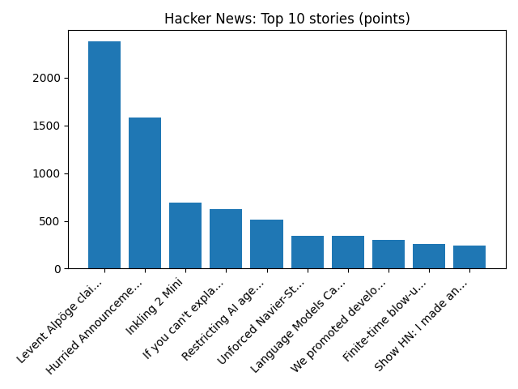

# Daily Knowledge Garden — 2026-11-21

## 🧭 Daily Summary
Global coverage includes Senator proposes select committee on AI as Democrats hope to move quickly to regulate it - AP News; Magnitude 6.8 quake in Peru's Andean region sends Lima residents onto streets - Reuters; For families of the fallen, Trump’s proposed arch casts a shadow over Arlington National Cemetery - AP News. Local coverage includes Housing inventory rises in major Virginia markets - Virginia Business; Remains of missing Rockville man possibly found in Northern Virginia - FOX 5 DC.

## 🌍 Global News (cross-source)
- [Senator proposes select committee on AI as Democrats hope to move quickly to regulate it - AP News](https://news.google.com/rss/articles/CBMiqwFBVV95cUxQMVppTkpwTl9RaDg3enpSUG00Y1l0eXFZVkV5ODJoYjhlRVFNdkNSWkEtMnJ6NDhRaHlFVkFqcEl5T3g2R3BrbjNTVjRyaU56ZjRTd0NYTkxvX0RkWVNkVkJ6THp1M3JuWmJaNFZrVlRrS0hsVjF6U1J3M0I2aTF5dW9CV3JXckdnN3hjWDVJWUFGX1E0QzlvNWIyMTNsVm5Oa3RWMWxrckJSVzg?oc=5) — AP — Headlines (Google News)
- [Magnitude 6.8 quake in Peru's Andean region sends Lima residents onto streets - Reuters](https://news.google.com/rss/articles/CBMiuAFBVV95cUxON0haQkQteXQ4cWlzdGJTQmROQVpnT21rVUI1UkNpenozVEplWmNtUTRpLWpvTlo4Z2tvUHhHSnR1RWtYMS1UV1JpVXplWGkzT1gwMkFfdmYwdWZnRVRjLUhBZjVQWTZDOTNucWdZb0NTVHVyYk5mVnI2cFR1WUhFOXhDTGZuY2VoeXZySmc4RjRuOWFULTFEb2NnYjN6MnFJZ1d1c3pFaVRqSUJsRlg4aTdENEt1MFFR?oc=5) — Reuters — Headlines (Google News)
- [For families of the fallen, Trump’s proposed arch casts a shadow over Arlington National Cemetery - AP News](https://news.google.com/rss/articles/CBMiogFBVV95cUxPak40Q3ZoUVlvdnV3Vmk3TnZUbDdnTEdjRHhTUGJUa2FPXzZETmlKM2VUWmpnQWl4bWpTc1p3RWlhMUVjQWRuN2xkUklnYjJhNG9zYnhJN0pZMklXWm1vS2FXZ256djZ1a0ItNDFfeTY3VndCZGdLSXgzN3l0bnhtVWhJaXVYMFN0UV9Nbzh3dVY5aVFzQ3MwcXBkT0NGOWdWenc?oc=5) — AP — Politics (Google News)
- [Can AI really help spot Black Friday deals? We put it to the test](https://www.bbc.co.uk/news/articles/cw8dv4jmnle2o?at_medium=RSS&at_campaign=rss) — BBC — Tech
- [Mamdani announces plan to close New York's Rikers Island jail by 2032](https://www.bbc.co.uk/news/articles/cmjeqv89egylo?at_medium=RSS&at_campaign=rss) — BBC — World

## 🏙️ Local News
- [Housing inventory rises in major Virginia markets - Virginia Business](https://news.google.com/rss/articles/CBMiggFBVV95cUxNUlA5Y3ctYnhUVDFoek5JV3RhTkhFWnkxU21RYktzR0lKSDBuVWxKT0ZyTDZrS0E0MDBiY0h4cV9kQ1NMM3A2MTljeUtPSGNmTmxfNk5DZGI0TXh5RXZBVGQwSWlKeWpqLUR0MnpfOVlKbGx4dUdFZzBqUWZOSF96dU9R?oc=5) — Google News — Northern Virginia
- [Remains of missing Rockville man possibly found in Northern Virginia - FOX 5 DC](https://news.google.com/rss/articles/CBMilAFBVV95cUxOeHktSTFjeWRMVl9iZXZiMGplZ1ZtMU81anBPb2huRmQwOG1XM2trMm1mU1c5OHF5M1lMMVdNLTdGMFFUS3JNTGthczZHX3lyNFkxWC1RdmNtT0w5NHVqd2pBU2lPZXREd1o0cEpObUQta0pkZVNaRENnSWVwQkxCOXVvVDc1MUhCcm5JampQNWMxNHky?oc=5) — Google News — Northern Virginia
- [Northern Virginia Turkey Trots: A Few Miles Before The Mashed Potatoes - Patch](https://news.google.com/rss/articles/CBMimAFBVV95cUxPZnlLZVNueWVlUnFvYXFxaXBXRGtUTHlRUDNFMUpweERadjEyYVBWSTRNc1RWYzdaWjJDQ2JxU3NpZGUxQ29kRk1WaUtxUHdwSTNvQWlLZXR1TFliMTVnWVVoTzE5azBXZThIYlFSbzU0YnFMamZLQTBaTTRaZ3lZZXhBUzczQlEtSUlEWDVXVnhqUTdFSE5DQ9IBuwFBVV95cUxOc3ZZMXJzS3Jpek9GSmRKVWRaTm5SM2VLNjVLQ2gtVVgzMHAtYlo5eG9ENm1LeERURW9TWEVYSzMwSXBRbjVqZVNnck1IVnRfa1lsLXNqdFNYYldUZ3lyaWc0el9MdnltX2dBNURyVVpGcDN1YlZaOVdsZWx3Vk51UHNpOEswc0RsdEpZVjloWmFtS1VRT1NJWW54LWlSTHBBNlJqeFZlU3NBMUQyaVJWTGY4WTd0T1JCTWkw?oc=5) — Google News — Northern Virginia
- [Primark Opens Third Northern Virginia Location at Pentagon City - Northern Virginia Magazine](https://news.google.com/rss/articles/CBMivwFBVV95cUxOUFVKWVpRQkgxWWVRVThlcVhiUU5fX1BaQ3ZnZS1LNWJzMkM2clhiMlhoaTlOaXNrYm9JYzNHNlM5cEF6aW1ETXlCRjZqRXVfWXpPVjNuN1ZaQlh1aWlOMEZGU3ltWmNYMFFMLWJNN0tOZ1Brem5yaDdNdHlXYkdHYWhDMHFBdHJzODB4bUlaNUZ2Y1lwdVdxZDFOWFJUNGhVN2VkYUpDMFhWei15ZGJxNjhpd2g5dFJrdGh0R0tOYw?oc=5) — Google News — Northern Virginia
- [Holly Jolly: Northern Virginia 2026 holiday events guide - InsideNoVa](https://news.google.com/rss/articles/CBMipwFBVV95cUxON09mTnJUaGhQS3J2cnQ1QzZ6Nk12UmFwQThQNVdab25feDF1QmJ6Q2F4NjZVemRfVDJFSnRVOWJkWTlFYklCbWtwMl9wZ0hRRVY5U2VjVEFwMk1ROVF4NjRnd092TjZFNF93VDNoSk16XzRFNC1YdlJXRG54dm9BdmtaeGQ2WEJvQUl1STNFRE5RcmlzdUxROVQ0dkhaUVFFcUdhcmpTYw?oc=5) — Google News — Northern Virginia

## 🚀 Hacker News (Top 5)
- [Levent Alpöge claims proof of the Generalized Riemann Hypothesis [pdf]](https://alpo.ge/remark.pdf) — 2377 points, 1603 comments
- [Hurried Announcement: Alessandro Masullo GRH](https://math216.wordpress.com/2026/11/20/hurried-announcement-alessandro-masullo-grh/) — 1580 points, 720 comments
- [Inkling 2 Mini](https://thinkingmachines.ai/news/inkling-2-mini/) — 689 points, 112 comments
- [If you can't explain something in simple terms, you don't understand it (2017)](https://kottke.org/17/06/if-you-cant-explain-something-in-simple-terms-you-dont-understand-it) — 627 points, 293 comments
- [Restricting AI agents in mobile operating systems platforms from capturing data](https://signal.org/blog/protecting-your-privacy/) — 511 points, 305 comments

## 🌍 Wikipedia — On This Day (selected)
- **2022** — A magnitude 5.6 earthquake on the Indonesian island of Java kills between 335 and 602 people.
- **2021** — An SUV plows through a Christmas parade in Waukesha, Wisconsin, killing six and injuring 62.
- **2019** — Israeli Prime Minister Benjamin Netanyahu is indicted on charges of bribery, fraud, and breach of trust.
- **2019** — Tesla launches the SUV Cybertruck. A gaffe occurs during the launch event when its "unbreakable" windows shatter during demonstration.
- **2017** — Robert Mugabe formally resigns as President of Zimbabwe, after thirty-seven years in office.

## 🎲 Wikipedia — Random Article
**2023 Maryland Cycling Classic**  
The 2023 Maryland Cycling Classic (known as the Maryland Cycling Classic, presented by UnitedHealthcare for sponsorship reasons) was the second edition of the Maryland Cycling Classic. It was held on 3 September 2023 as part of the 2023 UCI ProSeries calendar.
https://en.wikipedia.org/wiki/2023_Maryland_Cycling_Classic

## 🌌 NASA APOD
[V-G-R](https://science.nasa.gov/image-article/apod-2026-november-20-v-g-r/)

## Feed Health
- **Reuters — Headlines (Google News)**: ok (15 articles)
- **Reuters — World (Google News)**: ok (15 articles)
- **Reuters — Business (Google News)**: ok (15 articles)
- **BBC — World**: ok (15 articles)
- **BBC — Tech**: ok (15 articles)
- **BBC — Business**: ok (15 articles)
- **BBC — Science**: ok (15 articles)
- **AP — Headlines (Google News)**: ok (15 articles)
- **AP — Politics (Google News)**: ok (15 articles)
- **AP — Business (Google News)**: ok (15 articles)
- **NPR — Top Stories**: ok (10 articles)
- **NPR — Politics**: ok (10 articles)
- **NPR — Business**: ok (10 articles)
- **NPR — Science**: ok (10 articles)
- **NPR — Technology**: ok (10 articles)
- **ScienceNews**: ok (15 articles)
- **ScienceDaily — Top**: ok (15 articles)
- **Nature — Technology**: ok (15 articles)
- **Google News — Northern Virginia**: ok (15 articles)
- **Google News — Northern Virginia traffic**: ok (15 articles)
- **Google News — Northern Virginia weather**: ok (15 articles)
- **Wikipedia — On This Day**: ok (10 articles)
- **Wikipedia — Random**: ok (1 articles)
- **NASA — APOD**: ok (1 articles)

Runs so far today: 1
