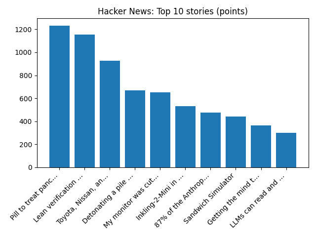

# Daily Knowledge Garden — 2026-11-22

## 🧭 Daily Summary
Global coverage includes International climate talks end in disappointment; German army starts testing kamikaze drones and AI targeting tool in Lithuania - Reuters; Explosion on Russian ship at Libya port caused by suspected drone attack, officials say. Local coverage includes Loudoun County pauses new data center applications for a year - InsideNoVa; Tournament Opponent Varsity Football @ NVHS - MaxPreps.

## 🌍 Global News (cross-source)
- [International climate talks end in disappointment](https://www.npr.org/2026/11/22/nx-s1-6046195/cop31-climate-talks-close-disappointment) — NPR — Top Stories
- [German army starts testing kamikaze drones and AI targeting tool in Lithuania - Reuters](https://news.google.com/rss/articles/CBMizgFBVV95cUxOaEZNb1cwZkRsWmFUN0Nkc0dfTGt4SUVDaXNCSHphV2VrQTBXYnQzTWN2Z0tkOEdiUnRyRnJqX2NST1pmYXJrYVFUQ204QllMNFRtelc0cEtUZy1MWlFMeXRfemNPS0pGQU1veHZyMU1XTWdJNE5pcWstLXUtZ0d4QXRMVzAzZFJKNzlteEZlWUVRbHpIeTJyanFWSlJVMlY4R0NOODNIN1RSLWJDdnQyM25KcDNNbDRvMHZkT1Nfenl6SUl2YUoxalBLT1RqQQ?oc=5) — Reuters — Headlines (Google News)
- [Explosion on Russian ship at Libya port caused by suspected drone attack, officials say](https://www.bbc.co.uk/news/articles/cr894gjz0j0yo?at_medium=RSS&at_campaign=rss) — BBC — World
- [Russia starts towing ship hit by drones in Baltic, Finland says - Reuters](https://news.google.com/rss/articles/CBMipgFBVV95cUxPTXUxa0FLT1o3Tzh4MUR0MV9ZenU1LU9PZl9QSzhsQXlOQThFNUxWbWFXRXZTOHFpb1lJdG1GTV9hOUZsc2x4YzBOSzV3ZHZkV2pyNjNIaTVWZEViQ2lLb3JkcjJsbGhVNXFmWXQ5c0pDTkVXeG9IbmlKV3AxYUtfNE5DVnhWX3lvNmg0SF9SZ1lHQzEtSnY1REsycUlvWFVEOFlBSXR3?oc=5) — Reuters — Headlines (Google News)
- [UN climate talks break down over bitter disagreements on fossil fuels - AP News](https://news.google.com/rss/articles/CBMiqAFBVV95cUxNVlZ4dzdCVnBlV0g5cDVCV19scWJkTG9RQWtiMng5NFlVb2VqSng0SmhxRGxLaUJ5aEgyTXRVMlpGVV9abXMwX19naG9EMlhjdEhaemxUTHM2bVhTdWc5Q09NMTR5Wk4yVmtlY2NFSHVncDdMWkhtU05keGJ6NXlGSTVKaFNlOVpsVl80QWE0T3ZQY0t5ZDB4YlNVUWdJZXJaZnJPZmFhb3I?oc=5) — AP — Headlines (Google News)

## 🏙️ Local News
- [Loudoun County pauses new data center applications for a year - InsideNoVa](https://news.google.com/rss/articles/CBMipAFBVV95cUxQV0VLdjd2Y0c5ck53SHItcmZVWlp4a3ZuZ3dRSXBjdGdEVXcwZlhZUTRlTDlTcXVKYWZ4WDJQdC1uenVqU1ljQzFSNDZDYXpfd2F1Qm52RjBvX2w2YmUyV2t0N2RYaWtzcHFiS3ctMUVheVRkNm14dzNPaGIxejBYSEFKcExHWXBFNi1GYlJHMmZleFBtWnhyWG81NWc0eW10bWpqbg?oc=5) — Google News — Northern Virginia
- [Tournament Opponent Varsity Football @ NVHS - MaxPreps](https://news.google.com/rss/articles/CBMi8wFBVV95cUxQazlZOFBtekFMNnVvR1NHRHk2MnhZeXFuOFl0eGJWSjZHY3oxMlZNblM0SWJVcVptZ0N5Q2pqNnBCWkFKbk5Sd3hldWpWMDJqOGEwV09OTENVQWxTYVU2dXBrbDFrdDkwY2g5QWlXWEFXZnlqdUozOUNPT2s2bzhOc0VOMTBuajY1YzI3Z3VETU5rUVZobzY3QmVxVnptQkpBSHgwZVpraGw1bE1hcjlSZzJzS2VhYlFTOWJ1ODZHQmdValE4VUZnNkdFVk1EdXFjelhnRzhCWlpWZEFXRFR2b0NnSkJmckw1S0FjTHpCTHcyN1U?oc=5) — Google News — Northern Virginia
- [Remains of missing Rockville man possibly found in Northern Virginia - FOX 5 DC](https://news.google.com/rss/articles/CBMilAFBVV95cUxOeHktSTFjeWRMVl9iZXZiMGplZ1ZtMU81anBPb2huRmQwOG1XM2trMm1mU1c5OHF5M1lMMVdNLTdGMFFUS3JNTGthczZHX3lyNFkxWC1RdmNtT0w5NHVqd2pBU2lPZXREd1o0cEpObUQta0pkZVNaRENnSWVwQkxCOXVvVDc1MUhCcm5JampQNWMxNHky?oc=5) — Google News — Northern Virginia
- [Lawsuit accuses ICE of making unlawful arrests in Northern Virginia, Hampton Roads - InsideNoVa](https://news.google.com/rss/articles/CBMivwFBVV95cUxPa1hGMVBBSUpDbXBJbmVRWEgzSmhzbkNKNzA3LW9SNzRrSGRCTHpQYldMYkt3NTNoRS1fejNFQWlmZUlKaGFnaDNmLVVFVlpRb1ZWLVdGMG9HbzhycW5ZcTVyVE9TeHR5UzdCZmd3RVVfeldILXhZZXlKV2NGbzBzekNRMDFpVXJLRmhOdnYzVGt1R1B2UzlWbXJYRDBsbWlJTERhT0t0MGpteXBJMm0xb21Zd1NYVTBnRThHemI3cw?oc=5) — Google News — Northern Virginia
- [Northern Virginia Turkey Trots: A Few Miles Before The Mashed Potatoes - Patch](https://news.google.com/rss/articles/CBMimAFBVV95cUxPZnlLZVNueWVlUnFvYXFxaXBXRGtUTHlRUDNFMUpweERadjEyYVBWSTRNc1RWYzdaWjJDQ2JxU3NpZGUxQ29kRk1WaUtxUHdwSTNvQWlLZXR1TFliMTVnWVVoTzE5azBXZThIYlFSbzU0YnFMamZLQTBaTTRaZ3lZZXhBUzczQlEtSUlEWDVXVnhqUTdFSE5DQ9IBuwFBVV95cUxOc3ZZMXJzS3Jpek9GSmRKVWRaTm5SM2VLNjVLQ2gtVVgzMHAtYlo5eG9ENm1LeERURW9TWEVYSzMwSXBRbjVqZVNnck1IVnRfa1lsLXNqdFNYYldUZ3lyaWc0el9MdnltX2dBNURyVVpGcDN1YlZaOVdsZWx3Vk51UHNpOEswc0RsdEpZVjloWmFtS1VRT1NJWW54LWlSTHBBNlJqeFZlU3NBMUQyaVJWTGY4WTd0T1JCTWkw?oc=5) — Google News — Northern Virginia

## 🚀 Hacker News (Top 5)
- [Hurried Announcement: Alessandro Masullo GRH](https://math216.wordpress.com/2026/11/20/hurried-announcement-alessandro-masullo-grh/) — 2388 points, 1160 comments
- [Inkling 2 Mini](https://thinkingmachines.ai/news/inkling-2-mini/) — 1380 points, 280 comments
- [Lean verification of the Riemann Hypothesis](https://leanprover-community.github.io/blog/posts/riemann-hypothesis/) — 810 points, 647 comments
- [Brazil's tax authority open-sources its tax calculator on GitHub under MIT](https://www.gov.br/receitafederal/pt-br/assuntos/noticias/2026/novembro/receita-federal-publica-primeiro-codigo-fonte-aberto-no-github-e-amplia-transparencia-da-reforma-tributaria) — 740 points, 237 comments
- [Ask HN: I have been unemployed for 2y. 15 years of experience, US. What to do?](https://news.ycombinator.com/item?id=50583761) — 606 points, 675 comments

## 🌍 Wikipedia — On This Day (selected)
- **2022** — A shooting at a Walmart in Chesapeake, Virginia leaves seven workers dead, including the shooter, and four others injured.
- **2014** — While playing with a toy gun in Cleveland, 12-year-old African American Tamir Rice is killed by a white police officer.
- **2010** — During the Cambodian water festival, a stampede in Koh Pich, Phnom Penh, kills 347 people.
- **2004** — The Orange Revolution begins in Ukraine, resulting from the presidential elections.
- **2003** — Baghdad DHL attempted shootdown incident: Shortly after takeoff, a DHL Express cargo plane is struck on the left wing by a surface-to-air missile and forced to land.

## 🎲 Wikipedia — Random Article
**Overbury Court**  
Overbury Court is a Georgian style country house in Overbury, Worcestershire, England. It is a privately owned Grade II* listed building.
https://en.wikipedia.org/wiki/Overbury_Court

## 🌌 NASA APOD
[Swirls and Colors on Jupiter from Juno](https://science.nasa.gov/image-article/apod-2026-november-22-swirls-and-colors-on-jupiter-from-juno/)

## Feed Health
- **Reuters — Headlines (Google News)**: ok (15 articles)
- **Reuters — World (Google News)**: ok (15 articles)
- **Reuters — Business (Google News)**: ok (15 articles)
- **BBC — World**: ok (15 articles)
- **BBC — Tech**: ok (15 articles)
- **BBC — Business**: ok (15 articles)
- **BBC — Science**: ok (15 articles)
- **AP — Headlines (Google News)**: ok (15 articles)
- **AP — Politics (Google News)**: ok (15 articles)
- **AP — Business (Google News)**: ok (15 articles)
- **NPR — Top Stories**: ok (10 articles)
- **NPR — Politics**: ok (10 articles)
- **NPR — Business**: ok (10 articles)
- **NPR — Science**: ok (10 articles)
- **NPR — Technology**: ok (10 articles)
- **ScienceNews**: ok (15 articles)
- **ScienceDaily — Top**: ok (15 articles)
- **Nature — Technology**: ok (15 articles)
- **Google News — Northern Virginia**: ok (15 articles)
- **Google News — Northern Virginia traffic**: ok (15 articles)
- **Google News — Northern Virginia weather**: ok (15 articles)
- **Wikipedia — On This Day**: ok (10 articles)
- **Wikipedia — Random**: ok (1 articles)
- **NASA — APOD**: ok (1 articles)

Runs so far today: 2
