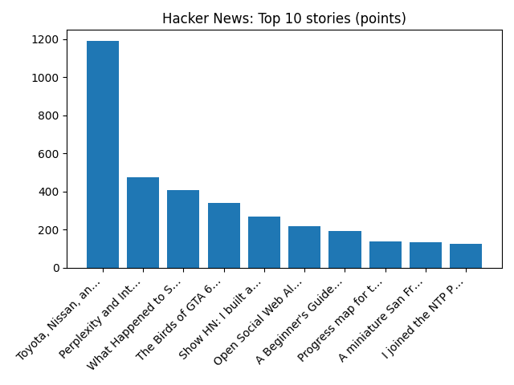

# Daily Knowledge Garden — 2026-11-23

## 🧭 Daily Summary
Global coverage includes Democrats win largest House majority since 1992 after flipping North Carolina seat; Energy bills will soar - here's how you can ease the pain; In their own words: Leaders at UN climate talks discuss why negotiations ended without deal - AP News. Local coverage includes Patricia Albaugh Obituary (2026) - Strasburg, VA - Northern Virginia Daily - Legacy | Obituary; Massanutten Academy needs at least $2.5M to finish school year - Daily News-Record.

## 🌍 Global News (cross-source)
- [Democrats win largest House majority since 1992 after flipping North Carolina seat](https://www.bbc.co.uk/news/articles/c6vg29g7dlyno?at_medium=RSS&at_campaign=rss) — BBC — World
- [Energy bills will soar - here's how you can ease the pain](https://www.bbc.co.uk/news/articles/crm4rygl4m3o?at_medium=RSS&at_campaign=rss) — BBC — Business
- [In their own words: Leaders at UN climate talks discuss why negotiations ended without deal - AP News](https://news.google.com/rss/articles/CBMirgFBVV95cUxPM0xZUG54R1V0M1N4VHlZd05nbTExbGdkUVNwWVBwRnlabWFHZWhRMldkM2taVFVhM3NIb1JQZnhIVDFEMmw4UzRzWTdyMVotWVNRVllEQjRtSFVRallpY0V5czd3eFplcTVWTldEOXpuclV0NmJVeF94aXQ5OUZQcGxaUVlQOEtaU1Blb1o4b055WmFPWDFsQXp2Tzlpd0VLa0RwWTNxT013S2VfU1E?oc=5) — AP — Headlines (Google News)
- [Business - AP News](https://news.google.com/rss/articles/CBMiQEFVX3lxTFB0d05vWXR6YjNHTUJRSzlCR1N4VTNGMUdsb3lpUDRYbXpmOE9oWE5vSHhBcHRXZlhKcFN2N1NLWks?oc=5) — AP — Business (Google News)
- [US futures bounce while Asia markets brace for AI wipeout - Reuters](https://news.google.com/rss/articles/CBMigwFBVV95cUxNR2c4ZVNmcHBzVFctOTBkRUd2d0VHTklseUhCcEtZT2VHbU1WbWprMUk2aDZSQ2tkZHNYVE9EWUgyaEkxeWtyN0M2V2NzR2ZCTHFmMEhvbHFDeExTNUdTeDF3WkxJZ2RSdmZ2cHBxWlFjTXdoa1hXdlZQRWtyTFFKVlJjMA?oc=5) — Reuters — Headlines (Google News)

## 🏙️ Local News
- [Patricia Albaugh Obituary (2026) - Strasburg, VA - Northern Virginia Daily - Legacy | Obituary](https://news.google.com/rss/articles/CBMikAFBVV95cUxNaXNsSlJDdlNFN0QwZXd4Nnd3NERxNWpObVNkWFhoU01Pem5ZR2NfR0VDZDBpV2I2R3I3WmJJU015OVdEbDRpa19yZWhINWROT29nSWEzNV9iZ19hMDBEZURYOWNSX2RWMUxtQ2c0MmZlS3g1SzdrY3ZyN0duMGlQVG5MOU5rbFF6cTlKRHBMWmw?oc=5) — Google News — Northern Virginia
- [Massanutten Academy needs at least $2.5M to finish school year - Daily News-Record](https://news.google.com/rss/articles/CBMi5wFBVV95cUxNV0dZeE5vY3pEY2dGWnVLUE9yQ0ZiYmJFN0R4QV96NGtwak5UT2tTeHYtcnNORjNjdEw5cUxSSG0yV1ZvRThhZkV3dFBES0FZSHR1MXRHRDlyTldGQjJnaWRaNUwyaXhFaGdwRTF0dzl1dDR0OTYyUzQ0cURtbmhQNldDbGhxamYtbV9YUU9zbGRpX0RfemVLM2lmQzFrZ194NWpFQnRDaFBjcTVqdV9zM1U3ZGZlZGRreDcwUkVmeGxCX2tSNG11WUxjSkJQalUzMWZvbXVGZ3VqNWZZdTRNczFpM3c0RDQ?oc=5) — Google News — Northern Virginia
- [Loudoun County pauses new data center applications for a yea... - InsideNoVa](https://news.google.com/rss/articles/CBMipAFBVV95cUxQV0VLdjd2Y0c5ck53SHItcmZVWlp4a3ZuZ3dRSXBjdGdEVXcwZlhZUTRlTDlTcXVKYWZ4WDJQdC1uenVqU1ljQzFSNDZDYXpfd2F1Qm52RjBvX2w2YmUyV2t0N2RYaWtzcHFiS3ctMUVheVRkNm14dzNPaGIxejBYSEFKcExHWXBFNi1GYlJHMmZleFBtWnhyWG81NWc0eW10bWpqbg?oc=5) — Google News — Northern Virginia
- [Housing inventory rises in major Virginia markets - Virginia Business](https://news.google.com/rss/articles/CBMiggFBVV95cUxNUlA5Y3ctYnhUVDFoek5JV3RhTkhFWnkxU21RYktzR0lKSDBuVWxKT0ZyTDZrS0E0MDBiY0h4cV9kQ1NMM3A2MTljeUtPSGNmTmxfNk5DZGI0TXh5RXZBVGQwSWlKeWpqLUR0MnpfOVlKbGx4dUdFZzBqUWZOSF96dU9R?oc=5) — Google News — Northern Virginia
- [Remains of missing Rockville man possibly found in Northern Virginia - FOX 5 DC](https://news.google.com/rss/articles/CBMilAFBVV95cUxOeHktSTFjeWRMVl9iZXZiMGplZ1ZtMU81anBPb2huRmQwOG1XM2trMm1mU1c5OHF5M1lMMVdNLTdGMFFUS3JNTGthczZHX3lyNFkxWC1RdmNtT0w5NHVqd2pBU2lPZXREd1o0cEpObUQta0pkZVNaRENnSWVwQkxCOXVvVDc1MUhCcm5JampQNWMxNHky?oc=5) — Google News — Northern Virginia

## 🚀 Hacker News (Top 5)
- [Toyota, Nissan, and Honda to standardize parts to lower costs](https://www.caranddriver.com/news/a74490092/toyota-nissan-honda-standardize-parts-lower-costs/) — 1189 points, 679 comments
- [Perplexity and Intelligence](https://openai.com/index/perplexity-and-intelligence/) — 476 points, 330 comments
- [What Happened to Silicon Valley?](https://www.oreilly.com/radar/what-happened-to-silicon-valley/) — 408 points, 234 comments
- [The Birds of GTA 6: A Field Guide to Vice City and Leonida's Wildlife](https://www.audubon.org/magazine/birds-of-gta-6-field-guide-vice-city-wildlife) — 341 points, 153 comments
- [Show HN: I built a game where you are an LLM's subagent](https://github.com/gulivan/worker755) — 269 points, 62 comments

## 🌍 Wikipedia — On This Day (selected)
- **2019** — The last Sumatran rhinoceros in Malaysia, Imam, dies, making the species officially extinct in the country.
- **2018** — Founders of Italian fashion brand Dolce & Gabbana issue an apology following a series of offensive advertisements on social media promoting a fashion show in Shanghai, China, which was canceled.
- **2015** — Blue Origin's New Shepard space vehicle became the first rocket to successfully fly to space and then return to Earth for a controlled, vertical landing.
- **2011** — Arab Spring: After 11 months of protests in Yemen, Yemeni president Ali Abdullah Saleh signs a deal to transfer power to the vice president, in exchange for legal immunity.
- **2010** — Bombardment of Yeonpyeong: North Korean artillery attack kills two civilians and two marines on Yeonpyeong Island, South Korea.

## 🎲 Wikipedia — Random Article
**Cobalt(II) acetate**  
Cobalt(II) acetate is the cobalt salt of acetic acid. It is commonly found as the tetrahydrate Co(CH3CO2)2·4 H2O, abbreviated Co(OAc)2·4 H2O.
https://en.wikipedia.org/wiki/Cobalt(II)_acetate

## 🌌 NASA APOD
[Swirls and Colors on Jupiter from Juno](https://science.nasa.gov/image-article/apod-2026-november-22-swirls-and-colors-on-jupiter-from-juno/)

## Feed Health
- **Reuters — Headlines (Google News)**: ok (15 articles)
- **Reuters — World (Google News)**: ok (15 articles)
- **Reuters — Business (Google News)**: ok (15 articles)
- **BBC — World**: ok (15 articles)
- **BBC — Tech**: ok (15 articles)
- **BBC — Business**: ok (15 articles)
- **BBC — Science**: ok (15 articles)
- **AP — Headlines (Google News)**: ok (15 articles)
- **AP — Politics (Google News)**: ok (15 articles)
- **AP — Business (Google News)**: ok (15 articles)
- **NPR — Top Stories**: ok (10 articles)
- **NPR — Politics**: ok (10 articles)
- **NPR — Business**: ok (10 articles)
- **NPR — Science**: ok (10 articles)
- **NPR — Technology**: ok (10 articles)
- **ScienceNews**: ok (15 articles)
- **ScienceDaily — Top**: ok (15 articles)
- **Nature — Technology**: ok (15 articles)
- **Google News — Northern Virginia**: ok (15 articles)
- **Google News — Northern Virginia traffic**: ok (15 articles)
- **Google News — Northern Virginia weather**: ok (15 articles)
- **Wikipedia — On This Day**: ok (10 articles)
- **Wikipedia — Random**: ok (1 articles)
- **NASA — APOD**: ok (1 articles)

Runs so far today: 1
