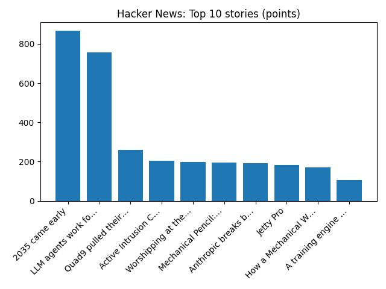

# Daily Knowledge Garden — 2026-11-24

## 🧭 Daily Summary
Global coverage includes DR Congo says military aircraft missing as rebels claim to shoot down plane; Nigerian monarch, 92, suspended after sexual assault claims; Shein to pay $100 million to settle US shipping, customer service claims - Reuters. Local coverage includes Thomas Simeone Named a 2026 Top Lawyer by Northern Virginia Magazine - EIN Presswire; Belmont Bay Rehabilitation Center unveils renovated Woodbrid... - InsideNoVa.

## 🌍 Global News (cross-source)
- [DR Congo says military aircraft missing as rebels claim to shoot down plane](https://www.bbc.co.uk/news/articles/cwy7r5z8gg65o?at_medium=RSS&at_campaign=rss) — BBC — World
- [Nigerian monarch, 92, suspended after sexual assault claims](https://www.bbc.co.uk/news/articles/cmglrz462nn6o?at_medium=RSS&at_campaign=rss) — BBC — World
- [Shein to pay $100 million to settle US shipping, customer service claims - Reuters](https://news.google.com/rss/articles/CBMinwFBVV95cUxPcWhsZ000UTV1SjF3ak9ONXpxUy1JWUFjM2wtMWZTQ3dqOVhZNDBKRHFQVkFlYjZaVWRjWXFoSUY3Ry1JN1ozRk9TQTQ3R2ZFV2ZVQUx6MjF5endGeUptTU5OakRMNlVjb01qWi0ySHItb1dEUFJDc3kxNTJ0akJfbXBlSVZMdkdwb2p1b3BHWnh3aW5scllxRVg2M3BFSHc?oc=5) — Reuters — Headlines (Google News)
- [US House Democrats expand probe into Trump Jr.'s investments - Reuters](https://news.google.com/rss/articles/CBMiswFBVV95cUxON3hxNnRMaTVqeGdDSDNyd3F3djJlWVEwX1RIeW9zZlJ2YS1MMGRYRVliNmpGUFBDRDV4Wm1wVzZmRldmTGNWUV81d1g3eTR5RmRTci1vVDUzTEQwaVJhcDlLdDV3cDQxSVNSaWdSQ0RDNGtCYXFvX2paM1VkNHRFUDZOR3ZRbDJIUlNpVXd3YTd4SWI1Vlh4ZFk0VEZPZVg5MUhyWnlyNENZc1oweHJqWEt4cw?oc=5) — Reuters — Headlines (Google News)
- [Trump gives the Medal of Freedom to Giuliani, a fierce political ally who led New York through 9/11 - AP News](https://news.google.com/rss/articles/CBMikgFBVV95cUxQYUQ2bU9lbFNyQ3k1Vl9qSWFtRURxSGJvekRlcVo1WjRJNllBS1UzME13bUJWdmJBMFUwM1FVY3NQTnNLeGFxRThHVTV0Vkd2OS1DZlJaTS1lc0szM054Tm9ETEpFNDI1NjJyVFZYTklQWWdmXzBaZDN0YmRWMFVid0dRUkVMV1p6NTJfN1BfNjF4Zw?oc=5) — AP — Politics (Google News)

## 🏙️ Local News
- [Thomas Simeone Named a 2026 Top Lawyer by Northern Virginia Magazine - EIN Presswire](https://news.google.com/rss/articles/CBMitgFBVV95cUxOREtvbENHQ0NlRVFtMWQ5UWQtbXFnWGZLOXBQa2FWNWUzaWdqRDVkNzVxeUtOa0ZtYTdsWVRIMHRXb2lWWjVCaHItWkdiZ3c2WHBQZENsRTlleU80bFRteDVlSlFCeGFaOVQ2MWhDMzhPMU9hdExlZll0V0E2NEVZMVBvc3BaUExyUko1clVTaUpYb2ptQ1U5eVROSXdEckFRLWVDSTI1dTBLekgyTkUwM2ZjVXZZZw?oc=5) — Google News — Northern Virginia
- [Belmont Bay Rehabilitation Center unveils renovated Woodbrid... - InsideNoVa](https://news.google.com/rss/articles/CBMisgFBVV95cUxOUUZ2dFVkN0JKSzJQTkpJaW54Y2RHclg5SndtZUhvVVdIcXpGR19sR1FRalgwU3lMSjJic1VvcTVNd29keVUyYmIybEl6bnlPN0ZwYUNwTHZpLVVWSE5ZZXg0SGs3cmoxb2NZYXJld2hPS2VHbjNyZE9KU2FvTDhqLTdManNhb2tuNHZPVE5mWWFnb3Fqc2VRRzYzaXJ3amFpSkpwc1BJV2pHS2VicXNMYS1n?oc=5) — Google News — Northern Virginia
- [Thanksgiving Travel Weather: Storms, Flight Delays And What To Know In VA - Patch](https://news.google.com/rss/articles/CBMinwFBVV95cUxQamFCWlcyaHpLUTBJeklIek5sNW13Z1pxWmROdEF2YWRMRnJHVmZ6X1VZZnRoTTREbFZyMVQxU2g0d1VKSVktdXY0a25hSlpla3FOaTJWbnAtbjVyYUJveEtrZ0xJVllDRGpROE1fdE9RMm15ZkgydjRUdlYxazktU1ZVVEZpODZETkJXSzdlYUJQUkJvR1BiMFZ2TmxIY1XSAb4BQVVfeXFMTzRXbzZmbmtENUtqZ3BxQ3Y1SEV3UENOeXhadWNReUtVMFNjVnBqc3FrakMwWUUzRUljYlZSSnlZN2oxMm9iSW9GaXNpbGI0VlgtZHBwTE5VUEpwWmVBWmVmcGd0WVBWRkNuNTJuVGJtMGhvVm5UR1MtQ3JzN0FOaUlUUFlEaW5iMFkxaENMX2F5WlVmLTJ6bmFUV0VRcS1XNW1CQnFISjVEOHV0MllVVGpwY2pyc19rT2RvbzhnZw?oc=5) — Google News — Northern Virginia
- [On the Market: 1-Acre New-Build Estate in Alexandria for $5.5M - Northern Virginia Magazine](https://news.google.com/rss/articles/CBMivgFBVV95cUxQQncwQ0Ixc0pNZGZtdjlzZjM0aXU5RlRXSlBLcXFHYkFlZTJKRjhsQzlScGV5aEtuWUE5VnZ6UGpXWWZIb25xeDJuQjFsTlJaeWNKcG9wdUdYY0ZZMDlfQy1HMjNxT1MycFVjNXFKRHEySmswaEh6TGJyNFJNdFV4bm1vdExtcXNzVnBXZGwydEdUOGhENzFrRDRGc2tIXzRBaE8tS09fSER3dlVNWEd1RWh3d1NidGFKaFhrZ3l3?oc=5) — Google News — Northern Virginia
- [New in NoVa: Laza Dessert Cafe makes Northern Virginia debut - The Burn](https://news.google.com/rss/articles/CBMilgFBVV95cUxOajFUX2FXbjFkQlVheWJaN2xmdzREVERxemdILWdCb1JTMnZfZWRHajMzaUxrMTcyXzM4SjFqcWFGdFBveTJyMUtiVHhCbmRZc0JKTl8tUTBJTzBNb2ItaW93ZTZKUGNUUDVNV0JEZkw1WDdEQmpjNW05S2xMMWJjeFVuU2pxLWZHcDRJRVZkM2xnb1BxNlE?oc=5) — Google News — Northern Virginia

## 🚀 Hacker News (Top 5)
- [2035 came early](https://fzakaria.com/2026/11/23/2035-came-early) — 866 points, 324 comments
- [LLM agents work for their parent companies, not for you](https://michaelharley.net/posts/2026/11/01/llm-agents-work-for-their-parent-companies-not-for-you/) — 758 points, 319 comments
- [Quad9 pulled their DNS service from France](https://quad9.net/news/blog/quad9-service-deactivation-in-france/) — 259 points, 143 comments
- [Active Intrusion Campaign Against Check Point Security Management Servers](https://www.greynoise.io/blog/check-point-security-management-servers-intrusion-campaign) — 205 points, 71 comments
- [Worshipping at the altar of Brendan Gregg](https://fzakaria.com/2026/11/12/worshipping-at-the-altar-of-brendan-gregg) — 198 points, 31 comments

## 🌍 Wikipedia — On This Day (selected)
- **2023** — Hibiscus Rising, commemorating David Oluwale, is unveiled in Leeds.
- **2022** — Five days after the general elections which resulted in a hung parliament, opposition leader and former deputy prime minister Anwar Ibrahim is officially named as the 10th prime minister of Malaysia.
- **2017** — A terrorist attack on a Mosque in Al-Rawda, North Sinai, Egypt kills 311 people and injures 128.
- **2016** — The government of Colombia and the Revolutionary Armed Forces of Colombia–People's Army sign a revised peace deal, bringing an end to the country's more than 50-year-long civil war.
- **2015** — A Russian Air Force Sukhoi Su-24 fighter jet is shot down by the Turkish Air Force over the Syria–Turkey border, killing one of the two pilots; a Russian marine is also killed during a subsequent rescue effort.

## 🎲 Wikipedia — Random Article
**Bongboldo**  
Bongboldo is a village in the Bassar Prefecture in the Kara Region  of north-western Togo.
https://en.wikipedia.org/wiki/Bongboldo

## 🌌 NASA APOD
[Galaxies Battle in the NGC 7771 Group](https://science.nasa.gov/image-article/apod-2026-november-24-galaxies-battle-in-the-ngc-7771-group/)

## Feed Health
- **Reuters — Headlines (Google News)**: ok (15 articles)
- **Reuters — World (Google News)**: ok (15 articles)
- **Reuters — Business (Google News)**: ok (15 articles)
- **BBC — World**: ok (15 articles)
- **BBC — Tech**: ok (15 articles)
- **BBC — Business**: ok (15 articles)
- **BBC — Science**: ok (15 articles)
- **AP — Headlines (Google News)**: ok (15 articles)
- **AP — Politics (Google News)**: ok (15 articles)
- **AP — Business (Google News)**: ok (15 articles)
- **NPR — Top Stories**: ok (10 articles)
- **NPR — Politics**: ok (10 articles)
- **NPR — Business**: ok (10 articles)
- **NPR — Science**: ok (10 articles)
- **NPR — Technology**: ok (10 articles)
- **ScienceNews**: ok (15 articles)
- **ScienceDaily — Top**: ok (15 articles)
- **Nature — Technology**: ok (15 articles)
- **Google News — Northern Virginia**: ok (15 articles)
- **Google News — Northern Virginia traffic**: ok (15 articles)
- **Google News — Northern Virginia weather**: ok (15 articles)
- **Wikipedia — On This Day**: ok (10 articles)
- **Wikipedia — Random**: ok (1 articles)
- **NASA — APOD**: ok (1 articles)

Runs so far today: 1
