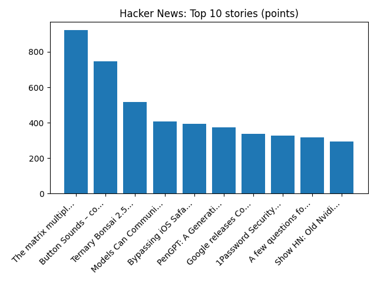

# Daily Knowledge Garden — 2026-11-25

## 🧭 Daily Summary
Global coverage includes US Army says controlled blast of explosives in Iowa was 'huge success'; Colombian police storm supermarket to free 76 held hostage for 17 hours; Anthropic's slide tests Wall Street's lofty bets on future AI profits - Reuters. Local coverage includes Thanksgiving Storm Is Expected to Hit East Coast With Heavy Rain and Flooding - The New York Times; Major Thanksgiving storm ahead for Northeast, mid-Atlantic - The Weather Channel.

## 🌍 Global News (cross-source)
- [US Army says controlled blast of explosives in Iowa was 'huge success'](https://www.bbc.co.uk/news/articles/cwg7l5ve251ko?at_medium=RSS&at_campaign=rss) — BBC — Science
- [Colombian police storm supermarket to free 76 held hostage for 17 hours](https://www.bbc.co.uk/news/articles/ckp80mjr9emyo?at_medium=RSS&at_campaign=rss) — BBC — World
- [Anthropic's slide tests Wall Street's lofty bets on future AI profits - Reuters](https://news.google.com/rss/articles/CBMirgFBVV95cUxOZE1sRHlKd3Y1aUpqaUVpeFQ3QjFmX191blVmM1gyS0hidW81RjFjSXJjQndnODAwQU9qb3VkYkJfZ3ppYzdBQ1J5cTRUaDMzamxvZVNsYzB6RUpiVzd2RlhxV2hKaDRjTFdhamRKZ3g3MXZDY1c5c3NMalpmc09aQ3JnNGEyQTR5NG85OW9VTEE1NW9md1VKdFYxeTlnbWNjd25UcjVwamhDX1pIaXc?oc=5) — Reuters — Headlines (Google News)
- [US to cap India tariff at 17% if trade deal is reached, USTR says - Reuters](https://news.google.com/rss/articles/CBMiqAFBVV95cUxQRmdGMDdiZVhMaEZiM2hLVlNhdXQzZkM1b2F5NXFYaWZzbC1mX25kLU56ZThrNjFmZ2JVMW9fbjJhbUMwMXdzN3JLYXAyNE02a0FqclFyblhxZmxfbWRLVlQ5OFdoQkdmNEF1ZTlZUzRVVkkxQm14eDY0R1ZtUXJpRWhaNDE5c1hOM3pUYUhiRmJ1NnlTaGVrQk9uNGwwU2w5UmliTkRpZGQ?oc=5) — Reuters — Headlines (Google News)
- [Almost 2,000 migrants arrive on Spain’s Canary Islands in a single day, breaking a record - AP News](https://news.google.com/rss/articles/CBMilAFBVV95cUxPa3Jzb2VHSk9lV2k4UlRIWXRJdHBSUzE5a2JjYjc0dWVIRlpmY0dmVjNCSGk5MktVREE1UnNXaHZEb2c2bUFBeV9Oa0tuR2JwYU1rYzdJYXNSVEt3dEJ3cHhnNzZxaFE2YjRJM1FISE0zQlNzWHhQMHRmaW10cGNxamJabUExME9sSFpqMHJpc19kTm9X?oc=5) — AP — Headlines (Google News)

## 🏙️ Local News
- [Thanksgiving Storm Is Expected to Hit East Coast With Heavy Rain and Flooding - The New York Times](https://news.google.com/rss/articles/CBMikgFBVV95cUxOUUNNNURkWkNzVzAwQ191cnlsbFZaUVVvZUtEWjJwSjBlSWJTMkY0MXNoUERLRWtvN1VUeWEwVHc0M3ZpNmcweHdIQjdwTnQwS0hyWU1BblVPVVJpd0c1bG9TSlVpS0IzczNDX3RERjNoRFo2U1J0dERqS2ZEUmxTT0FwTlliZmZyZGRabVRYeVRmQQ?oc=5) — Google News — Northern Virginia weather
- [Major Thanksgiving storm ahead for Northeast, mid-Atlantic - The Weather Channel](https://news.google.com/rss/articles/CBMiogFBVV95cUxQTzBfTGFNaVdiWlU5UlMwSUpVbXV2OWpxS0Q2UDVnMUlhVmViVjgzOWN2N2ZpZ3R4YUp2cV8yR2Y5V21PNEZPYWYxcHhfbUpHTV85elRwY3hMRjRsWmNBc01SbGxLTHlfQUpmOU9DYVRqbExFX1J5YzM0bk5Sd2hwSjZUVTJiUkNJeUxFeElmWWtRXzh2ckdvdVRoTVRJZmxEeUE?oc=5) — Google News — Northern Virginia weather
- [Northern Virginia multifamily sales blow past 2025 totals as suburban Maryland, D.C. lag way behind - The Business Journals](https://news.google.com/rss/articles/CBMimgFBVV95cUxPVVVKTXF0WDdPUjRpUzBmeWpZVjZPYVdxRWxnSWxlb3hMMHJTa3Z4SGotUE9pcW1ZUVNOOUNuOW94cmx0cHJpTVZDYkZpSG1LZ29GTTFqNXgteVlLUV9XeVowSm9aSWlrSU9reXh5cjFfeEJtbmRaM29aX1NKUF9mSjFCUEdZYmJrRC1IZ3VRc041MVhBMnR1YWNB?oc=5) — Google News — Northern Virginia
- [Southwest D.C. Master Plan Begins to Take Shape - Holland & Knight](https://news.google.com/rss/articles/CBMiogFBVV95cUxOaVFPSTJ5c2tsN2RzaFI5LWZyS1hhWnVXQ19JeTlaSXphYVlTamhJNERHU2NMNnVQTGhXMXl0ZEFTbmFDTFdrc2ltVTBqWDR0WF9Gb1hteHVTRHU3VHJXZHdBMmpjMjV1SFIyRkQxek1JWkN3dmtRVGxoQ2d5aHRPdTN5UmItcXBvcHdjeU9vY0c1LTBha1FQZGt5Q0FuTnRSTFE?oc=5) — Google News — Northern Virginia
- [Strong winds forecast Thursday across Washington, Maryland, Virginia, and West Virginia - NottinghamMD.com](https://news.google.com/rss/articles/CBMivgFBVV95cUxQZFpPQlc3aW5OeElpUkxuMFZPRXlKU21iekl1ZXNMcjU1TUFQSzI2TnFKSmZnYWxhZzcxUGYxTTVqc2hHUXE5OFhZYU82dThjT1JrNk5XWUxaNE5Ga3ZKcVNhSUZxWl9BeU92a0V1cFlHQXVQTW9mS004VmRqdlNLNTl0TGV4TFlaMXdiUTNCYndSYlNCMXVFbUQtMFVsVTlCQXh6QUZBOXFfSHd6Yy1NejM1TVRaZEp6Q044UlZn?oc=5) — Google News — Northern Virginia weather

## 🚀 Hacker News (Top 5)
- [The Spray Bottle](https://mechanical-pencil.com/products/spray-bottle) — 400 points, 104 comments
- [Ternary Bonsai 2.5 27B](https://prismml.com/news/bonsai-2-5-27b) — 372 points, 127 comments
- [Quad9 pulled their DNS service from France](https://quad9.net/news/blog/quad9-service-deactivation-in-france/) — 368 points, 220 comments
- [GTA 6 Running on Windows](https://twitter.com/raul_bs3/status/2125213756238291075) — 317 points, 410 comments
- [Jetty Pro](http://hypercritical.co/2026/11/23/jetty-pro) — 287 points, 129 comments

## 🌍 Wikipedia — On This Day (selected)
- **2023** — Three Palestinian students are injured in a shooting in Burlington, Vermont.
- **2021** — A fire at a coal mine in Kemerovo Oblast kills 51 people.
- **2009** — Jeddah floods: Freak rains swamp the city of Jeddah, Saudi Arabia, during an ongoing Hajj pilgrimage. Three thousand cars are swept away and 122 people perish in the torrents, with 350 others missing.
- **2008** — Cyclone Nisha strikes northern Sri Lanka, killing 15 people and displacing 90,000 others while dealing the region the highest rainfall in nine decades.
- **2000** — The 2000 Baku earthquake, with a Richter magnitude of 7.0 kills 26 people in Baku, Azerbaijan.

## 🎲 Wikipedia — Random Article
**Bajaj**  
Bajaj may refer to:
https://en.wikipedia.org/wiki/Bajaj

## 🌌 NASA APOD
[SPHEREx Seeing Through Dust](https://science.nasa.gov/image-article/apod-2026-november-25-spherex-seeing-through-dust/)

## Feed Health
- **Reuters — Headlines (Google News)**: ok (15 articles)
- **Reuters — World (Google News)**: ok (15 articles)
- **Reuters — Business (Google News)**: ok (15 articles)
- **BBC — World**: ok (15 articles)
- **BBC — Tech**: ok (15 articles)
- **BBC — Business**: ok (15 articles)
- **BBC — Science**: ok (15 articles)
- **AP — Headlines (Google News)**: ok (15 articles)
- **AP — Politics (Google News)**: ok (15 articles)
- **AP — Business (Google News)**: ok (15 articles)
- **NPR — Top Stories**: ok (10 articles)
- **NPR — Politics**: ok (10 articles)
- **NPR — Business**: ok (10 articles)
- **NPR — Science**: ok (10 articles)
- **NPR — Technology**: ok (10 articles)
- **ScienceNews**: ok (15 articles)
- **ScienceDaily — Top**: ok (15 articles)
- **Nature — Technology**: ok (15 articles)
- **Google News — Northern Virginia**: ok (15 articles)
- **Google News — Northern Virginia traffic**: ok (15 articles)
- **Google News — Northern Virginia weather**: ok (15 articles)
- **Wikipedia — On This Day**: ok (10 articles)
- **Wikipedia — Random**: ok (1 articles)
- **NASA — APOD**: ok (1 articles)

Runs so far today: 2
