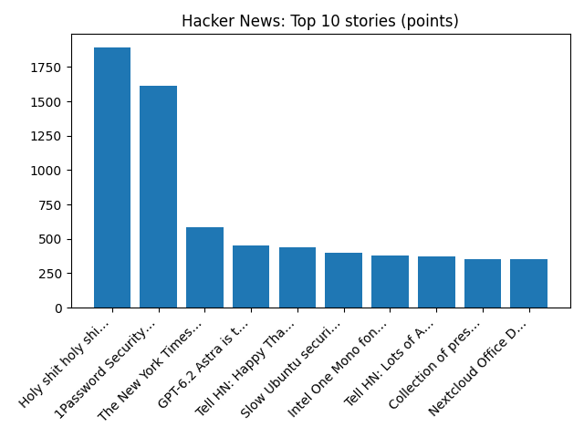

# Daily Knowledge Garden — 2026-11-26

## 🧭 Daily Summary
Global coverage includes Second court defeat for Trump's deep-sea mining ambitions; US Marlboro maker Altria explores Imperial cash bid, possible carve-up - Reuters; Police use tear gas to disperse fresh Bangladesh garment worker protests - Reuters. Local coverage includes Thanksgiving storm downs trees across DMV, traps driver on GW Parkway - FOX 5 DC; Tornado Warning Today: Severe Storm Threatens Virginia on Thanksgiving, Residents Urged to Seek Shelter - Aktualita.co.

## 🌍 Global News (cross-source)
- [Second court defeat for Trump's deep-sea mining ambitions](https://www.bbc.co.uk/news/articles/c6y4jyx2m172o?at_medium=RSS&at_campaign=rss) — BBC — Science
- [US Marlboro maker Altria explores Imperial cash bid, possible carve-up - Reuters](https://news.google.com/rss/articles/CBMiywFBVV95cUxNYjc1S044enVDVHpleXVSM2YwME5kOGM4azBiSF9QNVc1Q2MyYmNRVFNJZ1p1dFVSOXdKTGxqYi1pU1dhdzcycGQ0dm5pN1NaRmZUendRME9GRVFfNHluZ0pUZkpsc0xLX1pNb1ZFdEk0TU8yTjZxbklUbC04ZkNJbWt6V21qUEowclUwME5KY1ZfUlVXaUlPQm9faDZPVzB4clJfZkFLekxaQVNWaldMT0ZwSFl3LVYwblRiaXYzNEt3dzBMck1WUkp1QQ?oc=5) — Reuters — Headlines (Google News)
- [Police use tear gas to disperse fresh Bangladesh garment worker protests - Reuters](https://news.google.com/rss/articles/CBMixwFBVV95cUxQemRiN3hJQ0RYZkhZSi14QkplRnhIVC1SNHAtS0pYM2dBUlpuMExGTWxVVTFzN3JFX0ZSYXVQeTJEaGNtNl9rRDRDcnFYbExFeFRpWjNmRW9RLXZ6eGppaUZLbFdBVV9VeXBTZ0FqNmhQb21FS0R4a3hxVmFLeXo5a2EwZnZfcC1leFg3aUo3aUIzR0pIZnRSQUc5QjhsbjlKcTJjYnJkRzRtaTJhWW5KTDB4Z2VZRXNTVk85Tjc0NThJMGlCZG9n?oc=5) — Reuters — Business (Google News)
- [Two Italians killed in strike in Kuwait, as Iran denies responsibility](https://www.bbc.co.uk/news/articles/c39w9y5dx4k5o?at_medium=RSS&at_campaign=rss) — BBC — World
- [Trump calls the pre-election GDP figures 'fake' and demands an investigation of Commerce Department - AP News](https://news.google.com/rss/articles/CBMijwFBVV95cUxPSWs0NUw0T1MxU0FFajZoSzUzQ2tCblZyZGhDc25mSVpXV0NpczlfWHpwaWdaUEE0T3lFSXdhYl9oUVZ3cTV1ei01aXprNTBoYUJCbG02THdJeGVISENOWjdrVzJpb2pxZEI5aU94VmFCTWU4ckR5MjFjZ2JDMzFibl9WVGZ2Q09PeVo5LXc1WQ?oc=5) — AP — Business (Google News)

## 🏙️ Local News
- [Thanksgiving storm downs trees across DMV, traps driver on GW Parkway - FOX 5 DC](https://news.google.com/rss/articles/CBMinAFBVV95cUxQZE9LN1hyT2NJS0p4NXFEbU5vZTZRSXhRQ2xRdHpNVFFLc3BzakhLbmMyLU43MC00QXE4Y2thTDhBTHVPd3pLMzFDdHVieUhzUXhjSTJyejg3VElmS19qRDBObjhCeTN1d1VsOGlxM2lhSEJGb29EQVZJaWtPVmpRSzYzOGJPTVBjbHFhb2VfVGdZQ3VqMTFXZGx0aTY?oc=5) — Google News — Northern Virginia
- [Tornado Warning Today: Severe Storm Threatens Virginia on Thanksgiving, Residents Urged to Seek Shelter - Aktualita.co](https://news.google.com/rss/articles/CBMib0FVX3lxTE9zaFdLclg5Q3g4OFZDVFlHeTl0UzlCVnNFdnV2QnRoaVlESUpENlpfMlhjUmdVM09qOG9BTFNmQWVGa2xNSnQ5MHdwaHl5blozOGFDbW12Z2d3R0k2YUJ3cnVhWjFNd2tkaHU1Vk45SQ?oc=5) — Google News — Northern Virginia weather
- [Two Northern Virginia families are forced out of their homes before Thanksgiving because of fires - WUSA9](https://news.google.com/rss/articles/CBMijgJBVV95cUxQOV9pOWR0TERONzRxeXByb3poTUtRX0VpclRmZzVtbmc0Q3phbm1uNmM5M09RMU5BRTl5MEVlQmJ3WjY0WFBLeTM5M1VpRXpqZjFJMWtsWFFGSzM5Z3dyVHh5T1RCOExsSFV0Vk9pVGZ6RUNmN0NtcFg1TEdWUk9IQ3NSMGZGR0k1a3hjX2laQWp6VGE1Uzk4di1jTUJQTlNVVlQyQ2ZzdWpnMHcwRHJWQVlsWGxicGl4a0JaVGxrNk41NURrZ1prbko4OWxDX1ZQTHIwczdsWnJiRGtLWHozSjNBRGxXeGl3bDN3U2xkbWhQR2NzcDMyYmFSc181YVN4TndHQS03eHhrNVlXX2c?oc=5) — Google News — Northern Virginia
- [Storm Team4 Forecast: Strong gusts arrive as Thanksgiving Day storm set to bring heavy rain - NBC4 Washington](https://news.google.com/rss/articles/CBMi6AFBVV95cUxNa1E3MmVPNVBTUHpaU0Y3TUhvU2RfUE9NRk5xYXdCYk9KeExMSmYyajJuZkR1azJXQVVmVW93LUNhaG41V3V5NzlvYVpKbmlJeDBlQVM2eXJ2WWdBb09IRTdnbVhaR1R0UnljZnkwZXRWTG0zTG5KbVd2QzBfYWdBbHJvSDl3UU1mc3BDOVdqWnhuZ09ZckFnVU1MNHFqTGJkZy02SlBhdW9HMGY2Y1pfYXZGOFBkMkFkcFRFU1hmSzhsVjAtQlJLcFFPemwyUy1HajlNMmlxN3FKcWc3aUw5ZGtfeGVWdm1T0gHwAUFVX3lxTE54SlVwS3d5OGItQ0g1U09nOHNBUE1FTmNMQVk3LXk4ek5YTFV0dTh2cTRmVk95LXNWU2JjQ1Y5MUFUa3E1YXM0LUpRQTFKMndhdUFJNWUwV1pJZGo4a05IeGZKRUhUS1d2ODlHeVNVZERNcjlUT0VPeFlVUTB0MnVGaVVXNmQ4SHBaWHBHWURRYThUanFRWHRHOGdOTllfd0RBU3lnUWdzUGRVV2N3TzJCMFpnX0dUWG52ZE9neDRMclpQeERiVEx2dXpEWnhNS3l4WFRmckpZMUZ3aWZzZVlLMnExOC1kVk12bTV4SWlNRg?oc=5) — Google News — Northern Virginia
- [Allen Will Obituary (2026) - Edinburg, VA - Northern Virginia Daily - Legacy obituary](https://news.google.com/rss/articles/CBMiiAFBVV95cUxNZzRzM3BaSVIzcEVmdWhweFh5eEdnYlR1MEhsSzBXdDNOd3J1ZFUyVzltcVl3NTBQSFRHZmVNTi0zS1l4R2hhZUY2Ul9ZaXVuZHpla1JjZDJXT19fYjJZZlRMdEFmbkJ3WFRaSW9jamg1MjVsQ3g3QWEzNk03ZmNPaXZsSUpXanlB?oc=5) — Google News — Northern Virginia

## 🚀 Hacker News (Top 5)
- [1Password Security Incident](https://1password.com/blog/update-on-nov-2026-security-incident) — 1225 points, 517 comments
- [Holy shit holy shit holy shit holy shit: The magnitude of what’s now happening](https://scottaaronson.blog/?p=10379) — 1004 points, 853 comments
- [Google releases Cogentic papers on integer factorization, discrete logs and more](https://github.com/google-research/google-research/tree/master/cogentic_research_papers) — 452 points, 339 comments
- [A few questions for the guy who went snorkeling in a Home Depot retention pond](https://www.vox.com/down-to-earth/511999/home-depot-retention-pond-snorkel-joseph-ricketts) — 447 points, 111 comments
- [Windows Loudness Equalization, reverse-engineered and ported to PipeWire](https://github.com/xoxorwr/pw-loudness-eq) — 324 points, 180 comments

## 🌍 Wikipedia — On This Day (selected)
- **2025** — The Wang Fuk Court fire, a catastrophic fire in Tai Po, Hong Kong, leaves at least 168 dead and 79 injured.
- **2021** — COVID-19 pandemic: The World Health Organization identifies the SARS-CoV-2 Omicron variant.
- **2019** — A magnitude 6.4 earthquake strikes western Albania leaving at least 52 people dead and over 1,000 injured. This was the world's deadliest earthquake of 2019, and the deadliest to strike the country in 99 years.
- **2018** — The robotic probe Insight lands on Elysium Planitia, Mars.
- **2011** — NATO attack in Pakistan: NATO forces in Afghanistan attack a Pakistani check post in a friendly fire incident, killing 24 soldiers and wounding 13 others.

## 🎲 Wikipedia — Random Article
**Ba'ath Brigades**  
The Ba'ath Brigades (Arabic: كتائب البعث, romanized: Katā'ib al-Baʿth), also known as the Ba'ath Battalions, were a Syrian volunteer militia made up of Syrian Ba'ath Party members, almost entirely of Sunni Muslims from Syria and many Arab countries, loyal to the Ba'athist-led regime in power at the time.
https://en.wikipedia.org/wiki/Ba%27ath_Brigades

## 🌌 NASA APOD
[Eye in the Sky: The Milky Way over Lençóis](https://science.nasa.gov/image-article/apod-2026-november-26-eye-in-the-sky-the-milky-way-over-lencois/)

## Feed Health
- **Reuters — Headlines (Google News)**: ok (15 articles)
- **Reuters — World (Google News)**: ok (15 articles)
- **Reuters — Business (Google News)**: ok (15 articles)
- **BBC — World**: ok (15 articles)
- **BBC — Tech**: ok (15 articles)
- **BBC — Business**: ok (15 articles)
- **BBC — Science**: ok (15 articles)
- **AP — Headlines (Google News)**: ok (15 articles)
- **AP — Politics (Google News)**: ok (15 articles)
- **AP — Business (Google News)**: ok (15 articles)
- **NPR — Top Stories**: ok (10 articles)
- **NPR — Politics**: ok (10 articles)
- **NPR — Business**: ok (10 articles)
- **NPR — Science**: ok (10 articles)
- **NPR — Technology**: ok (10 articles)
- **ScienceNews**: ok (15 articles)
- **ScienceDaily — Top**: ok (15 articles)
- **Nature — Technology**: ok (15 articles)
- **Google News — Northern Virginia**: ok (15 articles)
- **Google News — Northern Virginia traffic**: ok (15 articles)
- **Google News — Northern Virginia weather**: ok (15 articles)
- **Wikipedia — On This Day**: ok (10 articles)
- **Wikipedia — Random**: ok (1 articles)
- **NASA — APOD**: ok (1 articles)

Runs so far today: 2
