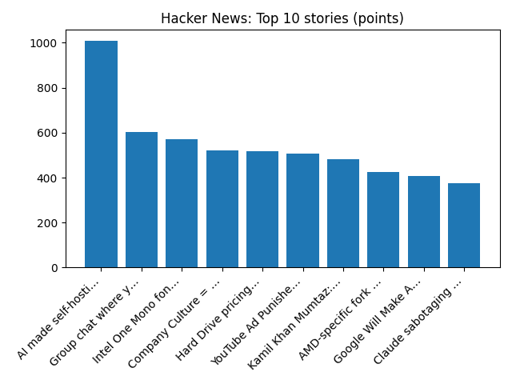

# Daily Knowledge Garden — 2026-11-27

## 🧭 Daily Summary
Global coverage includes Hundreds of thousands still without power after storms hit US on Thanksgiving; Weary of war but with no sign of backing down, Kyiv faces another punishing winter; Canada's top court upholds Quebec religious symbols law in test of unity - Reuters. Local coverage includes More Than 650,000 Without Power on East Coast - The New York Times; From Lights to Nutcrackers: Holiday Cheer in Northern Virgin... - InsideNoVa.

## 🌍 Global News (cross-source)
- [Hundreds of thousands still without power after storms hit US on Thanksgiving](https://www.bbc.co.uk/news/articles/cre3dj5n7dpwo?at_medium=RSS&at_campaign=rss) — BBC — Science
- [Weary of war but with no sign of backing down, Kyiv faces another punishing winter](https://www.bbc.co.uk/news/articles/c3pw4yrr8kz9o?at_medium=RSS&at_campaign=rss) — BBC — World
- [Canada's top court upholds Quebec religious symbols law in test of unity - Reuters](https://news.google.com/rss/articles/CBMiyAFBVV95cUxPa2xTN3lIM0VNZ0t1dTRlSy13WUo1T0JIek5NZThtRklXazNKZlhyUUN0VWxOOXpRY2drMkFOZXlZd1BFM0FrYWpPQjlnYk1kUzB0dzZVczV4b1B2YjZ2MmtJYXM5dEIwNi1VVW9TcUVGWHRPbUNybDdyV2ZzNTZObm5FQTUwLUt2VjNtOWx4N3c4MDdTZGFvS3VGdHVaSno4aWh6ZzNRRURtNmdTMmxrS1lIdmhTZVdCVWFyak9QY2FjRHJsd1dJWA?oc=5) — Reuters — Headlines (Google News)
- [US goods trade deficit deteriorates further as AI helps to lift imports to record high - Reuters](https://news.google.com/rss/articles/CBMilAFBVV95cUxPOUhkOFctdmNWVmE4V25NYVFPXy1fbmpLZnJubGRnZDZQVkk1alZaNE1hMjNJMkVxMFY5aFZVclJnTmM5WkhEVjM0OUFlMEVXc2pLX3VGMzBZOVFuZ0JqWHFTWWROTmY5dkFzMDdSTFR4THE2WEt6dmd6ZVVob1kwOFdyUHpvaVZndmExTTEtbG80VVN4?oc=5) — Reuters — Headlines (Google News)
- [Zelenskyy urges US to pressure Putin and questions Trump’s reference to Putin as a ‘friend’ - AP News](https://news.google.com/rss/articles/CBMiogFBVV95cUxOZHZncjd6TjJOQy1tZVlWUVowZ0hBY2NWMjN2d1k3WXdzUlB4VUdlbl9kMDdLTnZ2bzY5eGlZUGFNSEQxYVNCaVNRYWlBTkZneUxoZm5ub1Q2MVd3QjFza1BJWWhiWEQ2Tk1aUE1jVlByV0h6NldmUC1NOUQ5WW5ka3pqdUFwaXI1SEd4VzNzUGNoZ2c5WG5Yd3dFeWpyY0taN3c?oc=5) — AP — Headlines (Google News)

## 🏙️ Local News
- [More Than 650,000 Without Power on East Coast - The New York Times](https://news.google.com/rss/articles/CBMigAFBVV95cUxQajcxMndmT3daSmtBUHQxSjQ2TUFqam1FTHNaaTg0UHprYTVXRUREMmZJVHZON0ZmOWZuNTdwdjcxOFhSZGRDNXV0aVJpU0hqY2k1SEVVZjlfNVRFcmZXNXRTR0JSZnhBMDRHZXlNSGlEMzZRamgxSlRSOEhsRjNPOA?oc=5) — Google News — Northern Virginia weather
- [From Lights to Nutcrackers: Holiday Cheer in Northern Virgin... - InsideNoVa](https://news.google.com/rss/articles/CBMitgFBVV95cUxPNjU4UVdtYmpDcWhZaXN5NjF5cXczT280TjhOU1VxWENvRU5nR0JkaXlsRjJ6eG9TdEZUdlRRSlEtTVgwVFJKMW9TQ0piLUdqalRxTXpWSW5tMDRUSzg1cEhnNDRCSm1qdjE2dDJ0d245b0k4ZTZvR3EtN3BPcklaRHZsY0pSenFvSFlkc3drb1ZLUmZrNzRqcldyTUc2S2tDSzBMQnBNRi1tdFZ1YXV1dTZMQV9Pdw?oc=5) — Google News — Northern Virginia
- [Allen Will Obituary (2026) - Edinburg, VA - Northern Virginia Daily - Legacy](https://news.google.com/rss/articles/CBMiiAFBVV95cUxNZzRzM3BaSVIzcEVmdWhweFh5eEdnYlR1MEhsSzBXdDNOd3J1ZFUyVzltcVl3NTBQSFRHZmVNTi0zS1l4R2hhZUY2Ul9ZaXVuZHpla1JjZDJXT19fYjJZZlRMdEFmbkJ3WFRaSW9jamg1MjVsQ3g3QWEzNk03ZmNPaXZsSUpXanlB?oc=5) — Google News — Northern Virginia
- [Old Town Alexandria underwater as Thanksgiving storm floods Union Street - WUSA9](https://news.google.com/rss/articles/CBMi3wFBVV95cUxPX0wzWERoQmJnb2YyOS01enhyYzhWbzZJclNkMkRjeW9NVU9PcTNBblVqd3RvaFFMTkpDU1lRQTdHb2lyLWMyYnZfeVVwQzZna2dBRFRYWl94WW5tdjlWYnYzREl6Tzk5VndlellnVEdycUt5bm91THF2QnM2cXdNNDQxRDFCek5EVmNNZHlzNjFHTXk0R0dLNC1YUUpqVi1qQzhkN3VDbzJ1amVKeEcxb0xGQWplYjdMVEkxaTFrV3VmeGxDT1F6MUJkTGhVVERjWnVjbDZJbHR0X0F4VG04?oc=5) — Google News — Northern Virginia
- [Holly Jolly: Northern Virginia 2026 holiday events guide - InsideNoVa](https://news.google.com/rss/articles/CBMipwFBVV95cUxON09mTnJUaGhQS3J2cnQ1QzZ6Nk12UmFwQThQNVdab25feDF1QmJ6Q2F4NjZVemRfVDJFSnRVOWJkWTlFYklCbWtwMl9wZ0hRRVY5U2VjVEFwMk1ROVF4NjRnd092TjZFNF93VDNoSk16XzRFNC1YdlJXRG54dm9BdmtaeGQ2WEJvQUl1STNFRE5RcmlzdUxROVQ0dkhaUVFFcUdhcmpTYw?oc=5) — Google News — Northern Virginia

## 🚀 Hacker News (Top 5)
- [Holy shit holy shit holy shit holy shit: The magnitude of what’s now happening](https://scottaaronson.blog/?p=10379) — 2001 points, 1822 comments
- [Tell HN: Happy Thanksgiving](https://news.ycombinator.com/item?id=50655664) — 633 points, 138 comments
- [Intel One Mono font (2023)](https://github.com/intel/intel-one-mono) — 480 points, 243 comments
- [Nextcloud Office Desktop app](https://nextcloud.com/blog/euro-office-comes-to-your-desktop-with-the-nextcloud-office-desktop-app/) — 406 points, 206 comments
- [AI made self-hosting fun again](https://janlukas.blog/posts/ai-self-hosting) — 390 points, 211 comments

## 🌍 Wikipedia — On This Day (selected)
- **2024** — Syrian rebel groups led by Hay'at Tahrir al-Sham launch a ground offensive into Syria.
- **2020** — Iran's top nuclear scientist, Mohsen Fakhrizadeh, is assassinated near Tehran.
- **2020** — Days after the announcement of its discovery, the Utah monolith is removed by recreationists.
- **2015** — An active shooter inside a Planned Parenthood facility in Colorado Springs, Colorado, shoots at least four police officers. One officer later dies. Two civilians are also killed, and six injured. The shooter later surrendered.
- **2009** — Nevsky Express bombing: A bomb explodes on the Nevsky Express train between Moscow and Saint Petersburg, derailing it and causing 28 deaths and 96 injuries.

## 🎲 Wikipedia — Random Article
**Zhrebchevo Reservoir**  
Zhrebchevo Reservoir (Bulgarian: Язовир Жребчево) is a large dam and reservoir in central Bulgaria, situated between the Sub-Balkan valleys of Kazanlak and Tvarditsa that lie between the Balkan Mountains to the north and the Sredna Gora mountain range to the south. Administratively, the reservoir is located in the municipalities of Gurkovo and Nikolaevo of Stara Zagora Province and Tvarditsa and Nova Zagora of Sliven Province.
https://en.wikipedia.org/wiki/Zhrebchevo_Reservoir

## 🌌 NASA APOD
[The Moon Watchers](https://science.nasa.gov/image-article/apod-2026-november-27-the-moon-watchers/)

## Feed Health
- **Reuters — Headlines (Google News)**: ok (15 articles)
- **Reuters — World (Google News)**: ok (15 articles)
- **Reuters — Business (Google News)**: ok (15 articles)
- **BBC — World**: ok (15 articles)
- **BBC — Tech**: ok (15 articles)
- **BBC — Business**: ok (15 articles)
- **BBC — Science**: ok (15 articles)
- **AP — Headlines (Google News)**: ok (15 articles)
- **AP — Politics (Google News)**: ok (15 articles)
- **AP — Business (Google News)**: ok (15 articles)
- **NPR — Top Stories**: ok (10 articles)
- **NPR — Politics**: ok (10 articles)
- **NPR — Business**: ok (10 articles)
- **NPR — Science**: ok (10 articles)
- **NPR — Technology**: ok (10 articles)
- **ScienceNews**: ok (15 articles)
- **ScienceDaily — Top**: ok (15 articles)
- **Nature — Technology**: ok (15 articles)
- **Google News — Northern Virginia**: ok (15 articles)
- **Google News — Northern Virginia traffic**: ok (15 articles)
- **Google News — Northern Virginia weather**: ok (15 articles)
- **Wikipedia — On This Day**: ok (10 articles)
- **Wikipedia — Random**: ok (1 articles)
- **NASA — APOD**: ok (1 articles)

Runs so far today: 2
