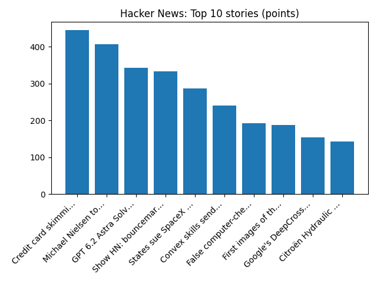

# Daily Knowledge Garden — 2026-11-28

## 🧭 Daily Summary
Global coverage includes Hundreds of thousands still without power a day after US slammed with Thanksgiving storms; How gamers are using AI and leaked files to clone Grand Theft Auto 6; Black Friday shoppers undeterred by inflation and bad weather - AP News. Local coverage includes Nor’easter leaves thousands without power across Northern Virginia, floods Alexandria streets - DC News Now; From Lights to Nutcrackers: Holiday Cheer in Northern Virginia - InsideNoVa.

## 🌍 Global News (cross-source)
- [Hundreds of thousands still without power a day after US slammed with Thanksgiving storms](https://www.bbc.co.uk/news/articles/cre3dj5n7dpwo?at_medium=RSS&at_campaign=rss) — BBC — Science
- [How gamers are using AI and leaked files to clone Grand Theft Auto 6](https://www.bbc.co.uk/news/articles/c64gn8pe5eeqo?at_medium=RSS&at_campaign=rss) — BBC — Tech
- [Black Friday shoppers undeterred by inflation and bad weather - AP News](https://news.google.com/rss/articles/CBMiowFBVV95cUxNQS1feGtndkRIT3NUc2hNSFhEX2pNWXZOR0JBSkdpT196Zk5sdlFqc0NpNUVnRmtnQ2xDUjNNcXF2VnF3a05oejFCZHZzODZ5NXN5NFNOZUVMQmRWdEg4dC05dHFTcHBiZVpjUFRpT2xCaGtXcm54eXRwWTNYOXp3R2NDV2VqSFVURVJZMG9wUElMaWdxamVEOTJCcTNNMDM1WlYw?oc=5) — AP — Politics (Google News)
- [China's premium puffer jacket push meets consumer resistance - Reuters](https://news.google.com/rss/articles/CBMivAFBVV95cUxOTlExbWltNnJEdUNzdzVrMGN1M29qbkc5d3l4MnVFd01fOXBiZFAwS2dVRHB1NmdHb3FLLWVwOV9BUEpwWndDc2lwdGt5T05HdDYwVC1pRllMMk93cGRyM3ZMSUxHM2owcUFRRjZmVzhVdWp3NEJmbFNoQndxNWhJQmdVYk03SkwtN29vT2dMekY5SjBVNlZibWFtVkkyUHBqdXBNd09WQnJiQnRBQTVLQWNRR1FNUUNvdUd4UQ?oc=5) — Reuters — Business (Google News)
- [Inspired Steelers move on from Rodgers’ exit with cathartic 27-5 win over sloppy Broncos - AP News](https://news.google.com/rss/articles/CBMiigFBVV95cUxNTjhwUXphaGRTZ2pSbTVfM0k0VS1uXzNMY3hydUhEVVpRQW42Z2hwRUpvSC1LdWR4bWVEN0s2Zk9fQzhQMElfVkNXMmdDNTRCeVFYbjVUUkpaZkcwRnlZNUhDTkNXZWxhcW9aaDhXcGVLY3RkR3VXLXA2eEFZQlFacUtnUml4bnd2MlE?oc=5) — AP — Politics (Google News)

## 🏙️ Local News
- [Nor’easter leaves thousands without power across Northern Virginia, floods Alexandria streets - DC News Now](https://news.google.com/rss/articles/CBMi2gFBVV95cUxOVHBIMUpyV3FFaWVZdm42Snd3R2JlZnlUYWdBQkpxbWxvYU5RamxVS1NNLVV3OENpaTQ2a3ZSVnNINVJIT1BNWVBTTFhzNm44Y1VRd1I2OXcxR0NDZUhWd0FON0c0cnkwZlRteTlaV3ZxaDNmc2tsSFhQR2NBZ09kVWxacXJralNqTXBXRUo0bF9HXzVqYU9oNmRGUUdhcGxnamd3d1pyelNWWDQ5T3NFVm5JVEg1RjZpU0lBQjdHc1VmeW5vQWpJVDJ4MWdMZ1ZqSjFxZmVXbWJJQQ?oc=5) — Google News — Northern Virginia
- [From Lights to Nutcrackers: Holiday Cheer in Northern Virginia - InsideNoVa](https://news.google.com/rss/articles/CBMitgFBVV95cUxPNjU4UVdtYmpDcWhZaXN5NjF5cXczT280TjhOU1VxWENvRU5nR0JkaXlsRjJ6eG9TdEZUdlRRSlEtTVgwVFJKMW9TQ0piLUdqalRxTXpWSW5tMDRUSzg1cEhnNDRCSm1qdjE2dDJ0d245b0k4ZTZvR3EtN3BPcklaRHZsY0pSenFvSFlkc3drb1ZLUmZrNzRqcldyTUc2S2tDSzBMQnBNRi1tdFZ1YXV1dTZMQV9Pdw?oc=5) — Google News — Northern Virginia
- [Allen Will Obituary (2026) - Edinburg, VA - Northern Virginia Daily - Legacy](https://news.google.com/rss/articles/CBMiiAFBVV95cUxNZzRzM3BaSVIzcEVmdWhweFh5eEdnYlR1MEhsSzBXdDNOd3J1ZFUyVzltcVl3NTBQSFRHZmVNTi0zS1l4R2hhZUY2Ul9ZaXVuZHpla1JjZDJXT19fYjJZZlRMdEFmbkJ3WFRaSW9jamg1MjVsQ3g3QWEzNk03ZmNPaXZsSUpXanlB?oc=5) — Google News — Northern Virginia
- [Old Town Alexandria underwater as Thanksgiving storm floods Union Street - WUSA9](https://news.google.com/rss/articles/CBMi3wFBVV95cUxPX0wzWERoQmJnb2YyOS01enhyYzhWbzZJclNkMkRjeW9NVU9PcTNBblVqd3RvaFFMTkpDU1lRQTdHb2lyLWMyYnZfeVVwQzZna2dBRFRYWl94WW5tdjlWYnYzREl6Tzk5VndlellnVEdycUt5bm91THF2QnM2cXdNNDQxRDFCek5EVmNNZHlzNjFHTXk0R0dLNC1YUUpqVi1qQzhkN3VDbzJ1amVKeEcxb0xGQWplYjdMVEkxaTFrV3VmeGxDT1F6MUJkTGhVVERjWnVjbDZJbHR0X0F4VG04?oc=5) — Google News — Northern Virginia
- [Mother, 54, and Daughter, 19, Found Dead Inside Northern Virginia Home, Police Say No Signs of Foul Play - People.com](https://news.google.com/rss/articles/CBMijAFBVV95cUxQbzNvMl84Y193V1FsMVR2RDRPanJNenpUeU1HYS16RDd3OE9jcXY1RHk2LWc5dktKS3VVR2pDdWZqUjQ1REpFTU5xS2xTSXRKNlg3eDk5V0g1bzJSWi1BMzNOT3FOVktUZWsxWEczSGU5ZlhiWDdXWU51VW0xUWRGbmtZOFRDejVKYWdydQ?oc=5) — Google News — Northern Virginia

## 🚀 Hacker News (Top 5)
- [Credit card skimming scripts using WebRTC found on popular shopping sites](https://www.infohawk.com/news/2026-11-27-black-friday-webrtc-skimmer) — 445 points, 233 comments
- [Michael Nielsen took down his book on neural nets](https://neuralnetworksanddeeplearning.com/) — 407 points, 267 comments
- [GPT 6.2 Astra Solves a Historical Mystery](https://generativehistory.substack.com/p/gpt-62-astra-solves-a-historical) — 343 points, 223 comments
- [Show HN: bouncemarket – a live prediction market game for a bouncing ball](https://bouncemarket.minhanhday.com/) — 333 points, 115 comments
- [States sue SpaceX to stop Grok from generating child sex images, revenge porn](https://www.oag.state.va.us/media-center/news-releases/jay-jones/3162-attorneys-general-jones-and-rayfield-file-suit-against-spacex-parent-company-of-x-xai-and-grok-over-creation-and-promotion-of-child-exploitation-and-non-consensual-images-on-platform) — 287 points, 158 comments

## 🌍 Wikipedia — On This Day (selected)
- **2020** — Over seven hundred civilians are massacred by the Ethiopian National Defense Force and Eritrean Army in Aksum, Ethiopia.
- **2016** — LaMia Flight 2933 crashes near Medellín, Colombia, killing 71 of 77 people on board, including members of the Brazilian football club Chapecoense
- **2014** — Gunmen set off three bombs at the central mosque in the northern Nigerian city of Kano killing at least 120 people.
- **2002** — Suicide bombers blow up an Israeli-owned hotel in Mombasa, Kenya; their colleagues fail in their attempt to bring down Arkia Israel Airlines Flight 582 with surface-to-air missiles.
- **1991** — South Ossetia declares independence from Georgia.

## 🎲 Wikipedia — Random Article
**Wild Animal Ethics**  
Wild Animal Ethics: The Moral and Political Problem of Wild Animal Suffering is a 2020 book by philosopher Kyle Johannsen, published by Routledge. It examines the moral and political obligations humans may have to reduce wild animal suffering, including suffering caused by natural processes rather than human activities.
https://en.wikipedia.org/wiki/Wild_Animal_Ethics

## 🌌 NASA APOD
[The Moon Watchers](https://science.nasa.gov/image-article/apod-2026-november-27-the-moon-watchers/)

## Feed Health
- **Reuters — Headlines (Google News)**: ok (15 articles)
- **Reuters — World (Google News)**: ok (15 articles)
- **Reuters — Business (Google News)**: ok (15 articles)
- **BBC — World**: ok (15 articles)
- **BBC — Tech**: ok (15 articles)
- **BBC — Business**: ok (15 articles)
- **BBC — Science**: ok (15 articles)
- **AP — Headlines (Google News)**: ok (15 articles)
- **AP — Politics (Google News)**: ok (15 articles)
- **AP — Business (Google News)**: ok (15 articles)
- **NPR — Top Stories**: ok (10 articles)
- **NPR — Politics**: ok (10 articles)
- **NPR — Business**: ok (10 articles)
- **NPR — Science**: ok (10 articles)
- **NPR — Technology**: ok (10 articles)
- **ScienceNews**: ok (15 articles)
- **ScienceDaily — Top**: ok (15 articles)
- **Nature — Technology**: ok (15 articles)
- **Google News — Northern Virginia**: ok (15 articles)
- **Google News — Northern Virginia traffic**: ok (15 articles)
- **Google News — Northern Virginia weather**: ok (15 articles)
- **Wikipedia — On This Day**: ok (10 articles)
- **Wikipedia — Random**: ok (1 articles)
- **NASA — APOD**: ok (1 articles)

Runs so far today: 1
